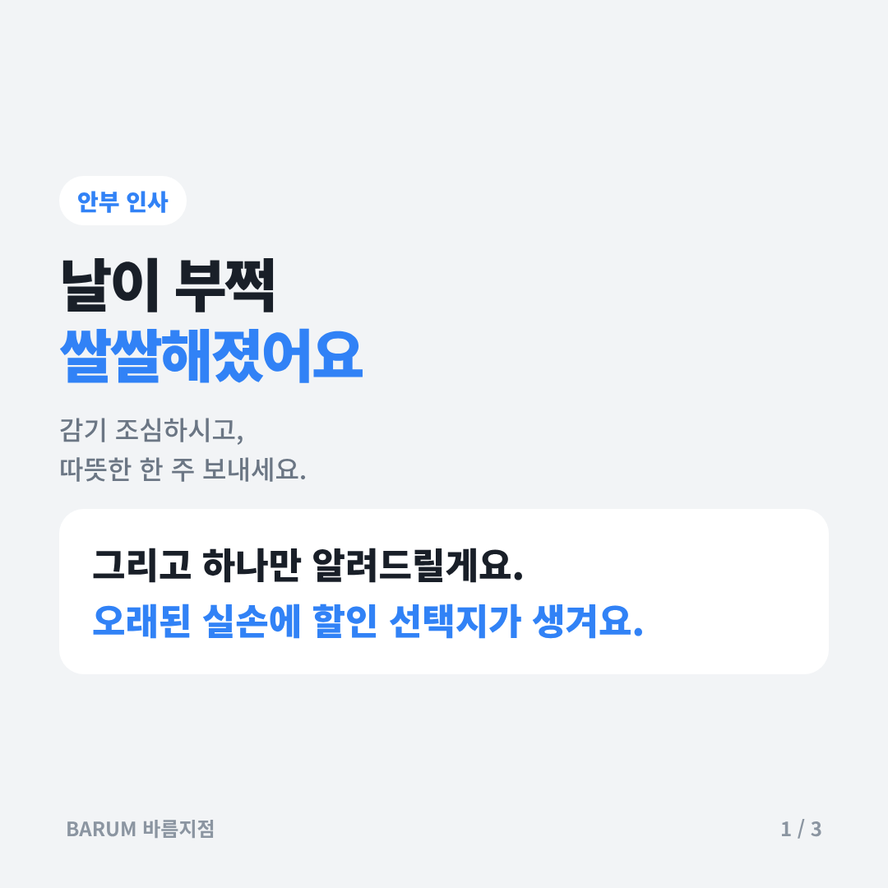
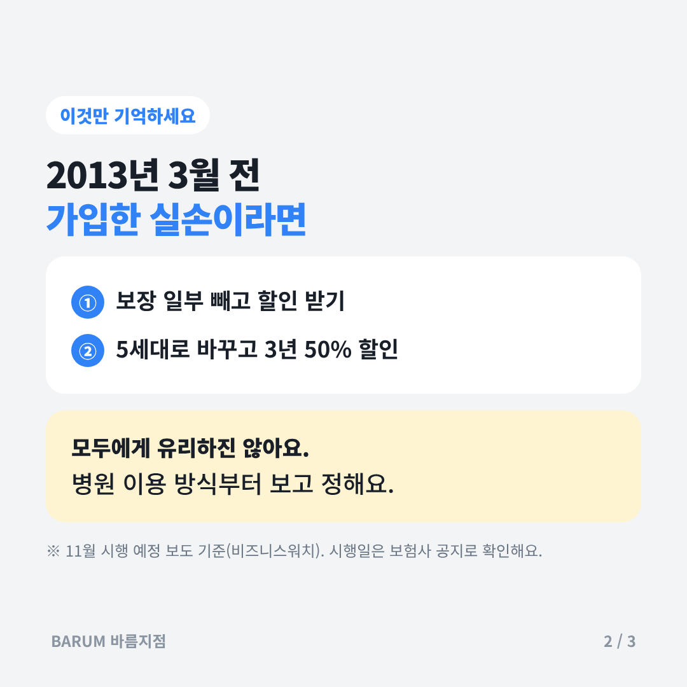
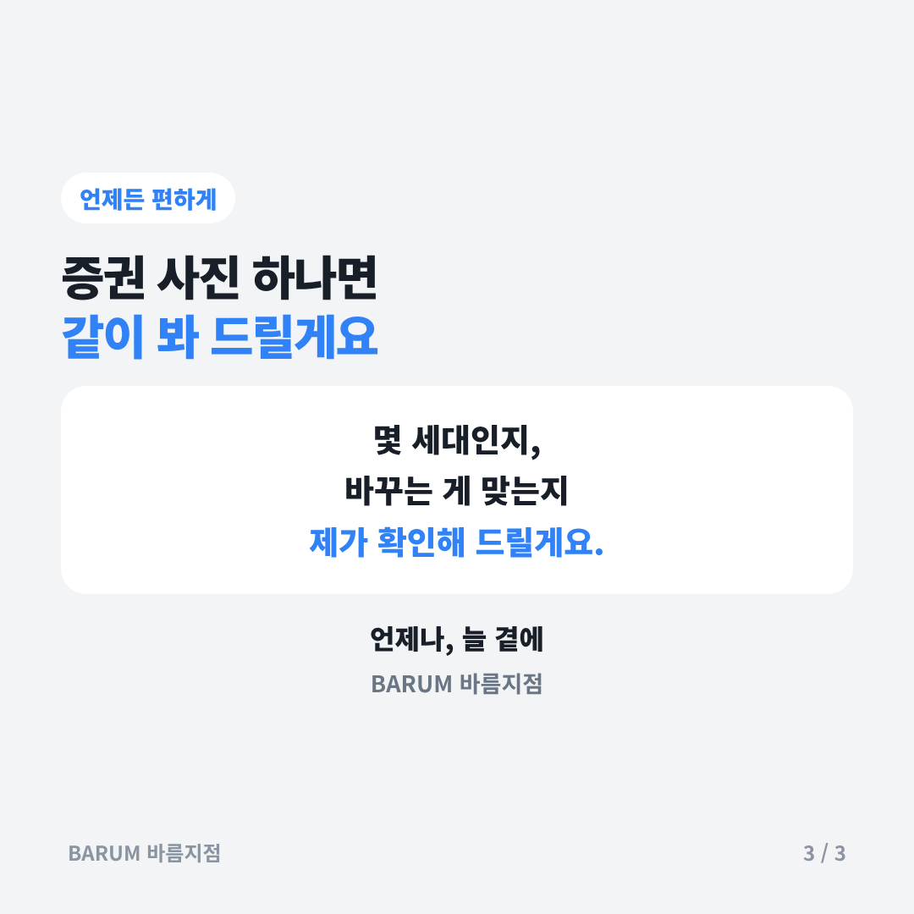

# 2026-11-13 고객 안부 초안

## 카드뉴스 (정사각형 1080×1080 · 고객 공유용)

카드 묶음 받기: https://raw.githubusercontent.com/bokkile83-ui/barum-news/main/anbu/cards/2026-11-13_카드.zip

## ① 정중하게
> ○○님, 안녕하세요. BARUM 바름지점입니다.
> 2013년 3월 이전에 가입하신 실손보험은 이번 달부터 보험료를 줄이는 선택지(할인 특약·전환 할인)가 생긴다고 보도됐어요.
> 모든 분께 유리한 건 아니어서, 병원 이용 방식을 먼저 보고 정하시는 게 좋아요. 궁금하시면 증권만 보내 주세요. 같이 확인해 드릴게요.

## ② 친근하게
> ○○님~ 날이 부쩍 쌀쌀해졌어요. 감기 조심하세요!
> 혹시 실손 오래전에 드셨으면, 이번 달부터 보험료 줄이는 방법이 생긴대요.
> 바꾸는 게 맞는지는 사람마다 달라서요. 편하실 때 증권 사진 하나 보내 주시면 봐 드릴게요 :)

## ③ 짧게
> ○○님, 2013년 3월 전 가입 실손이면 이번 달 할인 선택지가 생겨요.
> 바꾸기 전에 같이 확인해요. 언제나, 늘 곁에.

## 출처
- [비즈니스워치 — 1·2세대 실손 가입자, 11월 선택 기로(2026.10.21)](https://news.bizwatch.co.kr/article/finance/2026/10/20/0029)
