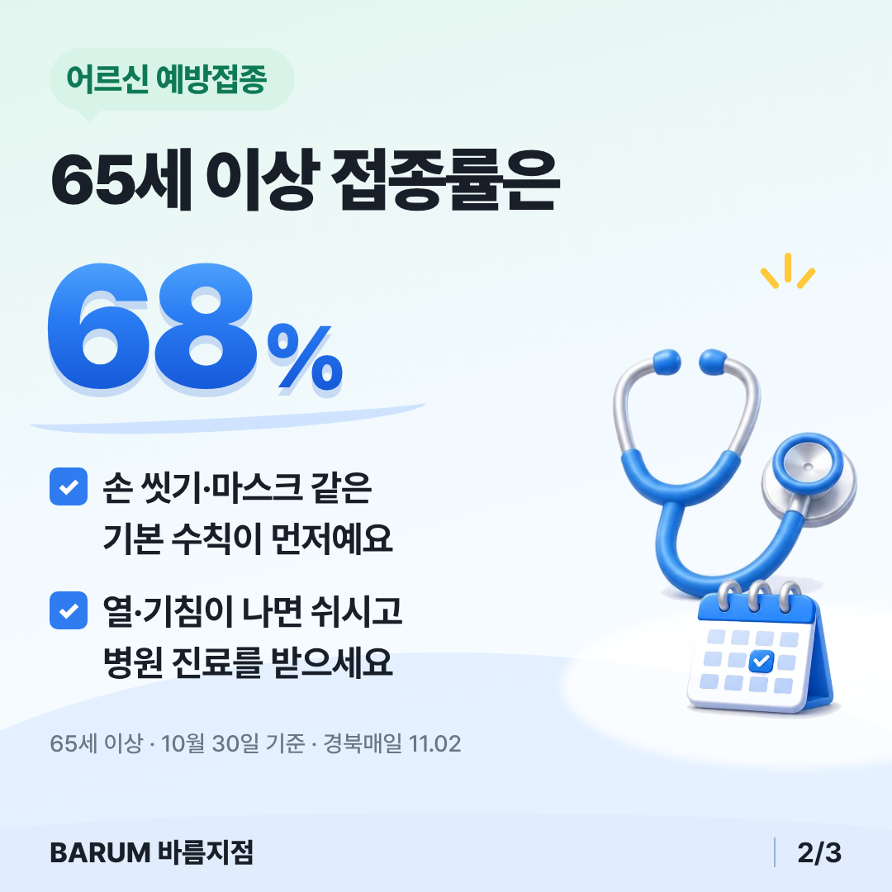

# 2026-11-16 고객 안부 초안

## 카드뉴스 (정사각형 1080×1080 · 고객 공유용)

카드 묶음 받기: https://raw.githubusercontent.com/bokkile83-ui/barum-news/main/anbu/cards/2026-11-16-flu_카드.zip

## 고른 소식
독감 의심환자가 4주 만에 다시 늘었어요. 10월 18~24일(43주차) 외래환자 1,000명당 19.2명(직전 주 17.7명), 7~12세가 49.0명으로 가장 많아요. 65세 이상 독감 접종률은 10월 30일 기준 68%예요. (경북매일 11.02, 질병관리청 집계)

## ① 정중하게
> ○○님, 안녕하세요. BARUM 바름지점입니다.
> 날이 부쩍 차가워졌어요. 독감 의심환자가 4주 만에 다시 늘어, 외래환자 1,000명당 19.2명이라고 해요.
> 손 씻기와 마스크 같은 기본 수칙 챙기시고, 열이나 기침이 나시면 무리하지 마시고 진료 먼저 받으세요.
> 아직 접종 전이시면 가까운 병원에 한번 물어보세요. 궁금한 건 언제든 편하게 연락 주세요.

## ② 친근하게
> ○○님~ 아침저녁으로 많이 쌀쌀하죠?
> 독감이 다시 늘고 있대요. 특히 초등학생 아이들 사이에 많다고 하니 가족분들 다 같이 조심하세요!
> 따뜻한 차 한 잔 하시고, 몸 안 좋으시면 꼭 쉬어 가세요. 언제든 편하게 연락 주세요 :)
> - BARUM 바름지점

## ③ 짧게
> ○○님, 독감이 4주 만에 다시 늘고 있대요.
> 손 씻기 챙기시고 따뜻하게 지내세요. 언제나, 늘 곁에. - BARUM 바름지점

## 출처
- [경북매일 — 독감 4주 만에 다시 증가…초등학생 환자 많아 (2026.11.02)](https://kbmaeil.com/article/20261102500332)
- [정책브리핑 — 어르신 독감 예방접종 6일부터 (2026.10.02)](https://www.korea.kr/news/policyNewsView.do?newsId=148972954)
