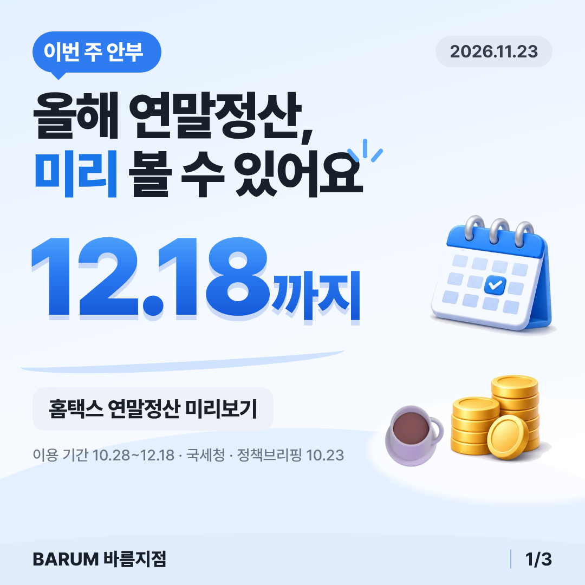
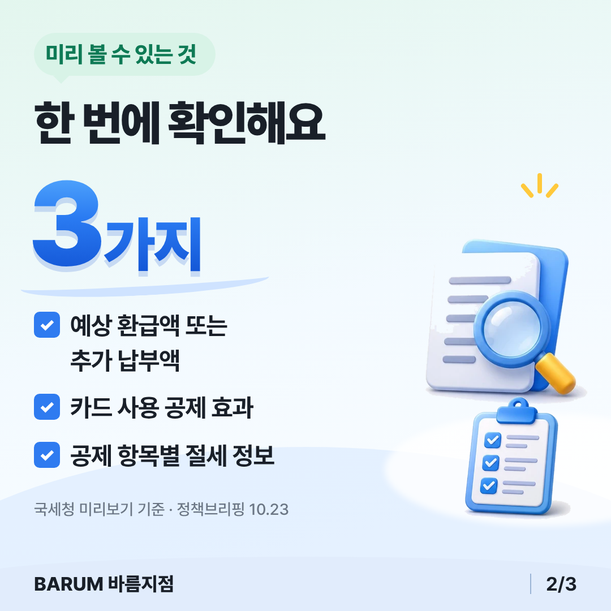
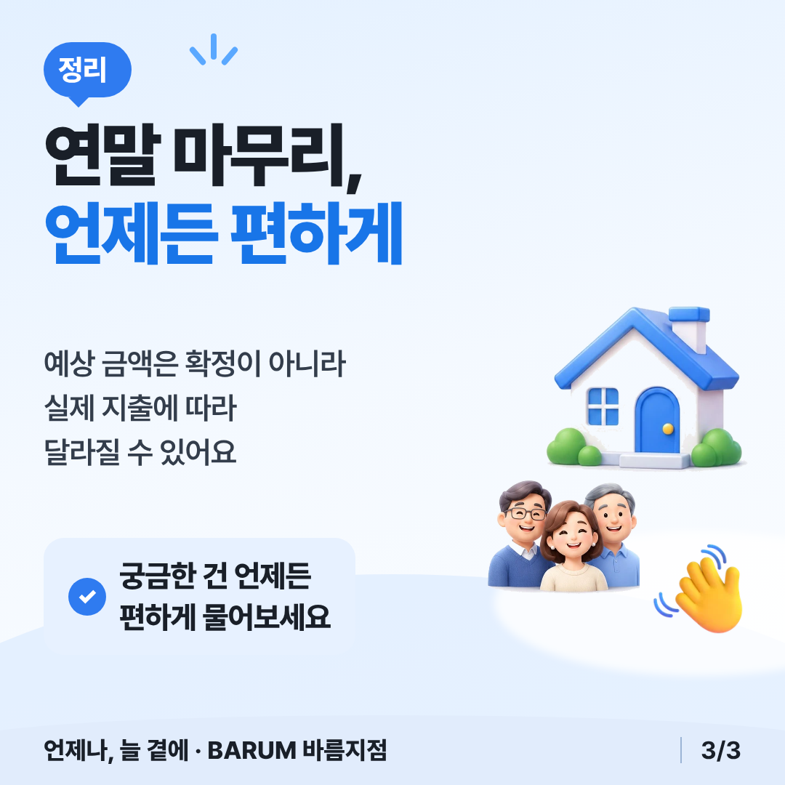

# 2026-11-23 고객 안부 초안

## 카드뉴스 (정사각형 1080×1080 · 고객 공유용)

카드 묶음 받기: https://raw.githubusercontent.com/bokkile83-ui/barum-news/main/anbu/cards/2026-11-23-yearend_카드.zip

## 고른 소식
국세청 「연말정산 미리보기」가 12월 18일(금)까지 열려 있어요(10.28 개통). 홈택스 → 장려금·연말정산·기부금 → 편리한 연말정산 → 연말정산 미리보기. 예상 환급액(또는 추가 납부액), 카드 사용 공제 효과, 공제 항목별 절세 정보 3가지를 미리 볼 수 있어요. 예상세액은 확정 금액이 아니고 실제 소득·지출에 따라 달라져요. 간소화 서비스는 2027년 1월 개통 예정. (정책브리핑 10.23, 국세청)

## ① 정중하게
> ○○님, 안녕하세요. BARUM 바름지점입니다.
> 어느덧 올해도 한 달 남짓 남았어요. 홈택스 「연말정산 미리보기」가 12월 18일까지 열려 있다고 해요.
> 예상 환급액이나 추가 납부액, 카드 사용 공제 효과를 미리 볼 수 있어서, 남은 한 달 지출 계획 세우실 때 참고하시기 좋아요.
> 날이 많이 차가워졌어요. 따뜻하게 지내시고, 궁금한 건 언제든 편하게 연락 주세요.

## ② 친근하게
> ○○님~ 벌써 11월도 끝자락이에요!
> 13월의 월급, 연말정산 미리보기가 12월 18일까지래요. 홈택스에서 올해 얼마나 돌려받을지 미리 볼 수 있어요.
> 숫자는 예상치라 실제랑 조금 다를 수 있으니 참고만 하세요 :)
> 감기 조심하시고, 언제든 편하게 연락 주세요! - BARUM 바름지점

## ③ 짧게
> ○○님, 연말정산 미리보기가 12월 18일까지예요. 홈택스에서 예상 환급액을 미리 볼 수 있어요.
> 따뜻하게 지내세요. 언제나, 늘 곁에. - BARUM 바름지점

## 출처
- [정책브리핑 — 13월의 월급, 나는 얼마나 받을까? 연말정산 미리보기 (국세청, 2026.10.23)](https://www.korea.kr/news/policyNewsView.do?newsId=148974171)
