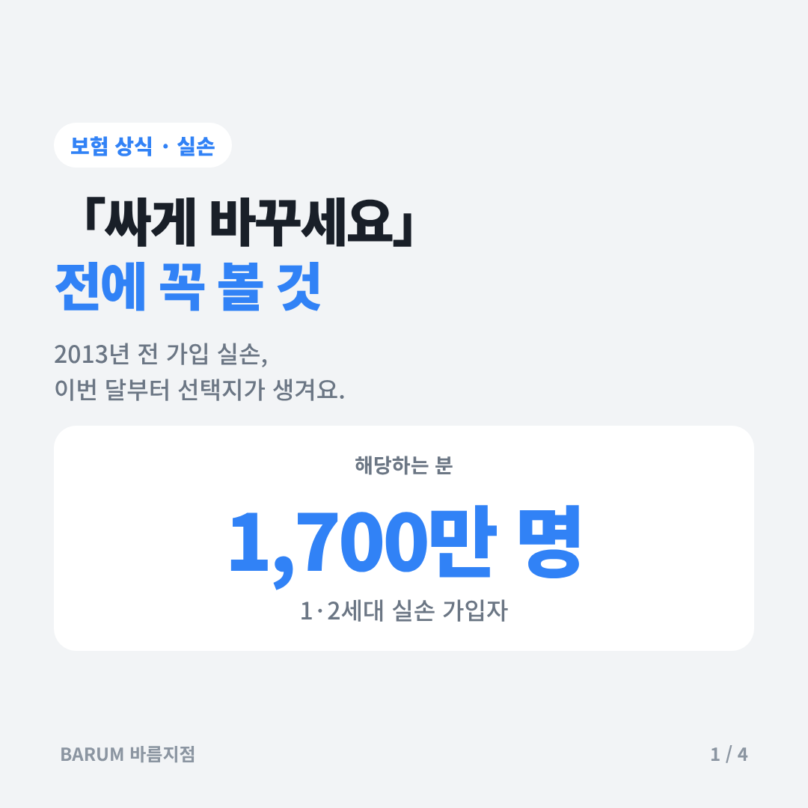
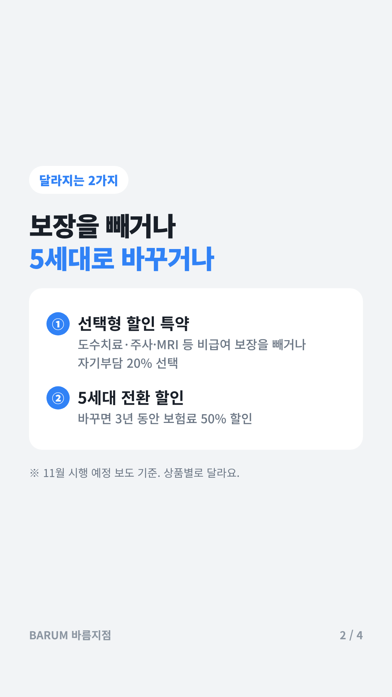
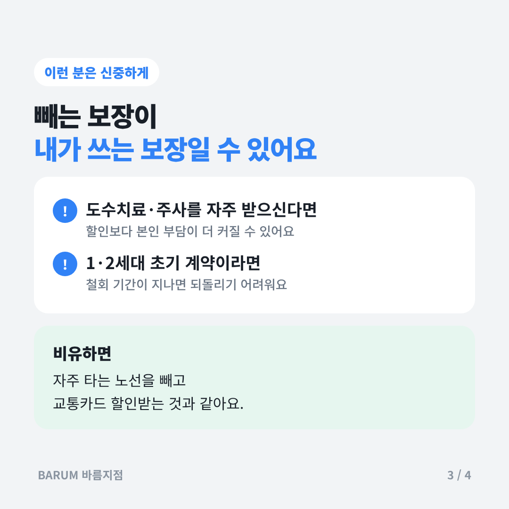
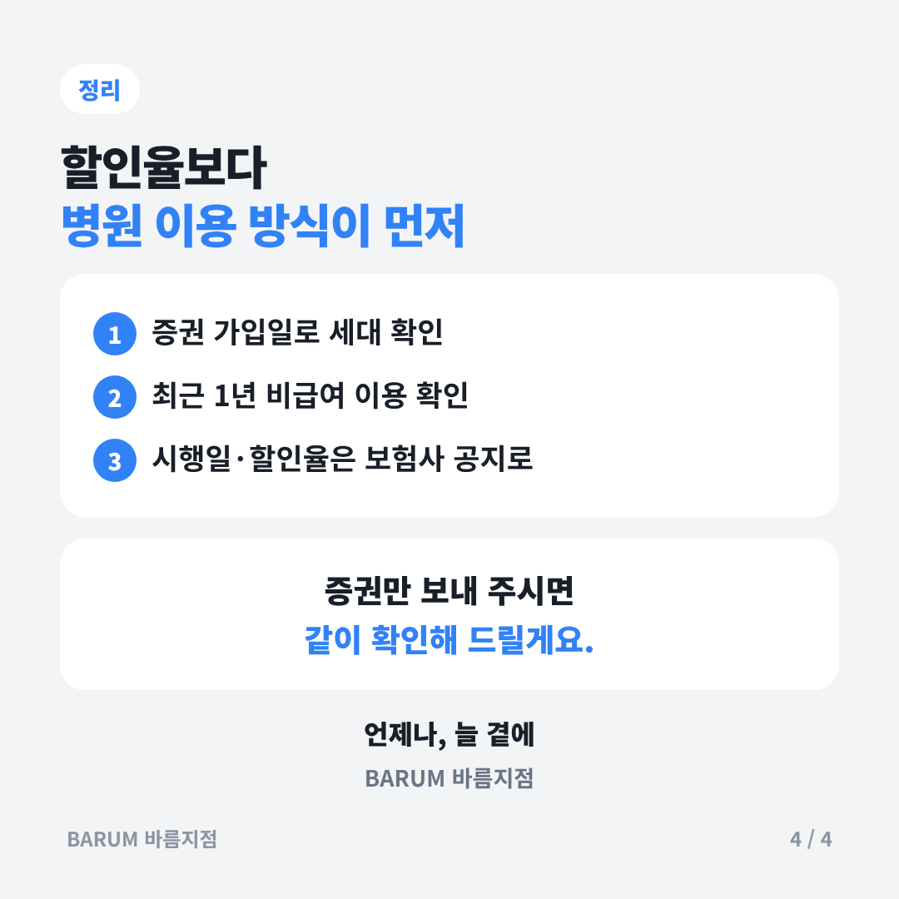

# 2026-11-13 블로그·인스타 초안 — 1·2세대 실손, 할인받을까 유지할까

## 카드뉴스 (정사각형 1080×1080 · 고객 공유용)

카드 묶음 받기: https://raw.githubusercontent.com/bokkile83-ui/barum-news/main/blog/cards/2026-11-13_카드.zip?v=sq2

## 제목 후보
- 2013년 전 가입 실손, 이번 달부터 달라지는 2가지
- 1·2세대 실손 할인 특약, 무조건 좋은 걸까요?
- 「싸게 바꾸세요」 전에 꼭 볼 것 — 오래된 실손 할인 정리

## 본문 뼈대
**도입** — 2013년 3월 이전에 가입한 실손(1·2세대)은 약 1,700만 명이에요. 이번 달부터 보험료를 줄이는 선택지 두 가지가 시행될 예정이라고 보도됐어요.

**핵심 1. 선택형 할인 특약** — 계약은 그대로 두고 도수치료·체외충격파·비급여 주사·비급여 MRI 보장을 빼거나 자기부담 20%를 고르는 방식이에요. 1세대가 모두 적용하면 30~40%대 할인이 추산돼요.

**핵심 2. 5세대 전환 할인** — 5세대로 바꾸면 보험료를 3년 동안 50% 할인받아요. 11월부터 6개월 시행 후 연장을 검토해요. 바꾼 뒤 3개월 안에는 조건 없이 되돌릴 수 있어요.

**핵심 3. 이런 분은 신중하게** — 도수치료·주사처럼 비급여를 자주 쓰시면 빼는 보장이 바로 내가 쓰는 보장일 수 있어요. 1·2세대 초기 계약은 한 번 바꾸면 되돌리기 어려워요(철회 기간 제외).

**정리** — 할인율보다 내 병원 이용 방식이 먼저예요. 실제 시행일과 할인율은 보험사 공지로 확인하세요.

**상담 안내** — 증권만 보내 주시면 몇 세대인지, 어떤 선택이 맞는지 같이 확인해 드릴게요.

## 인스타 캡션
2013년 전에 가입한 실손,
이번 달부터 선택지가 생겨요.

✔ 보장 일부 빼고 할인
✔ 5세대로 바꾸면 3년 50% 할인

그런데요,
빼는 보장이 내가 자주 쓰는 보장이면?
할인보다 손해가 클 수 있어요.

증권 하나로 같이 확인해요.
언제나, 늘 곁에.

#실손보험 #1세대실손 #2세대실손 #5세대실손 #실손할인 #보험상식 #보험료절약 #부산보험 #창원보험 #바름지점

## 출처
- [비즈니스워치 — 1·2세대 실손 가입자, 11월 선택 기로(2026.10.21)](https://news.bizwatch.co.kr/article/finance/2026/10/20/0029)
- [이투데이 — 금융위, 보험사 계리가정 관리 강화(2026.11.4)](https://www.etoday.co.kr/news/view/2644167)
