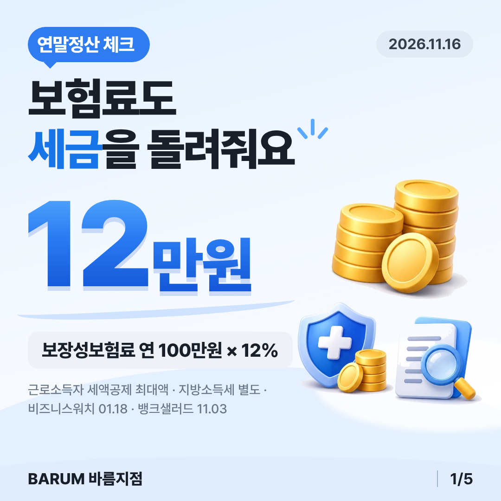
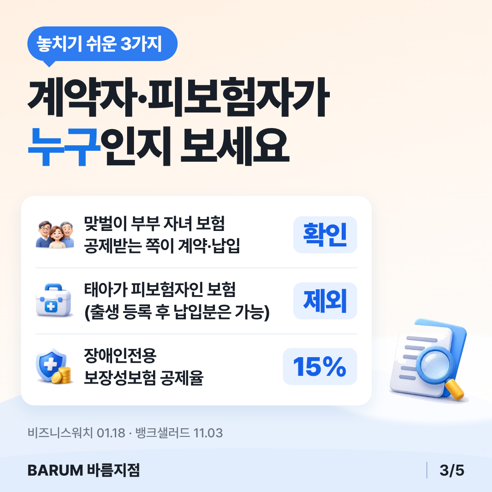
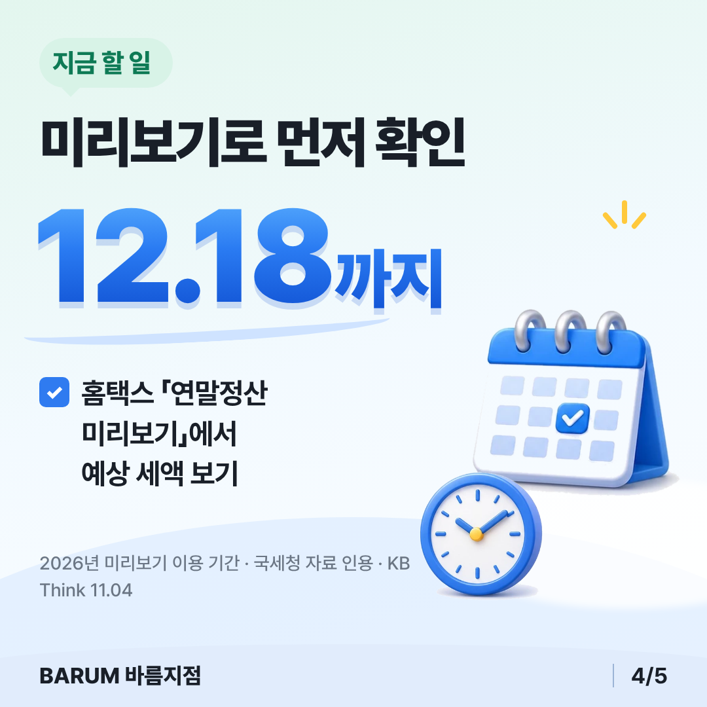

# 2026-11-16 블로그·인스타 초안 — 연말정산, 보험료 세액공제 최대 12만 원

## 카드뉴스 (정사각형 1080×1080 · 고객 공유용)







카드 묶음 받기: https://raw.githubusercontent.com/bokkile83-ui/barum-news/main/blog/cards/2026-11-16-taxcredit_카드.zip

## 제목 후보
- 연말정산, 보험료로 돌려받는 최대 12만 원 챙기셨어요?
- 실손·암 보험료도 세금이 돌아와요 — 놓치기 쉬운 3가지
- 12월 18일 전에 홈택스 미리보기로 보험료 공제 먼저 보세요

## 본문 뼈대
**도입** — 매달 내는 실손·암 보험료, 연말정산 때 세금으로 일부 돌아와요. 보장성보험료는 연 100만 원까지, 12%를 세액공제해 줘요. 다 채우면 최대 12만 원이에요(지방소득세 별도, 근로소득자 기준).

**핵심 1. 어떤 보험이 되나요** — 실손·암·치아·자동차처럼 사고나 병에 대비하는 보장성보험이에요. 저축성·연금보험은 이 공제에 들어가지 않아요. 장애인전용 보장성보험은 따로 연 100만 원 한도, 공제율 15%예요.

**핵심 2. 누가 내고 누가 보장받나** — 계약자와 피보험자가 본인이거나 기본공제 대상자여야 해요. 부양가족은 연 소득 100만 원 이하 등 요건을 채워야 해요. 맞벌이 부부라면 자녀를 공제받는 쪽이 계약하고 보험료를 내야 공제돼요. 엄마 이름으로 내고 아빠가 자녀 공제를 받으면 어긋나는 거예요.

**핵심 3. 태아보험은 언제부터** — 태아가 피보험자인 기간의 보험료는 빠져요. 아이가 태어나 주민등록번호를 받고 기본공제 대상자로 올라간 뒤 낸 보험료부터 들어가요.

**정리** — 공제는 「얼마 냈나」보다 「누구 이름으로 냈나」가 먼저예요. 올해 연말정산 미리보기는 12월 18일까지 홈택스에서 쓸 수 있다고 안내돼 있어요(국세청 자료 인용 · KB Think 11.04). 부양가족 나이 요건 등 세부 기준은 국세청 안내로 한 번 더 확인하세요.

**상담 안내** — 증권만 보내 주시면 계약자·피보험자가 공제에 맞게 되어 있는지 같이 확인해 드릴게요.

{{지점 사례}}

## 릴스 대본

**훅 3개 (서로 다른 공식)**
1. #3 Nobody Tells You — 말: 「보험료 낸 만큼 세금 돌려받는 거, 아무도 안 알려줘요.」 / 화면: **보험료도 세금 돌려받아요**
2. #19 The Deadline — 말: 「12월 18일 전에 이거 하나만 보세요.」 / 화면: **12.18 전에 이것만**
3. #23 The Statistic — 말: 「실손 보험료, 12%는 돌아와요.」 / 화면: **실손료 12% 환급**

**고른 훅: #1(Nobody Tells You)** — 보험료가 세금과 연결된다는 걸 모르는 분이 많아 「아 그래?」가 바로 나오는 문장이고, 숫자(12만 원)는 2번째 줄에서 바로 받쳐 줘요. #3은 「12% 환급」이 보험금처럼 오해될 수 있어 뺐어요.

**대본 (약 30초 · 약 140자)**
```
[0:00] 보험료 낸 만큼 세금 돌려받는 거, 아무도 안 알려줘요.
[0:03] 실손·암 같은 보장성보험료는 연 100만 원까지,
[0:07] 12%를 세금에서 빼 줘요. 최대 12만 원이에요.
[0:11] 근데 놓치는 분이 많아요. 이름 때문에요.
[0:14] 맞벌이시면 아이 공제받는 쪽이 보험료를 내야 해요.
[0:19] 태아보험은 아이가 태어나 등록된 뒤 낸 것부터예요.
[0:23] 12월 18일까지 홈택스 미리보기로 먼저 보세요.
[0:27] 헷갈리면 댓글에 「공제」 남겨 주세요. 같이 확인해 드릴게요.
```

**화면 글자 카드 (세로 1080×1920 · 가운데 안전 영역 y 250~1600)**
- 0:00–0:03 보험료도 세금 돌려받아요
- 0:03–0:11 연 100만 원 × 12% = 최대 12만 원
- 0:11–0:14 놓치는 이유: 이름
- 0:14–0:19 맞벌이: 자녀 공제받는 쪽이 납입
- 0:19–0:23 태아보험: 출생 등록 후부터
- 0:23–0:27 12.18까지 홈택스 미리보기
- 0:27–0:30 댓글 「공제」

**요청 하나** — 댓글 단어 「공제」 (대본·캡션 같은 단어)

**SKILL.md 기준 점검 (점수 도구는 영어 기준이라 미사용)**
- 훅 2초 안: 통과 — 첫 줄 약 25자, 3초 안쪽. 화면 글자 6단어 이내.
- 비트당 4초 이내: 고칠 점 — 0:14 맞벌이 줄이 5초. 말이 빠르면 두 줄로 나눠 찍기(「맞벌이시면요」 / 「아이 공제받는 쪽이 내야 해요」).
- 루프: 통과 — 마지막 「같이 확인」 뒤 첫 줄 「세금 돌려받는」으로 다시 이어짐.
- 지급 확정·과장·가짜 마감: 통과 — 12.18은 국세청 안내 기간이라 가짜 마감 아님. 「최대」 표기 유지.

## 캡션

```
실손·암 보험료, 연말정산 때 최대 12만 원이 세금에서 빠져요. 대신 「누구 이름으로 냈나」가 맞아야 해요.

보장성보험료는 연 100만 원까지 12% 세액공제예요.
지방소득세는 별도고, 근로소득자 기준이에요.

맞벌이 부부라면 아이를 공제받는 쪽이 보험료를 내야 해요.
태아보험은 아이가 태어나 등록된 뒤 낸 보험료부터 들어가요.

연말정산 미리보기는 12월 18일까지 홈택스에서 볼 수 있어요.
내 보험료 공제가 헷갈리면 댓글에 「공제」 남겨 주세요. 같이 확인해 드릴게요 🙂

#연말정산 #보험료세액공제 #실손보험 #부산보험상담 #창원보험상담
```

**점검 (ig-caption)**
- 첫 줄 125자 안: 통과 — 첫 문장 약 40자, 끊김 없음. 인사·해시태그·이모지 시작 없음.
- 요청 하나: 통과 — 댓글 「공제」만.
- 검색어(문장 속): 연말정산 보험료 공제 · 보장성보험료 세액공제 · 태아보험 연말정산.
- 해시태그 5개 이하: 통과(5개). 링크 없음.

## 스토리 (5장)

1. **[손 + 휴대폰 홈택스 화면]** 「올해 연말정산 미리보기, 보셨어요?」
2. **[보험 증권 클로즈업, 계약자·피보험자 칸 손가락]** 「보험료 공제는 이 두 칸이 맞아야 돼요」
3. **[글자]** 「보장성보험료 연 100만 원 × 12% = 최대 12만 원 (지방소득세 별도)」
4. **[퀴즈 스티커]** 「태아보험료도 공제될까요?」 ① 전부 된다 ② 출생 등록 후 낸 것부터 ③ 안 된다 → 정답 ②
5. **[말하는 얼굴]** 「맞벌이시면 아이 공제받는 쪽이 내야 해요. 헷갈리면 DM 주세요, 같이 확인해 드릴게요」

**답 활용** — 퀴즈 오답(①·③) 고른 분은 반응 목록에서 확인해 DM으로 먼저 말 걸지 않고, DM 온 분께만 답장. 퀴즈 결과 비율은 다음 날 스토리 1장으로 공개.

**점검 (ig-story)** — 4번째에 스티커 하나: 통과. 1장에 손/얼굴: 통과. 글자 안전 영역(y 250~1600): 찍을 때 확인.

## AI 티 점검 (ig-human 기준)
- 긴 줄표(—)·과한 기호: 대본·캡션 본문에서 제거, 체크 기호 대신 문장으로 씀 — 통과.
- 뻔한 말(「꼭 알아야 할」「놓치면 손해」「팔로우하고」): 없음 — 통과.
- 셋 나열 습관: 「실손·암·치아·자동차」는 사실 나열이라 유지. 「한 문장 한 사실」 지킴.
- 고칠 점: 캡션 이모지 1개(🙂)는 voice.md 허용 범위(1~2개). 빼도 됨.

## 출처
- [비즈니스워치 — 연말정산 보장성보험료 공제(공제율 12%·한도 100만 원, 장애인전용 15%, 맞벌이·태아 기준) 2025.01.18](https://news.bizwatch.co.kr/article/finance/2025/01/17/0036)
- [뱅크샐러드 — 보험료 세액공제·기본공제 대상 요건 (2026.11.03 수정)](https://www.banksalad.com/articles/보험료-세액공제-연금저축-연말정산-세액공제-한도)
- [KB Think — 연말정산 미리보기 2026.10.28~12.18 (국세청 자료 인용, 2026.11.04 기준)](https://kbthink.com/year-end-tax/preview.html)
- [공감신문 — 연말정산 미리보기 개통 기사 2026.11.13 (개통일 표기가 위와 달라 개통일은 카드에서 뺐음)](https://www.gokorea.kr/news/articleView.html?idxno=885516)

※ [확인] 부양가족 직계존속 나이 요건은 출처마다 표기가 달라(남60·여55 / 60세) 글에서 뺐어요. 국세청 원문 확인 후 넣을 것.
