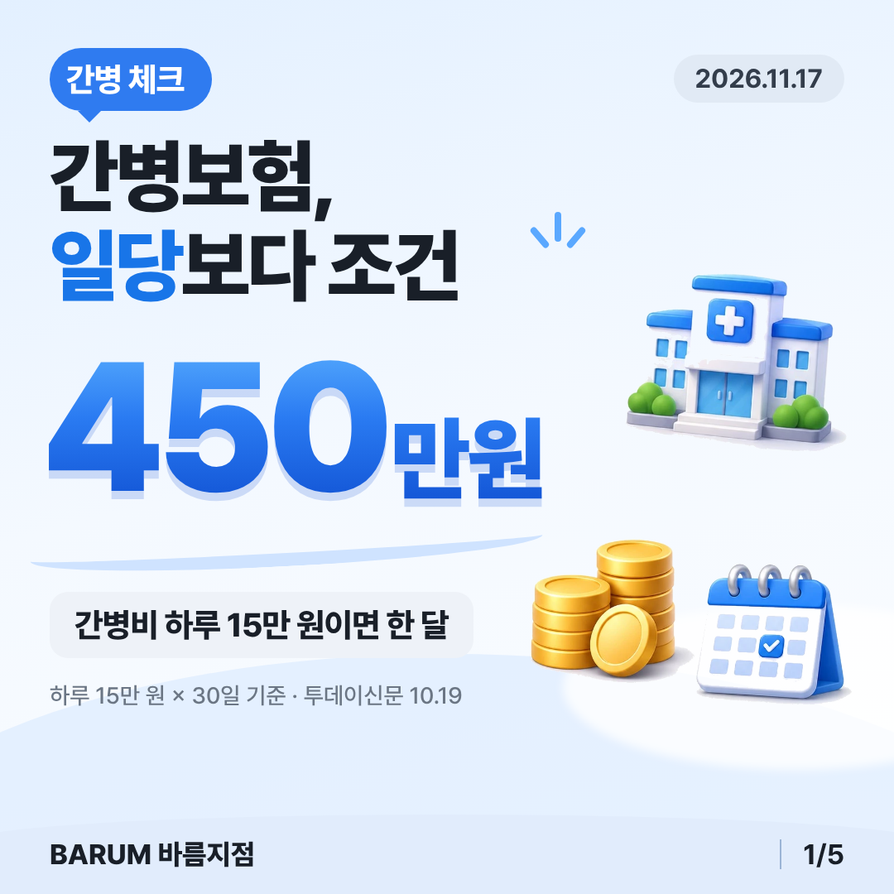
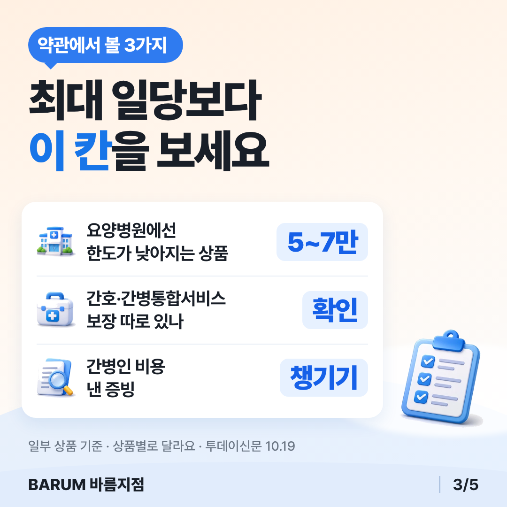
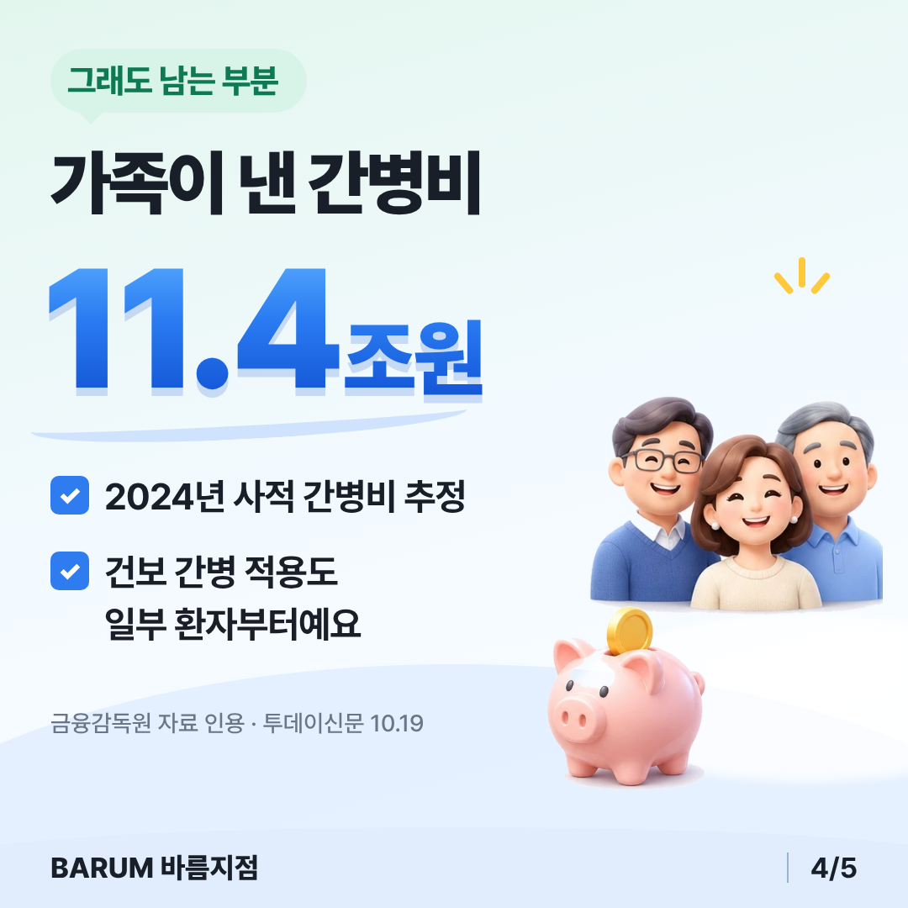

# 2026-11-17 블로그·인스타 초안 — 간병보험, 일당보다 조건부터

## 카드뉴스 (정사각형 1080×1080 · 고객 공유용)







카드 묶음 받기: https://raw.githubusercontent.com/bokkile83-ui/barum-news/main/blog/cards/2026-11-17-carecost_카드.zip

## 제목 후보
- 간병보험 하루 20만 원? 요양병원에선 얼마인지 보셨어요
- 간병비 한 달 450만 원, 내 보험은 어디서 나오나요
- 요양병원 간병비 30%로 줄어든다는데, 간병보험은 그대로 둬도 될까요

## 본문 뼈대
**도입** — 간병비 하루 15만 원이면 한 달 450만 원, 석 달이면 1,350만 원이에요(투데이신문 10.19). 그래서 간병보험 광고는 「하루 최대 20만 원」 같은 큰 숫자로 시작해요. 그런데 그 숫자가 모든 병원, 모든 상황에서 나오는 건 아니에요.

**핵심 1. 병원에 따라 한도가 달라요** — 일반병원에서는 하루 20만 원을 보장해도, 요양병원에서는 별도 특약에 따라 5만~7만 원 수준으로 한도가 낮아지는 상품이 있어요(일부 상품 · 상품별로 달라요). 오래 입원하는 곳이 요양병원이라면 이 칸이 제일 중요해요.

**핵심 2. 「사용일당」과 「통합서비스」는 다른 칸이에요** — 간호·간병통합서비스는 병원 간호인력이 간호와 간병을 함께 해 주는 병동이에요. 간병인 사용일당 특약만 있으면 통합병동에 입원했을 때 받지 못할 수 있어요. 또 일부 상품은 하루 간병비가 일정 금액에 못 미치면 가입금액의 절반만 주거나, 최소 이용시간을 채워야 해요. 간병업체에 낸 비용을 증명하지 못해 지급이 보류된 민원사례도 금감원이 공개한 적이 있어요.

**핵심 3. 요양병원 간병비, 건강보험이 들어와요** — 정부가 요양병원 간병비 본인부담을 지금 100%에서 30% 안팎으로 낮추는 방안을 추진하고 있어요. 의료중심 요양병원 500곳 내외, 의료·간병 필요도가 높은 환자 약 8만5천 명부터예요(세계일보 07.28). 시범사업은 2027년 상반기가 목표예요(투데이신문 10.19). 모든 요양병원·모든 환자에게 한 번에 적용되는 건 아니에요. 그리고 정액형 간병보험은 건보가 들어온다고 보험금이 자동으로 줄지는 않는다고 기사는 짚었어요.

**정리** — 간병보험은 「하루 얼마」보다 「어디서, 어떤 방식으로 간병받을 때 얼마」가 먼저예요. 증권에서 일반병원·요양병원·통합병동 세 칸을 나눠 보시면 돼요. 2024년 사적 간병비는 11조 4천억 원으로 추정돼요(금감원 자료 인용 · 투데이신문 10.19). 제도가 바뀌어도 가족이 내는 몫은 남아요.

**상담 안내** — 증권만 보내 주시면 내 간병 보장이 병원별로 얼마인지 같이 확인해 드릴게요.

{{지점 사례}}

## 릴스 대본

**훅 3개 (서로 다른 공식)**
1. #3 Nobody Tells You — 말: 「간병보험 하루 20만 원, 요양병원에선 아닐 수도 있어요. 이거 아무도 안 알려줘요.」 / 화면: **요양병원에선 얼마예요?**
2. #23 The Statistic — 말: 「간병비 하루 15만 원이면 한 달에 450만 원이에요.」 / 화면: **간병비 한 달 450만 원**
3. #20 Permission — 말: 「간병보험, 일당 큰 걸 고를 필요 없어요.」 / 화면: **일당보다 조건부터**

**고른 훅: #1(Nobody Tells You)** — 「요양병원에선 한도가 낮아질 수 있다」는 건 가입한 분도 대부분 모르는 사실이라 바로 「내 건?」 하고 멈추게 돼요. 450만 원은 2번째 줄에서 이유로 받쳐 줘요. #3은 「필요 없다」가 가입 판단을 대신하는 말처럼 들릴 수 있어 뺐어요.

**대본 (약 32초 · 약 150자)**
```
[0:00] 간병보험 하루 20만 원, 요양병원에선 아닐 수도 있어요.
[0:04] 간병비 하루 15만 원이면 한 달 450만 원이거든요.
[0:08] 근데 일부 상품은 요양병원 가면 5만~7만 원으로 줄어요.
[0:13] 통합병동은 따로 칸이 있어야 하는 경우도 있고요.
[0:17] 간병인 비용 낸 증빙도 꼭 챙기셔야 해요.
[0:20] 내년부터 요양병원 간병비 부담을 30% 안팎으로 줄이는 것도 추진 중이에요.
[0:26] 증권에서 병원별로 얼마인지, 세 칸만 보세요.
[0:29] 헷갈리면 댓글에 「간병」 남겨 주세요. 같이 확인해 드릴게요.
```

**화면 글자 카드 (세로 1080×1920 · 가운데 안전 영역 y 250~1440, 오른쪽 230px 비움)**
- 0:00–0:04 요양병원에선 얼마예요?
- 0:04–0:08 한 달 450만 원
- 0:08–0:13 요양병원 한도 5만~7만 원
- 0:13–0:17 통합병동 칸 따로 확인
- 0:17–0:20 간병인 비용 증빙 필수
- 0:20–0:26 요양병원 간병비 부담 30% 추진
- 0:26–0:29 병원별 세 칸 보기
- 0:29–0:32 댓글 「간병」

**마지막 요청 하나** — 댓글 「간병」.

**SKILL.md 기준 점검**
- 훅 3초 안: 통과(약 26자 ≈ 4초 → 첫 줄을 「간병보험 20만 원, 요양병원에선 달라요」로 줄이면 3초 안. 촬영 때 줄인 쪽 권장).
- 한 릴스 한 생각(간병보험은 병원별 조건부터): 통과.
- 숫자로 말하기·출처 있는 숫자만: 통과(15만·450만·5만~7만·30%).
- 마지막에 훅 단어 다시(요양병원·얼마): 통과.
- 고칠 점: 0:20 줄이 6초로 길어요. 한 비트 4초 넘으면 지루해져 「요양병원 간병비, 내년엔 부담 30%로 줄일 예정이에요」로 나눠 말하기 권장.

## 캡션

**Job A** — 릴스가 훅을 들고 있으니 첫 줄은 요청과 맥락만.

```
간병보험 하루 20만 원, 요양병원·통합병동에서도 그만큼인지 확인해 보셨어요? 댓글에 「간병」 남겨 주세요.

간병비는 하루 15만 원이면 한 달 450만 원이에요.

그런데 일부 간병보험은 요양병원에서 한도가 5만~7만 원으로 낮아져요. 간병인 사용일당만 있으면 간호·간병통합서비스 병동에선 못 받을 수도 있고요.

요양병원 간병비 본인부담을 100%에서 30% 안팎으로 낮추는 건강보험 적용도 추진 중이에요. 다만 의료 필요도가 높은 환자, 일부 병원부터예요.

간병보험 조건, 간병인 사용일당, 요양병원 간병비는 증권 칸만 봐도 알 수 있어요. 같이 확인해 드릴게요.

BARUM 바름지점

#간병보험 #간병인사용일당 #요양병원간병비 #간호간병통합서비스
```

**점검** — 첫 줄 125자 안(약 70자)·끊김 없음: 통과 / 요청 하나(댓글 「간병」): 통과 / 검색어(간병보험 조건·간병인 사용일당·요양병원 간병비) 본문 문장 안: 통과 / 해시태그 4개: 통과 / 링크 없음: 통과.

## 스토리 (5장)

```
1  [손으로 증권 넘기는 장면]   「간병보험, 하루 얼마 받는지 아세요?」
2  [병원 복도 사진 + 글자]    「같은 보험도 요양병원에선 5만~7만 원으로 줄 수 있어요(일부 상품)」
3  [글자 카드]               「일반병원 · 요양병원 · 통합병동, 세 칸이 따로예요」
4  [퀴즈 스티커]             「간병인 사용일당만 있으면 통합병동에서도 받는다?」 O / X(정답 X — 못 받을 수 있어요)
5  [손 + 증권]               「내 보험 세 칸, 같이 확인해 드릴게요. DM 주세요」
```
이후: 퀴즈에서 O 를 고른 분께 답장으로 「상품마다 달라서 증권 보시면 바로 알 수 있어요」.

**점검** — 첫 장 손 등장: 통과 / 한 장 한 생각: 통과 / 스티커 4번째: 통과 / 글자 y 250~1600 안: 촬영 때 확인.

## ig-human 점검
- 과한 기호·말줄임·이모지: 없음(캡션 이모지 0개).
- 뻔한 말(「꼭 알아야 할」「완벽 정리」「놓치면 손해」): 없음.
- 3개 나열 반복: 「일반병원·요양병원·통합병동」은 실제 칸 이름이라 유지.
- 보험금 지급 확정 표현: 없음(「~수 있어요」「일부 상품」「상품별로 달라요」로 표기).
- 결과: 통과.

## 출처
- [하루 20만원 준다는 간병보험…건보 확대 앞두고 달라지는 고민 — 투데이신문 2026.10.19](https://www.ntoday.co.kr/news/articleView.html?idxno=130141)
- [요양병원 간병비 부담 30%로 준다 — 세계일보 2026.07.28](https://www.segye.com/newsView/20260728514850)
- [내년부터 요양병원 간병비 건보 적용…환자 부담 100%→30% — 다음 뉴스 2026.07.28](https://v.daum.net/v/20260728123944538)
