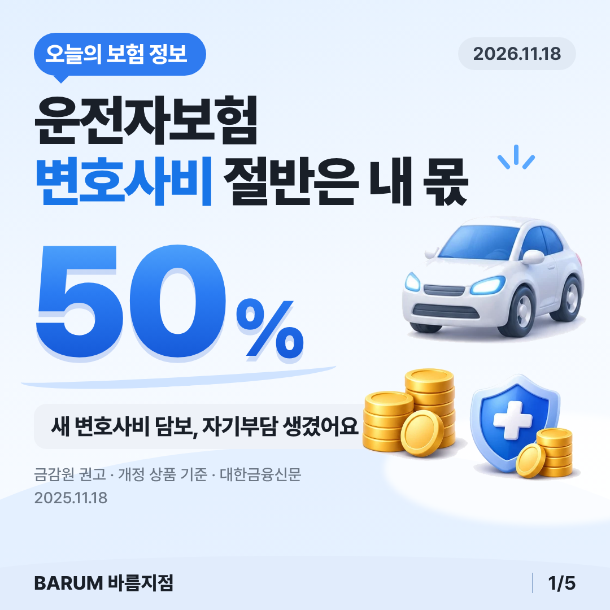
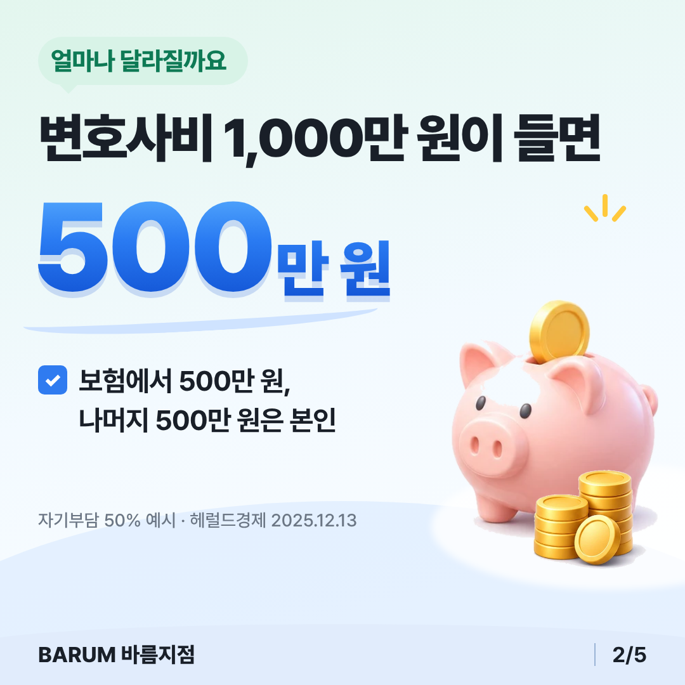
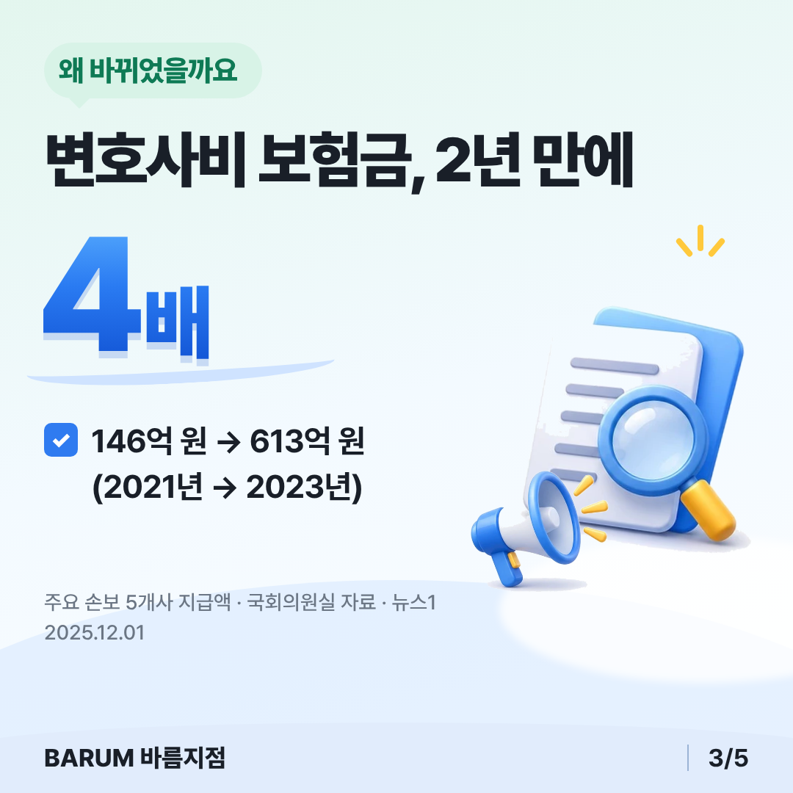
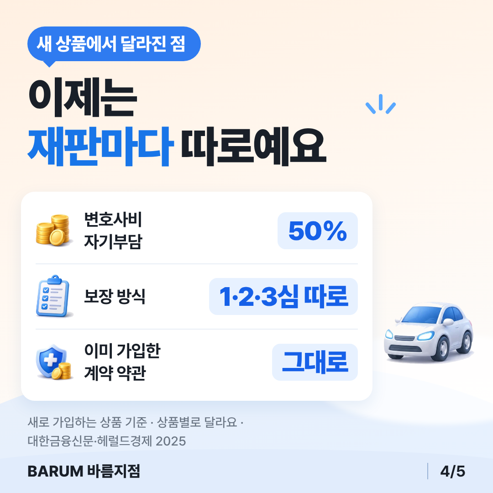
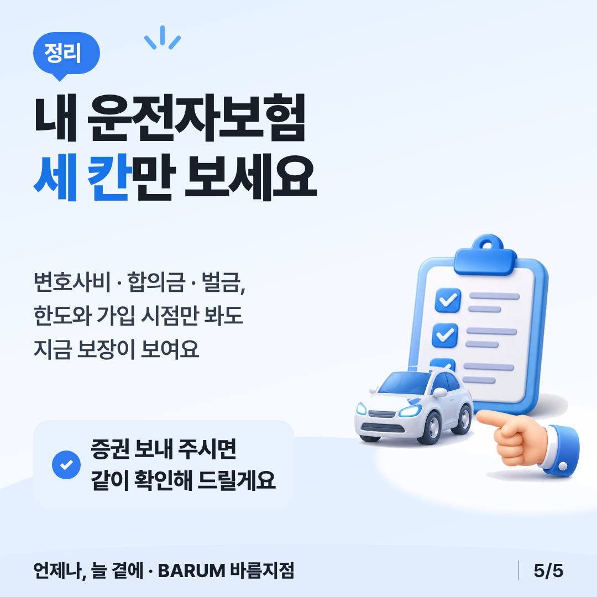

# 2026-11-18 블로그·인스타 초안 — 운전자보험 변호사비, 절반은 내 몫

## 카드뉴스 (정사각형 1080×1080 · 고객 공유용)







카드 묶음 받기: https://raw.githubusercontent.com/bokkile83-ui/barum-news/main/blog/cards/2026-11-18-driverlawyer_카드.zip

## 제목 후보
- 운전자보험 변호사비, 이제 절반은 내 돈이에요
- 변호사비 1,000만 원 나오면 보험은 500만 원, 내 운전자보험은요?
- 운전자보험 새로 들기 전에 「가입 시점」부터 보세요

## 본문 뼈대
**도입** — 운전자보험은 사고 났을 때 형사 책임 쪽 비용을 막아 주는 보험이에요. 그중 「변호사 선임비용」 담보가 바뀌었어요. 금융감독원이 2025년 11월 손해보험사들에 변호사 선임비용 담보에 가입자 자기부담 50%를 넣도록 권고했거든요(대한금융신문 2025.11.18). 대형사는 2026년 1월 초, 중소형사는 1월 중순에 상품을 바꾸는 일정이었어요(헤럴드경제 2025.12.13).

**핵심 1. 새 상품은 변호사비 절반이 자기부담이에요** — 변호사비가 1,000만 원 들었다면 보험에서 500만 원, 나머지 500만 원은 본인이 내는 구조예요(헤럴드경제 예시). 실제 비율과 한도는 상품·약관별로 달라요.

**핵심 2. 재판 단계마다 한도가 따로예요** — 1심·2심·3심을 구분하지 않고 한 번에 주던 정액 담보는 판매가 멈추고, 심급별 담보만 가입할 수 있게 됐어요(대한금융신문). 한때 최대 1억 원까지 팔리던 한도도 최근엔 3,000만~5,000만 원 수준이었어요(뉴스1 2025.12.01). 변호사비 보험금이 주요 손보 5개사에서 2021년 146억 원 → 2023년 613억 원으로 약 4배가 되면서 손질이 들어간 거예요(뉴스1, 국회의원실 자료).

**핵심 3. 이미 가입한 계약은 약관이 그대로예요** — 기존에 가입한 상품의 약관이 바뀌는 건 아니라고 기사는 짚었어요(헤럴드경제). 그래서 갈아타기 전에 지금 계약이 언제 가입한 건지, 변호사비·합의금·벌금 한도가 얼마인지 먼저 보시는 게 순서예요. 음주·무면허·뺑소니 사고는 원래 보장 대상이 아니에요(헤럴드경제).

**정리** — 운전자보험은 「보험료 얼마」보다 「언제 가입했고, 세 칸(변호사비·합의금·벌금) 한도가 얼마인지」가 먼저예요. 비유하면 오래 쓴 휴대폰 요금제 같아요. 지금은 안 파는 조건이 내 계약에 남아 있을 수 있거든요. 바꿀지 둘지는 그 칸을 본 다음에 정해도 늦지 않아요.

**상담 안내** — 증권만 보내 주시면 내 운전자보험 세 칸, 같이 확인해 드릴게요.

{{지점 사례}}

## 릴스 대본

**훅 3개 (서로 다른 공식)**
1. #3 Nobody Tells You — 말: 「운전자보험 변호사비, 이제 절반은 내 돈이에요.」 / 화면: **변호사비 절반은 내 몫**
2. #23 The Statistic — 말: 「변호사비 보험금이 2년 만에 4배가 됐어요.」 / 화면: **2년 만에 4배**
3. #2 Negative Command — 말: 「운전자보험, 지금 바로 갈아타지 마세요. 가입 날짜부터 보세요.」 / 화면: **갈아타기 전, 날짜부터**

**고른 훅: #1(Nobody Tells You)** — 「절반은 내 돈」은 운전하는 분이면 바로 「내 거도?」 하고 멈추는 말이에요. 4배(#2)는 이유라서 본문에서 받쳐 주고, #3은 「갈아타지 마세요」가 계약 판단을 대신하는 말로 들릴 수 있어 뺐어요.

**대본 (약 30초 · 약 140자)**
```
[0:00] 운전자보험 변호사비, 이제 절반은 내 돈이에요.
[0:03] 새 상품은 변호사비 1,000만 원 들면 보험에서 500만 원이거든요.
[0:08] 1심, 2심, 3심 한도도 따로 나뉘었고요.
[0:11] 변호사비 보험금이 2년 만에 4배가 돼서 바뀐 거예요.
[0:15] 근데 이미 가입한 계약은 약관이 그대로예요.
[0:19] 그러니까 갈아타기 전에 가입 날짜부터 보세요.
[0:22] 변호사비, 합의금, 벌금 세 칸이요.
[0:25] 헷갈리면 댓글에 「운전자」 남겨 주세요. 같이 확인해 드릴게요.
```

**화면 글자 카드 (세로 1080×1920 · 가운데 안전 영역 y 250~1440, 오른쪽 230px 비움)**
- 0:00–0:03 변호사비 절반은 내 몫
- 0:03–0:08 1,000만 원 → 500만 원
- 0:08–0:11 1·2·3심 한도 따로
- 0:11–0:15 2년 만에 4배
- 0:15–0:19 기존 계약 약관 그대로
- 0:19–0:22 가입 날짜부터 확인
- 0:22–0:25 변호사비·합의금·벌금
- 0:25–0:30 댓글 「운전자」

**마지막 요청 하나** — 댓글 「운전자」.

**SKILL.md 기준 점검**
- 훅 3초 안: 통과(약 20자 ≈ 4~5글자/초로 3초 안팎).
- 한 릴스 한 생각(새 상품은 변호사비 자기부담, 기존 계약은 그대로라 먼저 확인): 통과.
- 숫자로 말하기·출처 있는 숫자만: 통과(50%·1,000만→500만·4배).
- 한 비트 4초 이하: 0:03 줄이 5초 → 「1,000만 원 들면, 보험은 500만 원」으로 줄이면 통과. 촬영 때 줄인 쪽 권장.
- 마지막에 훅 단어 다시: 고칠 점 — 끝 줄에 「변호사비」가 0:22에만 나와요. 0:25를 「변호사비 헷갈리면 댓글에 「운전자」」로 말하면 루프가 살아요.

## 캡션

**Job A** — 릴스가 훅을 들고 있으니 첫 줄은 요청과 맥락만.

```
운전자보험 변호사비, 내 계약은 자기부담이 있는지 보셨어요? 댓글에 「운전자」 남겨 주세요.

새로 나온 운전자보험은 변호사 선임비용의 50%를 본인이 내요. 1,000만 원 들면 보험에서 500만 원이에요.

1심·2심·3심 한도도 따로 나뉘었어요. 변호사비 보험금이 2년 새 4배로 늘면서 금감원이 손질했거든요.

이미 가입한 계약은 약관이 그대로예요. 그래서 운전자보험 갈아타기 전엔 가입 날짜와 변호사비·합의금·벌금 한도부터 보시는 게 순서예요.

운전자보험 변호사선임비용, 운전자보험 자기부담금 궁금하시면 같이 확인해 드릴게요.

BARUM 바름지점

#운전자보험 #변호사선임비용 #운전자보험자기부담금 #교통사고처리지원금
```

**점검** — 첫 줄 125자 안(약 55자)·끊김 없음: 통과 / 요청 하나(댓글 「운전자」): 통과 / 검색어(운전자보험 변호사선임비용·운전자보험 자기부담금·운전자보험 갈아타기) 본문 문장 안: 통과 / 해시태그 4개: 통과 / 링크 없음: 통과.

## 스토리 (5장)

```
1  [운전석에서 손으로 증권 드는 장면]  「운전자보험, 변호사비 칸 보신 적 있어요?」
2  [글자 카드]                        「새 상품은 변호사비 절반이 자기부담이에요」
3  [증권 칸 가리키는 손]              「이미 가입한 계약은 약관 그대로예요. 가입 날짜부터 보세요」
4  [투표 스티커]                      「내 운전자보험 언제 가입했는지 아세요?」 안다 / 모른다
5  [손 + 증권]                        「모르셔도 괜찮아요. 증권 보내 주시면 같이 확인해 드릴게요」
```
이후: 「모른다」 고른 분께 답장으로 「증권 앱에서 가입일만 찍어 보내 주셔도 돼요」.

**점검** — 첫 장 손 등장: 통과 / 한 장 한 생각: 통과 / 스티커 4번째: 통과 / 글자 y 250~1600 안: 촬영 때 확인.

## ig-human 점검
- 과한 기호·말줄임·이모지: 없음(캡션 이모지 0개).
- 뻔한 말(「꼭 알아야 할」「완벽 정리」「놓치면 손해」): 없음.
- 3개 나열: 「변호사비·합의금·벌금」은 실제 담보 칸 이름이라 유지.
- 보험금 지급 확정·가입 권유·가짜 마감: 없음(「상품·약관별로 달라요」 표기, 갈아타기 권유 없음).
- 결과: 통과.

## 출처
- [내달부터 운전자보험 가입해도 변호사비용 절반은 소비자 부담 — 대한금융신문 2025.11.18](https://www.kbanker.co.kr/news/articleView.html?idxno=222623)
- [운전자보험 변호사 선임비용 보장 '축소'…합의금·벌금 특약 활용도 커진다 — 뉴스1(다음) 2025.12.01](https://v.daum.net/v/20251201064613124)
- [“변호사비 절반은 내 돈으로?” 내년 달라지는 운전자보험 가입할까, 말까 — 헤럴드경제 2025.12.13](https://biz.heraldcorp.com/article/10635832)
- [운전자보험 자기부담금 비용 확대 — 뱅크샐러드 (2026.11.16 수정)](https://www.banksalad.com/articles/%EC%9A%B4%EC%A0%84%EC%9E%90%EB%B3%B4%ED%97%98-%EC%9E%90%EA%B8%B0%EB%B6%80%EB%8B%B4%EA%B8%88-%EA%B0%9C%EC%A0%95%EC%95%88)
