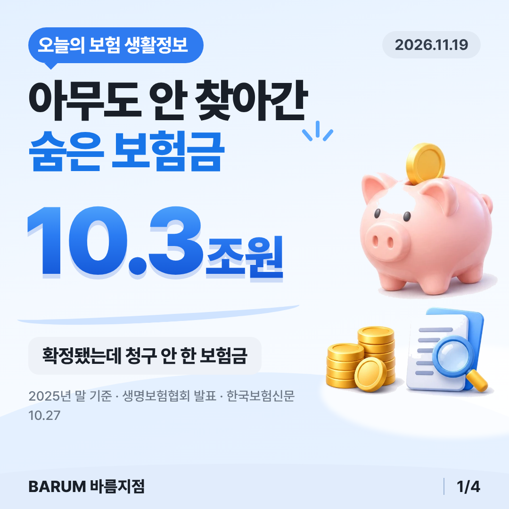
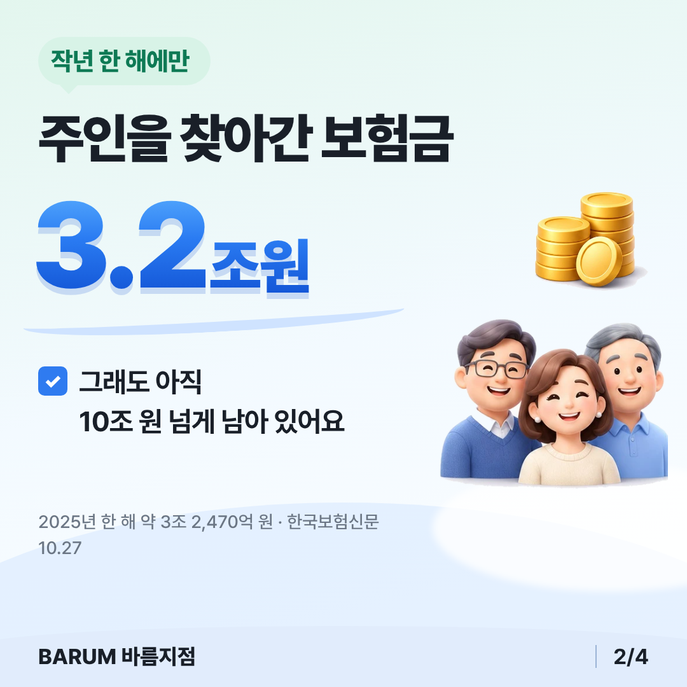
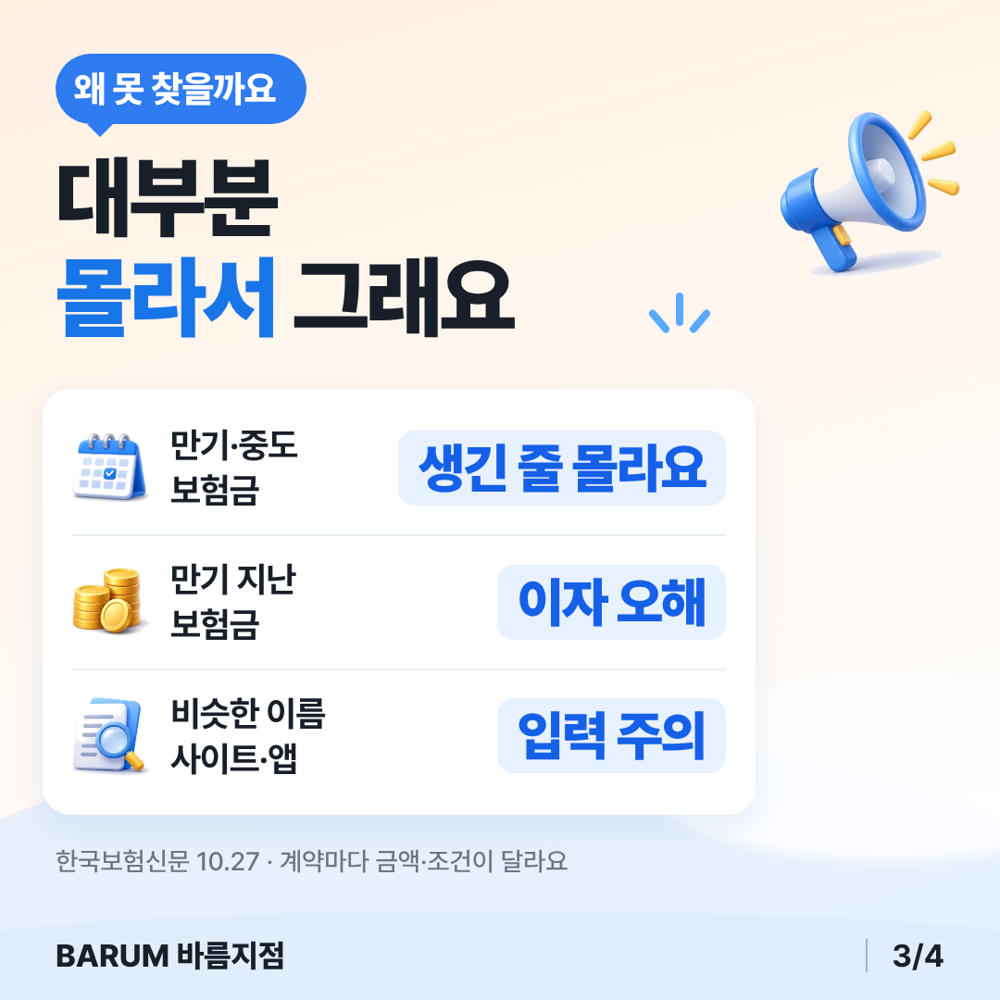

# 2026-11-19 블로그·인스타 초안 — 숨은 보험금 10.3조, 내 것도 있을까

## 카드뉴스 (정사각형 1080×1080 · 고객 공유용)






카드 묶음 받기: https://raw.githubusercontent.com/bokkile83-ui/barum-news/main/blog/cards/2026-11-19-hiddenclaim_카드.zip

## 제목 후보
- 아무도 안 찾아간 보험금 10조 3,000억 원, 내 이름도 있을까요
- 작년에만 3조 원이 주인을 찾았어요, 숨은 보험금 조회하는 법
- 만기 지난 보험금, 그냥 두면 이자가 붙을 거라 생각하셨다면

## 본문 뼈대
**도입** — 받을 돈이 이미 정해졌는데 아무도 청구하지 않은 보험금이 있어요. 이걸 「숨은 보험금」이라고 불러요. 2025년 말 기준으로 약 10조 3,000억 원이에요(생명보험협회 발표, 한국보험신문·뉴스1 2026.10.27). 생명보험협회는 서민금융진흥원과 함께 11월 30일까지 「숨은 보험금 찾아주기」 캠페인을 하고 있어요(한국보험신문 10.27).

**핵심 1. 줄고는 있지만 아직 10조 원이 넘어요** — 2022년 말 12조 4,000억 원 → 2023년 말 12조 1,000억 원 → 2024년 말 11조 2,000억 원 → 2025년 말 10조 3,000억 원이에요. 2025년 한 해에만 약 3조 2,470억 원이 주인을 찾아갔어요(한국보험신문 10.27). 서랍 속 안 쓴 상품권 같아요. 있는 줄 알아야 쓰거든요.

**핵심 2. 못 찾는 이유는 대부분 「몰라서」예요** — 만기·중도·휴면 보험금이 생긴 사실을 모르는 경우, 그리고 만기가 지나도 높은 이자가 계속 붙는다고 잘못 아는 경우가 주요 원인이에요(한국보험신문 10.27). 이사로 주소가 바뀌어 안내 우편을 못 받은 분도 있어요. 그래서 이번엔 최신 주소 기준으로 우편·모바일 안내를 보낸다고 해요(같은 기사).

**핵심 3. 조회는 공식 사이트에서만 해요** — 「내보험찾아줌」에서 가입한 보험 내역과 숨은 보험금을 같이 조회·청구할 수 있어요. 이름이 비슷한 사이트나 앱에는 개인정보를 넣지 말고, 운영 주체가 공식 기관인지 먼저 확인하라는 안내도 함께 나왔어요(한국보험신문 10.27). 금액과 받는 조건은 계약마다 달라요.

**정리** — 숨은 보험금은 「내가 받을 돈이 있나」를 확인하는 데 몇 분이면 돼요. 조회해서 나온 금액을 바로 찾을지, 계약을 그대로 둘지는 그 계약이 어떤 보험인지 보고 정하시면 돼요. {{지점 사례}}

**상담 안내** — 조회 결과 화면만 보내 주시면 어떤 계약에서 나온 돈인지 같이 확인해 드릴게요.

## 릴스 대본

**훅 3개 (서로 다른 공식)**
1. #23 The Statistic — 말: 「주인 없는 보험금이 10조 원이 넘어요.」 / 화면: **주인 없는 보험금 10조**
2. #3 Nobody Tells You — 말: 「만기 지난 보험금, 보험사가 먼저 챙겨 주지 않아요.」 / 화면: **먼저 안 챙겨 줘요**
3. #19 The Deadline — 말: 「11월 30일까지 숨은 보험금 찾기 캠페인 중이에요.」 / 화면: **11월 30일까지 캠페인**

**고른 훅: #1(The Statistic)** — 「10조」는 숫자 하나로 「나도?」를 부르는 말이에요. #2는 「먼저 안 챙겨 준다」가 기사에 없는 단정이라 뺐고, #3은 조회 자체는 캠페인 뒤에도 되는데 마감처럼 들릴 수 있어 본문 한 줄로만 넣었어요.

**대본 (약 30초 · 약 140자)**
```
[0:00] 주인 없는 보험금이 10조 원이 넘어요.
[0:03] 받을 돈은 정해졌는데 아무도 청구 안 한 돈이에요.
[0:07] 작년에만 3조 원이 주인을 찾아갔어요.
[0:10] 못 찾는 이유는 대부분 몰라서예요.
[0:13] 만기 보험금이 생긴 줄 모르거나,
[0:16] 그냥 두면 이자가 계속 붙는 줄 아시거든요.
[0:19] 조회는 「내보험찾아줌」 공식 사이트에서만 하세요.
[0:23] 이름 비슷한 앱엔 개인정보 넣지 마시고요.
[0:26] 내 10조 몫 궁금하면 댓글에 「보험금」 남겨 주세요. 같이 확인해 드릴게요.
```

**화면 글자 카드 (세로 1080×1920 · 가운데 안전 영역 y 250~1440, 오른쪽 230px 비움)**
- 0:00–0:03 주인 없는 보험금 10조
- 0:03–0:07 확정됐는데 청구 안 함
- 0:07–0:10 작년에만 3조 원
- 0:10–0:13 이유는 「몰라서」
- 0:13–0:19 만기 보험금 · 이자 오해
- 0:19–0:23 조회는 내보험찾아줌
- 0:23–0:26 비슷한 앱 주의
- 0:26–0:31 댓글 「보험금」

**마지막 요청 하나** — 댓글 「보험금」.

**SKILL.md 기준 점검**
- 훅 3초 안: 통과(약 16자 ≈ 3초).
- 한 릴스 한 생각(받을 돈이 있는지 공식 사이트에서 확인): 통과.
- 숫자·출처: 통과(10조 3,000억·3조 2,470억 — 한국보험신문 10.27).
- 한 비트 4초 이하: 0:26 줄이 약 5초 → 「댓글 「보험금」 남겨 주세요」까지만 말하고 「같이 확인해 드릴게요」는 화면 글자로 빼면 통과.
- 루프(훅 단어 다시): 통과 — 끝 줄 「10조」가 첫 줄과 이어져요.
- 가짜 마감: 통과 — 11월 30일은 실제 캠페인 기간이고, 훅으로 쓰지 않았어요.

## 캡션

**Job A** — 릴스가 훅을 들고 있으니 첫 줄은 요청과 맥락만.

```
내 이름으로 된 숨은 보험금, 조회해 보셨어요? 궁금하시면 댓글에 「보험금」 남겨 주세요.

받을 금액이 정해졌는데 아무도 청구하지 않은 보험금이 2025년 말 기준 약 10조 3,000억 원이에요. 작년 한 해에만 3조 원 넘게 주인을 찾아갔어요.

못 찾는 이유는 대부분 몰라서예요. 만기·중도 보험금이 생긴 줄 모르거나, 그냥 두면 이자가 계속 붙는 줄 아시는 경우가 많아요.

숨은 보험금 조회는 「내보험찾아줌」 공식 사이트에서 하시면 돼요. 이름이 비슷한 앱이나 사이트에는 개인정보를 넣지 마세요.

미청구 보험금, 만기 보험금 찾는 법 헷갈리시면 같이 확인해 드릴게요.

BARUM 바름지점

#숨은보험금 #내보험찾아줌 #미청구보험금 #만기보험금
```

**점검** — 첫 줄 125자 안(약 50자)·끊김 없음: 통과 / 요청 하나(댓글 「보험금」): 통과 / 검색어(숨은 보험금 조회·미청구 보험금·만기 보험금) 본문 문장 안: 통과 / 해시태그 4개: 통과 / 링크 없음: 통과 / 이모지 0개: 통과.

## 스토리 (5장)

```
1  [서랍에서 손으로 오래된 증권 꺼내는 장면]  「서랍 속 오래된 보험 증권, 있으세요?」
2  [글자 카드]                               「청구 안 한 보험금이 10조 원이 넘어요」
3  [휴대폰 화면 가리키는 손]                 「조회는 내보험찾아줌, 공식 사이트에서만요」
4  [퀴즈 스티커]                             「만기 지난 보험금, 그냥 두면 이자가 계속 붙는다?」 O / X
5  [손 + 증권]                               「헷갈리시면 조회 화면만 보내 주세요. 같이 확인해 드릴게요」
```
이후: 퀴즈에 「O」 고른 분께 답장으로 「만기 뒤 이자는 계약마다 달라요. 증권 찍어 보내 주시면 같이 볼게요」.

**점검** — 첫 장 손 등장: 통과 / 한 장 한 생각: 통과 / 스티커 4번째(퀴즈 — 흔한 오해 바로잡기): 통과 / 글자 y 250~1600 안: 촬영 때 확인.

## ig-human 점검
- 과한 기호·말줄임·이모지: 없음.
- 뻔한 말(「꼭 알아야 할」「놓치면 손해」「지금 바로」): 없음.
- 보험금 지급 확정 표현: 없음(「조회」「확인」만 쓰고, 「계약마다 달라요」 표기).
- 가짜 마감: 없음(캠페인 기간은 기사 그대로 본문에만).
- 개인 이름·고객 사례·보험사 이름: 없음(사례는 {{지점 사례}}로 비움).
- 결과: 통과.

## 출처
- [주인 못 찾은 보험금 10조3000억원… 대국민 '숨은보험금' 찾기 캠페인 실시 — 한국보험신문 2026.10.27](https://www.insnews.co.kr/news/articleView.html?idxno=93507)
- [생보협회, 숨은보험금 10조3000억원…주인 찾기 나선다 — 뉴스1 2026.10.27](https://www.news1.kr/finance/insurance-card/6333735)
