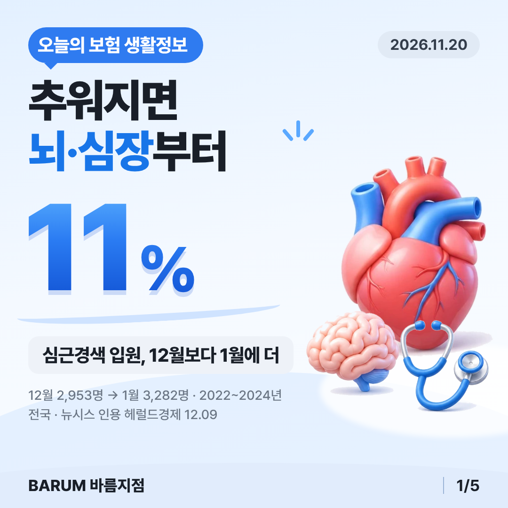
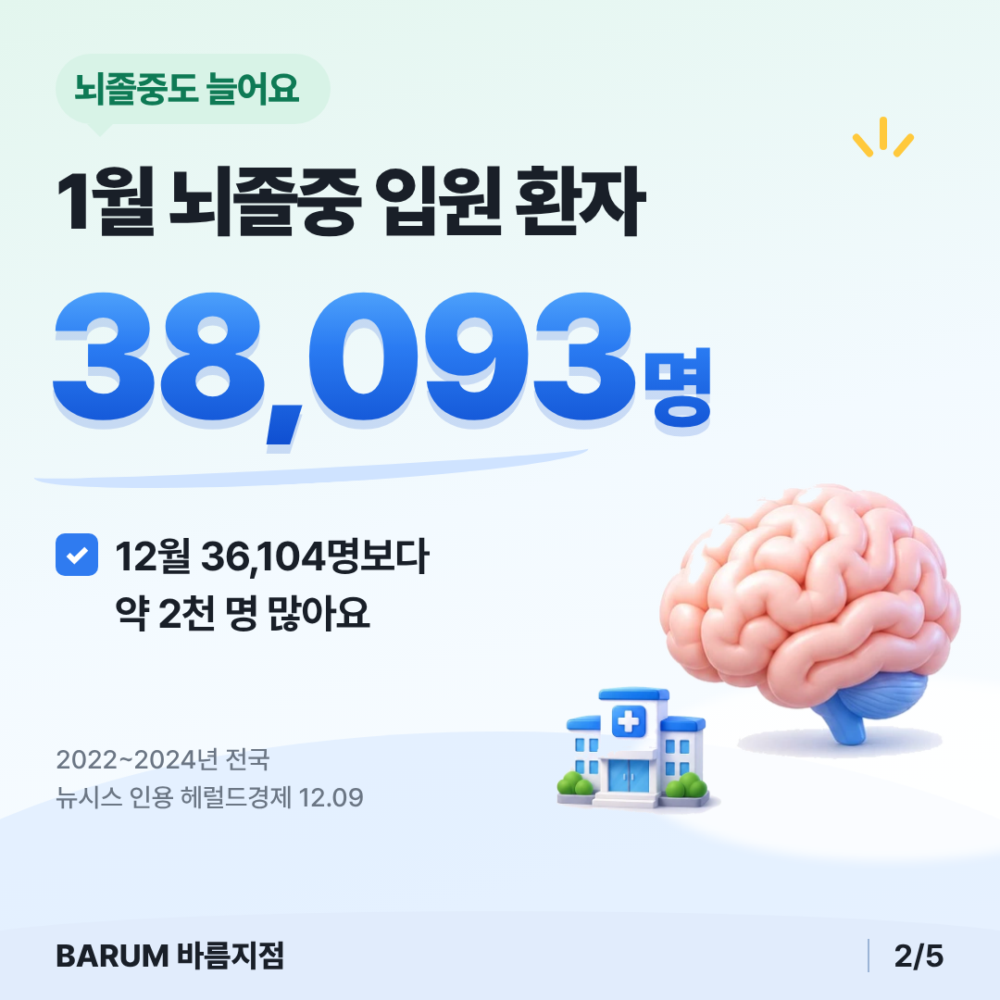
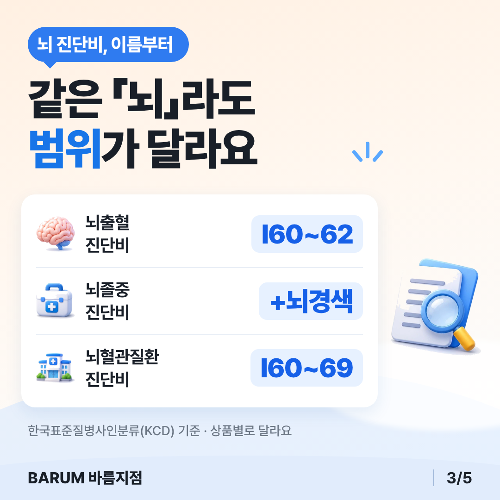
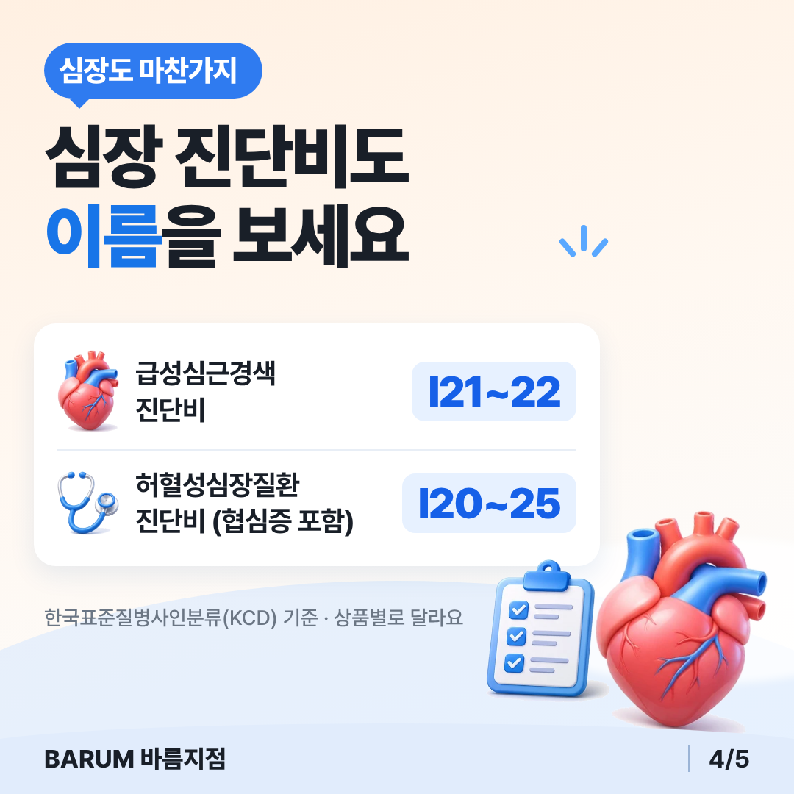
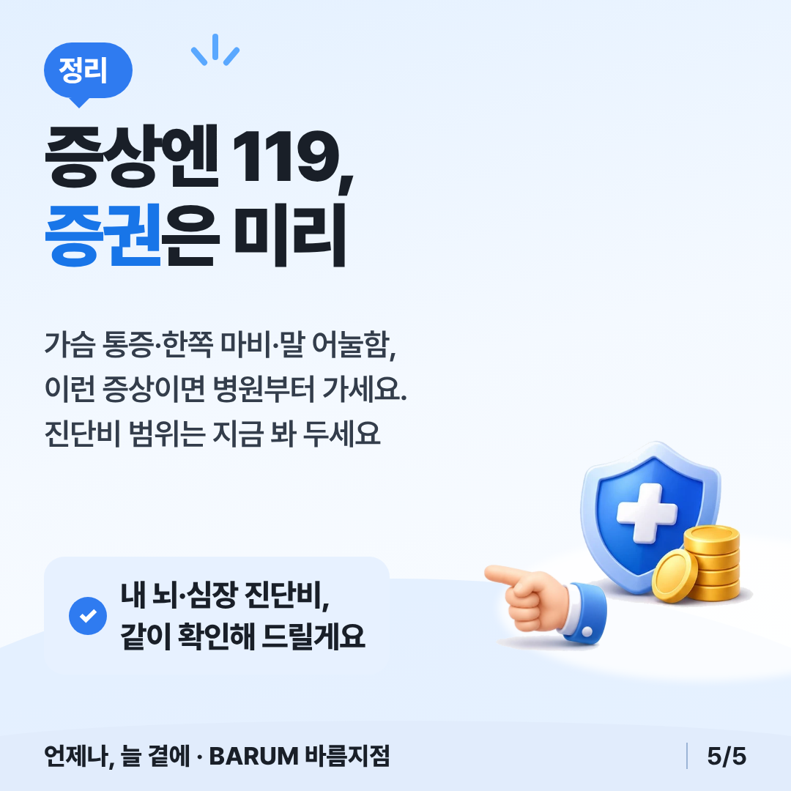

# 2026-11-20 블로그·인스타 초안 — 겨울 뇌·심장, 진단비 이름부터

## 카드뉴스 (정사각형 1080×1080 · 고객 공유용)







카드 묶음 받기: https://raw.githubusercontent.com/bokkile83-ui/barum-news/main/blog/cards/2026-11-20-winterheart_카드.zip

## 제목 후보
- 추워지면 늘어나는 심근경색·뇌졸중, 내 진단비는 어디까지일까요
- 「뇌출혈」「뇌졸중」「뇌혈관질환」 진단비, 이름 한 글자가 범위를 바꿔요
- 겨울 오기 전에 증권에서 딱 두 칸만 보세요 — 뇌·심장 진단비

## 본문 뼈대

**도입** — 기온이 떨어지면 혈관이 좁아지고 혈압이 올라요. 실제로 2022~2024년 전국 기준, 심근경색 입원 환자는 12월 2,953명에서 1월 3,282명으로 약 11% 늘었어요. 뇌졸중도 3만 6,104명에서 3만 8,093명으로 늘었고요(뉴시스 인용, 헤럴드경제 2025.12.09).

**핵심 1. 증상이 보이면 보험보다 병원이 먼저예요** — 가슴을 짓누르는 통증, 갑자기 숨이 차는 느낌, 한쪽 팔다리 힘 빠짐, 말이 어눌해지는 증상이 보이면 바로 119예요. 질병관리청 통계로 1년 안 사망률이 심근경색 15.8%, 뇌졸중 19.8%예요. 증상이 잠깐 사라져도(일과성 허혈발작) 검사는 받으셔야 해요.

**핵심 2. 뇌 진단비는 이름에 따라 범위가 달라요** — 같은 「뇌」 진단비라도 보장 범위는 질병코드로 정해져요.
- 뇌출혈 진단비: I60~I62(터지는 쪽)
- 뇌졸중 진단비: 뇌출혈 + 뇌경색(I63), 상품에 따라 I65·I66까지
- 뇌혈관질환 진단비: I60~I69 전체
막히는 뇌경색은 뇌출혈 진단비로는 받기 어려워요. 수도관으로 치면 「터진 것」만 고쳐 주는 보험과 「막힌 것」까지 고쳐 주는 보험의 차이예요. 정확한 범위는 상품별로 달라요.

**핵심 3. 심장도 마찬가지예요** — 급성심근경색 진단비는 I21~I22만, 허혈성심장질환 진단비는 협심증을 포함해 I20~I25까지 봐요. 「심장」이라고 적혀 있어도 어느 칸에 있는지가 중요해요.

**정리** — 겨울엔 증상 나면 병원부터, 증권은 미리. 내 증권에서 「뇌출혈」만 있는지, 「뇌혈관질환」까지 있는지, 심장은 「급성심근경색」만인지 「허혈성」까지인지 두 칸만 보시면 돼요. {{지점 사례}}

**상담 안내** — 증권만 보내 주시면 뇌·심장 진단비 범위, 같이 확인해 드릴게요. — BARUM 바름지점

## 릴스 대본

**훅 3개 (서로 다른 공식)**
1. #23 The Statistic — 말: 「심근경색 입원, 1월이 12월보다 11% 많아요.」 / 화면: **1월 심근경색 11%↑**
2. #7 Wrong Way, Right Way — 말: 「뇌 진단비 있다고요? 뇌출혈만이면 뇌경색은 빠져요.」 / 화면: **뇌출혈만? 뇌경색 빠져요**
3. #3 Nobody Tells You — 말: 「같은 뇌 진단비라도 이름 한 글자로 범위가 달라요.」 / 화면: **이름이 범위를 정해요**

**고른 훅: #2(Wrong Way, Right Way)** — 「나도 뇌 진단비 있는데?」 하는 사람을 정확히 멈춰 세우고, 화면 글자만으로 내용이 전달돼요. #1 통계는 본문 둘째 줄에 넣었어요.

**대본 (약 30초 · 약 140자)**
```
[0:00] 뇌 진단비 있다고요? 뇌출혈만이면 뇌경색은 빠져요.
[0:04] 겨울엔 뇌·심장 입원이 늘어요.
[0:07] 심근경색 입원, 1월이 12월보다 11% 많아요.
[0:10] 뇌출혈은 터지는 것만,
[0:12] 뇌졸중은 막히는 뇌경색까지,
[0:15] 뇌혈관질환은 I60부터 69까지 다 봐요.
[0:19] 심장도 급성심근경색만인지, 허혈성까지인지 보세요.
[0:23] 증상 나면 119가 먼저예요.
[0:26] 내 증권 궁금하면 댓글에 「뇌심장」 남겨 주세요.
```

**화면 글자 카드 (세로 1080×1920 · 가운데 안전 영역 y 250~1440, 오른쪽 230px 비움)**
- 0:00–0:04 뇌출혈만? 뇌경색 빠져요
- 0:04–0:07 겨울엔 뇌·심장 입원↑
- 0:07–0:10 1월 심근경색 11%↑
- 0:10–0:12 뇌출혈 = 터짐
- 0:12–0:15 뇌졸중 = +막힘
- 0:15–0:19 뇌혈관질환 = I60~69
- 0:19–0:23 심장: 급성 vs 허혈성
- 0:23–0:26 증상엔 119 먼저
- 0:26–0:30 댓글 「뇌심장」 · 같이 확인해 드릴게요

**마지막 요청 하나** — 댓글 「뇌심장」.

**SKILL.md 기준 점검**
- 훅 3초 안: 고칠 점 — 첫 줄 약 24자(≈ 4~5초). 「뇌출혈만이면 뇌경색은 빠져요」만 말하고 「뇌 진단비 있다고요?」는 화면 글자로 빼면 통과.
- 한 릴스 한 생각(진단비 이름이 범위를 정한다): 통과. 통계는 이유로만 한 줄.
- 숫자·출처: 통과(11% = 2,953명→3,282명, 뉴시스 인용 헤럴드경제 25.12.09 / 코드 범위 KCD 기준).
- 한 비트 4초 이하: 통과(0:15·0:19 줄 4초).
- 루프: 통과 — 끝 단어 「뇌」가 첫 줄 「뇌 진단비」로 이어져요.
- 지급 확정 표현: 「빠져요」는 뇌출혈 진단비의 코드 범위 설명이라 사실이지만, 영상 설명란·자막에 「상품별로 달라요」를 함께 둬요.

## 캡션

**Job A** — 릴스가 훅을 들고 있으니 첫 줄은 요청과 맥락만.

```
내 뇌·심장 진단비가 어디까지 보는지 궁금하시면 댓글에 「뇌심장」 남겨 주세요.

추워지면 혈관이 좁아지고 혈압이 올라요. 2022~2024년 전국 기준, 심근경색 입원 환자는 12월보다 1월에 약 11% 많았어요.

뇌 진단비는 이름에 따라 범위가 달라요. 뇌출혈 진단비는 I60~62, 뇌졸중 진단비는 뇌경색까지, 뇌혈관질환 진단비는 I60~69 전체를 봐요.

심장도 급성심근경색 진단비는 I21~22, 허혈성심장질환 진단비는 협심증을 포함해 I20~25까지예요. 정확한 범위는 상품별로 달라요.

가슴 통증, 한쪽 마비, 말 어눌함이 보이면 보험보다 병원이 먼저예요. 증권은 그 전에 미리 봐 두세요. 같이 확인해 드릴게요.

BARUM 바름지점

#뇌혈관질환진단비 #뇌졸중진단비 #허혈성심장질환 #심근경색 #보장분석
```

**점검** — 첫 줄 125자 안(약 45자)·끊김 없음: 통과 / 요청 하나(댓글 「뇌심장」): 통과 / 검색어(뇌혈관질환 진단비·뇌졸중 진단비·허혈성심장질환 진단비) 본문 문장 안: 통과 / 해시태그 5개: 통과 / 링크 없음: 통과 / 이모지 0개: 통과.

## 스토리 (5장)

```
1  [손으로 증권 펼쳐 진단비 칸 가리키는 장면]  「내 증권에 「뇌」 들어간 칸, 몇 개예요?」
2  [글자 카드]                                 「뇌출혈 · 뇌졸중 · 뇌혈관질환, 범위가 다 달라요」
3  [글자 카드]                                 「막히는 뇌경색은 뇌출혈 진단비로 받기 어려워요」
4  [퀴즈 스티커]                               「뇌경색은 뇌출혈 진단비 대상이다?」 O / X
5  [손 + 증권]                                 「헷갈리시면 증권 사진만 보내 주세요. 같이 확인해 드릴게요」
```
이후: 퀴즈에 「O」 고른 분께 답장으로 「뇌경색(I63)은 보통 뇌졸중·뇌혈관질환 진단비에서 봐요. 상품마다 다르니 증권 보내 주시면 같이 볼게요」.

**점검** — 첫 장 손 등장: 통과 / 한 장 한 생각: 통과 / 스티커 4번째(퀴즈 — 흔한 오해 바로잡기): 통과 / 글자 y 250~1600 안: 촬영 때 확인.

## ig-human 점검
- 과한 기호·말줄임·이모지: 없음(화살표 「↑」는 화면 글자 카드에만, 2곳).
- 뻔한 말(「꼭 알아야 할」「놓치면 손해」「지금 바로」): 없음.
- 보험금 지급 확정 표현: 없음(「받기 어려워요」「상품별로 달라요」로 표기).
- 가짜 마감·과장: 없음.
- 개인 이름·고객 사례·보험사 이름: 없음(사례는 {{지점 사례}}로 비움).
- 결과: 통과.

## 출처
- [헤럴드경제 — 영하권 추위 본격화…심근경색·뇌졸중 「주의」(2025.12.09, 뉴시스 인용 · 입원 수치·질병관리청 사망률)](https://biz.heraldcorp.com/article/10632774)
- [디지털데일리 — 겨울철 뇌졸중 위험↑, 이 증상 나타나면 병원부터(2026.01.19 · 증상·일과성 허혈발작)](https://www.ddaily.co.kr/page/view/2026011910244235342)
- [헬스조선(다음) — 겨울철 심·뇌혈관 건강, 생활 관리가 예방법(2026.01.05 · 증상)](https://v.daum.net/v/20260105151503521)
- [교보생명 뉴스룸 — 뇌출혈·뇌졸중·뇌혈관질환 진단비 보장 비교(2026.06.23 · 코드 범위)](https://news.kyobo.com/%EB%87%8C%EC%B6%9C%ED%98%88-%EB%87%8C%EC%A1%B8%EC%A4%91-%EB%87%8C%ED%98%88%EA%B4%80%EC%A7%88%ED%99%98-%ED%8A%B9%EC%95%BD-%EA%B0%80%EC%9D%B4%EB%93%9C/)
- [KB의 생각 — 뇌혈관질환 보험, 특약별 진단비 보장 범위(2025.08.14 · KCD I60~I69 표)](https://kbthink.com/insurance/trend/cerebrovascular-disease.html)
- [보닥 다이어리 — 뇌·심장 진단비 담보 보장범위 점검(2026.06.12 · 급성심근경색 I21~22, 허혈성 I20~25)](https://diary.bodoc.co.kr/article/%EB%87%8C-%EC%8B%AC%EC%9E%A5-%EC%A7%84%EB%8B%A8%EB%B9%84-%EB%8B%B4%EB%B3%B4-%EB%B3%B4%EC%9E%A5%EB%B2%94%EC%9C%84-%EC%A0%90%EA%B2%80)
