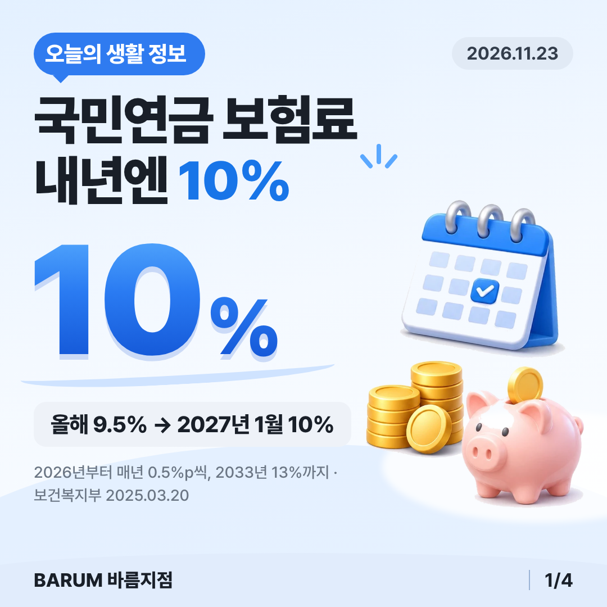
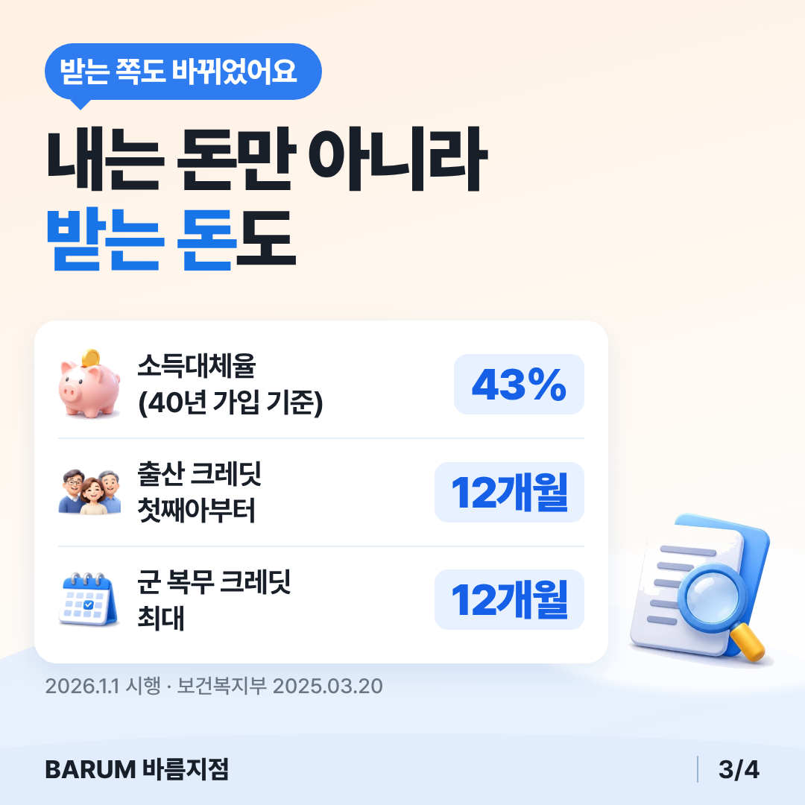

# 2026-11-23 블로그·인스타 초안 — 국민연금 보험료, 내년 1월 10%

## 카드뉴스 (정사각형 1080×1080 · 고객 공유용)






카드 묶음 받기: https://raw.githubusercontent.com/bokkile83-ui/barum-news/main/blog/cards/2026-11-23-pension10_카드.zip

## 제목 후보
- 국민연금 보험료, 내년 1월부터 10%예요 — 내 월급에선 얼마나 더 빠질까요
- 월급명세서 국민연금 칸, 해마다 0.5%p씩 오르는 이유
- 「내는 돈」도 「받는 돈」도 바뀐 국민연금, 딱 3가지만 보세요

## 본문 뼈대

**도입** — 월급명세서에서 국민연금 칸, 올해 1월에 숫자가 살짝 바뀐 거 보셨어요? 2025년 3월 국회를 통과한 연금개혁으로 보험료율이 9%에서 2026년 9.5%로 올랐고, 내년 1월에는 10%가 돼요. 이후에도 매년 0.5%p씩 올라 2033년 13%에서 멈춰요(보건복지부 보도자료 2025.03.20).

**핵심 1. 내 몫은 얼마나 늘까요** — 직장인은 회사와 반씩 나눠 내요. 기준소득월액 300만 원이면 본인 몫이 올해 월 142,500원(4.75%)에서 내년 150,000원(5%)으로 월 7,500원 늘어요. 1년이면 9만 원이에요. 지역가입자는 전액 본인 부담이라 같은 300만 원 기준 월 285,000원 → 300,000원, 월 15,000원이 늘어요. (요율 × 소득 계산 예시. 실제 금액은 기준소득월액 상·하한에 따라 달라요.)

**핵심 2. 받는 쪽도 바뀌었어요** — 소득대체율은 2026년부터 43%로 올랐어요. 단, 43%는 40년 가입했을 때 기준이라 「내 월급의 43%를 받는다」는 뜻은 아니에요. 출산 크레딧은 첫째아부터 12개월을 더 인정하고(상한 50개월 폐지), 군 복무 크레딧은 최대 12개월로 늘었어요. 국가의 지급 보장도 법에 적혔고요(보건복지부 2025.03.20).

**핵심 3. 저소득 지역가입자는 지원이 넓어졌어요** — 예전엔 납부를 다시 시작한 지역가입자만 최대 12개월 보험료 절반을 지원받았는데, 이제 저소득 지역가입자로 대상이 넓어졌어요. 소득 기준은 대통령령으로 정해요. 해당되는지 국민연금공단(1355)에 한 번 물어보세요.

**정리** — 내는 돈은 2033년까지 해마다 늘고, 받는 돈은 가입 기간에 따라 달라져요. 집으로 치면 국민연금은 「기초 공사」예요. 기초만으로 집이 다 서지는 않잖아요. 국민연금공단 「내 연금 알아보기」에서 예상 연금액을 먼저 보고, 퇴직연금·개인연금까지 합쳐 노후에 매달 얼마가 들어오는지 한 장으로 그려 보시는 게 좋아요.

**상담 안내** — 예상 연금액 화면 캡처와 가입하신 연금보험 증권만 보내 주시면, 매달 들어올 돈을 같이 확인해 드릴게요. — BARUM 바름지점

## 릴스 대본

### 훅 3개 (서로 다른 공식)
1. **숫자 충격(Specific Number)** — 말: 「내년 1월, 월급에서 국민연금이 또 더 빠져요.」 / 화면: **내년 국민연금 10%**
2. **모르면 손해(Nobody Tells You)** — 말: 「국민연금 43% 준다는 말, 그대로 믿으시면 안 돼요.」 / 화면: **43%의 진짜 뜻**
3. **질문형(Direct Question)** — 말: 「월급 300만 원이면, 국민연금 얼마 더 내는지 아세요?」 / 화면: **300만 원이면 얼마?**

**고른 훅: 3번** — 시청자가 자기 월급을 넣어 보게 만들고, 바로 답(7,500원)을 줄 수 있어 끝까지 보게 해요. 1번은 정보가 넓고, 2번은 주제가 받는 돈 쪽으로 쏠려요.

### 대본 (약 30초)
```
[0~3초] 월급 300만 원이면, 국민연금 얼마 더 내는지 아세요?
[3~7초] 내년 1월부터 보험료율이 9.5%에서 10%로 올라요.
[7~12초] 직장인은 회사랑 반씩 내니까, 내 몫은 월 7,500원 늘어요.
[12~16초] 지역가입자는 혼자 다 내서 월 만 오천 원이에요.
[16~21초] 이게 끝이 아니에요. 2033년 13%까지 해마다 0.5%씩 올라요.
[21~26초] 받는 돈 43%도 40년 꽉 채웠을 때 얘기예요.
[26~30초] 내 예상 연금액, 댓글에 「연금」 남겨 주시면 같이 확인해 드릴게요.
```
글자 수 약 150자 → 1초 4~5글자 기준 30~35초.

### 화면 글자 카드 (1080×1920 · 세로 230~1440px 사이 가운데 · 오른쪽 230px 비움)
- 0:00 300만 원이면 얼마?
- 0:03 9.5% → 10%
- 0:07 내 몫 +7,500원
- 0:12 지역가입자 +15,000원
- 0:16 2033년 13%까지
- 0:21 43% = 40년 기준
- 0:26 댓글 「연금」

### 마지막 요청
댓글에 「연금」 한 단어.

### 점검 (ig-reel SKILL.md 기준)
- 통과: 훅이 3초 안·숫자 포함 / 한 릴스 한 주제(보험료 인상) / 화면 글자 6단어 이내 / 요청 하나.
- 고칠 점: 마지막 줄이 훅 단어(「300만 원」)를 다시 부르지 않아 반복 재생 연결이 약해요 → 촬영 때 「300만 원이든 500만 원이든, 댓글에 연금」으로 바꿔도 돼요.

## 캡션

```
월급 300만 원 직장인, 내년 1월부터 국민연금 내 몫이 월 7,500원 늘어요. 댓글에 「연금」 남겨 주세요.

보험료율이 올해 9.5%에서 내년 10%가 돼요.
2033년 13%까지 해마다 0.5%p씩 올라가요.

직장인은 회사와 반씩, 지역가입자는 전액 본인 부담이에요.
같은 300만 원이라도 지역가입자는 월 15,000원이 늘어요.

받는 돈 소득대체율 43%는 40년 가입 기준이에요.
내 예상 연금액은 국민연금공단에서 바로 볼 수 있어요.

예상 연금액 화면만 보내 주시면 노후에 매달 들어올 돈, 같이 확인해 드릴게요 🙂

국민연금 보험료율 인상 2027 · 국민연금 10% · 연금개혁 소득대체율 43% · 노후 준비

#국민연금 #연금개혁 #노후준비 #부산보험상담 #창원보험상담
— BARUM 바름지점
```
- 점검(ig-caption 기준): Job A(릴스가 훅을 맡음) → 첫 줄 = 핵심 숫자 + 요청. 첫 줄 약 60자로 125자 안, 끊김 없음. 해시태그 5개, 요청 하나. 통과.

## 스토리

1. **열기** — 월급명세서를 든 손 사진 + 글 「국민연금 칸, 내년에 또 바뀌어요」
2. **내용** — 「9.5% → 10%, 2027년 1월부터」 (출처: 보건복지부 2025.03.20)
3. **내용** — 「월 300만 원 직장인 내 몫 +7,500원 / 지역가입자 +15,000원」
4. **요청(퀴즈 스티커)** — 「소득대체율 43%, 무슨 뜻일까요?」 ① 내 월급의 43% ② 40년 가입 기준 비율 → 정답 ②
5. **닫기** — 「내 예상 연금액, DM으로 화면 보내 주시면 같이 확인해 드릴게요 · BARUM 바름지점」

- 점검(ig-story 기준): 5장, 4번째에 스티커 하나(퀴즈 — 흔한 오해를 바로잡는 용도), 첫 장에 손. 통과.

## AI 티 점검 (ig-human 기준)
- 줄표(—)는 블로그 구분용만 두고 캡션·대본 말줄에서는 뺐어요. 「혁신적」「완벽한」 같은 뻔한 말 없음. 이모지 캡션 1개. 지급 확정·가입 권유·가짜 마감 표현 없음. 개인 이름·보험사 이름 없음.
- 통과.

## 출처
- [보건복지부 보도자료 — 보험료율 13%, 소득대체율 43% 등 담은 연금개혁법안 국회 본회의 통과 (2025.03.20)](https://www.mohw.go.kr/board.es?mid=a10503010100&bid=0027&act=view&list_no=1485039&tag=&nPage=1)
- [국민연금공단 블로그 — 연금개혁으로 변하는 보험료율과 소득대체율](https://blog.naver.com/pro_nps/223844903712)
- [국민연금공단 FAQ — 연금개혁](https://www.nps.or.kr/pnsinfo/ntpsklg/getOHAF0104M0.do)
- [브라보마이라이프 — 내년부터 보험료율·소득대체율 동시 인상](https://m.bravo.etoday.co.kr/view/atc_view.php?varAtcId=16920)
