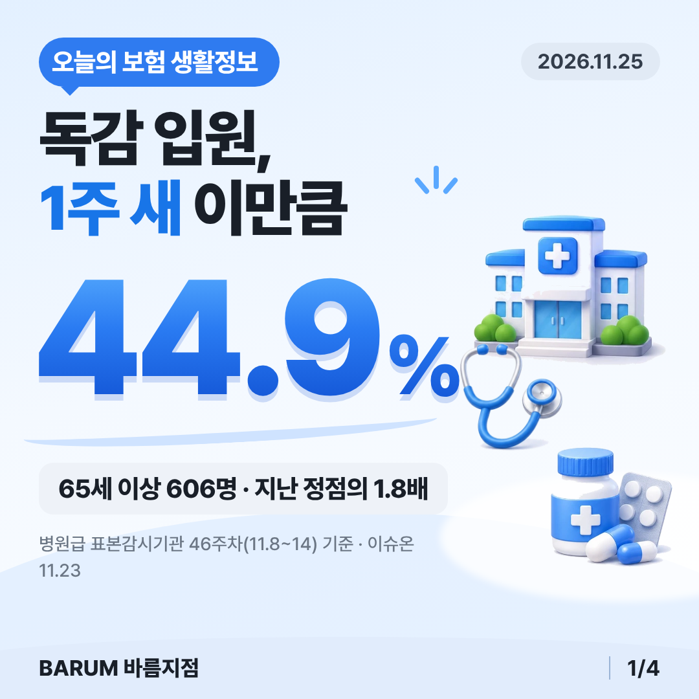
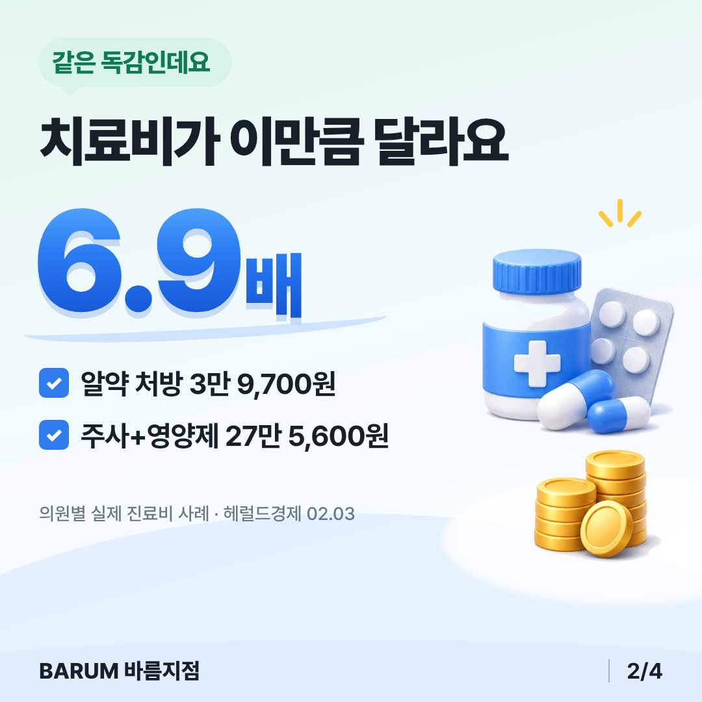
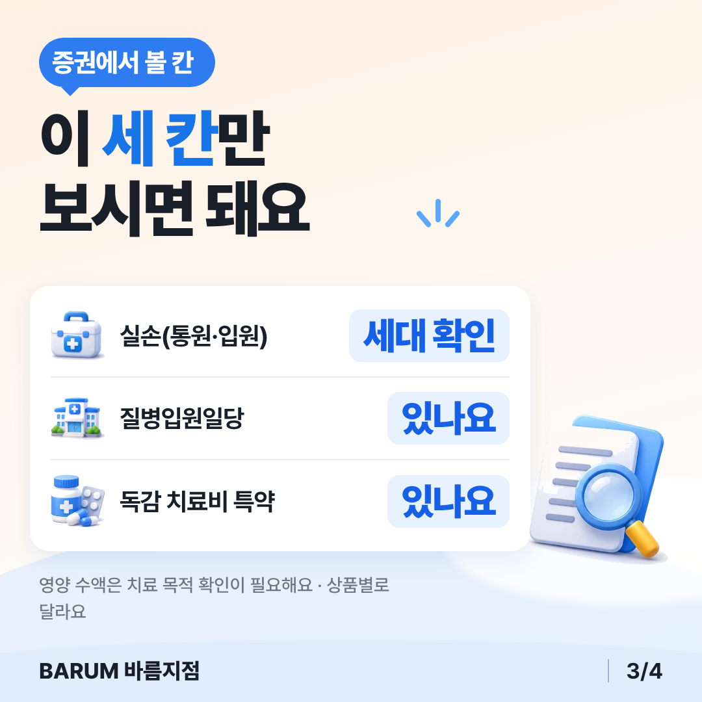
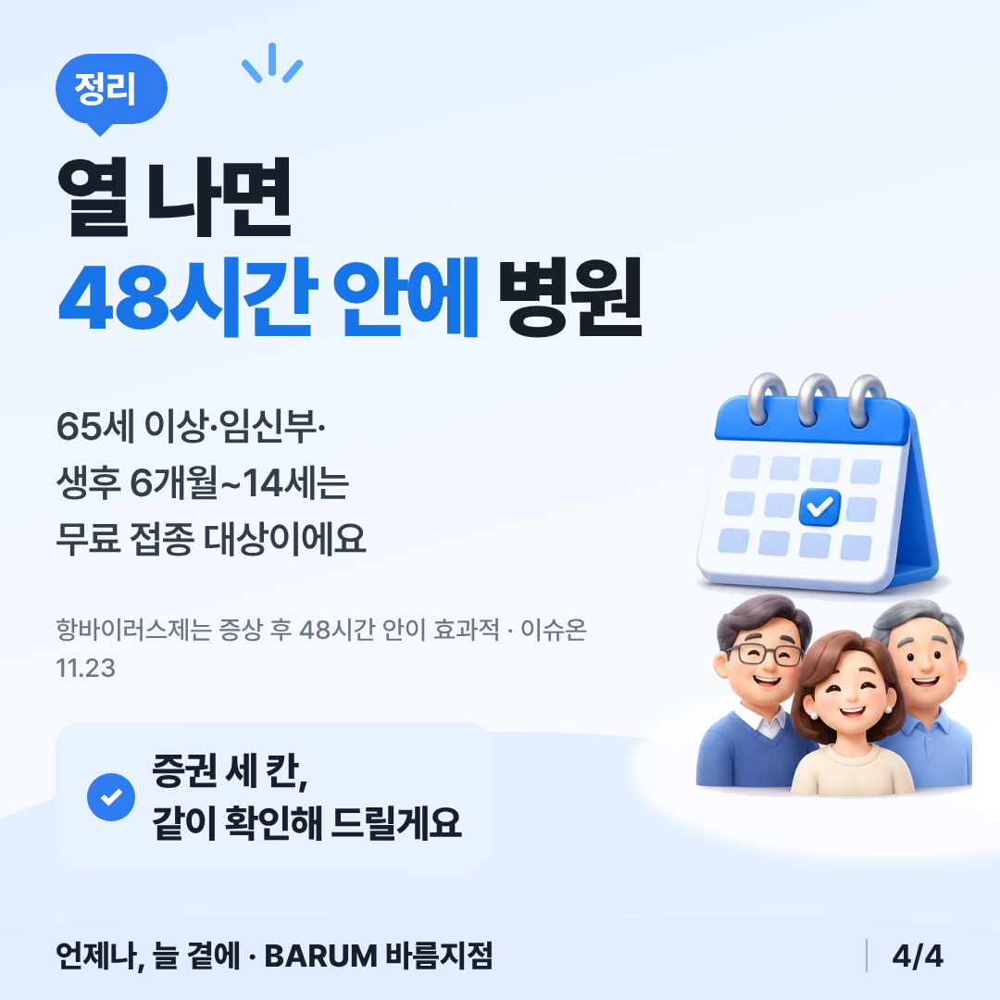

# 2026-11-25 블로그·인스타 초안 — 독감 입원 급증, 증권 세 칸

## 카드뉴스 (정사각형 1080×1080 · 고객 공유용)






카드 묶음 받기: https://raw.githubusercontent.com/bokkile83-ui/barum-news/main/blog/cards/2026-11-25-flu_카드.zip

## 제목 후보

1. 독감 입원 1주 새 44.9%↑ — 열 나면 48시간, 그다음은 증권 세 칸
2. 같은 독감인데 치료비 6.9배 차이, 수액 맞기 전에 알아 둘 것
3. 올겨울 독감, 병원비보다 먼저 볼 증권 세 칸

## 본문 뼈대

### 도입
올해 독감은 빨리 왔어요. 질병관리청이 9월 11일에 유행주의보를 냈는데, 지난해보다 36일 이른 거예요.
11월 둘째 주(46주차) 병원급 표본감시기관의 독감 입원환자는 926명. 한 주 전 639명보다 44.9% 늘었어요.
이 가운데 65세 이상이 606명(65.4%)으로, 지난 절기 가장 많던 때(329명)의 약 1.8배예요.
※ 표본감시 수치라 전국 전체 환자 수는 아니에요.

### 핵심 1 — 열 나면 48시간 안에 병원부터
- 항바이러스제는 증상이 생기고 48시간 안에 쓰는 게 가장 효과적이라고 알려져 있어요.
- 유행주의보 기간에는 소아·임신부·65세 이상 등 고위험군이 의사 판단으로 항바이러스제를 처방받으면 검사 없이도 건강보험이 적용돼요.
- 국가 무료 접종 대상: 65세 이상, 임신부, 생후 6개월~14세 어린이. 11월 19일 기준 65세 이상 접종률은 74.8%예요. 아직이면 지정 의료기관·보건소에서 맞으시면 돼요.

### 핵심 2 — 같은 독감, 치료비는 6.9배까지 차이
- 보도된 사례에서 알약(타미플루 등) 처방은 검사비 포함 3만 9,700원, 독감 주사에 영양제까지 맞은 경우는 27만 5,600원이었어요.
- 4개 주요 손보사가 2025년 한 해 낸 독감 관련 비급여 주사 보험금은 1,253억 원. 2022년 38억 원에서 3년 만에 약 33배예요.
- 생활 비유: 감기약으로 충분한데 「빨리 낫는다」는 말에 영양 수액을 얹는 건, 동네 마트 가는데 택시를 부르는 것과 비슷해요. 갈 수는 있지만 요금은 결국 누군가 내요.
- 영양 수액은 치료 목적인지 확인이 필요하고, 보상 범위는 실손 세대·상품별로 달라요. 이런 청구가 쌓이면 실손 보험료 인상으로 돌아와요(실손 위험손해율 119.3%, 2025년 3분기).

### 핵심 3 — 증권에서 이 세 칸만 보세요
1. **실손(통원·입원)** — 몇 세대인지. 세대마다 자기부담·통원 한도가 달라요.
2. **질병입원일당** — 입원하면 하루 얼마인지, 며칠까지인지. 상품별로 달라요.
3. **독감(인플루엔자) 치료비 특약** — 있는지 없는지부터. 있는 상품도, 없는 상품도 있어요.
→ 지급 여부는 약관과 진료 내용에 따라 정해지니, 청구 전에 영수증·세부내역서를 챙겨 두세요.

### 정리
열 나면 48시간 안에 병원, 접종 대상이면 접종부터. 그다음 증권에서 실손 세대·질병입원일당·독감 치료비 특약 세 칸만 보시면 돼요.
{{지점 사례}}

### 상담 안내 한 줄
증권만 보내 주시면 세 칸, 같이 확인해 드릴게요. — BARUM 바름지점

## 릴스 대본

### 훅 3개 (서로 다른 공식)
| # | 공식 | 말할 줄 | 화면 글자(6단어 이내) |
|---|---|---|---|
| A | #23 The Statistic | 독감 입원, 일주일 만에 44.9% 늘었어요. | 독감 입원 1주 새 +44.9% |
| B | #3 Nobody Tells You | 같은 독감인데 치료비가 6.9배 차이 나요. 이건 잘 안 알려 줘요. | 같은 독감, 치료비 6.9배 |
| C | #10 If This, Then Watch | 열이 나기 시작했다면, 48시간만 기억하세요. | 열 나면 48시간 |

**고른 훅: A** — 질병관리청 최신 수치라 「지금 내 얘기」로 들리고, 첫 화면 숫자 하나로 읽혀요. B·C는 본문 박자로 씁니다.

### 대본 (약 32초 · 약 150자)
```
0:00  독감 입원, 일주일 만에 44.9% 늘었어요.
0:04  65세 이상은 지난겨울 정점의 1.8배예요.
0:09  열 나면 48시간 안에 병원부터 가세요.
0:13  같은 독감도 알약은 3만 9천 원,
      주사에 영양제면 27만 원이 넘었어요.
0:21  증권에선 세 칸만 보세요.
      실손 세대, 질병입원일당, 독감 치료비 특약.
0:29  댓글에 '독감' 남겨 주시면 같이 확인해 드릴게요.
```
(마지막 말 「독감」이 훅 첫 단어와 같아 다시 볼 때 자연스럽게 이어져요.)

### 화면 글자 카드 (1080×1920 · 위 230px·아래 480px·오른쪽 230px 비움 → 가운데 안전 영역)
| 시간 | 화면 글자 | 장면 바꿈 |
|---|---|---|
| 0:00 | 독감 입원 1주 새 +44.9% | 손으로 체온계 드는 장면(첫 프레임부터 움직임) |
| 0:04 | 65세 이상 1.8배 | 어르신 일러스트·그래프 |
| 0:09 | 열 나면 48시간 | 시계·달력 |
| 0:13 | 알약 3만 9천 원 | 약봉지 |
| 0:17 | 주사+영양제 27만 원↑ | 수액 걸이 |
| 0:21 | 증권 세 칸만 | 증권 펼치는 손 |
| 0:24 | 실손 세대 · 입원일당 · 독감 특약 | 세 칸에 형광펜 |
| 0:29 | 댓글에 '독감' | 말하는 얼굴 |

본문은 자막을 화면에 넣어 소리 없이도 읽히게 합니다.

**요청 하나:** 댓글 단어 「독감」.

### SKILL.md 기준 점검 (ig-reel)
- 통과: 훅 2초 안 · 한 영상 한 주제(독감 때 증권 볼 곳) · 박자마다 장면 바뀜 · 숫자 전부 출처 있음 · 인사·이름 없이 바로 시작 · 요청 1개 · 루프 단어 있음.
- 고칠 점: 0:13~0:21 박자가 약 8초라 길어요 → 알약/주사 두 장면으로 나눠 찍기(위 표처럼 0:13·0:17 두 카드). 「27만 원이 넘었어요」는 보도된 한 의원 사례라 화면에 「사례」 작게 붙이면 더 안전해요.

## 캡션

```
독감 입원이 일주일 새 44.9% 늘었어요. 열 나면 48시간 안에 병원, 그다음은 증권 세 칸만 보시면 돼요.

65세 이상 입원은 606명으로 지난겨울 정점의 1.8배예요(질병관리청 46주차 표본감시).
65세 이상·임신부·생후 6개월~14세는 무료 접종 대상이에요.

같은 독감도 알약 처방은 3만 9,700원, 주사에 영양제까지는 27만 5,600원이었어요.
독감 수액 실손 청구는 치료 목적 확인이 필요하고, 실손 세대·상품별로 달라요.

증권에서 볼 칸은 실손 세대, 질병입원일당, 독감 치료비 특약 세 가지예요.

댓글에 '독감' 남겨 주시면 세 칸, 같이 확인해 드릴게요 🙂

#독감 #독감실비 #실손보험 #질병입원일당 #보장분석
```
검색어(본문 문장 안): 독감 입원 · 독감 수액 실손 · 질병입원일당

### SKILL.md 기준 점검 (ig-caption)
- 통과: 영상이 훅을 맡으니 Job A(요청·맥락·검색어) · 첫 줄 약 58자로 125자 안에서 끊김 없음 · 첫 글자 이모지·해시태그 아님 · 요청 1개(댓글 '독감', 띄어쓰기 없는 한 단어, 영상에서도 말함) · 해시태그 5개 · 링크 없음 · 이모지 1개.
- 고칠 점: 없음.

## 스토리

```
STORIES · 수요일 · 5장
1 [체온계 든 손, 셀카]        「요즘 주변에 독감 많죠?」
2 [카드뉴스 1장 캡처]          「입원이 일주일 새 44.9% 늘었대요」
3 [약봉지 vs 수액 사진 나란히]  「같은 독감인데 치료비가 이렇게 달라요」
4 [퀴즈 스티커]               「같은 독감, 치료비 차이 최대 몇 배였을까요?」 ① 2배 ② 4배 ③ 6.9배
5 [증권 펼친 손]              「정답 6.9배. 증권 세 칸 궁금하면 답장 주세요」
답한 분에게는 한 분씩 답장(먼저 말 건 분에게만).
```
글자는 1080×1920 기준 위 250px·아래 320px 안쪽에.

### SKILL.md 기준 점검 (ig-story)
- 통과: 1장에 손·얼굴 · 한 장 한 생각 · 스티커는 4번째 한 개(퀴즈 — 흔한 오해 「독감 치료비는 다 비슷」을 깨는 용도) · 「당신」 한 사람에게 말하기 · 피드 재게시는 설명 붙임.
- 고칠 점: 없음.

## AI 티 점검 (ig-human 기준)
- 걸러 낸 것: 「~할 수 있습니다」류 딱딱한 말 → 해요체, 「핵심은」「결론적으로」 같은 정리 말투 삭제, 느낌표·과한 기호 없음, 이모지는 캡션 1개.
- 3개 나열(세 칸)은 실제 증권 칸 수라 남김. 「무려」「최고」 같은 과장 말 없음.
- 결과: 통과.

## 출처

- [질병관리청 — 2026-2027절기 인플루엔자 유행주의보 발령(2026.09.11)](https://www.kdca.go.kr/bbs/kdca/41/312593/artclView.do)
- [이슈온 — 독감 입원환자 926명, 1주 새 44.9%↑…65세 이상 606명(2026.11.23)](https://www.issueon.co.kr/news/articleView.html?idxno=14461)
- [헤럴드경제 — "38억→1253억" 독감수액 보험금 급증(2026.02.03)](https://www.heraldk.com/article/2026020222373815029)

BARUM 바름지점
