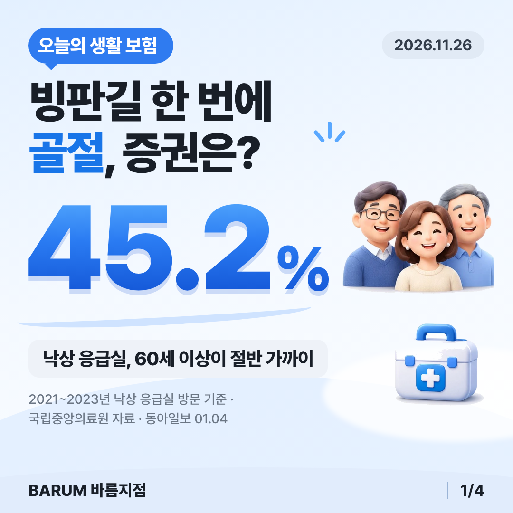
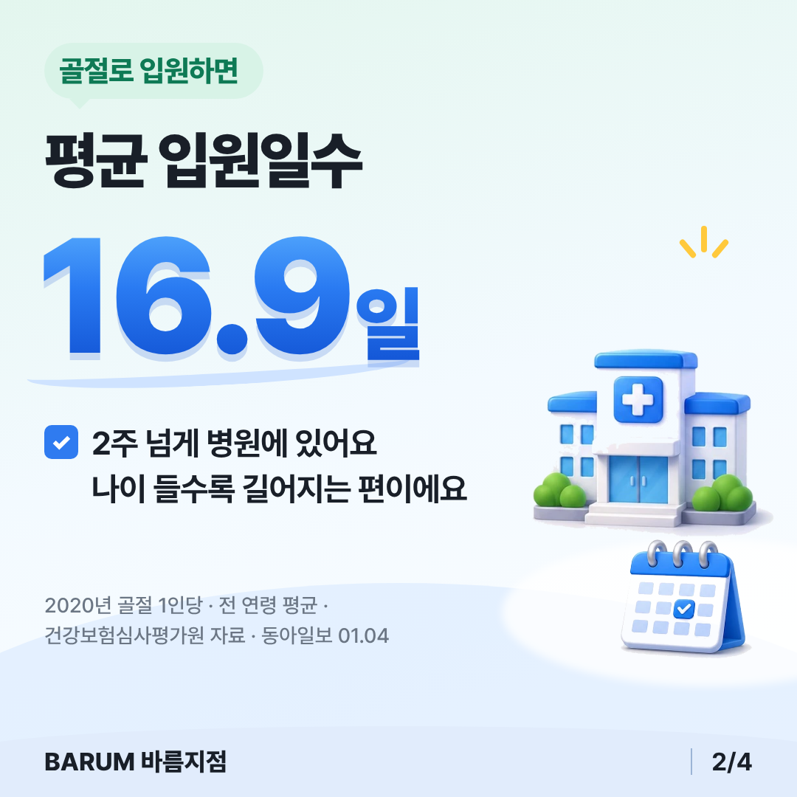
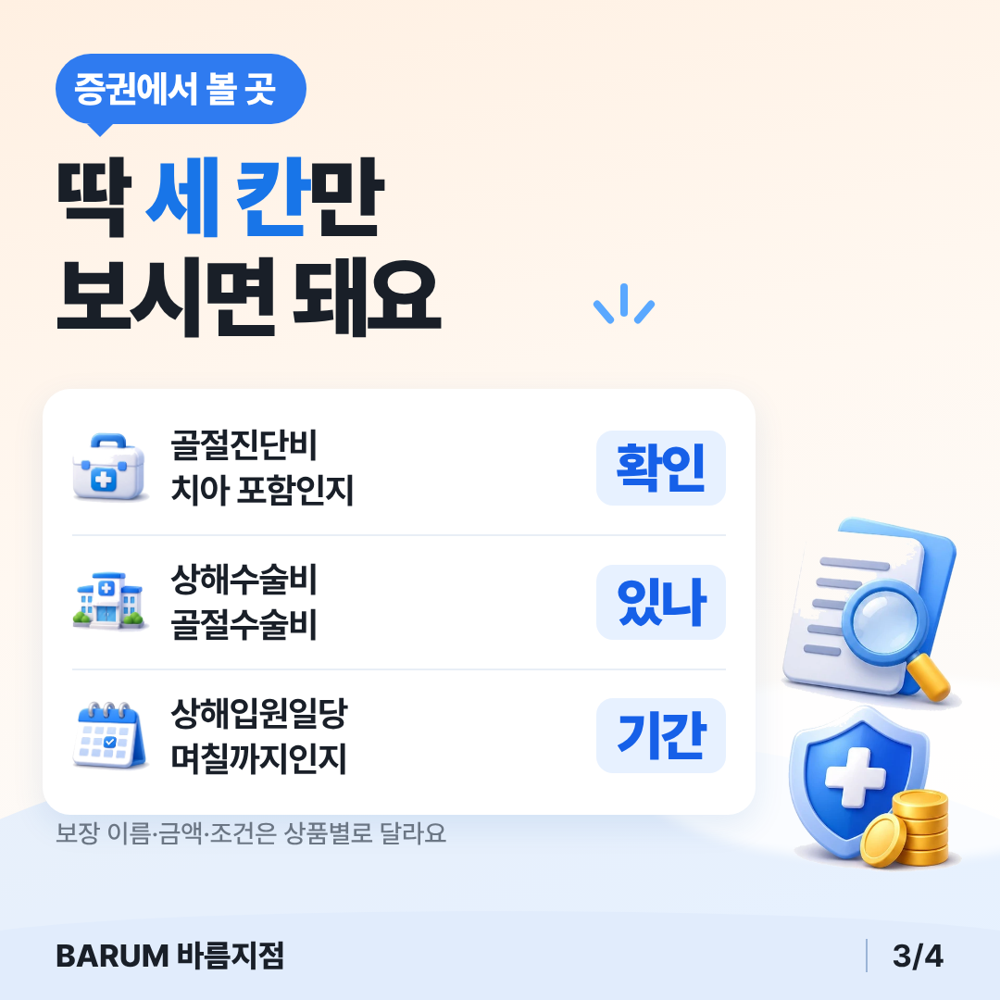
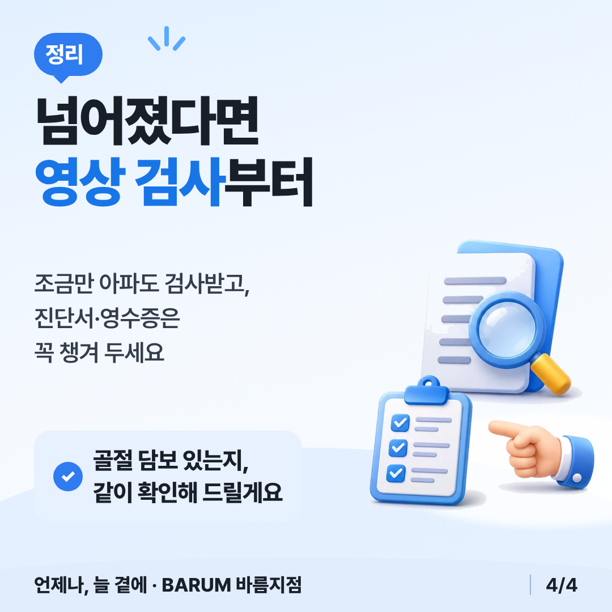

# 2026-11-26 블로그·인스타 초안 — 빙판길 낙상, 골절 증권 세 칸

## 카드뉴스 (정사각형 1080×1080 · 고객 공유용)






카드 묶음 받기: https://raw.githubusercontent.com/bokkile83-ui/barum-news/main/blog/cards/2026-11-26-fall_카드.zip

## 제목 후보

1. 빙판길 한 번에 골절, 넘어지기 전에 볼 증권 세 칸
2. 낙상 응급실 45.2%가 60세 이상 — 부모님 증권부터 열어 보세요
3. 골절 입원 평균 16.9일, 진단비·수술비·일당 칸 확인법

## 본문 뼈대

### 도입
곧 빙판길 계절이에요. 국립중앙의료원 응급의료 통계를 보면 2021~2023년 3년 동안 낙상으로 응급실을 찾은 약 86만 건 가운데 약 39만 건, 45.2%가 60세 이상이었어요(동아일보 2026.01.04 보도).
질병관리청 자료로는 65세 이상 낙상 입원 환자의 겨울철 입원율이 51.7%로, 다른 계절보다 10%포인트 넘게 높았다고 해요(같은 보도).
골절로 입원하면 1인당 평균 16.9일 병원에 있어요(건강보험심사평가원, 2020년 전 연령 평균). 2주가 넘는 시간이에요.
※ 부산·창원은 눈이 드물어도 새벽 그늘진 길, 계단, 물기 많은 화장실에서 넘어지는 일이 많아요. 낙상은 밖에서만 생기지 않아요.

### 핵심 1 — 넘어졌다면 「괜찮겠지」 말고 검사부터
- 통증이 가벼워도 영상 검사를 받아 보는 게 안전하다고 전문가들은 말해요. 금이 간 걸 모르고 지내면 치료가 길어질 수 있어요.
- 머리를 부딪혔다면 더 조심해야 해요. 고혈압·당뇨가 있거나 혈액을 묽게 하는 약을 드시는 분은 특히요.
- 진단서·진료비 영수증·세부내역서는 그날 바로 챙겨 두세요. 나중에 청구할 때 다시 떼러 가는 수고가 줄어요.

### 핵심 2 — 골절 보장은 칸이 여러 개예요
- 생활 비유: 집에 불이 나면 「화재보험 하나」로 끝나는 게 아니라, 건물·가재도구·임시 숙소비가 따로 있는 것과 비슷해요. 골절도 진단비, 수술비, 입원일당이 각각 따로예요.
- 한 칸만 있고 나머지는 비어 있는 경우도 있어요. 어떤 칸이 있는지는 증권을 열어 봐야 알아요.
- 보장 이름·금액·조건은 상품별로 달라요.

### 핵심 3 — 증권에서 이 세 칸만 보세요
1. **골절진단비** — 있는지, 그리고 「치아파절 포함」인지 「제외」인지. 같은 골절진단비라도 이 한 줄로 범위가 달라요.
2. **상해수술비 · 골절수술비** — 뼈를 맞추거나 고정하는 수술을 받을 때 볼 칸이에요. 상해 1~5종 수술비처럼 종별로 금액이 나뉜 상품도 있어요.
3. **상해입원일당** — 입원 하루에 얼마, 며칠까지인지. 평균 입원이 16.9일이니 「며칠까지」가 중요해요.
+ 실손은 몇 세대인지에 따라 자기부담이 달라요. 실손이 병원비를, 위 세 칸이 생활비 쪽을 맡는다고 보시면 돼요.

### 정리
겨울 낙상은 예방이 먼저예요. 보폭은 평소보다 10~20% 줄이고, 주머니에 손 넣지 말고 걸으세요. 그리고 넘어지기 전에 부모님 증권에서 세 칸만 같이 봐 두세요.
{{지점 사례}}

### 상담 안내 한 줄
증권만 보내 주시면 골절 담보가 어디까지 되어 있는지 같이 확인해 드릴게요. — BARUM 바름지점

## 릴스 대본

### 훅 3개
| # | 공식 | 말할 줄 | 화면 글자 |
|---|---|---|---|
| 1 | #23 The Statistic | 「낙상 응급실, 45%가 60세 이상이에요.」 | 낙상 응급실 45% |
| 2 | #3 Nobody Tells You | 「골절 칸은 넘어지고 나서야 다들 찾아요.」 | 골절 칸, 보셨어요? |
| 3 | #19 The Deadline | 「빙판길 오기 전에 증권 세 칸만 보세요.」 | 빙판 전에 세 칸 |

**고른 훅: #1** — 출처 있는 숫자가 첫 줄에 바로 나오고, 「60세 이상」이 30~50대에게는 「우리 부모님」 이야기로 꽂혀요.

### 대본 (약 32초 · 약 145글자)
```
[0:00-0:03] 낙상 응급실, 45%가 60세 이상이에요.
[0:03-0:07] 골절로 입원하면 평균 16.9일 병원에 있어요.
[0:07-0:10] 그런데 증권은 넘어진 뒤에야 열어 보시죠.
[0:10-0:14] 세 칸만 보세요. 하나, 골절진단비.
[0:14-0:18] 치아 포함인지, 제외인지 상품마다 달라요.
[0:18-0:21] 둘, 상해수술비나 골절수술비.
[0:21-0:24] 셋, 상해입원일당. 며칠까지인지요.
[0:24-0:28] 넘어지면 조금 아파도 검사부터, 영수증은 챙기시고요.
[0:28-0:32] 부모님 증권, 댓글에 「골절」 남겨 주시면 같이 확인해 드릴게요.
```
- 마지막 줄의 「부모님」·「골절」이 첫 장면 「60세 이상」·「낙상」과 이어져 다시 볼 때 자연스럽게 붙어요.

### 화면 글자 카드 (1080×1920 · y 230~1440 가운데 · 오른쪽 230px 비움)
| 시간 | 화면 글자 |
|---|---|
| 0:00 | 낙상 응급실 45% |
| 0:03 | 골절 입원 평균 16.9일 |
| 0:07 | 증권, 언제 여세요? |
| 0:10 | ① 골절진단비 |
| 0:14 | 치아 포함? 제외? |
| 0:18 | ② 상해·골절수술비 |
| 0:21 | ③ 입원일당 며칠까지 |
| 0:24 | 검사 먼저 · 영수증 |
| 0:28 | 댓글 「골절」 |
- 숫자 카드 아래 작은 글씨: 「2021~2023년 · 국립중앙의료원 자료 · 동아일보 01.04」 / 「2020년 전 연령 평균 · 심평원 자료」

### 마지막 요청
댓글 단어 「골절」 하나.

### 점검 (ig-reel SKILL.md 기준)
- 통과: 인사·자기소개 없이 숫자로 시작 / 한 영상 한 주제(골절 세 칸) / 숫자 2개 모두 출처 있음 / 요청 하나 / 화면 글자 6단어 이내.
- 고칠 점: 0:10~0:24 가 말로만 이어지면 지루해요 → 장면마다 증권 화면(가린 본) 확대 · 손가락 짚기로 화면을 바꿔 주세요. 0:24 줄은 4초라 빠듯해요, 말 속도가 느리면 「영수증은 챙기시고요」를 빼도 돼요.

## 캡션

```
부모님 증권에 골절 칸이 있는지 궁금하면 댓글에 「골절」 한 단어만 남겨 주세요.

낙상으로 응급실을 찾은 사람 가운데 45.2%가 60세 이상이었어요(2021~2023년, 국립중앙의료원 자료).
골절로 입원하면 평균 16.9일 병원에 있고요(2020년 전 연령 평균, 심평원 자료).

골절 보험은 칸이 여러 개예요.
골절진단비(치아 포함·제외), 상해수술비·골절수술비, 상해입원일당.
보장 이름과 조건은 상품별로 달라요.

빙판길 오기 전에, 겨울 낙상 대비로 증권 세 칸만 같이 봐요.
같이 확인해 드릴게요. 🙂

#골절진단비 #낙상 #보장분석 #부산보험 #창원보험
```
- 할 일: A(영상이 훅을 맡음) — 첫 줄은 요청만, 125자 안에서 끊김 없음.
- 검색어: 「골절 보험」·「겨울 낙상」·「골절진단비」를 본문 문장 안에 넣었어요.
- 점검: 통과 — 링크 없음 · 요청 하나 · 해시태그 5개 · 이모지 1개. 고칠 점: 없음.

## 스토리

| 장 | 화면 | 말·글 | 스티커 |
|---|---|---|---|
| 1 | 아침 출근길, 그늘진 계단을 손으로 가리키는 장면 | 「여기, 아침엔 미끄러워요」 | — |
| 2 | 카드 1장(45.2%) 캡처 | 「낙상 응급실 45%가 60세 이상」 | — |
| 3 | 증권(가린 본)에서 골절진단비 칸을 손가락으로 짚음 | 「여기 한 줄로 범위가 달라져요」 | — |
| 4 | 글자 화면 | 「골절진단비, 치아 부러진 것도 될까요?」 | 퀴즈: 된다 / 안 된다 / 상품마다 달라요(정답) |
| 5 | 정답 화면 | 「정답은 상품마다 달라요. 증권 보내 주시면 같이 확인해 드릴게요」 | — |
- 퀴즈에 답한 분께는 한 분씩 「어느 쪽인지 같이 볼까요?」로 답장해요(먼저 반응한 분에게만).
- 글자는 y 250~1600 안에. 첫 장에 손이 나와요.

## ig-human 점검 (AI 티 걸러 내기)
- 걸러 낸 것: 「~하는 것이 중요합니다」류 딱딱한 말 → 해요체로 / 「놓치지 마세요!」·「꿀팁」 같은 뻔한 말 없음 / 느낌표·이모지 남발 없음 / 줄표(—)는 블로그 제목 후보에만 남기고 대본·캡션에서는 뺐어요.
- 셋 나열(진단비·수술비·일당)은 실제 증권 칸이라 그대로 두었어요.
- 남은 고칠 점: {{지점 사례}} 자리는 실제 사례가 있을 때만 채워 주세요(없으면 줄째 지워요).

## 금지어·표현 점검
- 보험금 지급 확정 표현 없음 · 과장·가짜 마감 없음 · 「토스」 없음 · 개인 이름·고객 실명 없음 · 보험사 이름 없음.

## 출처
- [「살짝 미끄러진 것뿐인데」 뇌출혈…겨울철 노인 낙상 사고 주의 — 동아일보 2026.01.04](https://v.daum.net/v/20260104180141820) (국립중앙의료원 응급의료통계 45.2%·86만/39만 건, 질병관리청 겨울철 입원율 51.7%, 심평원 골절 평균 입원일수 16.9일, 예방 수칙)
- [빙판길 낙상사고 고령층 골절 위험 더 크다 — 공감신문 2026.10.06](https://www.gokorea.kr/news/articleView.html?idxno=880524) (영상 검사 권고, 미끄럼 방지 매트)
- [2025-2026절기 겨울철 한랭질환자 364명 — 질병관리청 2026.03.10](https://www.kdca.go.kr/bbs/kdca/42/310408/artclView.do) (참고: 겨울철 고령층 위험)
