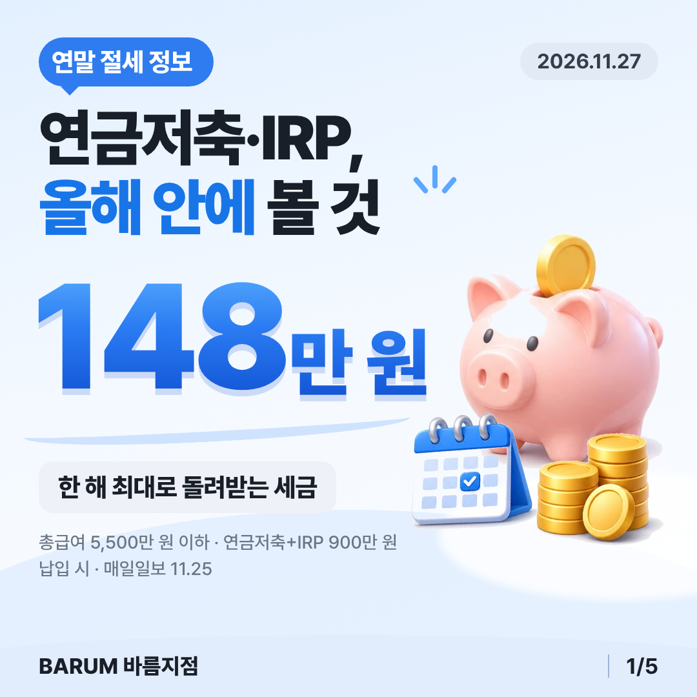
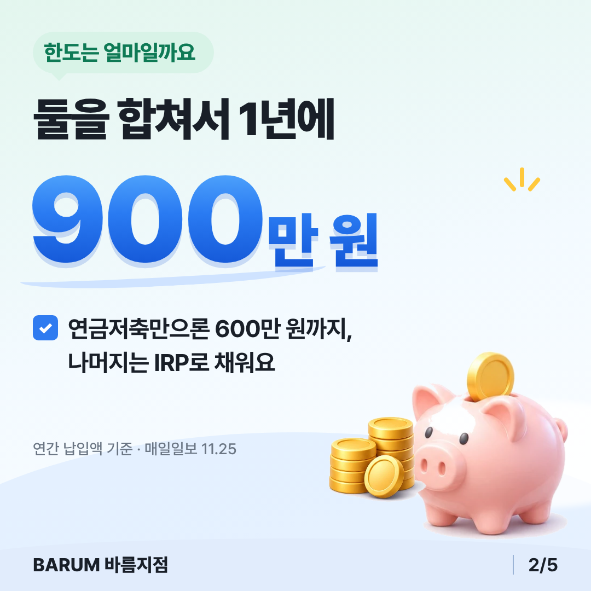
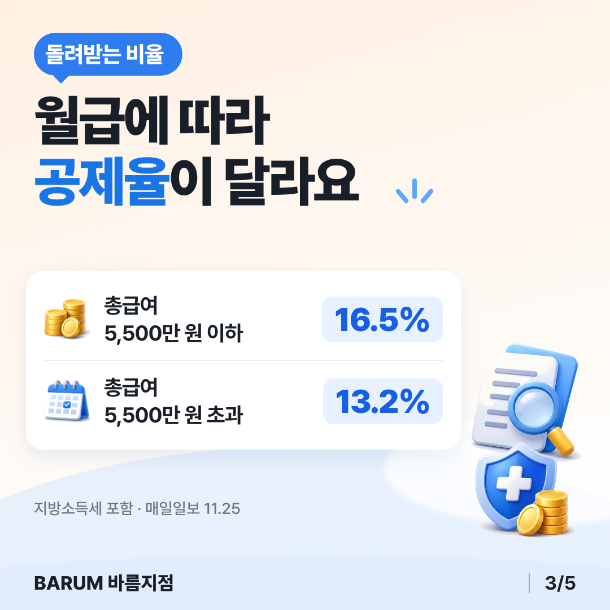
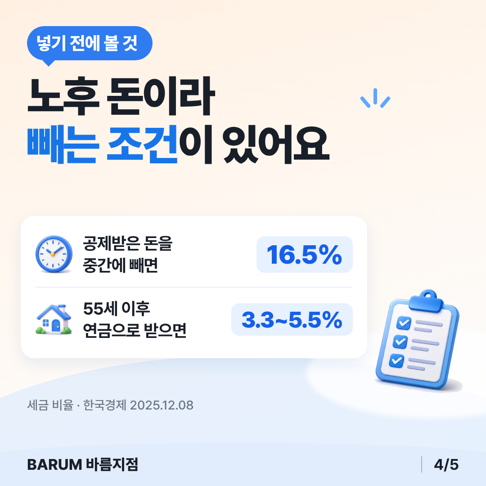
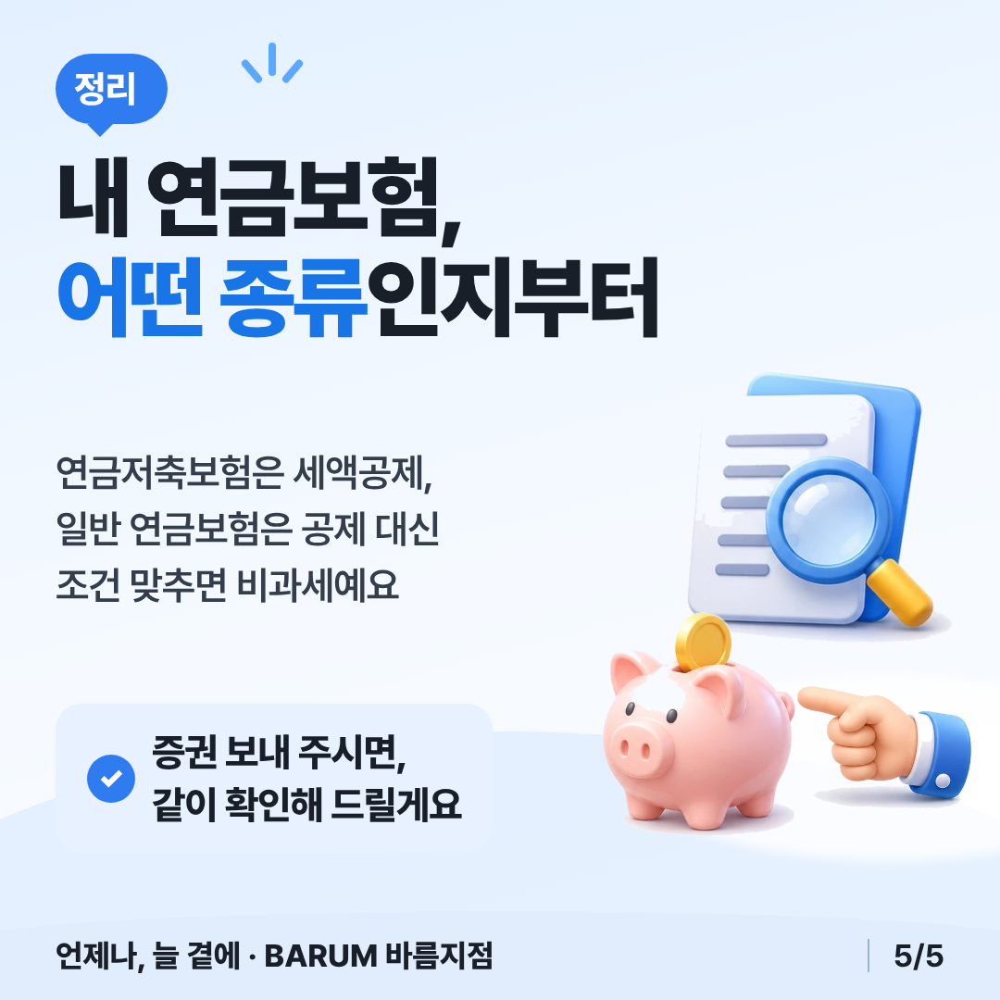

# 2026-11-27 블로그·인스타 초안 — 연금저축·IRP, 올해 안에 볼 것

## 카드뉴스 (정사각형 1080×1080 · 고객 공유용)







카드 묶음 받기: https://raw.githubusercontent.com/bokkile83-ui/barum-news/main/blog/cards/2026-11-27-pension_카드.zip

## 제목 후보

1. 연금저축·IRP, 올해 낸 돈만 올해 공제돼요 — 연말 전 볼 3가지
2. 최대 148만 5,000원 돌려받는 연금 세액공제, 넣기 전에 알아 둘 것
3. 내 연금보험은 세액공제일까 비과세일까 — 증권에서 이 칸부터

## 본문 뼈대

### 도입
11월 말이면 「연말정산 미리보기」를 열어 보는 분이 많아요. 국세청 홈택스 미리보기는 12월 18일까지 운영된다고 해요(매일일보 2026.11.25).
연금저축과 IRP(개인형 퇴직연금)는 1년 동안 넣은 돈을 기준으로 세금을 돌려줘요. 그래서 올해 공제는 올해 안에 넣은 돈만 계산돼요.
연말에는 계좌 개설·납입 처리가 몰려 늦어질 수 있어서, 12월 중순까지 마치는 게 안전하다는 조언도 있어요(같은 보도).
※ 이 글은 「꼭 넣으세요」가 아니에요. 넣은 돈은 오래 묶이는 노후 돈이라, 형편에 맞는지부터 보셔야 해요.

### 핵심 1 — 한도: 둘을 합쳐 1년에 900만 원
- 연금저축만으로는 600만 원까지 공제돼요.
- 연금저축과 IRP를 합치면 1년에 900만 원까지예요. IRP에만 900만 원을 넣어도 한도가 채워져요(매일일보 2026.11.25).
- 비유하면 「세금 돌려받는 바구니」가 900만 원짜리 하나고, 그 안에 연금저축 칸이 600만 원이라고 보시면 돼요.

### 핵심 2 — 돌려받는 비율: 월급에 따라 16.5% 또는 13.2%
- 총급여 5,500만 원 이하: 16.5%(지방소득세 포함) → 900만 원을 다 넣으면 최대 148만 5,000원.
- 총급여 5,500만 원 초과: 13.2% → 최대 118만 8,000원(매일일보 2026.11.25 · 한국경제 2025.12.08).
- 종합소득만 있는 분은 기준이 달라요(종합소득 4,500만 원 기준, 한국경제 2025.12.08). 본인 기준은 홈택스 미리보기에서 확인하세요.

### 핵심 3 — 넣기 전에: 빼는 조건이 있어요
- 공제받은 돈을 중간에 빼면 기타소득세 16.5%를 내요. 돌려받은 만큼 다시 낸다고 보시면 돼요.
- 만 55세 이후 연금으로 받으면 연금소득세 3.3~5.5%를 내요.
- IRP는 사망·파산 같은 특별한 사유가 아니면 중간에 일부만 빼기 어렵고, 해지하면 전액이 원칙이에요(한국경제 2025.12.08).
- 그래서 「연말이니까 일단 많이」보다는, 몇 년 넣어도 생활에 지장 없는 금액인지가 먼저예요.

### 정리 — 내 연금보험, 어떤 종류인지부터
- 이미 「연금보험」에 가입해 계신 분이 많아요. 그런데 이름이 비슷해도 종류가 달라요.
- 「연금저축보험」은 이번 글의 세액공제 대상이에요(연금저축 한도 600만 원 안에서).
- 일반 「연금보험」은 세액공제 대상이 아니고, 대신 정해진 조건을 맞추면 이자에 세금을 안 내는 비과세 쪽이에요. 조건은 상품별로 달라요.
- 증권 첫 장 상품명에 「연금저축」이 들어가는지부터 보시면 돼요. 이름만으로 애매하면 가입한 곳에 「세액공제 되는 상품인지」 물어보시면 돼요. 어느 쪽인지에 따라 올해 더 넣을지, 따로 둘지가 달라져요.

### 상담 안내 한 줄
갖고 계신 연금보험이 공제되는 쪽인지 헷갈리시면, 증권만 보내 주세요. 같이 확인해 드릴게요. — BARUM 바름지점

---

## 릴스 대본

### 훅 3개
| # | 공식(hooks.json) | 말할 줄 | 화면 글자(6단어 이내) |
|---|---|---|---|
| 1 | #3 Nobody Tells You | 「연금보험이라고 다 세금 돌려주는 거 아니에요.」 | 연금보험 ≠ 세액공제 |
| 2 | #19 The Deadline | 「올해 공제는 올해 넣은 돈만 쳐요. 12월 중순까진 끝내세요.」 | 올해 공제 = 올해 납입 |
| 3 | #23 The Statistic | 「900만 원 넣으면 최대 148만 원 돌려받아요. 조건이 있어요.」 | 900만 → 최대 148만 |

**고른 훅: 1번** — 연금보험을 이미 가진 사람이 많아 「내 얘기」로 바로 걸리고, 2번처럼 마감을 앞세우면 급하게 넣으라는 말로 읽힐 수 있어서예요. 숫자는 본문에서 받쳐 줘요.

### 대본 (약 30초 · 약 140글자)
```
[0:00] 연금보험이라고 다 세금 돌려주는 거 아니에요.
[0:03] 세액공제는 「연금저축」하고 IRP만 돼요.
[0:07] 둘을 합쳐서 1년에 900만 원까지예요.
[0:11] 월급 5,500만 원 이하면 16.5%, 최대 148만 원 정도 돌려받아요.
[0:17] 대신 중간에 빼면 16.5%를 다시 내요.
[0:21] 그러니까 연말이라고 무리해서 넣지 마시고요.
[0:24] 내 연금보험이 어느 쪽인지부터 보세요.
[0:27] 헷갈리면 댓글에 「연금」 남겨 주세요. 연금보험, 같이 확인해 드릴게요.
```

### 화면 글자 카드 (1080×1920 · y 230~1440 가운데 · 오른쪽 230px 비움)
| 시간 | 화면 글자 |
|---|---|
| 0:00–0:03 | 연금보험 ≠ 세액공제 |
| 0:03–0:07 | 연금저축 · IRP만 |
| 0:07–0:11 | 합쳐서 1년 900만 |
| 0:11–0:17 | 최대 148만 원 (총급여 5,500만↓) |
| 0:17–0:21 | 중간에 빼면 16.5% |
| 0:21–0:24 | 무리해서 넣지 마세요 |
| 0:24–0:27 | 내 증권부터 확인 |
| 0:27–0:30 | 댓글 「연금」 |

(작은 글씨 출처 줄: 매일일보 2026.11.25 · 한국경제 2025.12.08)

### 마지막 요청
댓글에 「연금」 한 단어 — 하나만.

### 점검 (ig-reel SKILL.md 기준)
- 통과: 훅 3초 이내, 첫 화면부터 훅 글자. 한 영상 한 생각(「연금보험이 다 공제는 아니다」). 숫자 4개 모두 출처 있음. 인사·이름·로고 없음. 마지막 줄이 훅의 「연금보험」을 다시 불러 반복 재생이 자연스러움.
- 고칠 점: 0:11 줄이 6초로 길어요 — 찍을 때 「16.5%」와 「148만 원」을 화면 두 장으로 나누면 장면이 4초 안쪽으로 바뀌어요. 0:21 「무리해서 넣지 마시고요」는 판매 압박을 빼려고 일부러 넣은 줄이라 유지해요.

## 캡션

**캡션 종류: A(릴스가 훅을 이미 가짐)** — 첫 줄은 요청과 맥락으로.

```
연금보험 갖고 계시면, 세액공제 되는 쪽인지 먼저 확인해 보세요.

세액공제는 「연금저축」과 IRP만 돼요. 둘을 합쳐 1년에 900만 원까지예요.
총급여 5,500만 원 이하면 16.5%, 넘으면 13.2%를 돌려받아요.

다만 공제받은 돈을 중간에 빼면 16.5%를 다시 내요.
IRP는 특별한 사유가 아니면 중간에 빼기도 어려워요.
그래서 연말정산 때문에 무리해서 넣는 건 권하지 않아요.

일반 연금보험은 세액공제가 아니라 조건을 맞추면 비과세인 쪽이에요. 조건은 상품별로 달라요.

내 연금보험이 어느 쪽인지 헷갈리면 댓글에 「연금」 남겨 주세요. 같이 확인해 드릴게요.

출처: 매일일보 2026.11.25 · 한국경제 2025.12.08
BARUM 바름지점

#연금저축 #IRP #연말정산 #세액공제 #부산보험
```
- 첫 줄 41자(125자 안, 끊김 없음). 요청 하나(댓글 「연금」). 검색어 「연금저축」「IRP」「연말정산」이 본문 문장 안에 들어감. 해시태그 5개. 링크 없음. 이모지 0개.
- 점검: 통과. 고칠 점 없음 — 「돌려받아요」 앞에 「최대」를 붙이고 싶으면 둘째 문단 끝에 「최대 148만 5,000원」을 더해도 125자 컷과 무관해요.

## 스토리

| 장 | 화면 | 말/글 | 스티커 |
|---|---|---|---|
| 1 | 손으로 연금보험 증권 첫 장을 넘기는 장면(얼굴 대신 손) | 「이거 세금 돌려받는 연금일까요?」 | — |
| 2 | 증권 상품명 부분을 손가락으로 가리킴(개인정보 가림) | 「이름에 '연금저축'이 있어야 세액공제 쪽이에요」 | — |
| 3 | 글 카드 | 「합쳐서 1년 900만 원 · 총급여 5,500만 원 이하 16.5% (매일일보 11.25)」 | — |
| 4 | 글 카드 | 「내 연금보험, 어느 쪽인지 아세요?」 | **투표**: 「안다」 / 「모르겠다」 |
| 5 | 손으로 메모지에 「증권만 보내 주세요」 쓰는 장면 | 「모르겠다 누르신 분께 따로 연락드릴게요. 같이 확인해 드릴게요」 | — |

투표 뒤: 「모르겠다」 누른 분에게만 DM 답장(먼저 누른 분에게만). 글자는 y 250~1600 안쪽.

## ig-human 점검 (AI 티 걸러 내기)
- 긴 줄표(—)는 블로그 제목 후보·설명 줄에만 남기고, 고객이 그대로 읽는 캡션·대본·스토리에서는 뺐어요.
- 「~하는 것이 중요합니다」「다양한」「꼭 챙기세요!」 같은 뻔한 말 없음. 느낌표 0개.
- 셋을 늘어놓는 줄(삼단 나열) 없음. 「결과는?」 같은 혼자 묻고 답하기 없음.
- 문장 길이를 섞었어요(「무리해서 넣지 마시고요」 짧은 줄 + 숫자 줄).
- 판정: 통과.

## 금지어·표현 점검
- 보험금·환급 확정 표현 없음(「최대」「조건이 있어요」로만). 가입 권유·가짜 마감 없음 — 12월 중순은 보도에 나온 처리 지연 조언이고, 「무리해서 넣지 마세요」를 같이 적음.
- 「토스」 없음 · 개인 이름 없음 · 고객 사례 없음(지점 사례가 필요하면 {{지점 사례}}) · 보험사·증권사 이름 없음.

## 출처
- [매일일보 2026.11.25 — 「13월의 월급」 막차 잡아라… 연말 전 챙겨야 할 은행권 절세 전략은](https://www.m-i.kr/news/articleView.html?idxno=2023176)
- [매일일보 2026.11.25 — IRP 절세 혜택 받기 혜택은](https://www.m-i.kr/news/articleView.html?idxno=2023201)
- [한국경제 2025.12.08 — 연금저축 600만+IRP 300만원 납입…148만원 稅공제](https://www.hankyung.com/article/2025120786001)
