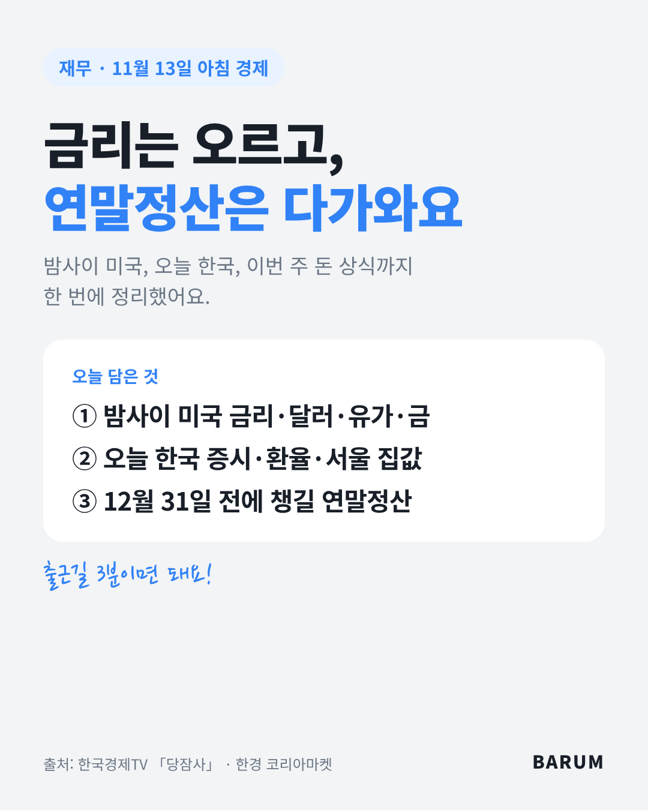
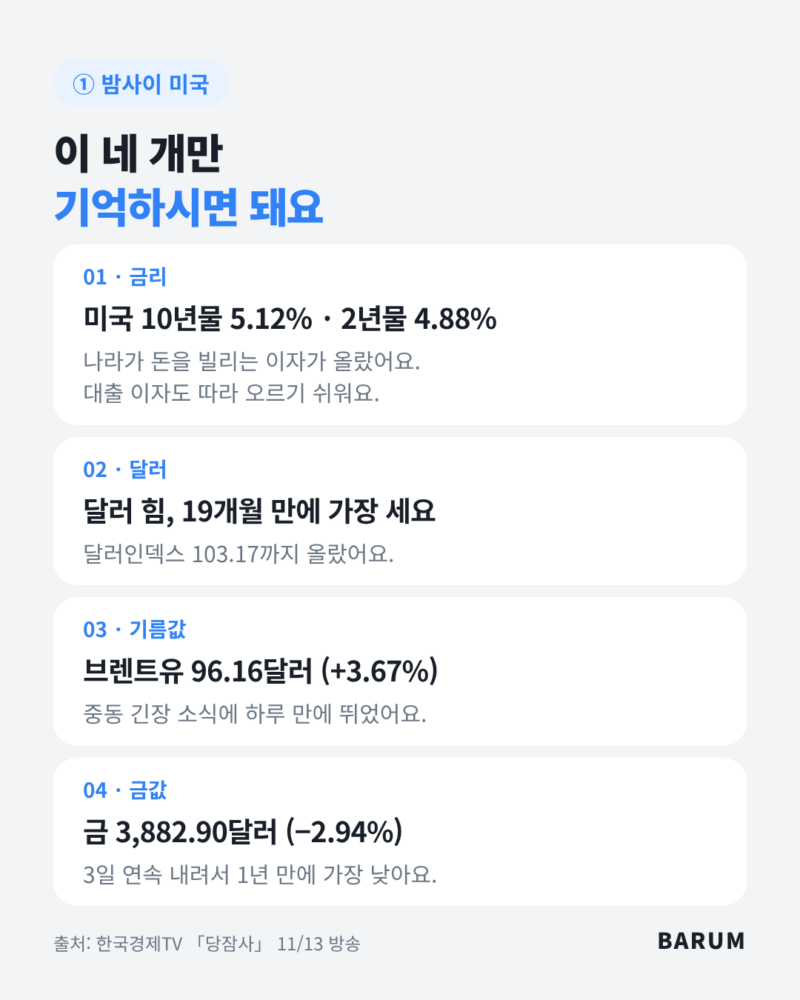
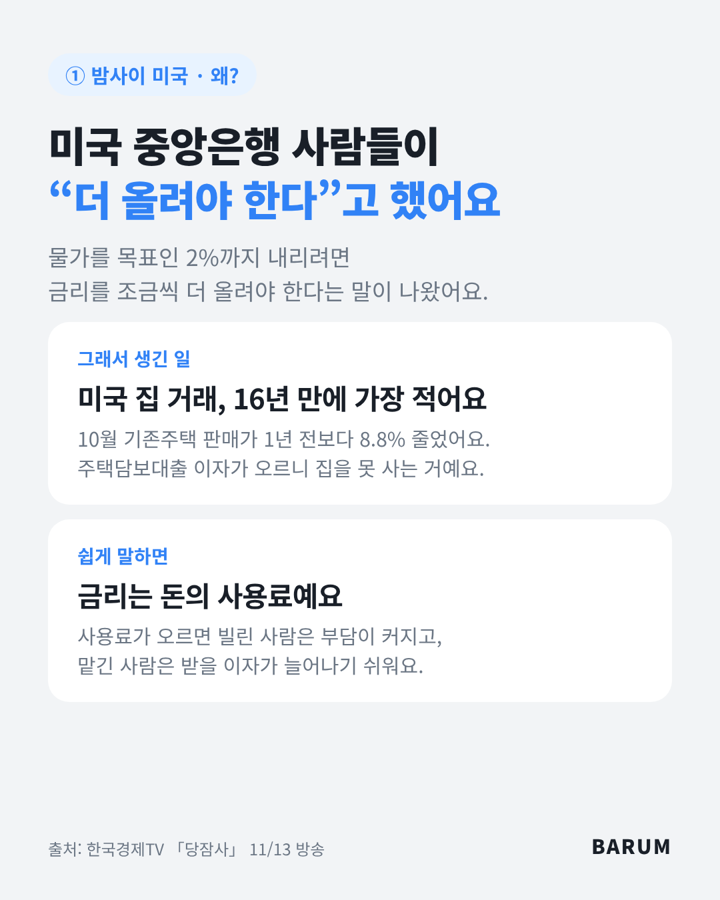
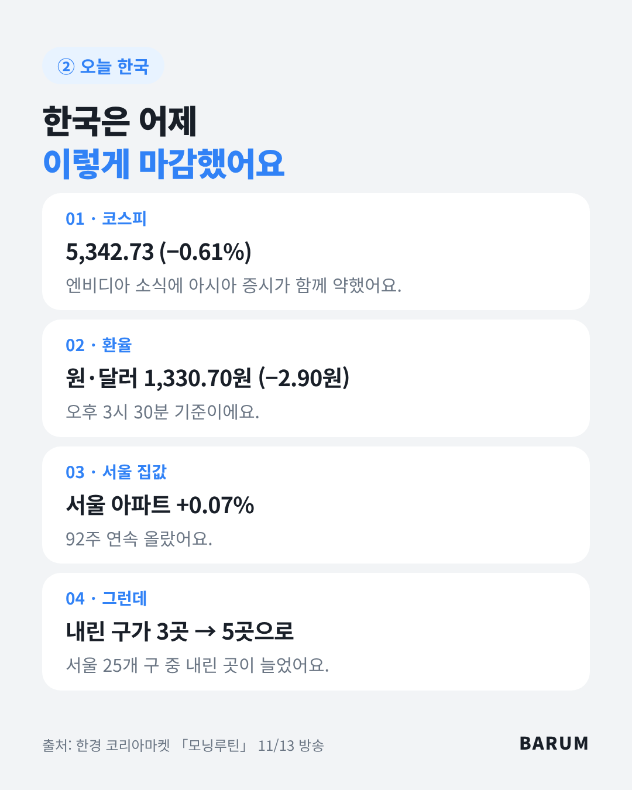
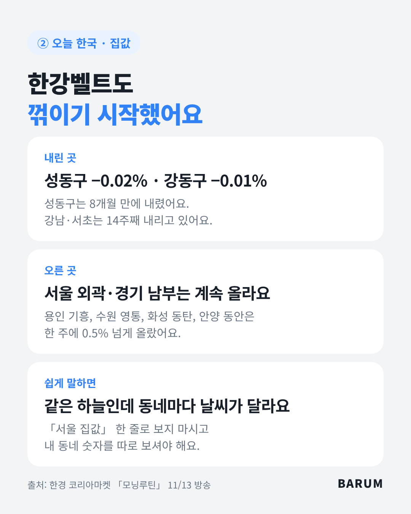
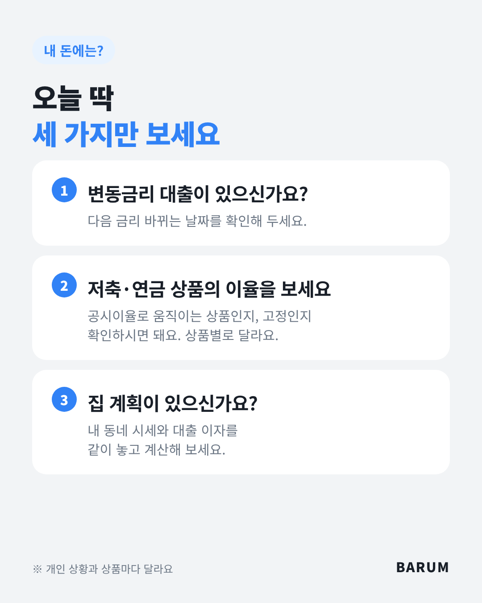
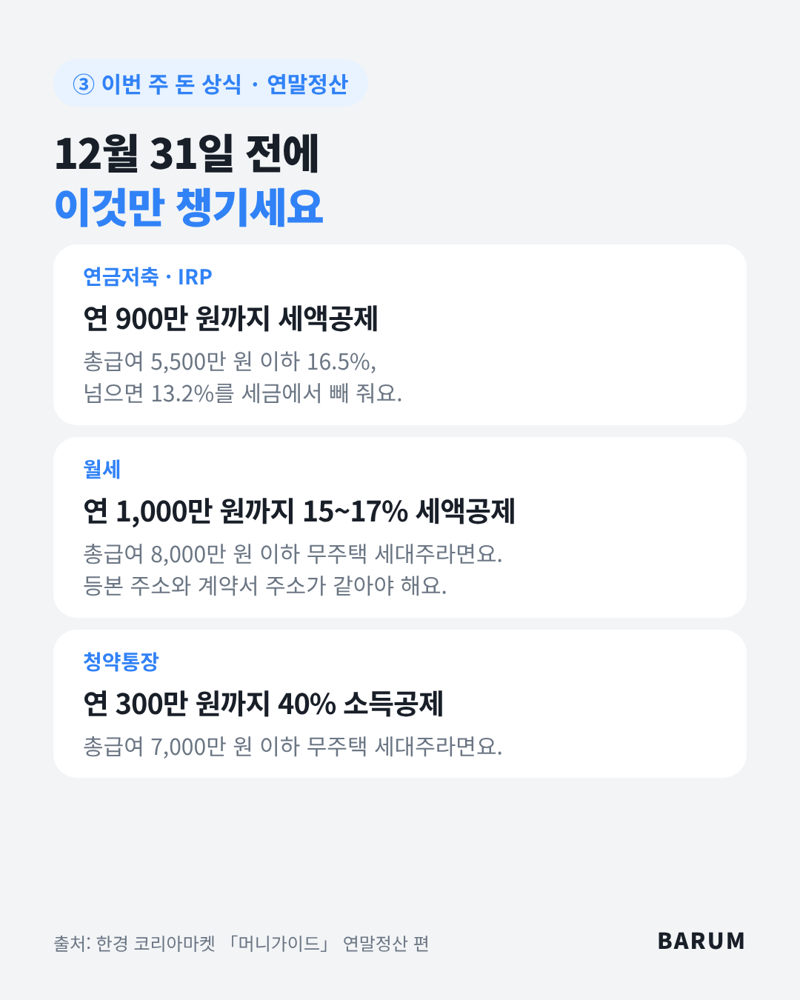
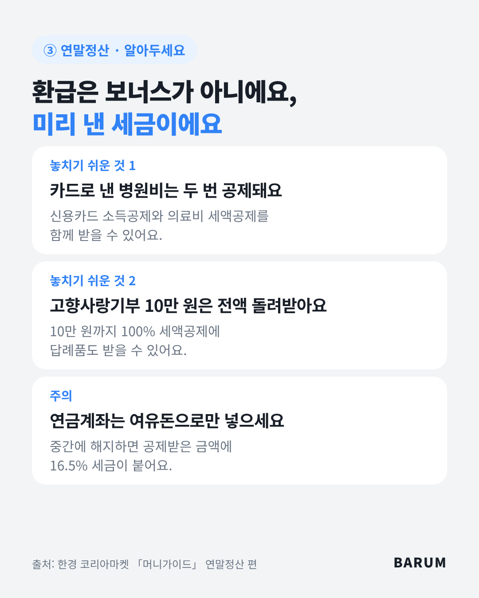
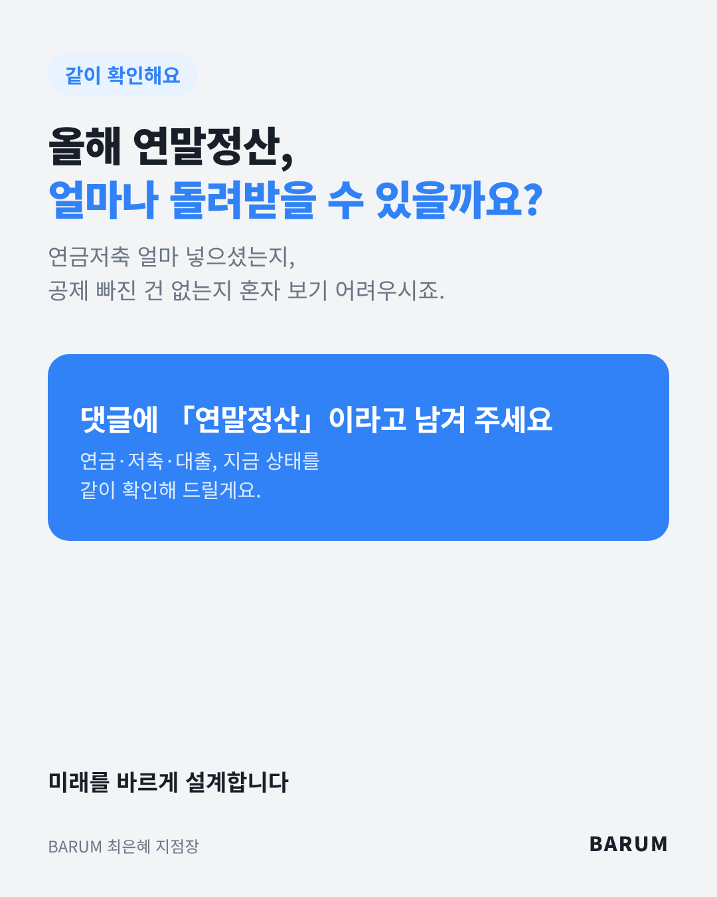

# 2026-11-14 재무 브리핑 (11/13 방송)

## 카드뉴스 (세로 1080×1350 · 고객 공유용)

카드 묶음 받기: https://raw.githubusercontent.com/bokkile83-ui/barum-news/main/fin/cards/2026-11-14-mix_카드.zip

## 밤사이 미국 (당잠사)
- 미국 10년물 국채금리 5.12%(하루 +0.134%p), 2년물 4.88%.
- 연준 인사들(해맥·데일리·굴스비)이 「물가 2%를 위해 추가 인상 필요」 발언.
- 달러인덱스 103.17, 19개월 만에 최고. 원·달러 1,335.50원.
- 브렌트유 96.16달러(+3.67%), WTI 89.04달러(+2.90%). 트럼프 「이란과 합의 필요 없어」 발언 영향.
- 금 3,882.90달러(−2.94%), 3일 연속 하락·1년 만에 최저.
- 미국 10월 기존주택 판매 전년 대비 −8.8%, 16년 만에 최저. 모기지 금리 상승 영향.
- 주간 신규 실업수당 청구 20만 건(예상 19.5만 건).

## 오늘 한국 (모닝루틴)
- 코스피 5,342.73(−0.61%), 코스닥 696.53(−1.22%). 엔비디아 젠슨 황 퇴진 여파.
- 원·달러 1,330.70원(−2.90원, 15시 30분 기준).
- 서울 아파트 +0.07%, 92주 연속 상승. 그런데 하락한 구가 3곳 → 5곳으로 늘었다.
- 성동구 −0.02%(8개월 만에 하락, 매물 1년 새 143% 증가), 강동구 −0.01%. 강남·서초 14주째, 송파 10주째 하락.
- 외곽·경기 남부(용인 기흥, 수원 영통, 화성 동탄, 안양 동안)는 한 주 0.5% 넘게 상승. 지역별로 갈라지는 장이다.

## 돈 상식 (머니가이드 · 연말정산)
- 연금저축·IRP: 연 900만 원까지 세액공제. 총급여 5,500만 원 이하 16.5%, 초과 13.2%. 중도해지 시 16.5% 기타소득세.
- 월세: 총급여 8,000만 원 이하 무주택 세대주, 연 1,000만 원 한도 15~17% 세액공제. 등본 주소와 계약서 주소가 같아야 한다.
- 청약통장: 총급여 7,000만 원 이하 무주택 세대주, 연 300만 원 한도 40% 소득공제.
- 카드로 낸 의료비는 신용카드 소득공제와 의료비 세액공제를 함께 받는다.
- 고향사랑기부 10만 원까지 100% 세액공제 + 답례품.
- 체크: 홈택스 「연말정산 미리보기」로 예상 환급액부터 본다.

## 설계사에게
- 결론: 금리는 더 오를 수 있고, 연말정산 시즌이 시작됐다. 오늘 상담 소재는 「연금저축·IRP 추가 납입」「변동금리 대출」「달러 상품 원화 환산」이다.
- 연금저축 고객: 올해 남은 한도를 확인해 준다. 여유자금 안에서만 권한다(중도해지 시 16.5% 과세).
- 대출 고객: 다음 금리 변경일을 확인하게 한다. 금리 방향은 단정하지 않는다.
- 달러보험 고객: 환율 1,330~1,335원대라는 것만 알려 준다. 환율 전망은 말하지 않는다.
- 국내 기준금리 이야기는 방송에 없었다. 국내 대출금리 숫자는 따로 확인 후 쓴다.

## 오늘 고객에게 한마디
> 「연말정산 마감이 다가와요. 연금저축이랑 IRP는 합쳐서 연 900만 원까지 세금을 돌려받을 수 있어요. 올해 얼마 넣으셨는지 같이 확인해 드릴게요.」

— BARUM 바름지점

## 출처
- [한국경제TV 「당잠사」 11/13 방송](https://www.youtube.com/watch?v=gNZjwF6oKcI)
- [한경 코리아마켓 「임현우의 모닝루틴」 20261113](https://www.youtube.com/watch?v=i6teOQHJcZc)
- [한경 코리아마켓 「머니가이드」 연말정산 편](https://www.youtube.com/watch?v=YVp1fL6A79Q)
- 숫자는 방송 화면·멘트 기준. 미국 10년물 금리는 모닝루틴에서 「5.21%까지」로 언급돼 당잠사 마감 화면(5.12%)을 썼다.
