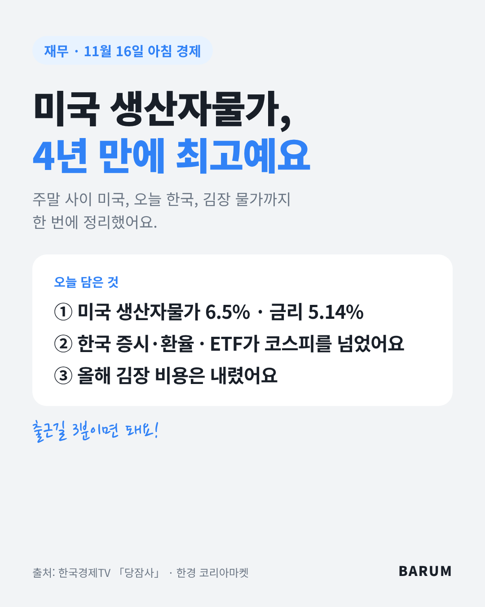
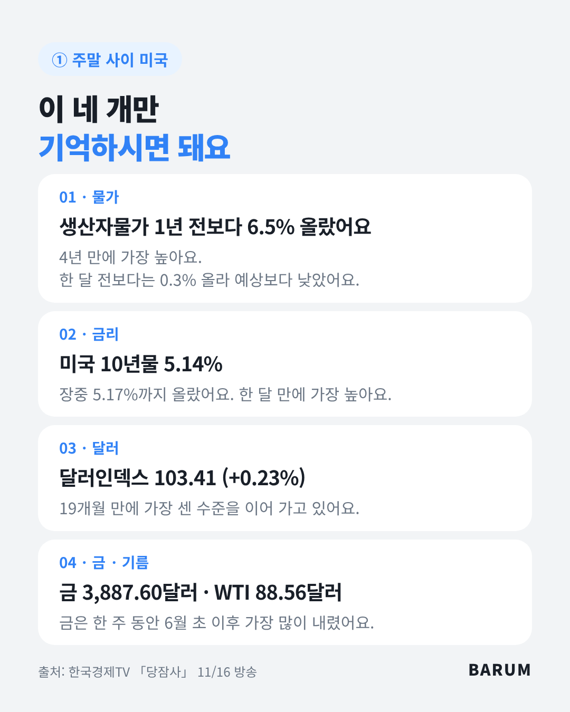
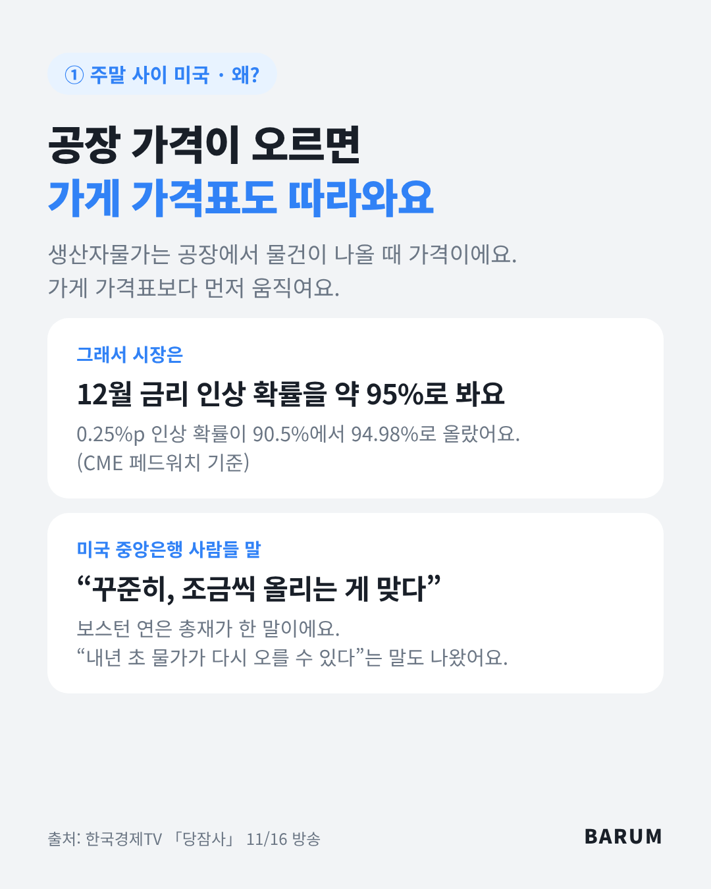
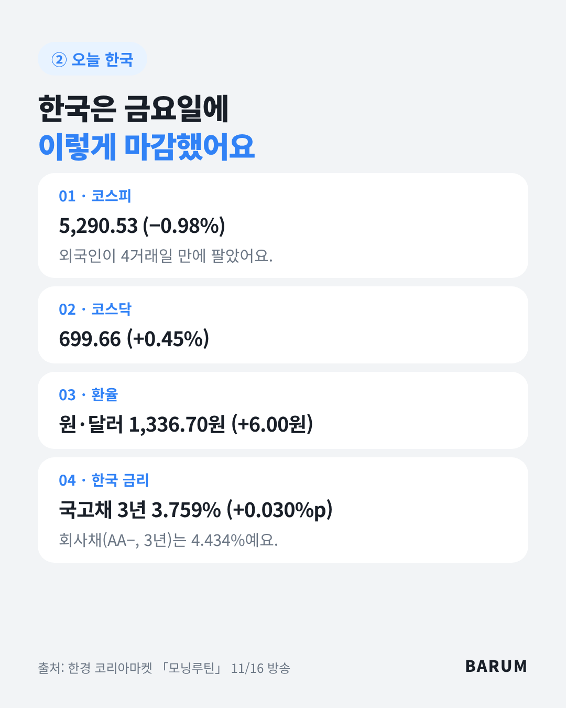
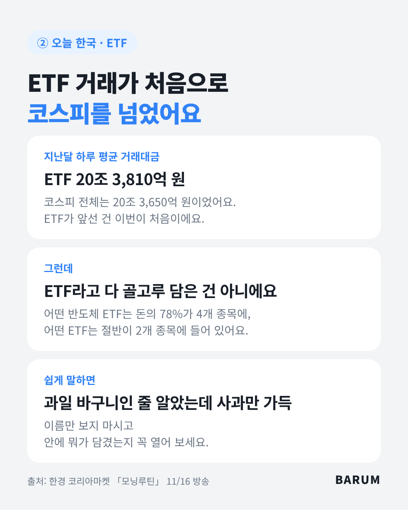
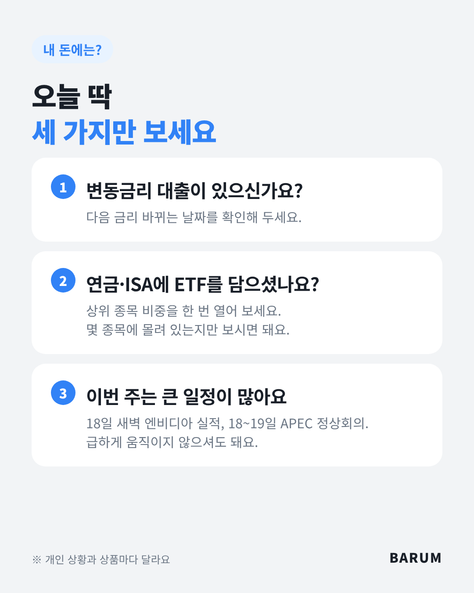
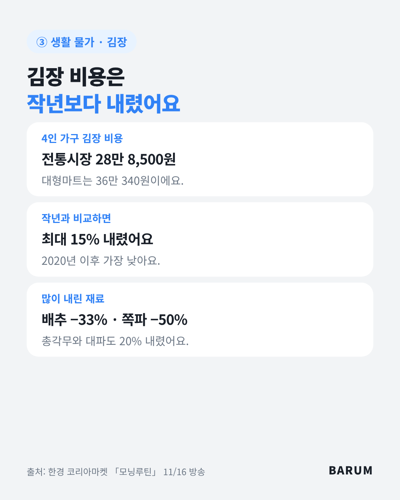
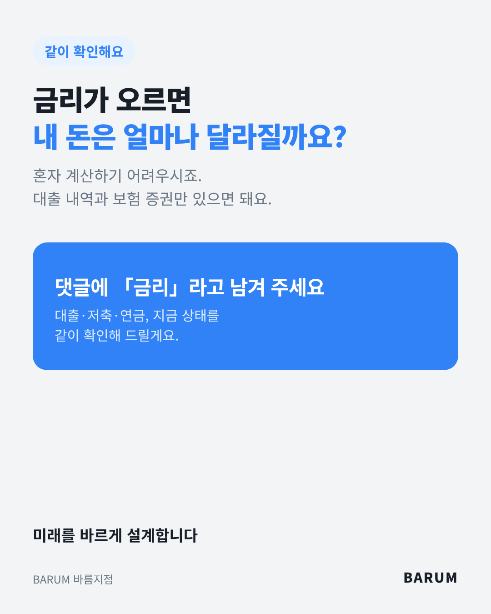

# 2026-11-16 재무 브리핑

## 카드뉴스 (세로 1080×1350 · 고객 공유용)

카드 묶음 받기: https://raw.githubusercontent.com/bokkile83-ui/barum-news/main/fin/cards/2026-11-16-mix_카드.zip

## 주말 사이 미국 (당잠사)
- 미국 10월 생산자물가(PPI) 전년 대비 6.5% 상승, 약 4년 만에 최고. 전월 대비는 0.3%로 예상(0.4%)을 밑돌았다. 근원 PPI는 전년 대비 5.0%.
- 미국 10년물 국채금리 5.14%(장중 5.17%, 한 달 만에 최고). 2년물 4.85%, 30년물 5.47%.
- CME 페드워치 기준 12월 0.25%p 인상 확률 90.5% → 94.98%. 0.5%p 인상 확률은 9.5% → 5.02%.
- 연준 인사: 콜린스(보스턴) 「꾸준하고 점진적인 인상이 적절」, 굴스비(시카고) 「내년 초 물가 재반등 위험」, 슈미드(캔자스시티) 「물가가 너무 높다」.
- 달러인덱스 103.41(+0.23%), 19개월 만에 최고 수준 유지.
- WTI 88.56달러(−0.20%), 브렌트유 95.84달러(+0.02%). IEA는 4분기 석유 공급이 수요를 앞설 것으로 전망.
- 금 3,887.60달러(+0.06%). 주간으로는 6월 초 이후 최대 낙폭. 은 48.65달러(−2.84%).
- 다우 +0.10%, S&P500 −0.40%, 나스닥 −0.91%, 필라델피아 반도체 −3.43%.
- 비트코인 6만 5천 달러 아래. 이번 달 비트코인 현물 ETF에서 25억 달러 넘게 순유출.
- 이번 주 일정: 18일(수) 새벽 엔비디아 실적, 18~19일 APEC 정상회의(미·중·러 3자 회동), 19일 앤트로픽 상장.

## 오늘 한국 (모닝루틴)
- 금요일 코스피 5,290.53(−0.98%), 코스닥 699.66(+0.45%). 외국인이 4거래일 만에 5,000억 원 이상 순매도.
- 원·달러 1,336.70원(+6.00원). 국고채 3년 3.759%(+0.030%p), 회사채 AA− 3년 4.434%(+0.027%p).
- 지난달 ETF 하루 평균 거래대금 20조 3,810억 원으로 코스피(20조 3,650억 원)를 처음 넘었다. 올해 순자산이 1조 원 넘게 늘어난 ETF가 28개다.
- 일부 ETF는 쏠림이 크다. 한 반도체 ETF는 상위 4개 종목에 78%, 한 커버드콜 ETF는 2개 종목에 50%가 들어 있다.
- 한국전력 3분기 영업이익 1조 6,000억 원(전년 대비 −70%), 주가 −9.79%. KB금융 +4.74%, 신한지주 +5.65%.
- 리모델링 추진 아파트 전국 149개 단지 12만 가구. 시멘트 출하량은 정점 대비 2년 새 24% 감소.
- 4인 가구 김장 비용: 전통시장 28만 8,500원, 대형마트 36만 340원. 전년 대비 최대 15% 하락, 2020년 이후 최저. 배추 −33%, 쪽파 −50%.

## 설계사에게
- 결론: 미국 12월 금리 인상이 거의 기정사실로 받아들여지고 있다. 오늘 상담 소재는 「변동금리 대출」「연금·ISA 안의 ETF 쏠림」이다.
- 대출 고객: 다음 금리 변경일을 확인하게 한다. 한국 기준금리 이야기는 방송에 없었으므로 국내 금리 방향은 말하지 않는다.
- 연금·ISA 고객: ETF 이름만 보지 말고 상위 종목 비중을 같이 열어 본다. 특정 ETF를 사라·팔라고 하지 않는다.
- 이번 주는 엔비디아 실적·APEC 등 큰 일정이 몰려 있다. 변동이 커도 서둘러 움직일 필요가 없다는 점을 알려 준다.
- 김장 비용 하락은 가벼운 안부 소재로 쓴다.

## 오늘 고객에게 한마디
> 「ETF도 안에 뭐가 담겼는지 열어 봐야 해요. 어떤 건 돈의 78%가 4개 종목에 몰려 있어요. 연금 계좌에 담으신 ETF, 같이 확인해 드릴게요.」

— BARUM 바름지점

## 출처
- [한국경제TV 「당잠사」 11/16 방송](https://www.youtube.com/watch?v=i1pUe8llLvA)
- [한경 코리아마켓 「임현우의 모닝루틴」 20261116](https://www.youtube.com/watch?v=ln6vrCyMgXk)
- 숫자는 방송 화면·멘트 기준. 원·달러 환율은 당잠사 1,337.60원, 모닝루틴 1,336.70원으로 기준 시각이 달라 국내 마감 기준(모닝루틴)을 썼다.
