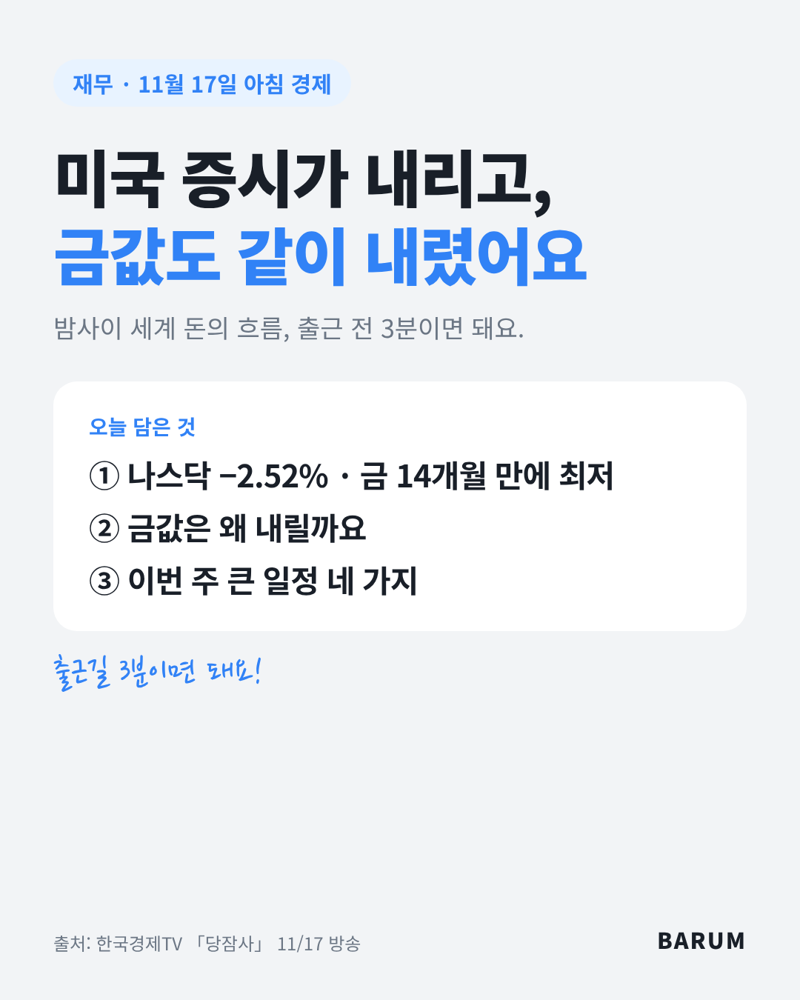
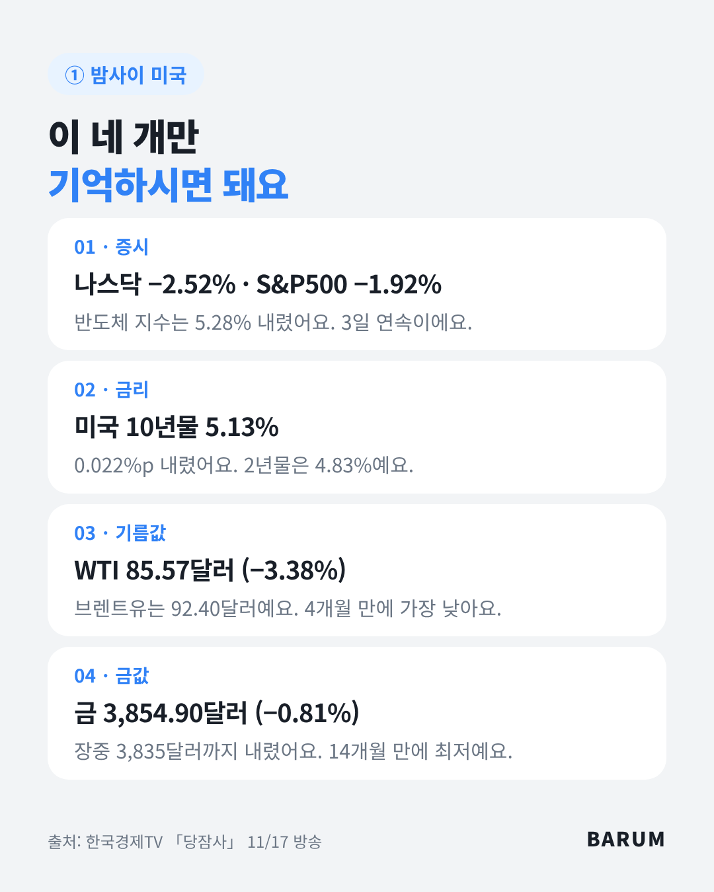
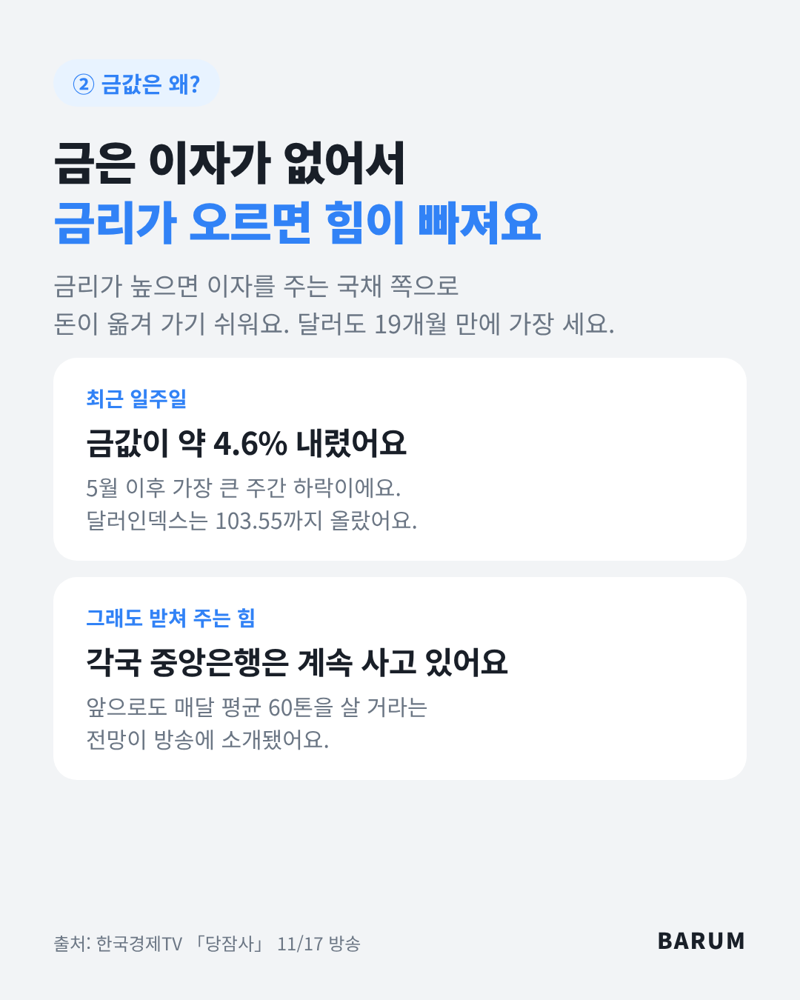
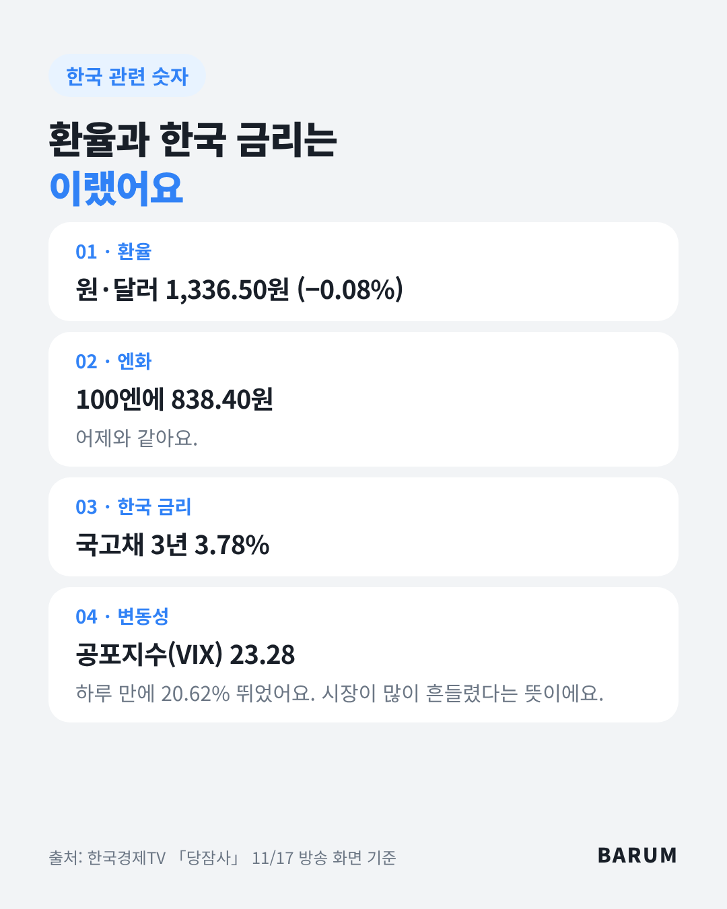
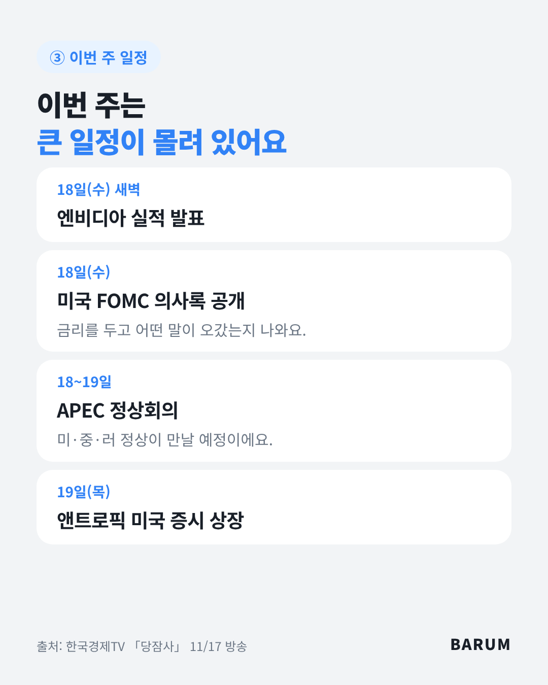
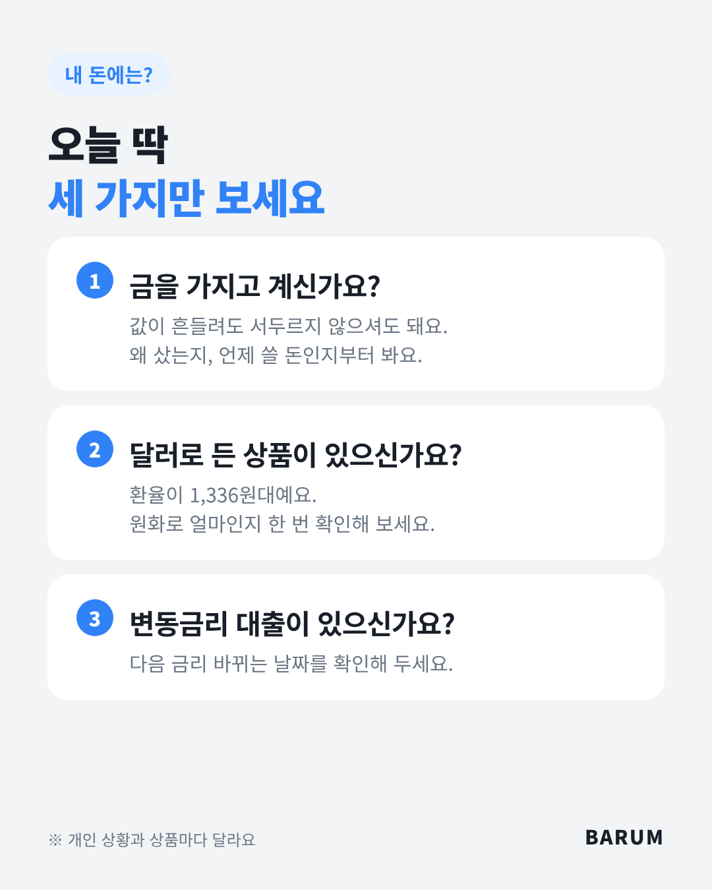
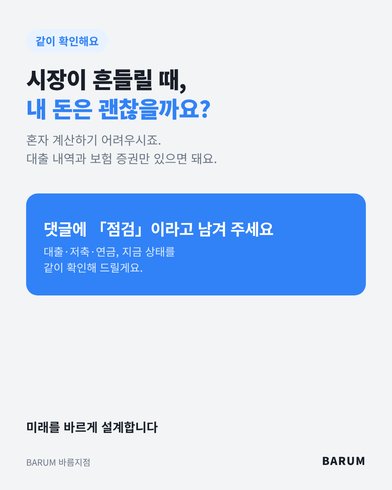

# 2026-11-17 재무 브리핑

## 카드뉴스 (세로 1080×1350 · 고객 공유용)

카드 묶음 받기: https://raw.githubusercontent.com/bokkile83-ui/barum-news/main/fin/cards/2026-11-17-mix_카드.zip

## 밤사이 미국 (당잠사)
- 다우 51,608.17(−1.41%), S&P500 7,416.59(−1.92%), 나스닥 24,502.93(−2.52%). 필라델피아 반도체 9,610.67(−5.28%), 3거래일 연속 하락.
- 공포지수(VIX) 23.28, 하루 만에 +20.62%.
- 미국 10년물 국채금리 5.13%(−2.2bp), 2년물 4.83%(−4bp), 30년물 5.48%. 기술주 매도에 안전자산으로 돈이 옮겨 갔다.
- 클리블랜드 연은 총재는 「회의 때마다 소폭씩 꾸준히 인상」을 다시 강조했다.
- 달러인덱스 103.55(+0.13%), 5거래일 연속 강세·19개월 만에 최고 수준. ING는 최대 104.6까지 오를 수 있다고 봤다.
- WTI 85.57달러(−3.38%), 브렌트유 92.40달러(−3.59%). 4개월 만에 최저. 중동 원유 수출 회복과 중국 수요 둔화 영향.
- 금 3,854.90달러(−0.81%), 장중 3,835달러로 14개월 만에 최저. 최근 1주일 약 4.6% 하락(5월 이후 최대 주간 낙폭). 은 46.96달러(−4.40%).
- 골드만삭스는 금값 전망을 올해 말 4,650 → 4,150달러, 내년 말 5,400 → 4,800달러로 낮췄다. 다만 중앙은행 금 매입은 월평균 60톤 수준으로 이어질 것으로 봤다.
- 미국 11월 뉴욕 제조업지수 7.8, 예상 하회. 구리는 4개월 만에 최저.
- 비트코인 약 65,000달러, 1주일 새 약 14% 하락.

## 한국 관련 숫자 (당잠사 화면)
- 원·달러 1,336.50원(−0.08%), 원·엔 838.40원(보합), 원·위안 200.63원.
- 국고채 3년 3.78%.
- 오늘은 모닝루틴이 아침 8시 생방송 전이라 넣지 못했다. 한국 증시 마감 숫자는 이 글에 없다.

## 이번 주 일정
- 18일(수) 새벽: 엔비디아 실적 발표
- 18일(수): 11월 FOMC 의사록 공개, 앤트로픽 공모가 결정
- 18~19일: APEC 정상회의(미·중·러 회동)
- 19일(목): 앤트로픽 상장

## 설계사에게
- 결론: 미국 증시와 금·유가가 함께 내린 날이다. 오늘 상담 소재는 「금 가진 고객의 불안」「달러 상품 원화 환산」이다.
- 금 문의: 내린 이유(높은 금리·강한 달러)와 받치는 힘(중앙은행 매입)을 둘 다 말한다. 「더 내린다」「지금 사라」는 말은 하지 않는다. 방송에 나온 기관 전망도 서로 달랐다.
- 달러보험 고객: 환율 1,336원대라는 사실만 알려 준다.
- 대출 고객: 미국 금리는 하루 내렸지만 연준 인사는 여전히 인상을 말한다. 국내 금리 방향은 방송에 없었으니 말하지 않는다.
- 이번 주는 일정이 몰려 변동이 클 수 있다. 서둘러 움직일 필요가 없다는 점을 알려 준다.

## 오늘 고객에게 한마디
> 「금값이 14개월 만에 가장 낮아졌어요. 금은 이자가 없어서 금리가 높을 때 힘이 빠지곤 해요. 서두르지 마시고, 언제 쓰실 돈인지부터 같이 봐요.」

— BARUM 바름지점

## 출처
- [한국경제TV 「당잠사」 11/17 방송](https://www.youtube.com/watch?v=ERcTmUjF8m8)
- 숫자는 방송 화면·멘트 기준. 지수 등락률은 방송 앞부분 헤드라인과 마감 화면이 조금 달라 마감 화면 숫자를 썼다.
