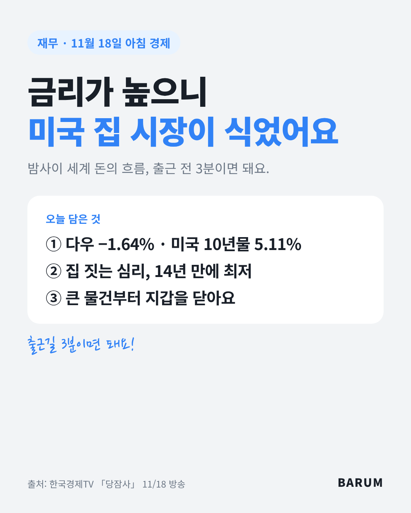
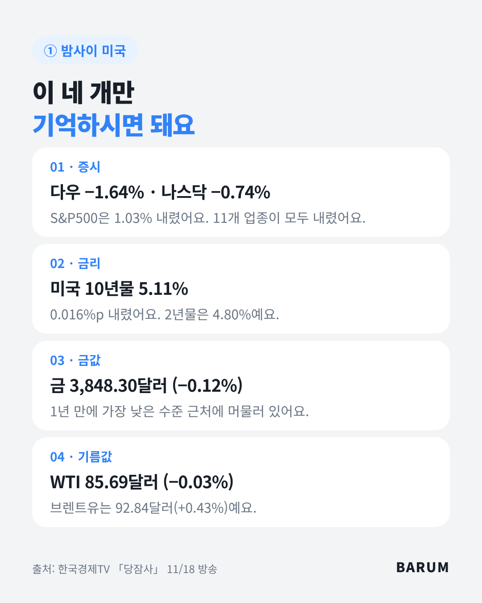
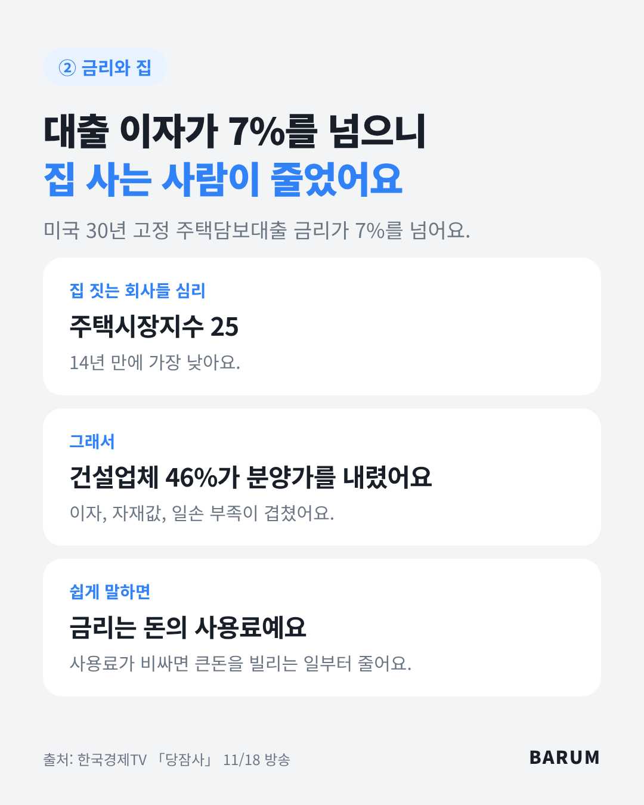
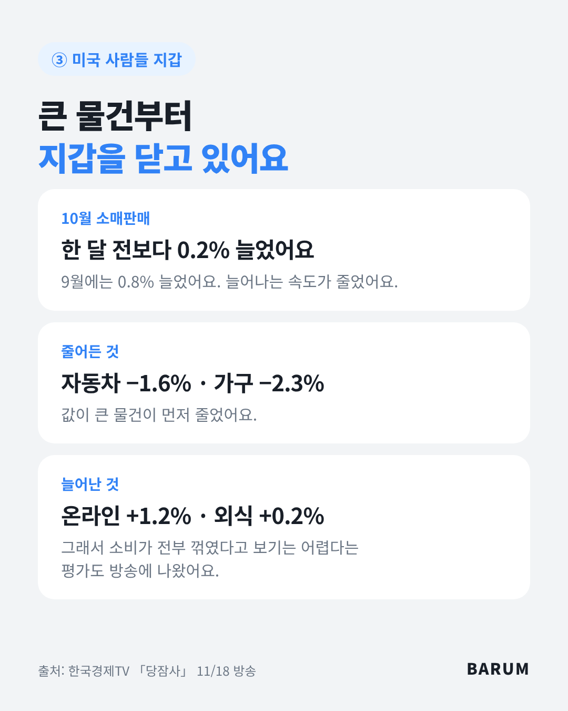
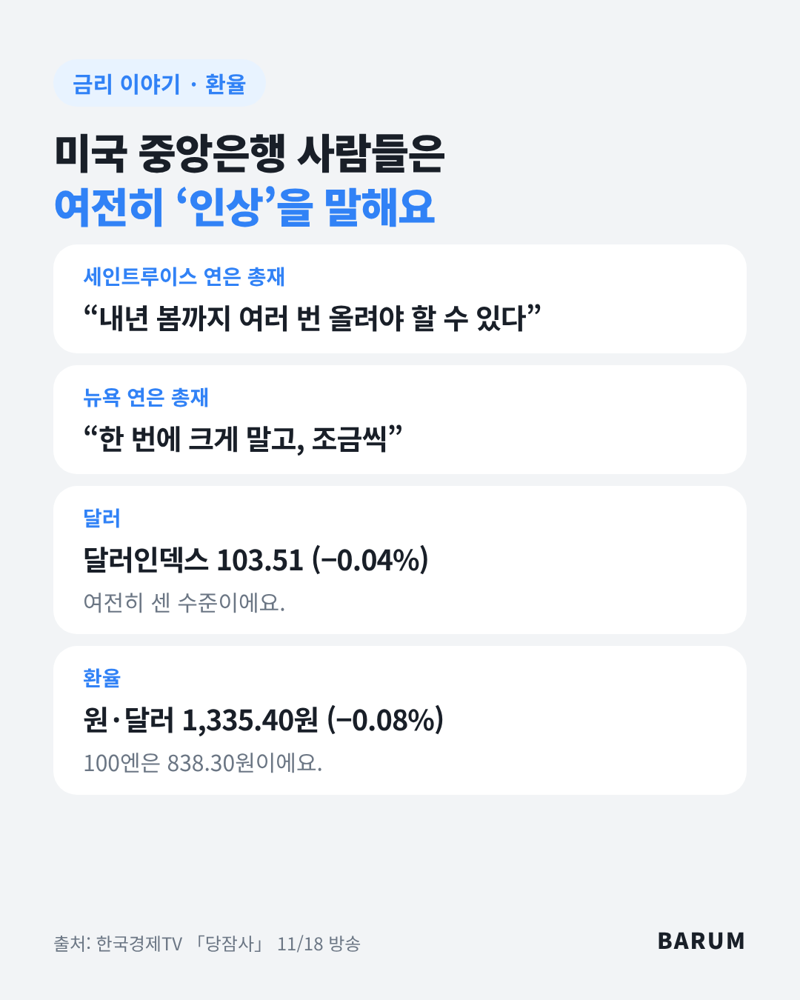
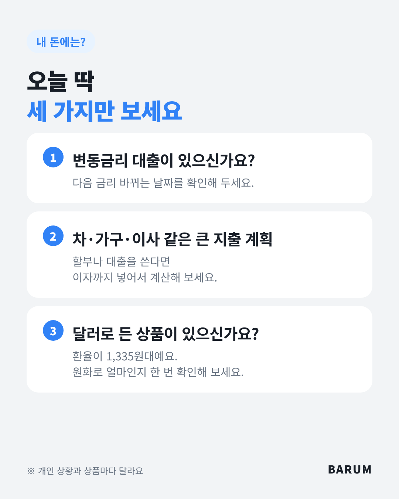
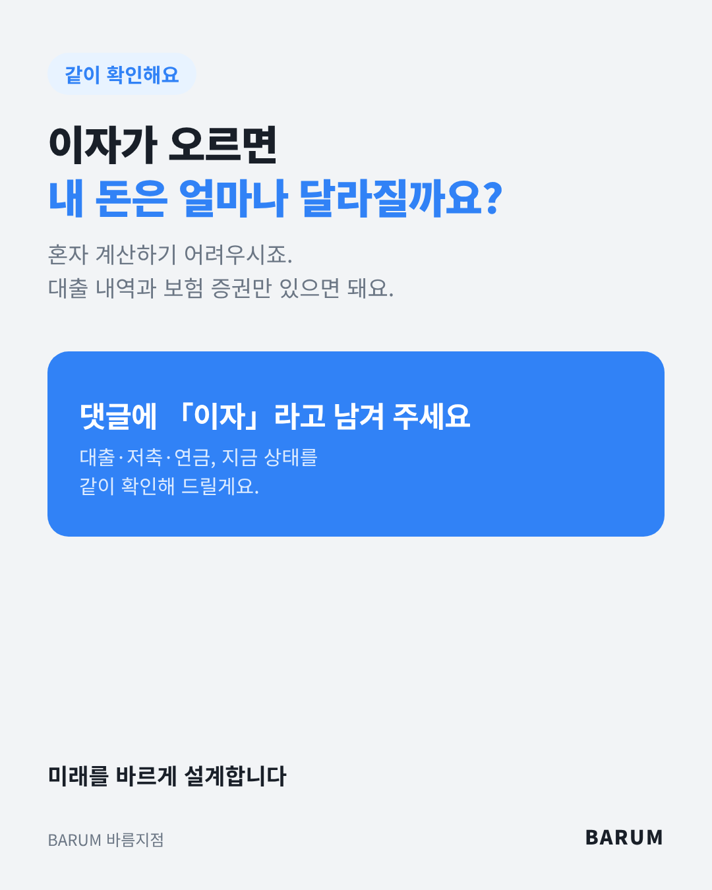

# 2026-11-18 재무 브리핑

## 카드뉴스 (세로 1080×1350 · 고객 공유용)

카드 묶음 받기: https://raw.githubusercontent.com/bokkile83-ui/barum-news/main/fin/cards/2026-11-18-mix_카드.zip

## 밤사이 미국 (당잠사)
- 다우 50,759.42(−1.64%), S&P500 7,340.53(−1.03%), 나스닥 24,328.38(−0.74%). 11개 업종 모두 하락, 금융 −1.87%. 필라델피아 반도체는 +0.34%.
- 미국 10년물 국채금리 5.11%(−1.6bp), 2년물 4.80%(−3.1bp), 30년물 5.46%.
- 연준 인사: 무살렘(세인트루이스) 「내년 봄까지 여러 차례 인상해야 할 가능성」, 윌리엄스(뉴욕) 「빅스텝은 필요 없고 점진적 인상 지지」.
- 미국 30년 고정 모기지 금리 7% 상회. 11월 주택시장지수(NAHB) 25, 14년 만에 최저. 건설업체 46%가 분양가를 내렸다.
- 미국 10월 소매판매 전월 대비 +0.2%(9월 +0.8%). 자동차·부품 −1.6%, 가구 −2.3%. 온라인 +1.2%, 주유소 +1.5%, 외식 +0.2%.
- 달러인덱스 103.51(−0.04%). 금 3,848.30달러(−0.12%), 1년 만에 최저 부근. 은 47.07달러(+0.44%).
- WTI 85.69달러(−0.03%), 브렌트유 92.84달러(+0.43%). 공급 과잉 전망과 호르무즈 해협 긴장이 맞서고 있다.
- 구리는 5주 연속 하락. 비트코인 약 64,000달러.
- 엔비디아 3분기 매출 1,158억 달러로 예상 상회, 시간외 2%대 상승(방송 끝부분 속보).
- 월가 2027년 말 S&P500 목표: 바클레이즈·모건스탠리 모두 8,700. 모건스탠리는 금리가 예상보다 더 오를 가능성을 위험 요인으로 꼽았다.

## 한국 관련 숫자 (당잠사 화면)
- 원·달러 1,335.40원(−0.08%), 원·엔 838.30원(보합), 원·위안 200.37원.
- 강한 달러 속에서도 원화는 강세였다. 반도체 수출 호조에 따른 경상수지 흑자 전망이 배경으로 꼽혔다.
- 모닝루틴은 아침 8시 생방송 전이라 넣지 못했다. 한국 증시 마감 숫자는 이 글에 없다.

## 이번 주 일정
- 19일(목): 미·중 정상회담(APEC 계기), 앤트로픽 상장
- 12월 1일: 젠슨 황 전 엔비디아 CEO 미국 하원 청문회 증언

## 설계사에게
- 결론: 높은 금리가 미국 주택과 큰 소비부터 식히고 있다. 오늘 상담 소재는 「대출 이자」「큰 지출 계획」이다.
- 대출 고객: 다음 금리 변경일을 확인하게 한다. 미국 사례는 참고로만 쓰고, 국내 주택담보대출 금리 숫자는 방송에 없었으니 따로 확인한다.
- 이사·차량 구입을 앞둔 고객: 할부·대출 이자를 포함한 총비용으로 같이 계산해 준다.
- 달러보험 고객: 환율 1,335원대라는 사실만 알려 준다. 환율 전망은 말하지 않는다.
- 금 문의: 3,848달러로 1년 만에 최저 부근이라는 사실과, 기관 전망이 엇갈린다는 점만 전한다.

## 오늘 고객에게 한마디
> 「미국은 대출 이자가 7%를 넘으면서 집 짓는 심리가 14년 만에 가장 낮아졌어요. 이자는 큰돈을 빌릴 때 제일 크게 느껴져요. 대출 금리 바뀌는 날짜, 같이 확인해 드릴게요.」

— BARUM 바름지점

## 출처
- [한국경제TV 「당잠사」 11/18 방송](https://www.youtube.com/watch?v=-26ghY_PNo4)
- 숫자는 방송 화면·멘트 기준. 지수 등락률은 방송 앞부분(장중)과 마감 화면이 달라 마감 화면 숫자를 썼다.
