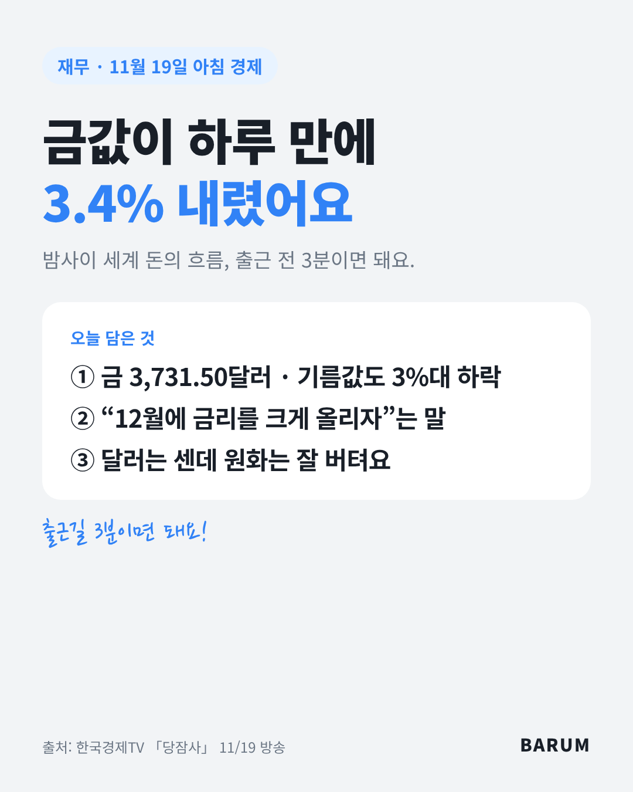
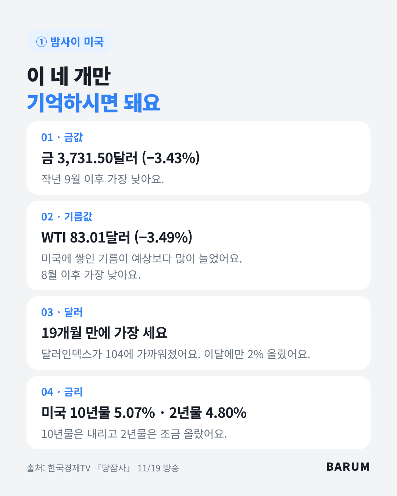
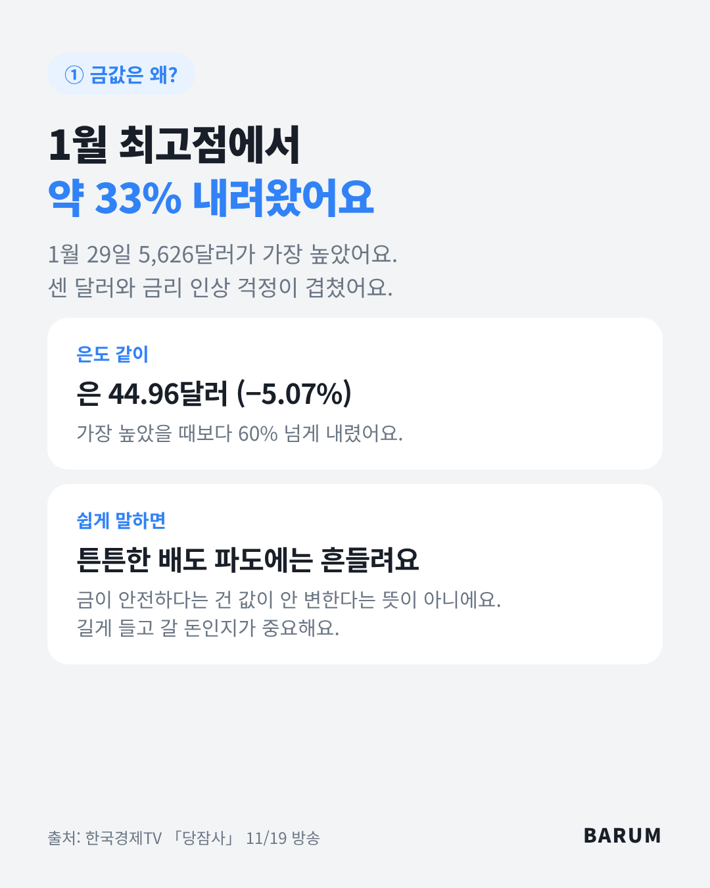
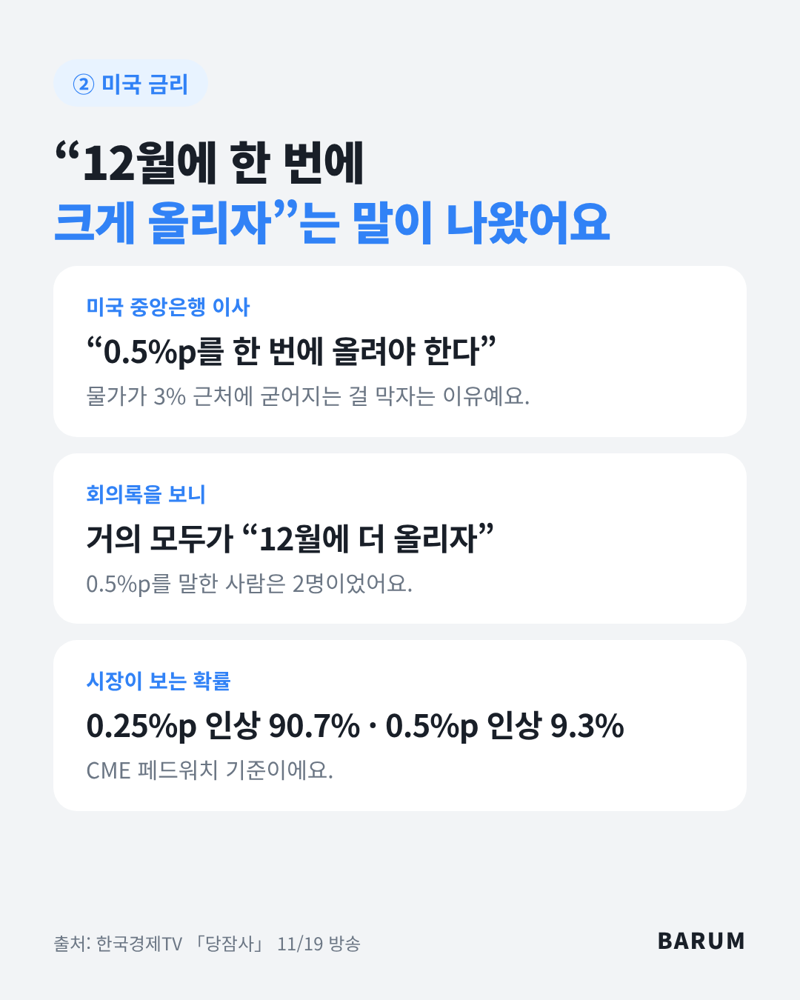
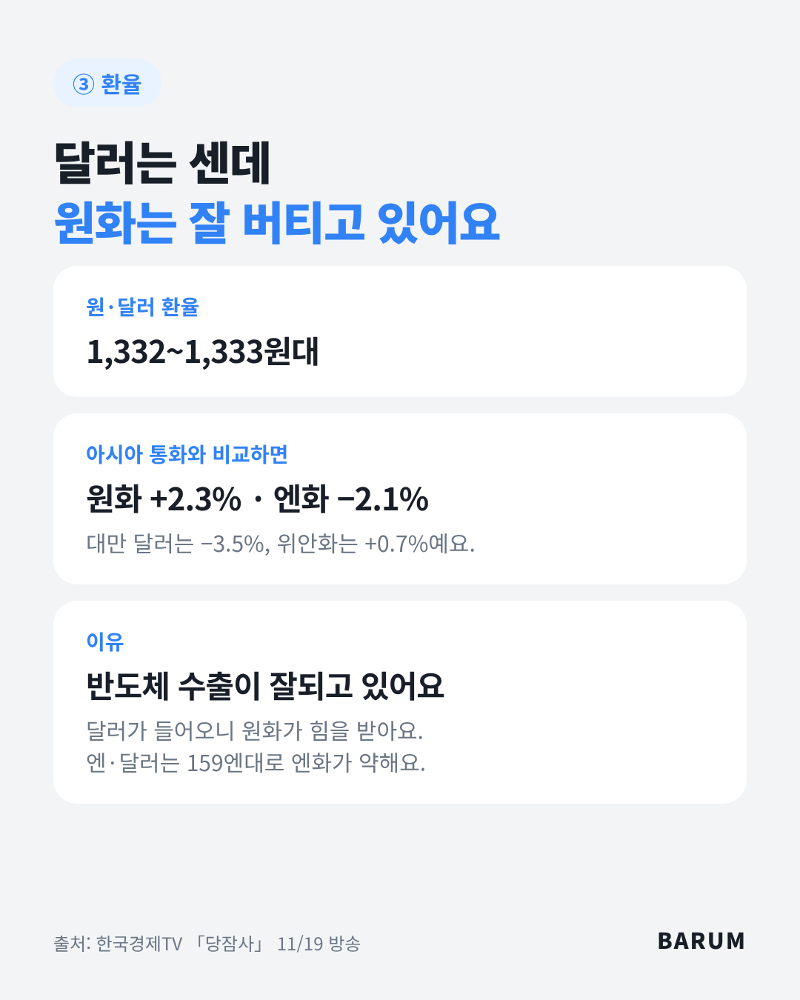
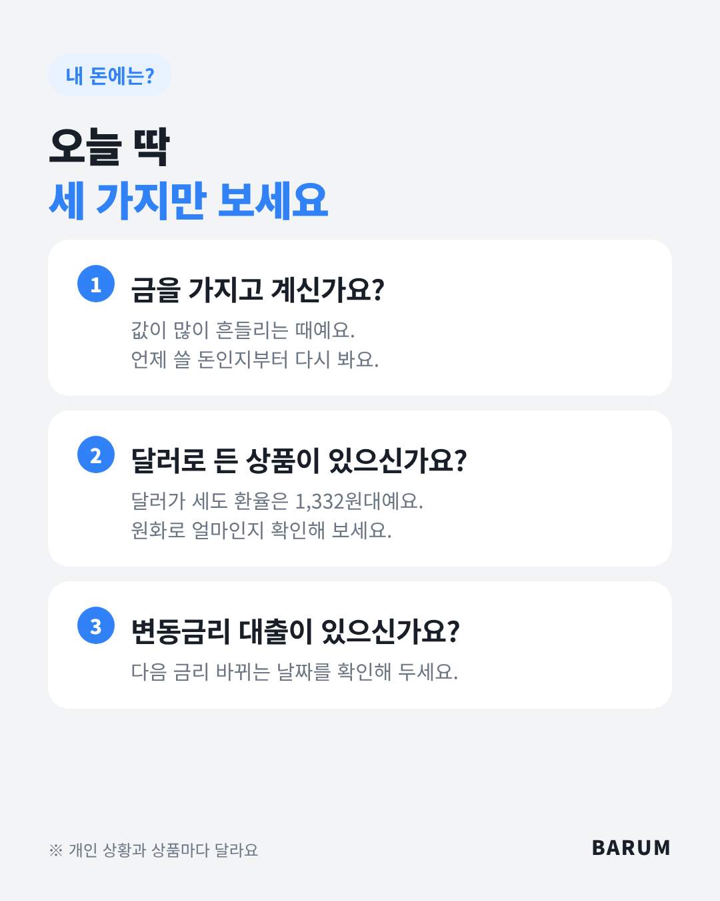
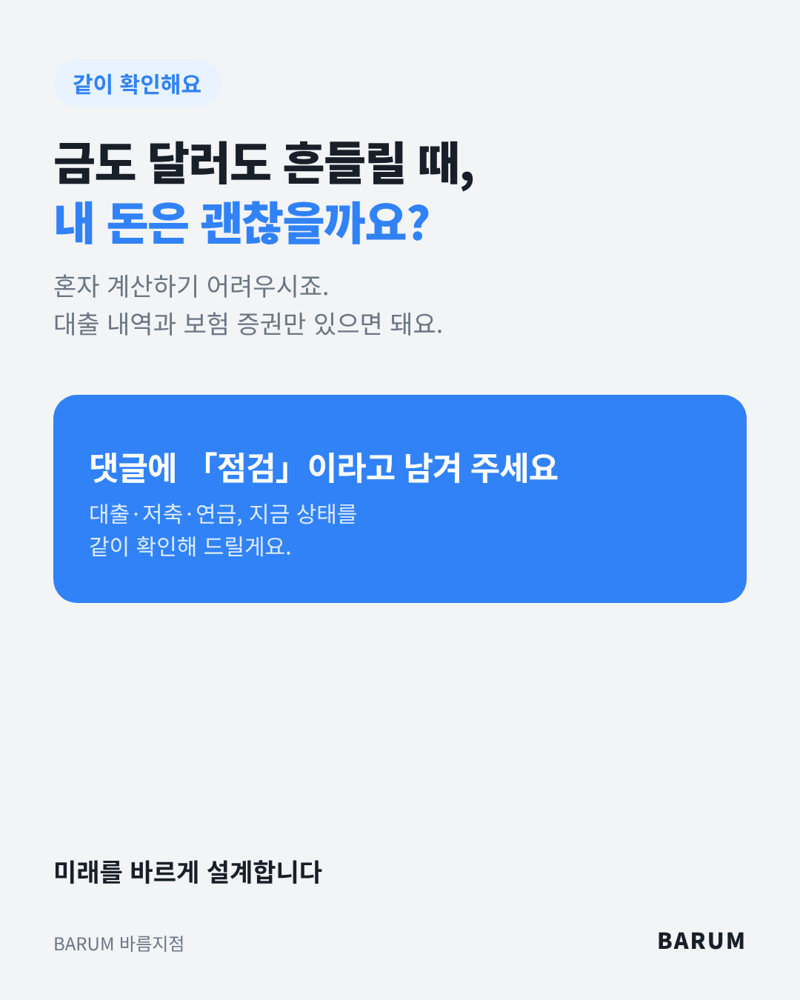

# 2026-11-19 재무 브리핑

## 카드뉴스 (세로 1080×1350 · 고객 공유용)

카드 묶음 받기: https://raw.githubusercontent.com/bokkile83-ui/barum-news/main/fin/cards/2026-11-19-mix_카드.zip

## 밤사이 미국 (당잠사)
- 금 3,731.50달러(−3.43%), 작년 9월 이후 최저. 1월 29일 최고점 5,626달러 대비 약 33% 하락. 은 44.96달러(−5.07%).
- 골드만삭스는 금값이 사상 최고치를 다시 넘는 시점을 2028년경으로 늦춰 잡았다.
- WTI 83.01달러(−3.49%), 브렌트유 91.72달러(−1.52%). 미국 원유·휘발유 재고가 예상보다 크게 늘어 8월 이후 최저.
- 달러인덱스 103.8대, 19개월 만에 최고. 이달에만 2% 상승. 유로화는 1.1달러 아래.
- 미국 10년물 국채금리 5.07%, 2년물 4.80%(+1.1bp), 30년물 5.41%.
- 월러 연준 이사: 12월에 0.5%p를 한 번에 올려야 한다고 주장. 10월 FOMC 의사록: 거의 모든 참석자가 추가 인상이 적절하다고 봤고, 0.5%p 인상 의견은 2명.
- CME 페드워치: 12월 0.25%p 인상 90.7%, 0.5%p 인상 9.3%. 선물시장은 내년에도 최소 2차례 추가 인상을 본다.
- 미국 10월 기존주택 매매계약 건수는 집계 이래 최저, 기존주택 판매량은 2010년 이후 최저.
- 방송 앞부분 기준 다우 −1.12%, S&P500 −0.31%, 나스닥 +0.42%. 에너지 −3.52%, 헬스케어 −2.18%, 임의소비재 +2.24%.
- 엔비디아는 호실적에도 −2.89%. 앤트로픽 상장 하루 전, 청약 수요가 공모 물량의 약 7배.
- 비트코인 약 62,400달러(−2.52%), 6주 연속 약세.

## 한국 관련 숫자 (당잠사 화면)
- 원·달러 1,332~1,333원대. 아시아 통화 가치 변화율: 원화 +2.3%, 위안화 +0.7%, 엔화 −2.1%, 대만 달러 −3.5%.
- 원화 강세 배경은 반도체 중심의 수출 호조. 다만 미국의 추가 금리 인상은 원화 강세 속도를 늦출 수 있다고 했다.
- 엔·달러 159.4엔 안팎. 원화와 엔화가 같이 움직이는 정도(상관계수)가 상반기 0.65에서 하반기 0.22로 낮아졌다.
- 모닝루틴은 아침 8시 생방송 전이라 넣지 못했다. 한국 증시 마감 숫자는 이 글에 없다.

## 설계사에게
- 결론: 금이 하루 3.4% 내렸고 미국은 12월 큰 폭 인상 이야기까지 나왔다. 오늘 상담 소재는 「금·달러 가진 고객의 불안」「대출 금리」다.
- 금 문의: 「안전자산도 값은 흔들린다」는 점과 고점 대비 약 33% 하락이라는 사실만 전한다. 사라·팔라는 말은 하지 않는다.
- 달러보험 고객: 달러는 세지만 원화도 강해서 환율은 1,332원대다. 환율 방향은 말하지 않는다.
- 대출 고객: 미국 12월 인상은 시장이 거의 확실하게 본다(0.25%p 90.7%). 국내 금리 이야기는 방송에 없었으니 다음 금리 변경일 확인만 권한다.
- [확인] 아시아 통화 변화율(원화 +2.3% 등)은 방송 화면 숫자이고 비교 기간은 확인하지 못했다. 기간을 말해야 하면 영상 37:52를 본다.

## 오늘 고객에게 한마디
> 「금값이 하루에 3% 넘게 내렸어요. 금이 안전하다는 건 값이 안 변한다는 뜻이 아니에요. 언제 쓰실 돈인지에 맞게 들고 계신지 같이 봐 드릴게요.」

— BARUM 바름지점

## 출처
- [한국경제TV 「당잠사」 11/19 방송](https://www.youtube.com/watch?v=If5T3iAJrwI)
- 숫자는 방송 화면·멘트 기준. 금값은 방송 안에서 3,720달러와 3,731.50달러가 함께 나와 선물 마감 화면 숫자(3,731.50달러)를 썼다. 3대 지수는 방송 앞부분 숫자다.
