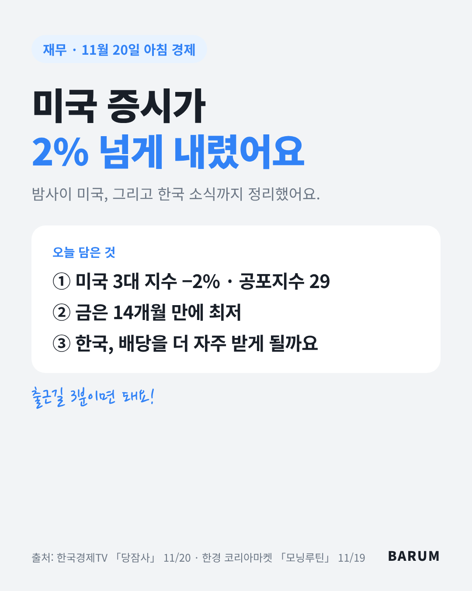
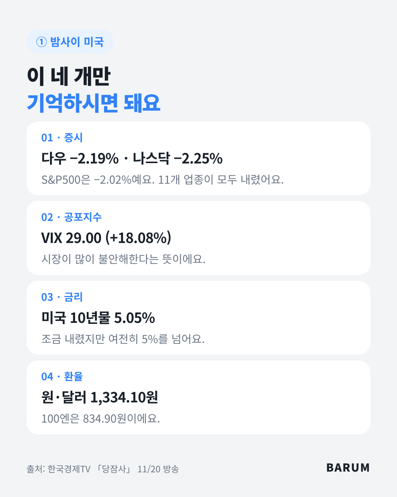
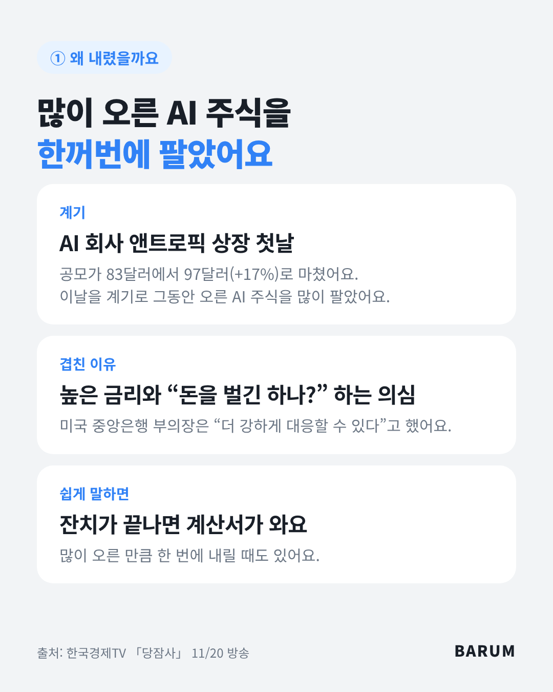
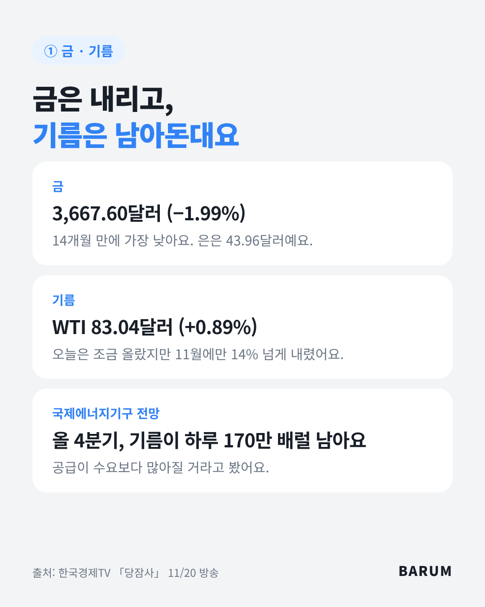
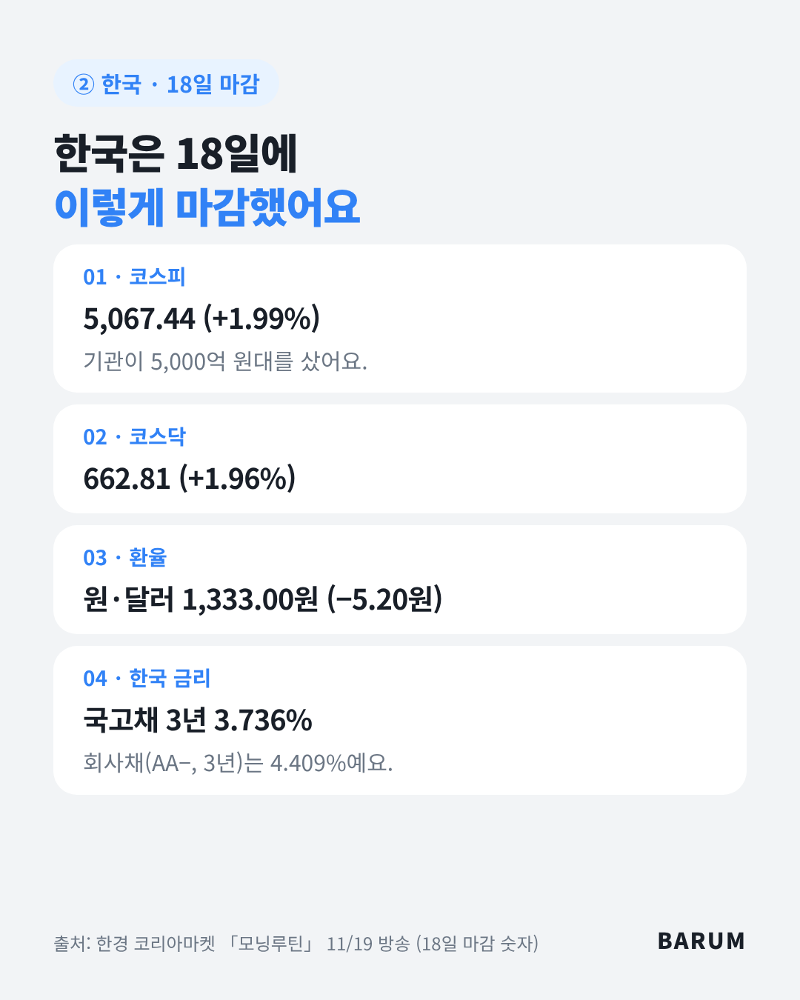
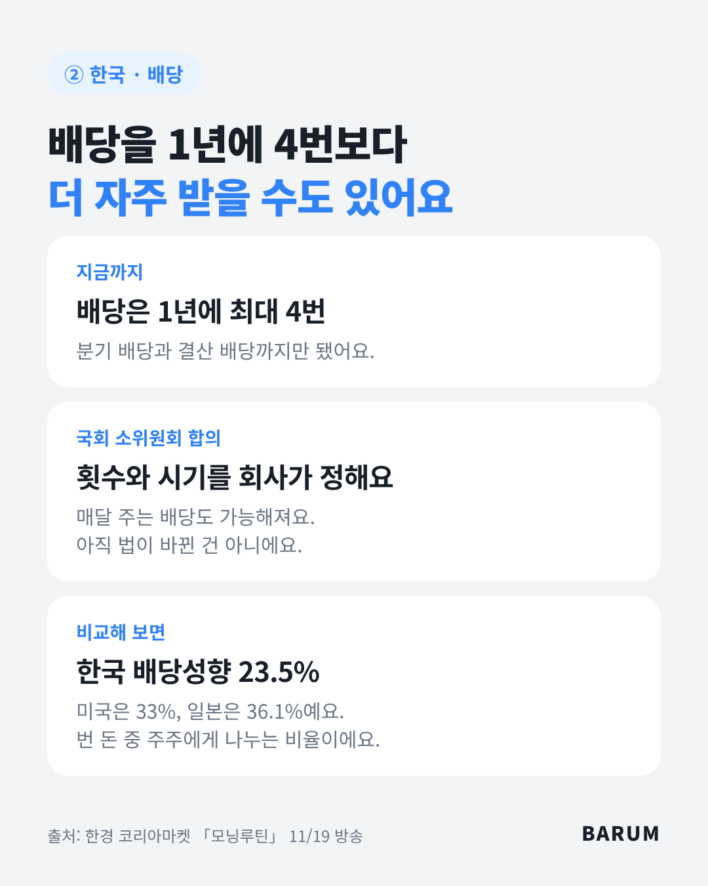
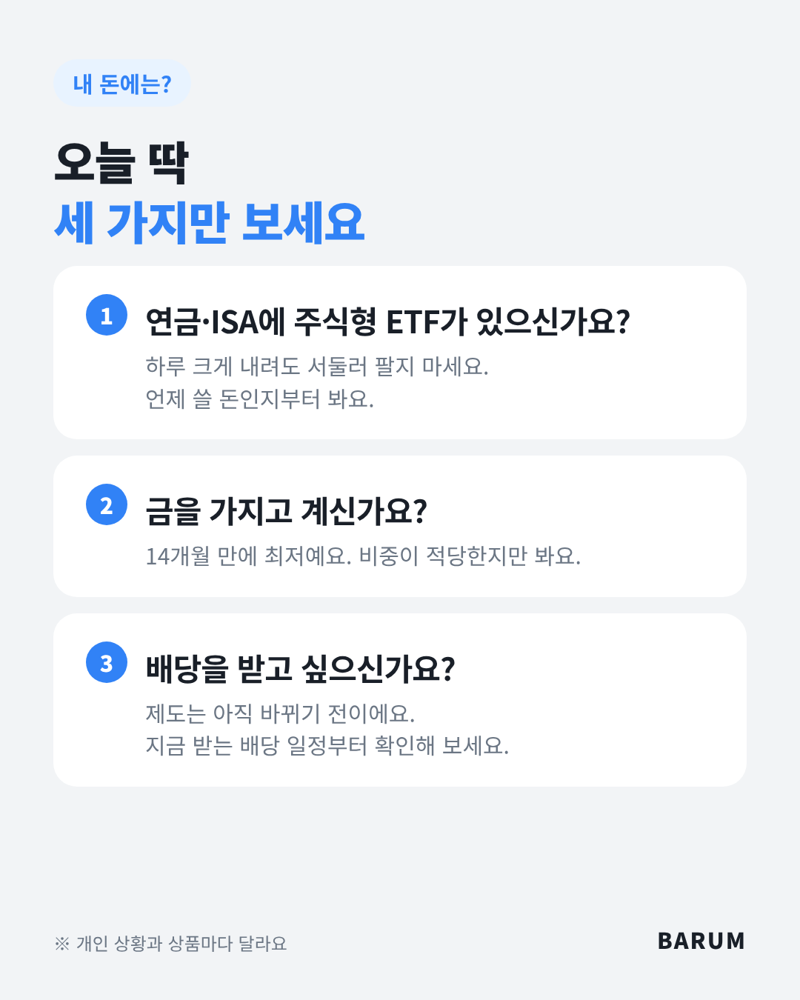
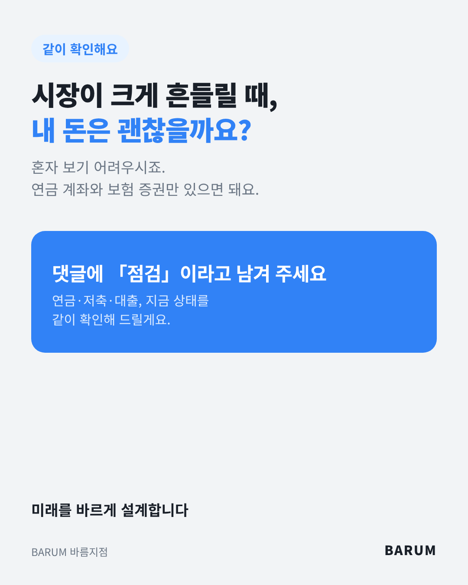

# 2026-11-20 재무 브리핑

## 카드뉴스 (세로 1080×1350 · 고객 공유용)

카드 묶음 받기: https://raw.githubusercontent.com/bokkile83-ui/barum-news/main/fin/cards/2026-11-20-mix_카드.zip

## 밤사이 미국 (당잠사 11/20)
- 다우 49,097.06(−2.19%), 나스닥 23,879.20(−2.25%), S&P500 7,175.83(−2.02%), 필라델피아 반도체 −2.42%. 11개 업종 모두 하락. S&P500이 200일 이동평균선 아래로 내려갔다.
- 공포지수(VIX) 29.00(+18.08%).
- 배경: 앤트로픽 상장(공모가 83달러 → 첫날 97달러, +17.07%)을 계기로 그동안 오른 AI 관련주 차익실현. 고금리 지속, AI 수익화 검증 요구, 미·중 반도체 규제(AMD 공매도 리포트)가 겹쳤다.
- 미국 10년물 5.05%(−1.8bp), 2년물 4.76%, 30년물 5.40%. 제퍼슨 연준 부의장 「기대 인플레이션 목표에 못 미치면 더 강한 대응이 정당화될 수 있다」.
- 금 3,667.60달러(−1.99%), 14개월 만에 최저. 은 43.96달러(−2.44%).
- WTI 83.04달러(+0.89%), 브렌트유 92.51달러(+0.61%). 11월 들어 WTI 14% 넘게 하락. IEA는 4분기 공급이 수요보다 하루 170만 배럴 많을 것으로 봤다. 골드만삭스는 내년 브렌트유 평균 88달러, 내년 말 78달러를 전망했다.
- 11월 필라델피아 연은 제조업지수 6.3(예상 20.6, 6개월 만에 최저). 신규 실업수당 청구 20.3만 건.
- 원·달러 1,334.10원, 100엔 834.90원. 비트코인 약 62,000달러, 6주 연속 하락.

## 한국 (모닝루틴 11/19 · 18일 마감 숫자)
- 코스피 5,067.44(+1.99%), 코스닥 662.81(+1.96%). 외국인 약 3,000억 원·개인 6,000억 원 이상 순매도, 기관 5,000억 원대 순매수.
- 원·달러 1,333.00원(−5.20원). 국고채 3년 3.736%(+0.011%p), 회사채 AA− 3년 4.409%.
- 수시배당제: 국회 정무위 법안심사소위에서 기업이 배당 횟수·시기를 정하는 「수시배당제」 도입에 여야가 합의했다. 지금은 분기·결산 배당 포함 연 최대 4회. 바뀌면 월배당도 가능하다. 아직 법 개정 전이다.
- 한국 배당성향 23.5%(미국 33%, 일본 36.1%). 중간·분기 배당을 한 코스피 상장사는 지난해 158개.
- 한·중 FTA 2단계(서비스·투자) 실질 타결. 네거티브 방식으로 전환.
- 참고: 당잠사 화면의 19일 코스피는 5,137.89, 코스닥 684.81이었다.

## 설계사에게
- 결론: 미국 증시가 하루 2% 넘게 내렸고 공포지수가 29까지 올랐다. 오늘 상담 소재는 「연금·ISA 안 주식형 ETF를 가진 고객의 불안」이다.
- 연금 계좌 고객: 하루 하락으로 서둘러 팔지 않도록 「언제 쓸 돈인지」부터 같이 본다. 방향 전망은 말하지 않는다.
- 배당 관심 고객: 수시배당제는 국회 소위 합의 단계다. 「곧 매달 배당 받는다」고 단정하지 않는다.
- 금 문의: 14개월 만에 최저라는 사실만 전한다.
- 모닝루틴 숫자는 18일 마감 기준이다. 「오늘 한국 증시」로 소개하지 않는다.

## 오늘 고객에게 한마디
> 「미국 증시가 하루에 2% 넘게 내렸어요. 연금 계좌는 하루 움직임보다 언제 쓸 돈인지가 더 중요해요. 지금 상태를 같이 확인해 드릴게요.」

— BARUM 바름지점

## 출처
- [한국경제TV 「당잠사」 11/20 방송](https://www.youtube.com/watch?v=lzAxjPb1Wsk)
- [한경 코리아마켓 「임현우의 모닝루틴」 20261119](https://www.youtube.com/watch?v=bGjcw5qboCI)
- 숫자는 방송 화면·멘트 기준. 3대 지수는 마감 화면 숫자를 썼다(방송 앞부분 숫자와 조금 다르다).
