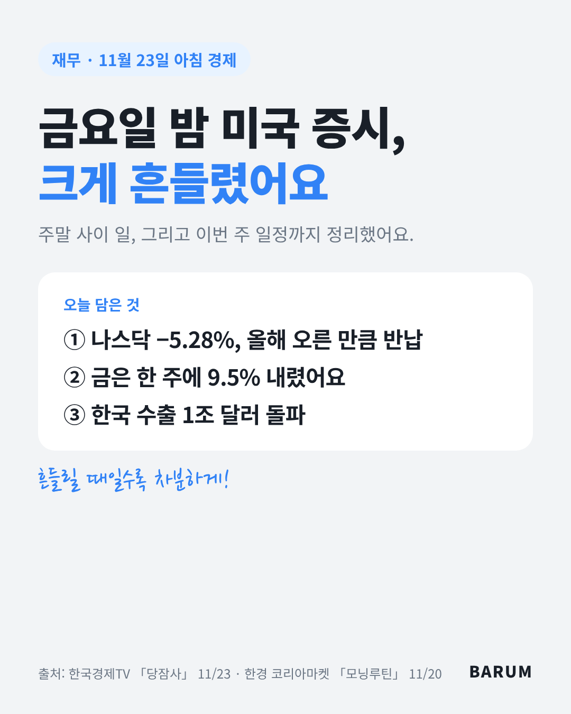
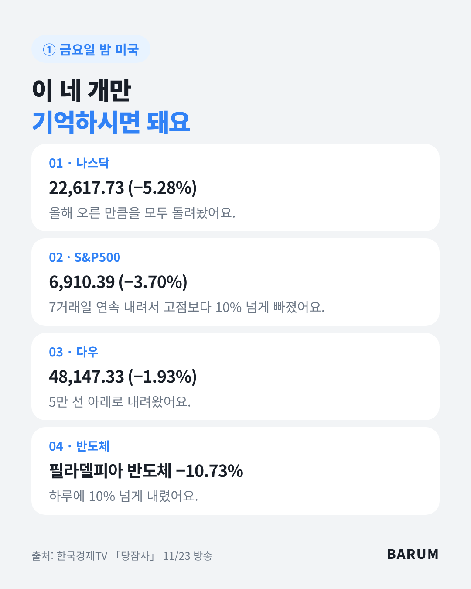
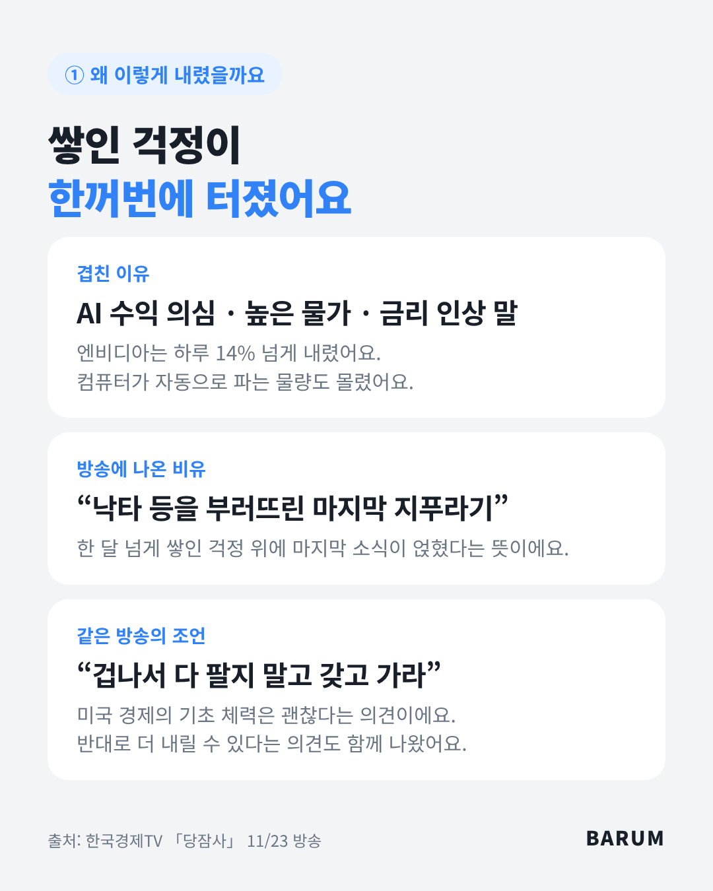
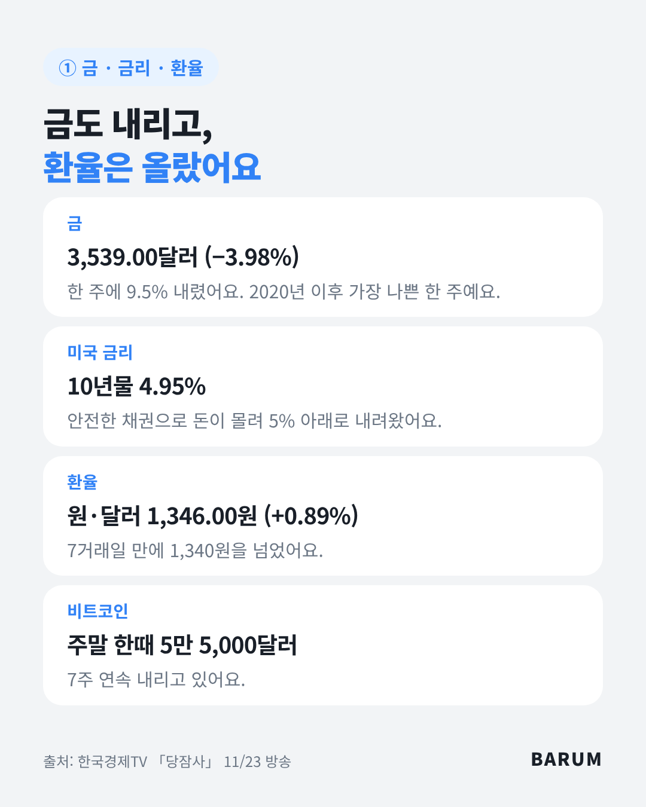
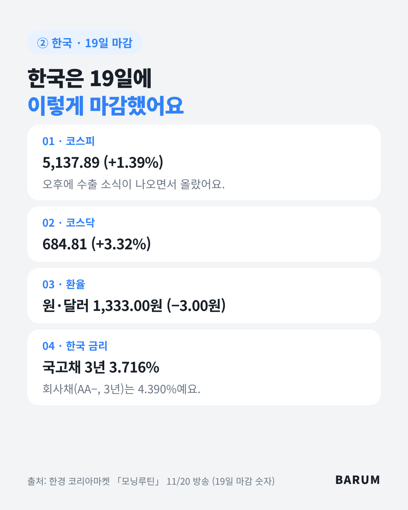
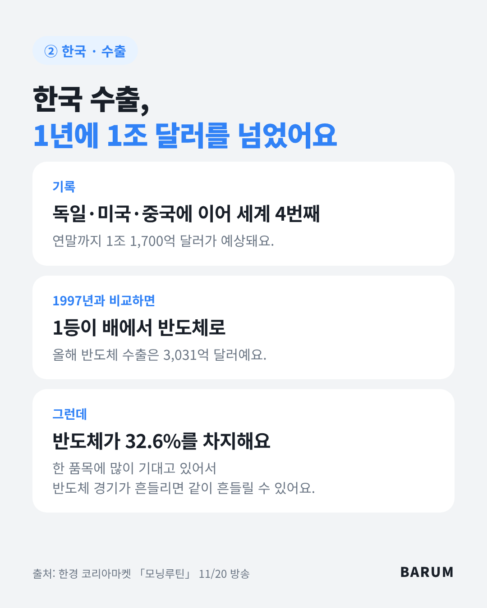
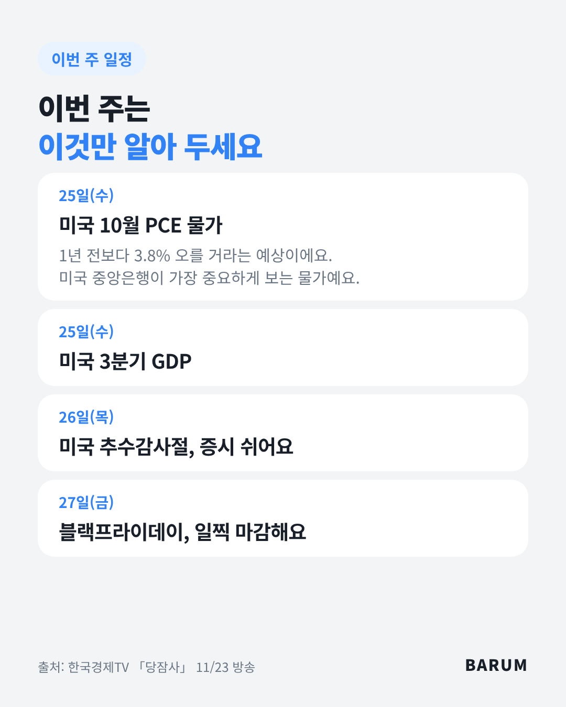
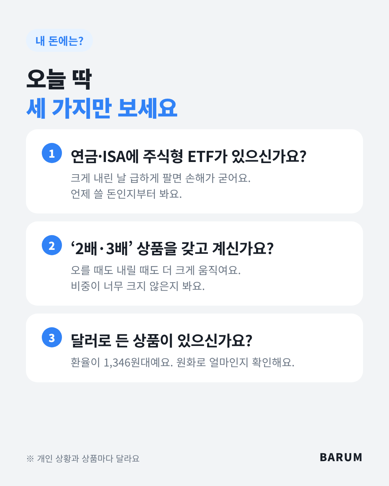
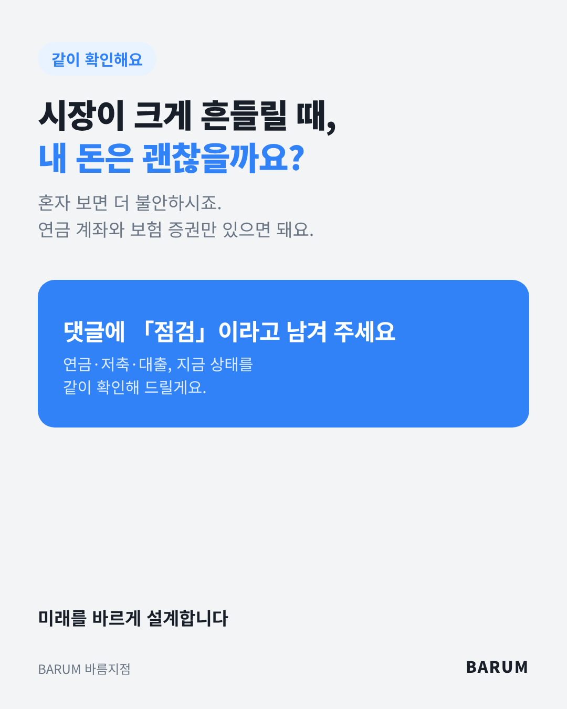

# 2026-11-23 재무 브리핑

## 카드뉴스 (세로 1080×1350 · 고객 공유용)

카드 묶음 받기: https://raw.githubusercontent.com/bokkile83-ui/barum-news/main/fin/cards/2026-11-23-mix_카드.zip

## 금요일 밤 미국 (당잠사 11/23)
- 다우 48,147.33(−1.93%), 나스닥 22,617.73(−5.28%, 올해 상승분 반납), S&P500 6,910.39(−3.70%, 7거래일 연속 하락·고점 대비 10% 넘게 하락해 조정 국면), 필라델피아 반도체 8,408.59(−10.73%). 11개 업종 중 필수소비재만 상승.
- 원인(CNBC 분석): 앤트로픽 초기 투자자 차익실현(−8.50%), 엔비디아 악재(SEC 회계 조사 보도, 하루 −14.01%·11월 40% 넘게 하락), S&P500 200일 이동평균선 붕괴에 따른 알고리즘 매도(한 달 약 570억 달러 순매도), 연준 인사들의 금리 인상 촉구.
- 연준: 쿡 이사 「인플레이션을 잡기 위해 금리를 서둘러 올려야」, 필라델피아 연은 총재 「연이은 인상도 고려」.
- 미국 10년물 4.95%(−10.2bp, 5% 아래), 2년물 4.65%(−13bp).
- 금 3,539.00달러(−3.98%), 작년 9월 이후 최저. 주간 −9.5%로 2020년 이후 가장 나쁜 한 주. 은 41.08달러(−7.39%).
- WTI 83.41달러(+1.18%), 브렌트유 92.57달러(+0.64%).
- 달러인덱스 103.84. 원·달러 1,346.00원(+0.89%), 7거래일 만에 1,340원 위. 엔·달러 158.53엔.
- 비트코인 주말 한때 5만 5,000달러, 7주 연속 하락. 이번 달 현물 ETF 유출 41억 달러.
- 월가 의견: 골드만삭스 패닉지수 10점 만점에 9점, 매도 압력 지속 가능. 제레미 시겔 「낙타 등을 부러뜨린 마지막 지푸라기… 패닉 셀링 대신 유지」. 에드 야데니 「AI 우려 과도」.
- 이번 주: 25일 미국 10월 PCE(예상 전년 대비 3.8%, 근원 3.2%)·3분기 GDP 잠정치(예상 3.4%), 26일 추수감사절 휴장, 27일 블랙프라이데이 조기 마감, 델 실적.

## 한국 (모닝루틴 11/20 · 19일 마감 숫자)
- 코스피 5,137.89(+1.39%), 코스닥 684.81(+3.32%). 오후 수출 1조 달러 소식 이후 상승 전환.
- 원·달러 1,333.00원(−3.00원). 국고채 3년 3.716%(−0.020%p), 회사채 AA− 3년 4.390%.
- 한국 연간 누적 수출 1조 달러 돌파. 독일·미국·중국에 이어 세계 4번째. 연말 1조 1,700억 달러 전망.
- 수출 1위 품목: 1997년 선박 → 2026년 반도체(3,031억 달러). 반도체 비중 32.6%로 쏠림이 크고, 고용 효과가 작아 체감이 낮다는 지적. 무역흑자 3,000억 달러 이상이 통상 압박 빌미가 될 수 있다는 우려.
- 해외 레버리지 ETF를 사려면 국내 투자자는 기본예탁금 3,000만 원 이상이 필요하다.
- 참고: 모닝루틴 방송 시점(20일 아침) 국내 장은 미국 급락 영향으로 약 4% 약세 출발했다. 20일 마감 숫자는 이 글에 없다.

## 설계사에게
- 결론: 미국 증시가 금요일 크게 빠졌고 이번 주에도 흔들릴 수 있다. 오늘 상담 소재는 「연금·ISA 주식형 ETF를 가진 고객의 불안」이다.
- 연금 계좌 고객: 급하게 팔면 손실이 확정된다는 점, 언제 쓸 돈인지에 따라 판단이 달라진다는 점을 설명한다. 「곧 오른다」「더 내린다」는 말은 하지 않는다. 방송에서도 의견이 엇갈렸다.
- 레버리지(2배·3배) 상품을 가진 고객: 변동이 더 크다는 점과 비중을 확인하게 한다.
- 달러 상품 고객: 환율 1,346원대라는 사실만 알려 준다.
- 25일 PCE 발표와 26일 미국 휴장 일정을 알고 있으면 고객 문의에 답하기 쉽다.

## 오늘 고객에게 한마디
> 「금요일 밤 미국 증시가 크게 흔들렸어요. 이런 날 급하게 팔면 손해가 굳어 버려요. 연금 계좌에 담긴 것부터 차분히 같이 볼게요.」

— BARUM 바름지점

## 출처
- [한국경제TV 「당잠사」 11/23 방송](https://www.youtube.com/watch?v=Hx2C-QlXSxc)
- [한경 코리아마켓 「임현우의 모닝루틴」 20261120](https://www.youtube.com/watch?v=LqtGXerpRDc)
- 숫자는 방송 화면·멘트 기준. 필라델피아 연은 총재 이름은 방송 안에서 다르게 들려 직함만 적었다.
