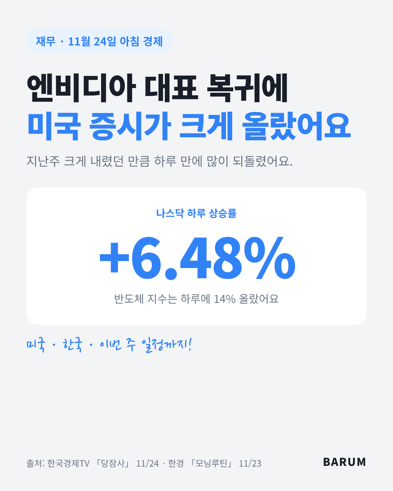
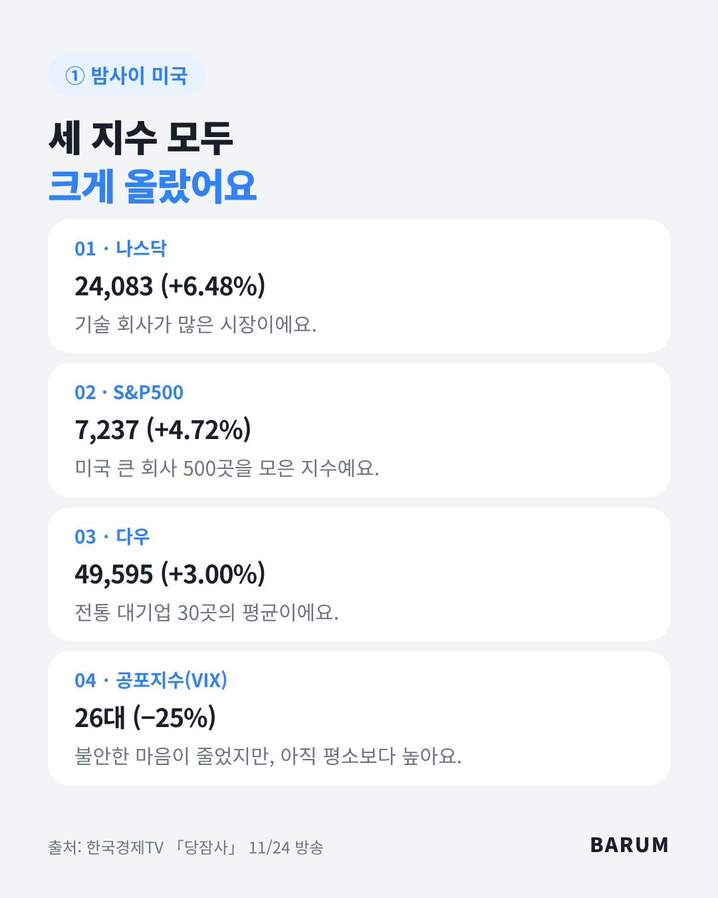
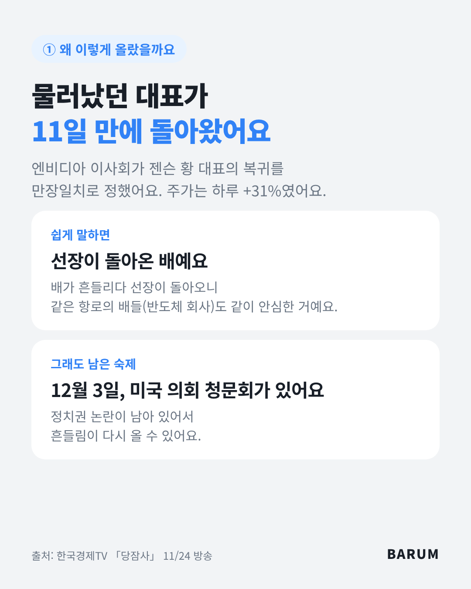
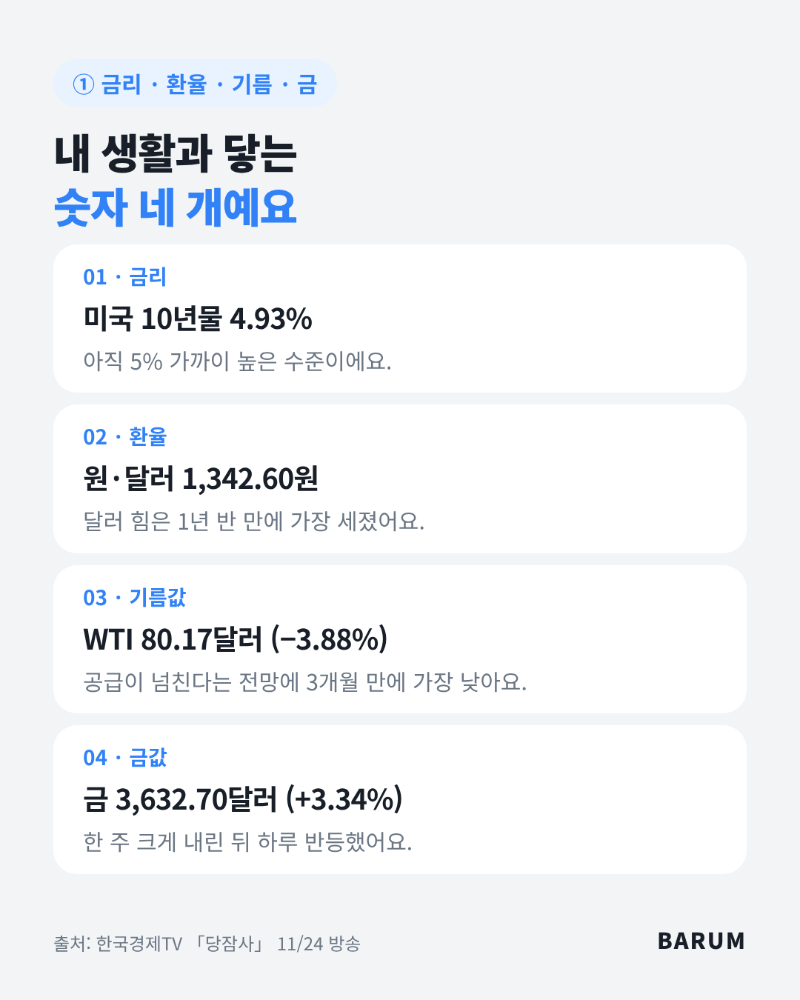
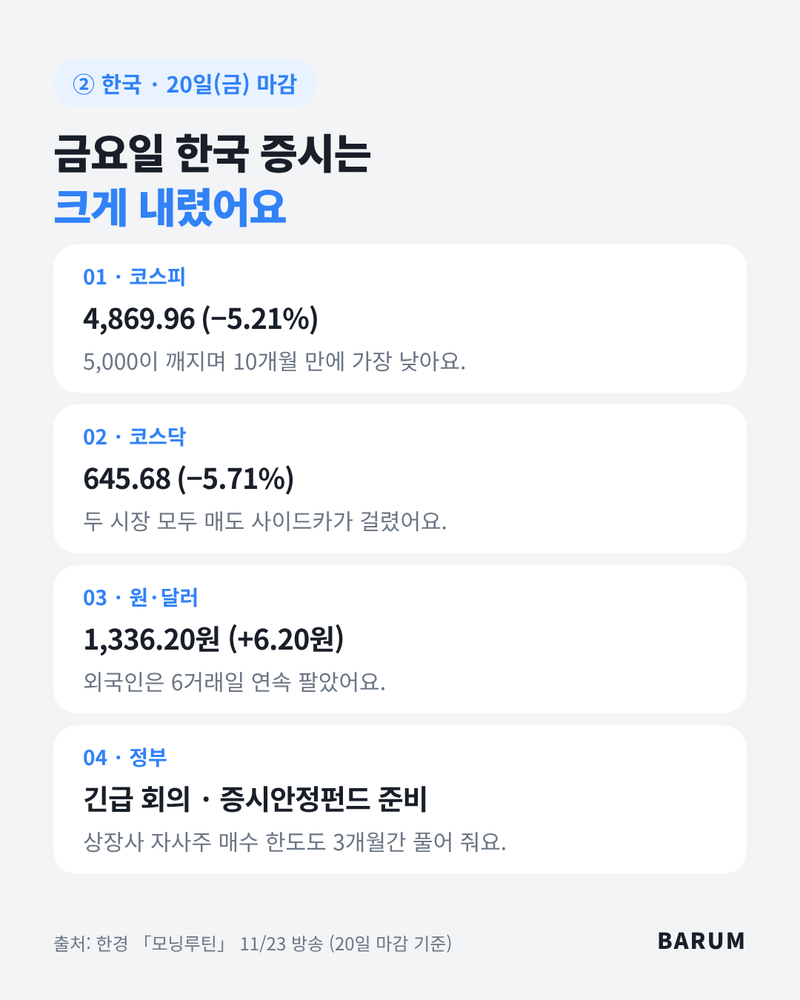
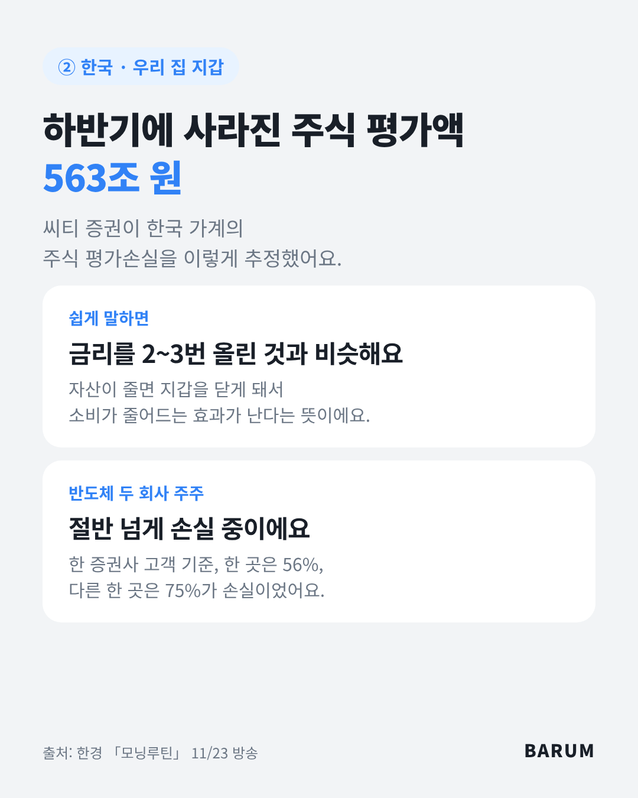
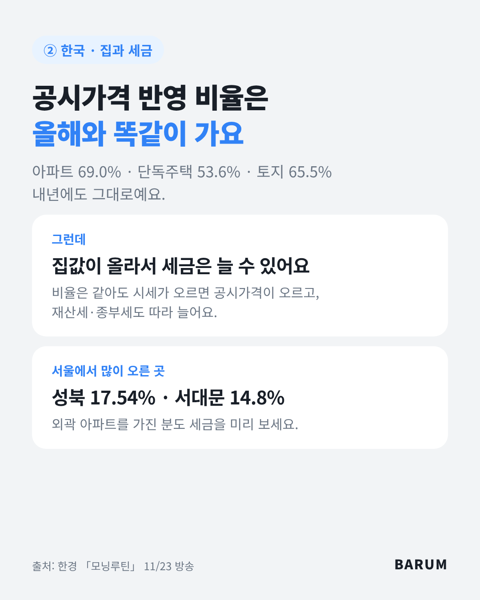
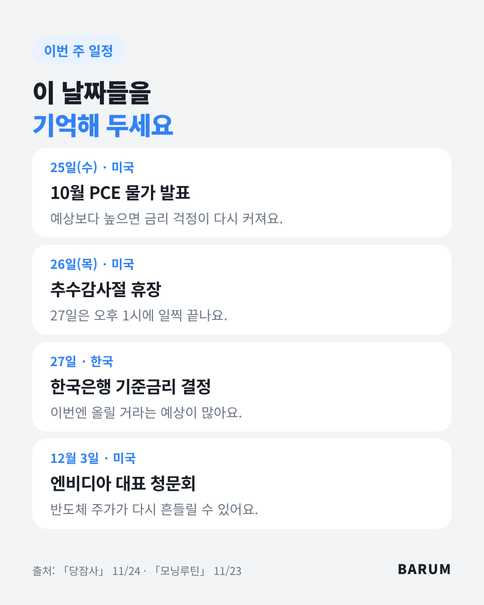
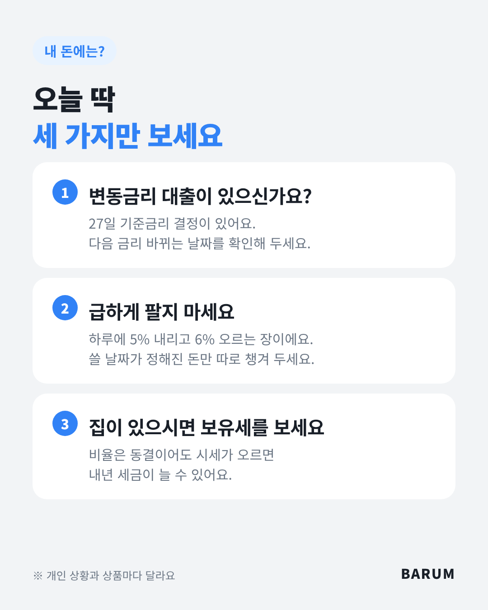
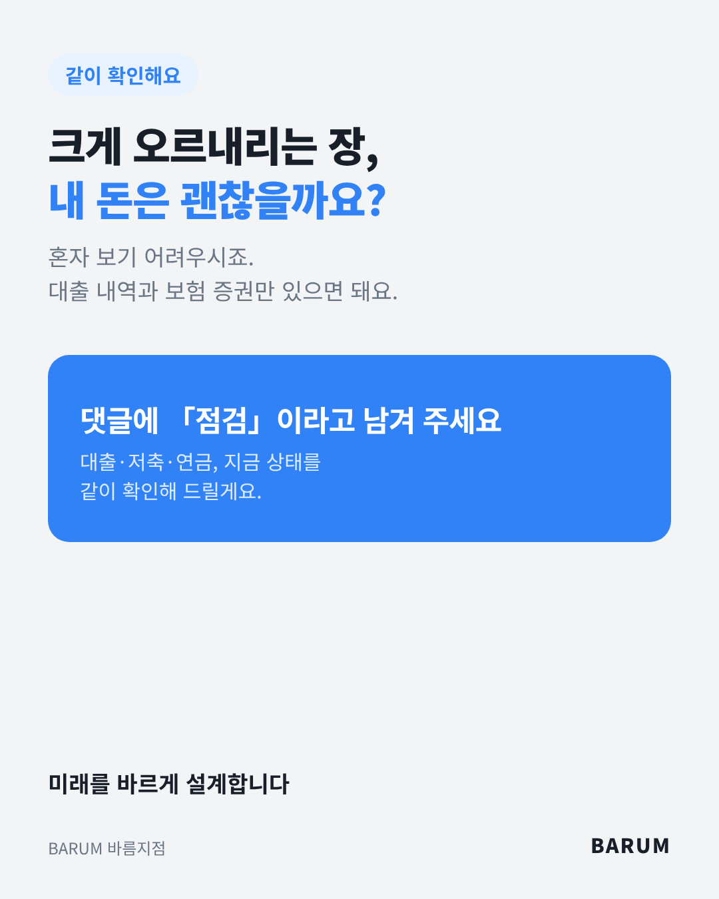

# 2026-11-24 재무 브리핑

## 카드뉴스 (세로 1080×1350 · 고객 공유용)

카드 묶음 받기: https://raw.githubusercontent.com/bokkile83-ui/barum-news/main/fin/cards/2026-11-24-mix_카드.zip

## 밤사이 미국 (당잠사 11/24)
- 다우 49,595.31(+3.00%), 나스닥 24,083.51(+6.48%), S&P500 7,237.17(+4.72%), 필라델피아 반도체 9,588.14(+14.03%). VIX 26대(−25%).
- 엔비디아 이사회가 젠슨 황 CEO 복귀를 만장일치로 결정(퇴진 11일 만). 엔비디아 +31.38%, TSMC +14%, 테슬라 +11%.
- 월가 목표가 상향: 멜리우스 220달러(매수로 상향), 번스타인 200달러, 오펜하이머 250달러.
- 정치 리스크 남음: 민주당 측 조사 촉구. 12월 3일 젠슨 황 미 상원 청문회.
- 미국 10년물 4.93%, 2년물 4.68%. 12월 금리 동결 가능성은 사라지고 50bp 인하 가능성 4%(CME).
- 달러인덱스 104.34, 작년 4월 이후 처음 104 돌파. 원·달러 1,342.60원.
- WTI 80.17달러(−3.88%), 브렌트 89.33달러(−3.50%). IEA 공급 과잉 전망, 3개월래 최저.
- 금 3,632.70달러(+3.34%)·은 42.88달러(+4.39%) 반등. 이번 달 금 −8%, 은 −14%.
- 크라우드스트라이크가 지스케일러를 약 439억 달러 주식 교환으로 인수 발표.
- JP모간 2027 전망 「BID」: 넓혀라(지역·업종)·이자수익(우량 채권)·분산(금·대체자산). 주식 55/채권 35/금 10 포트폴리오가 60/40보다 수익률 7.1%·변동성 8.6%로 낫다는 분석.

## 한국 (모닝루틴 11/23 · 20일 금요일 마감)
- 코스피 4,869.96(−5.21%, 10개월 만에 최저, 5,000선 붕괴), 코스닥 645.68(−5.71%). 양 시장 매도 사이드카.
- 원·달러 1,336.20원(+6.20원). 외국인 코스피 6거래일 연속 순매도(1.1조 원), 개인 1.5조 원 순매수.
- 정부 F4 긴급회의: 증권시장안정펀드 가동 준비(투입되면 2008년 이후 18년 만), 상장사 자사주 매수 한도 3개월 완화, 공매도 금지는 안 함(3개월 불법 공매도 집중 감시).
- 씨티: 한국 가계 주식 평가손실 하반기 563조 원 추정 → 기준금리 2~3차례 인상과 맞먹는 소비 위축 효과.
- 한 증권사 고객 기준 반도체 대형 2종목 보유자 56%·75%가 손실 중.
- 공시가격 현실화율 동결: 공동주택 69.0%, 단독 53.6%, 토지 65.5%. 시세 상승으로 보유세는 늘 수 있음(성북 17.54%, 서대문 14.8%, 구로 13.6%).
- 금융주·한국전력은 방어. 증권사 예상 배당수익률 7~9%대.

## 이번 주 일정
- 25일(수) 미국 10월 PCE 물가, 델·HPE 실적
- 26일(목) 미국 추수감사절 휴장, 27일 조기 폐장
- 27일 한국은행 금통위: 인상 예상 우세
- 11월 30일 엔비디아 워싱턴 GTC, 12월 3일 젠슨 황 청문회

## 설계사에게
- 결론: 하루에 −5%, 다음 날 +6%가 나오는 장이다. 오늘 상담 소재는 「급매도 막기」「변동금리 대출(27일 금통위)」「보유세」다.
- 주식·펀드 손실 고객: 지금 팔지 말라고 단정하지 않는다. 「쓸 날짜가 정해진 돈」과 「오래 둘 돈」을 나눠 보게 한다.
- 대출 고객: 27일 기준금리 결정 전에 다음 금리 변경일을 확인하게 한다. 인상 예상은 방송 의견이라고 전한다.
- 주택 보유 고객: 현실화율 동결이어도 시세 상승분만큼 내년 재산세·종부세가 오를 수 있다. 숫자는 고객 공시가격으로 따로 확인한다.
- 분산 이야기: JP모간 「주식 55·채권 35·금 10」은 기관 전망일 뿐이다. 개별 고객 권유로 쓰지 않는다.
- 엔비디아 복귀를 둘러싼 정치 이야기는 상담에서 꺼내지 않는다.

## 오늘 고객에게 한마디
> 「금요일에 크게 내리고 밤사이 미국은 크게 올랐어요. 이럴 때 급하게 팔기보다, 곧 써야 할 돈만 따로 챙겨 두시면 돼요. 같이 한번 나눠 볼게요.」

— BARUM 바름지점

## 출처
- [한국경제TV 「당잠사」 11/24 방송](https://www.youtube.com/watch?v=jguFMibEtRk)
- [한경 코리아마켓 「모닝루틴」 11/23 방송](https://www.youtube.com/watch?v=Bnfe_vuf_lg)
- 숫자는 방송 화면·멘트 기준. 미국 지수는 방송 뒷부분 마감 화면 숫자를 썼다(앞부분 숫자와 소수점 차이 있음). 한국 숫자는 모닝루틴이 생방송 전이라 전날(11/23) 회차를 썼다.
