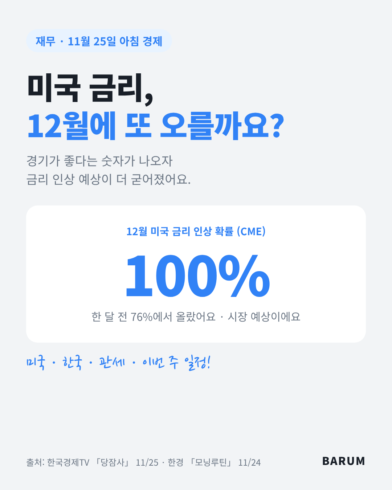
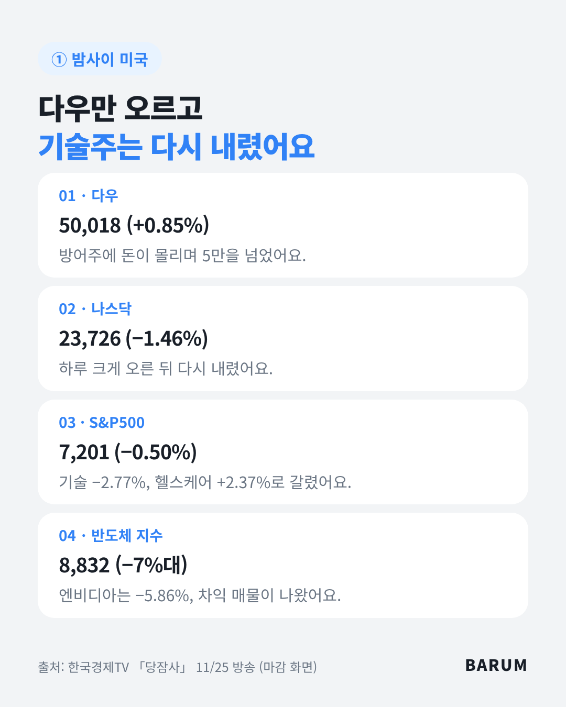
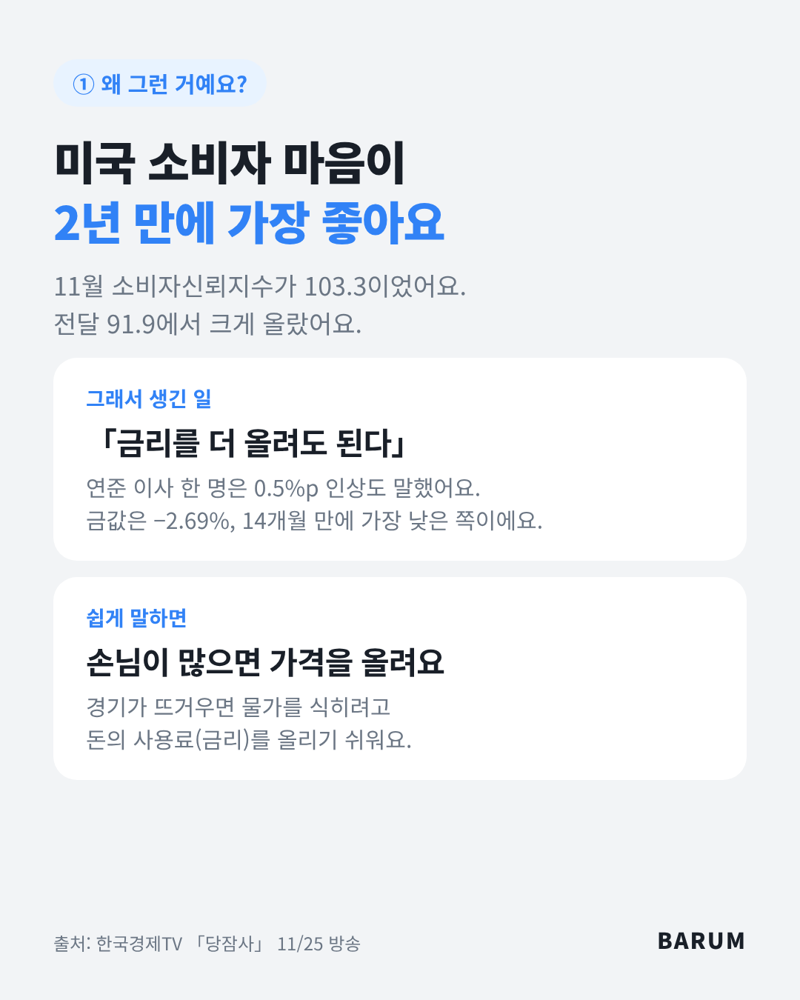
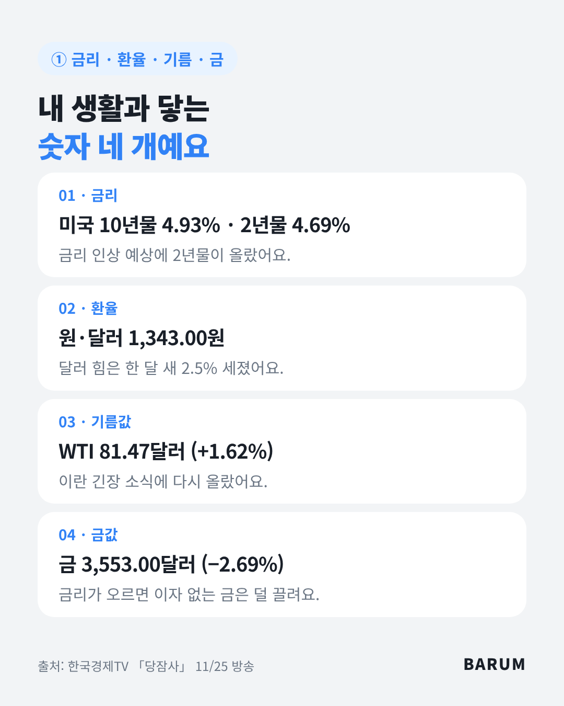
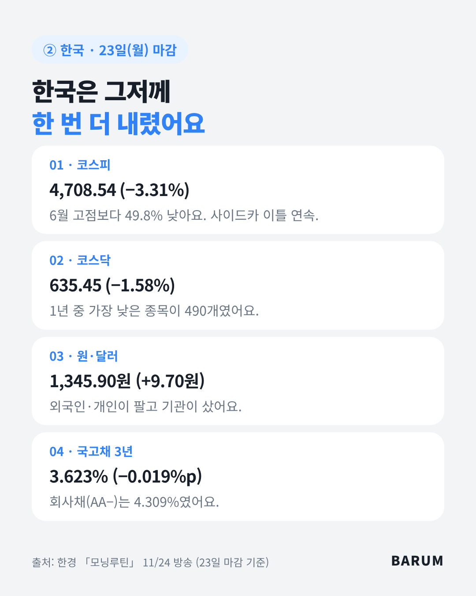
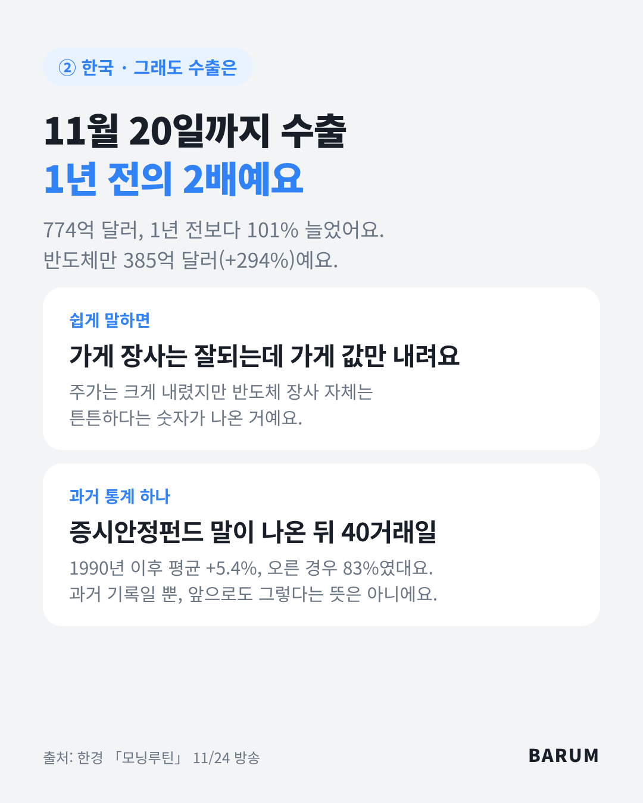
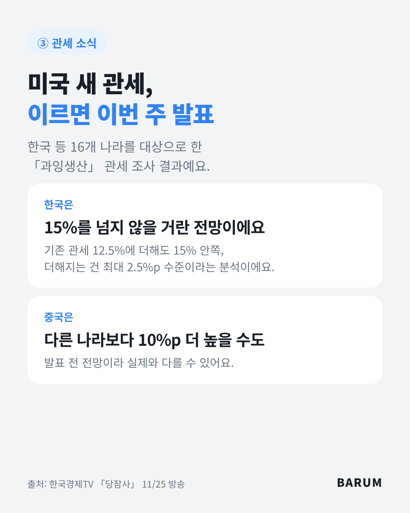
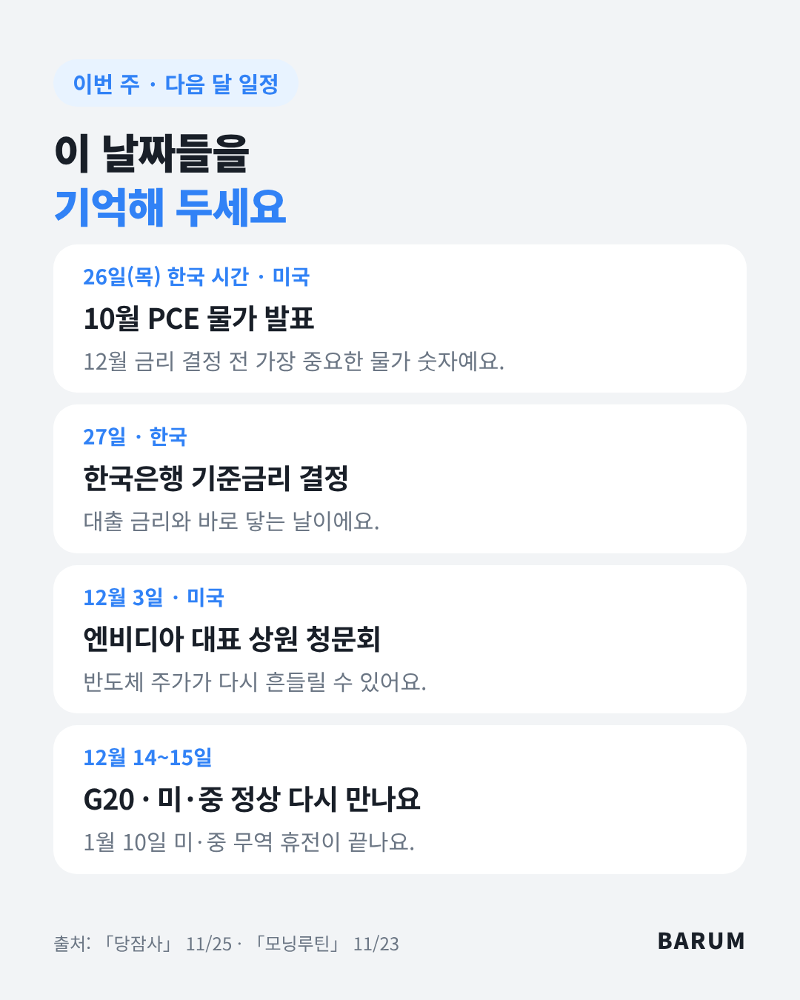
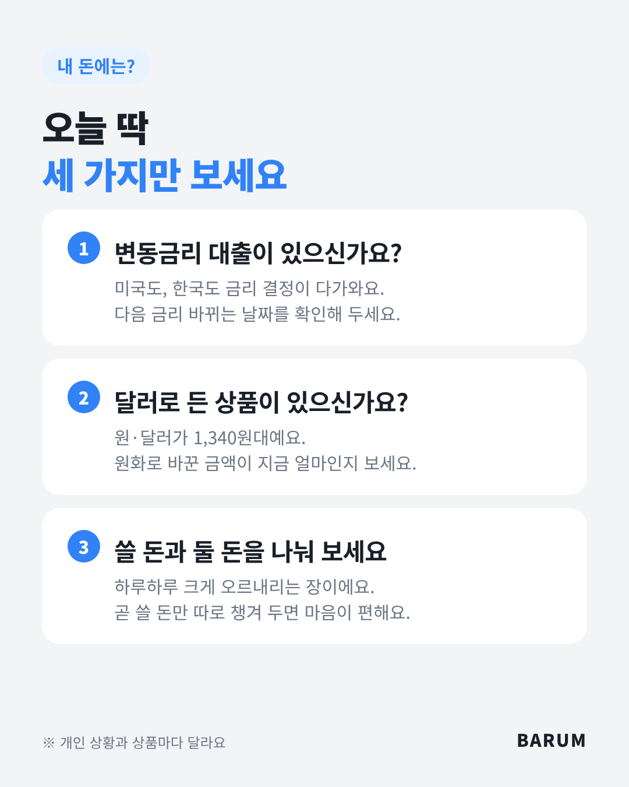
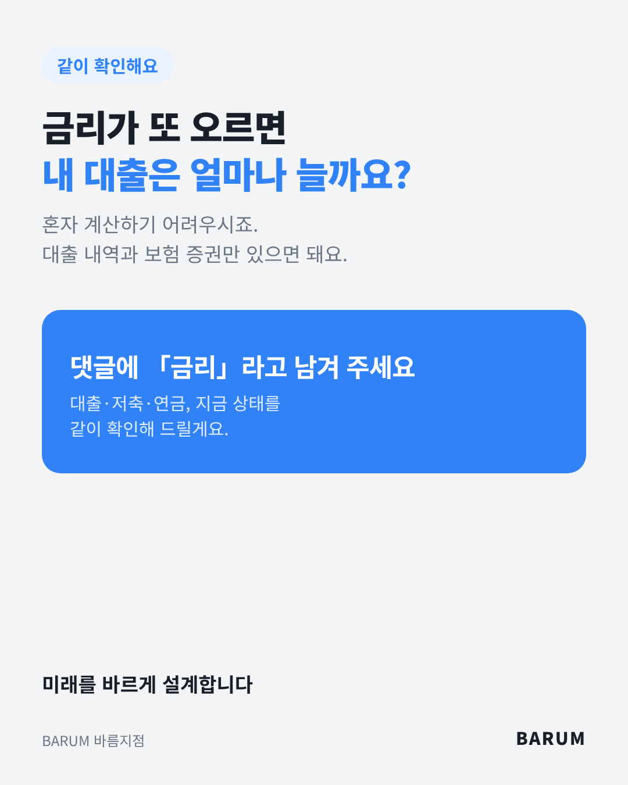

# 2026-11-25 재무 브리핑

## 카드뉴스 (세로 1080×1350 · 고객 공유용)

카드 묶음 받기: https://raw.githubusercontent.com/bokkile83-ui/barum-news/main/fin/cards/2026-11-25-mix_카드.zip

## 밤사이 미국 (당잠사 11/25)
- 다우 50,018.70(+0.85%, 방어주 유입), 나스닥 23,726.89(−1.46%), S&P500 7,201.09(−0.50%), 필라델피아 반도체 8,832.50(−7%대). 기술 −2.77%, 헬스케어 +2.37%, 필수소비재 +1.73%.
- 엔비디아 −5.86%(복귀 랠리 후 차익 실현, 민주당의 수출통제 위반 주장). 마이크론 −11.68%(BNP파리바 의견 하향·2027 공급 과잉 경고). 앤트로픽 공모가 83달러 붕괴, 81.71달러.
- 11월 컨퍼런스보드 소비자신뢰지수 103.3(전월 91.9), 2025년 1월 이후 최고.
- CME 12월 금리 인상 확률 100%(한 달 전 76%). 윌러 이사 「물가 상승 지속 시 12월 0.5%p 인상 고려」. BofA는 12·1·3월 3연속 인상, 기준금리 5% 가능성.
- 미국 10년물 4.93%, 2년물 4.69%, 30년물 5.32%.
- 달러인덱스 103.82(−0.47%). 한 달 새 101.81 → 104.32. 원·달러 1,343.00원.
- WTI 81.47달러(+1.62%), 브렌트 90.88달러(+1.69%). 이란 신규 제재·호르무즈 선박 피격 소식.
- 금 3,553.00달러(−2.69%, 14개월 만에 최저 부근), 은 40.68달러(−5.79%). 비트코인 59,772달러, 6만 달러 붕괴.
- USTR 「과잉생산 관세」 이르면 이번 주 발표. 16개 경제권 대상. 한국은 기존 12.5%에 더해도 15% 상한 안쪽(추가 최대 2.5%p) 전망, 중국은 10%p 더 높을 가능성.
- UBS 2027 기본 시나리오(50%): S&P500 8,200, 미 10년물 4.75%, 금 5,000달러. 「물가가 안정돼도 초저금리로 돌아가긴 어렵다」.

## 한국 (모닝루틴 11/24 · 23일 월요일 마감)
- 코스피 4,708.54(−3.31%), 6월 고점(9,385) 대비 −49.8%. 이틀 연속 매도 사이드카. 코스피 52주 신저가 312개.
- 코스닥 635.45(−1.58%), 52주 신저가 490개.
- 원·달러 1,345.90원(+9.70원). 외국인 2,000억 원·개인 3,000억 원 이상 순매도, 기관 1,000억 원 이상 순매수.
- 국고채 3년 3.623%(−0.019%p), 회사채 AA− 4.309%(−0.020%p).
- 11월 1~20일 수출 774억 달러(+101%), 반도체 385억 달러(+294%, 전체의 절반).
- 한화투자증권: 1990년 이후 증안펀드 첫 언급 뒤 40거래일 코스피 평균 +5.4%, 상승 확률 83%.
- 트럼프의 「해외 AI 데이터센터 이용 기업 과세」 발언에 IT서비스 15% 안팎, 건설 8% 안팎 급락.
- 국산 CAR-T 치료제 다음 달 1일부터 건강보험 급여 적용.

## 이번 주 · 다음 달 일정
- 26일(한국시간) 미국 10월 PCE
- 27일 한국은행 금통위(11/23 모닝루틴: 인상 예상 우세)
- 12월 3일 젠슨 황 상원 청문회, 12월 14~15일 G20(미·중 정상 재회동), 내년 1월 10일 미·중 무역 휴전 만료

## 설계사에게
- 결론: 오늘 키워드는 「금리 인상」이다. 미국 12월 인상 확률 100%, 한국도 27일 금통위가 있다. 상담 소재는 「변동금리 대출」「달러 상품 원화 환산」「쓸 돈/둘 돈 나누기」다.
- 대출 고객: 다음 금리 변경일을 확인하게 한다. 「오른다」고 단정하지 말고 「시장 예상」이라고 전한다.
- 주식 손실 고객: 증안펀드 과거 통계는 과거 기록일 뿐이다. 반등 근거로 쓰지 않는다.
- 달러보험 고객: 환율 1,343~1,346원대만 알려 준다. 환율 전망은 말하지 않는다.
- 관세 소식은 아직 발표 전 전망이다. 수출 기업 종사 고객에게도 확정처럼 말하지 않는다.

## 오늘 고객에게 한마디
> 「미국은 12월에 금리를 또 올릴 거라는 예상이 많아졌고, 한국도 27일에 금리를 정해요. 대출 금리가 언제 바뀌는지 같이 확인해 드릴게요.」

— BARUM 바름지점

## 출처
- [한국경제TV 「당잠사」 11/25 방송](https://www.youtube.com/watch?v=jYCUaFdAGUw)
- [한경 코리아마켓 「모닝루틴」 11/24 방송](https://www.youtube.com/watch?v=gFmaFtPQje0)
- 숫자는 방송 화면·멘트 기준. 미국 지수는 방송 뒷부분 마감 화면 숫자를 썼다(앞부분 숫자와 소수점 차이 있음). 한국 숫자는 모닝루틴이 생방송 전이라 전날(11/24) 회차를 썼다. 27일 금통위 전망은 11/23 모닝루틴 내용이다. 머니가이드는 새 편이 없어 뺐다.
