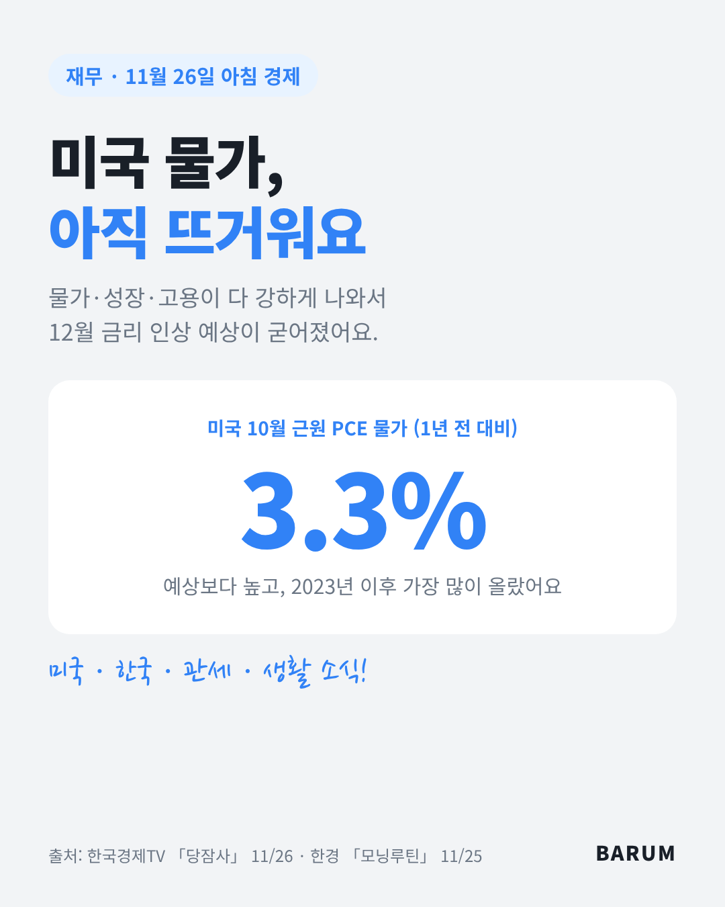
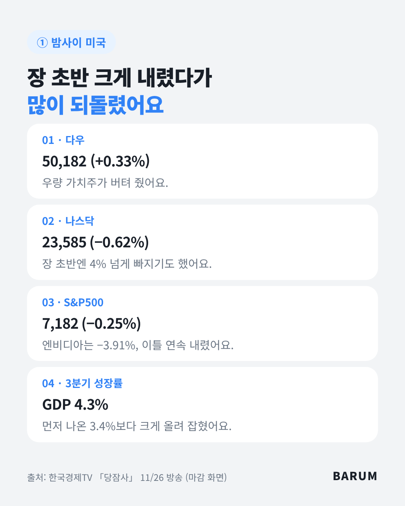
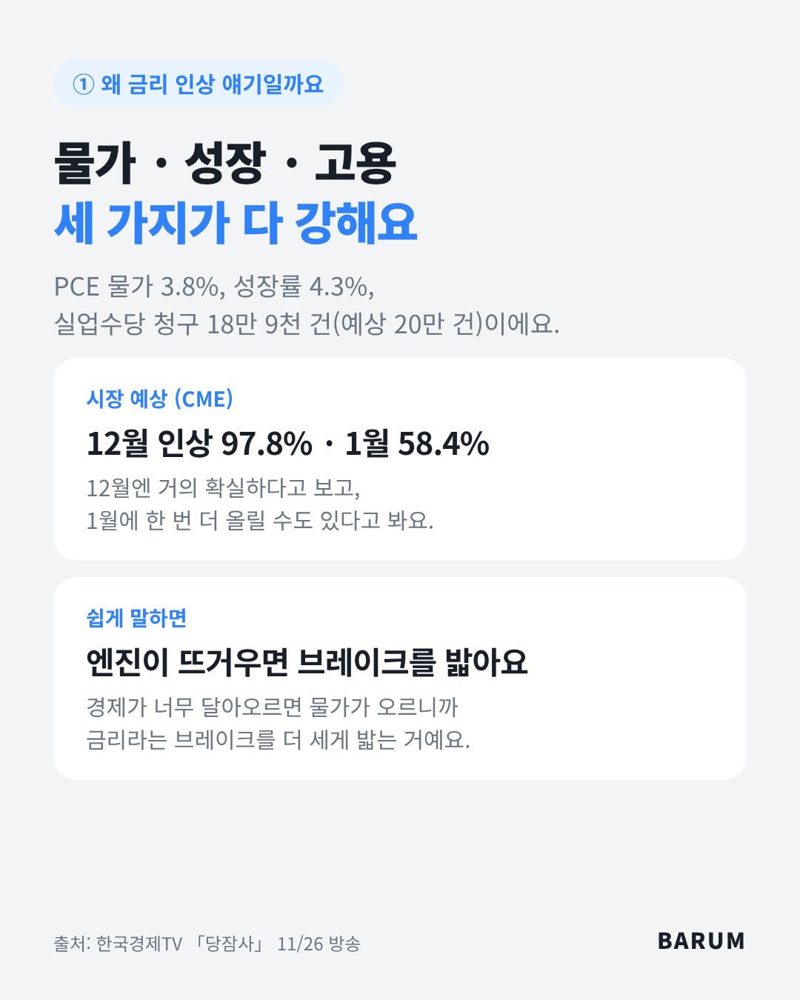
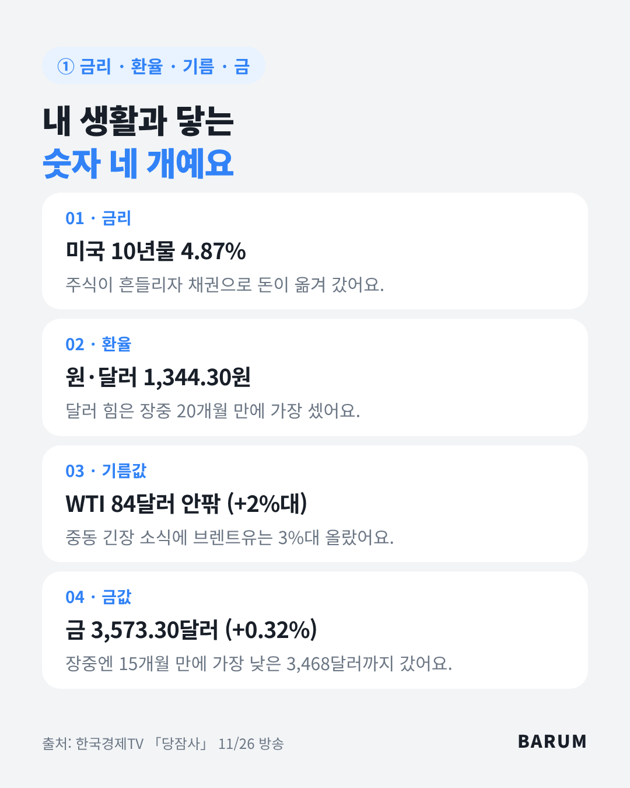
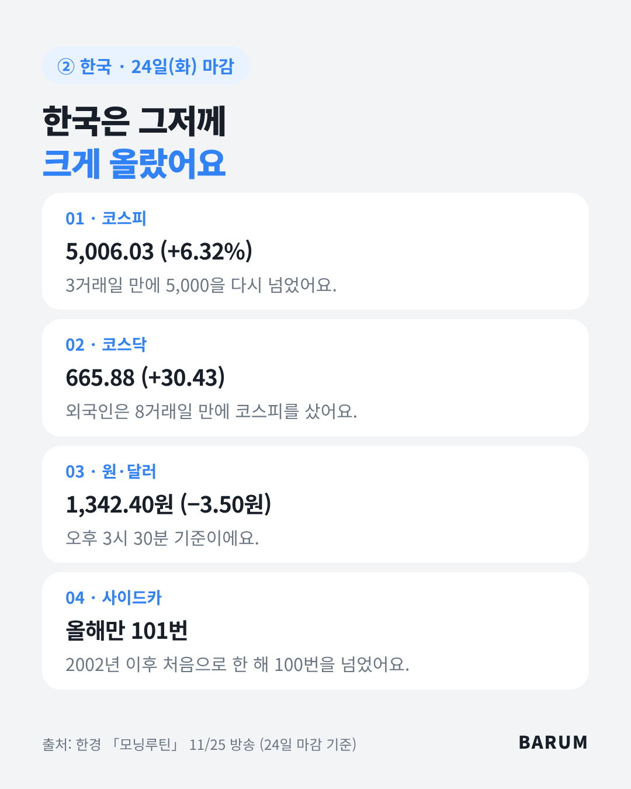
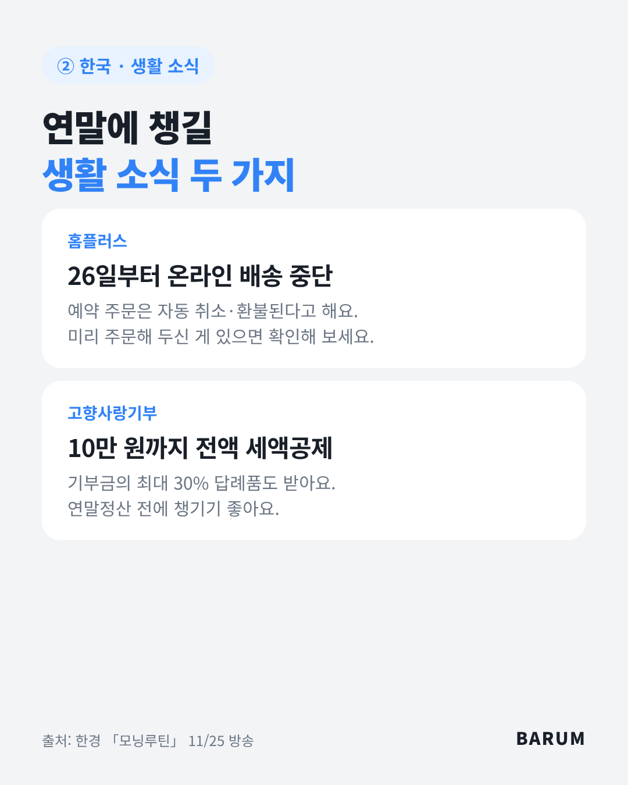
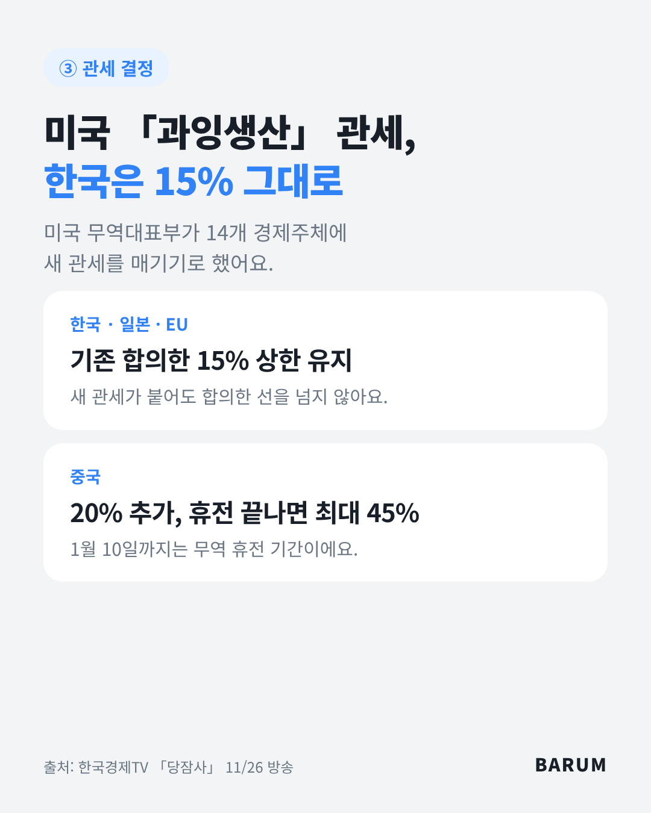
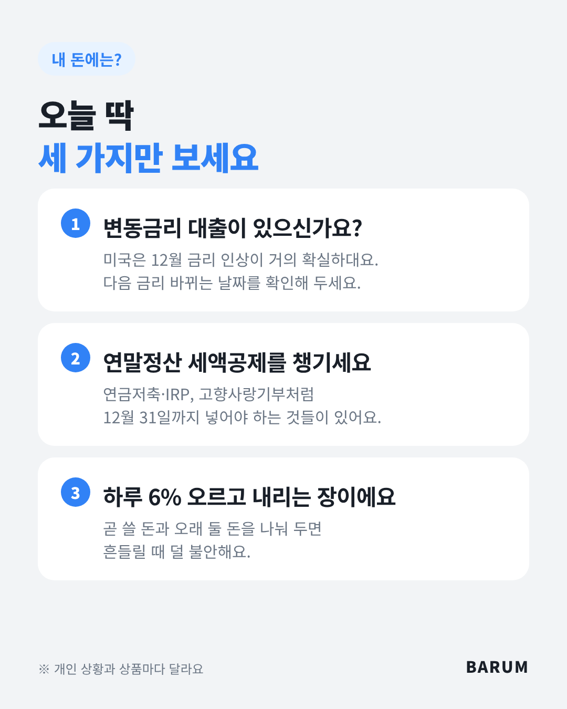
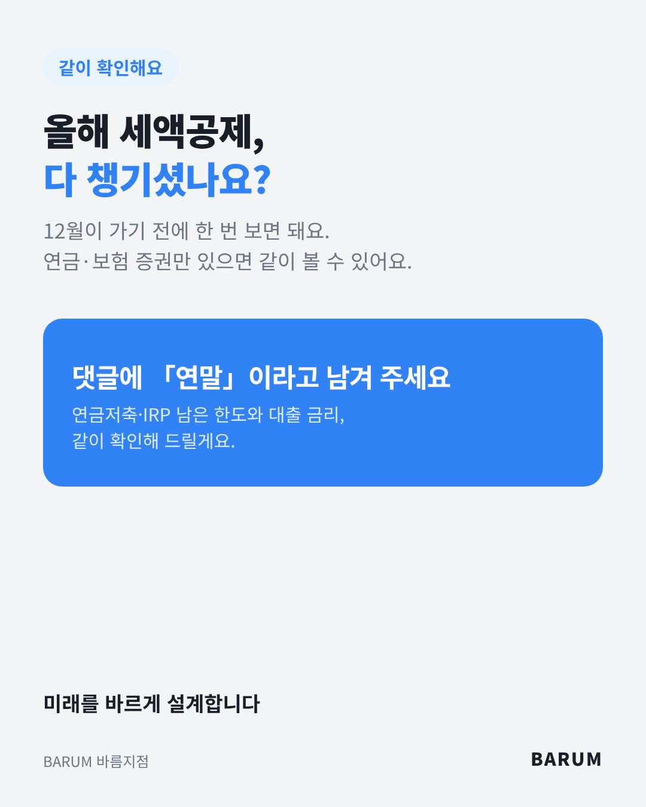

# 2026-11-26 재무 브리핑

## 카드뉴스 (세로 1080×1350 · 고객 공유용)

카드 묶음 받기: https://raw.githubusercontent.com/bokkile83-ui/barum-news/main/fin/cards/2026-11-26-mix_카드.zip

## 밤사이 미국 (당잠사 11/26)
- 다우 50,182.95(+0.33%), 나스닥 23,585.80(−0.62%, 장 초반 −4% 넘게 하락 후 만회), S&P500 7,182.78(−0.25%).
- 10월 PCE 물가 전년 대비 3.8%(예상 부합), 근원 PCE 3.3%(예상 상회, 2023년 이후 최대).
- 3분기 GDP 4.3%(속보치 3.4%에서 상향). 기업 장비 투자 +21.8%, 개인 소비 +4.2%, 10월 저축률 4.1%.
- 주간 신규 실업수당 청구 18만 9천 건(예상 20만 건).
- CME 12월 금리 인상 확률 97.8%, 내년 1월 추가 인상 58.4%. 일부 기관은 3월까지 최소 2차례 인상 전망.
- 미국 10년물 4.87%, 2년물 4.65%(안전자산 선호로 하락).
- 달러인덱스 장중 104.1(20개월래 최고) 후 103.6~103.7. 원·달러 1,344.30원.
- WTI 83.93~84.06달러(+2%대), 브렌트 94.41~94.62달러(+3%대). 후티 반군 사우디 정유시설 공격 주장. 미국 휘발유 갤런당 3.91달러(3월 이후 최저).
- 금 3,573.30달러(+0.32%), 장중 3,468달러(15개월래 최저). 은 40.90달러. 비트코인 60,215달러, 공포·탐욕 지수 8(극단적 공포).
- USTR 과잉생산 관세 확정: 14개 경제주체. 한국·일본·EU는 15% 상한 유지. 중국 20% 추가(1월 10일 휴전 종료 시 최대 45%).
- S&P가 엔비디아 신용등급(AA)을 부정적 관찰대상에 올림. 엔비디아 −3.91%(마감).

## 한국 (모닝루틴 11/25 · 24일 화요일 마감)
- 코스피 5,006.03(+6.32%), 3거래일 만에 5,000 회복. 코스닥 665.88(+30.43p).
- 원·달러 1,342.40원(−3.50원), 국고채 3년 3.640%, 회사채 AA− 4.318%.
- 외국인 코스피 8거래일 만에 순매수(7,000억 원 이상), 기관 8,000억 원 이상 순매수, 개인 2조 원 이상 순매도.
- 올해 코스피·코스닥 사이드카 101회, 2002년 제도 개편 이후 처음 100회 돌파.
- 홈플러스 26일부터 온라인 배송 중단, 예약 주문 자동 취소·환불.
- 고향사랑기부 10만 원 전액 세액공제 + 기부금 최대 30% 답례품(방송 광고 코너).
- 금융위 「디지털자산법」 입법 착수: 거래소 단일 주주 지분 원칙 20%, 금융회사는 승인 시 34%까지. 기존 거래소 약 3년 유예.
- 당일(25일) 프리마켓은 반도체 대형주 5% 안팎 하락 출발.

## 설계사에게
- 결론: 미국은 「물가·성장·고용」이 모두 강해 12월 금리 인상이 사실상 기정사실로 받아들여졌다. 오늘 상담 소재는 「변동금리 대출」「연말정산 세액공제 마감」이다.
- 연말정산: 연금저축·IRP 남은 한도(연 900만 원), 고향사랑기부 10만 원을 12월 31일 전에 확인하게 한다. 여유자금 안에서만 권한다.
- 대출 고객: 다음 금리 변경일을 확인하게 한다. 미국 금리 전망을 한국 금리로 바로 옮겨 말하지 않는다.
- 방송 하단 자막에 「10월 가계대출 금리 5% 돌파, 주담대 금리 최고치」가 있었으나 숫자 표기가 엇갈려(14년 7개월/14개월) 카드에는 쓰지 않았다. 상담 전 한국은행 발표로 확인한다.
- 증시는 하루 −3%, 다음 날 +6%가 나오는 장이다. 방향을 단정하지 않는다.

## 오늘 고객에게 한마디
> 「미국은 12월에 금리를 올릴 가능성이 아주 높아졌어요. 올해 세액공제도 12월 31일까지라 대출 금리와 연금저축 한도를 같이 확인해 드릴게요.」

— BARUM 바름지점

## 출처
- [한국경제TV 「당잠사」 11/26 방송](https://www.youtube.com/watch?v=CCVHyPD0TRw)
- [한경 코리아마켓 「모닝루틴」 11/25 방송](https://www.youtube.com/watch?v=XgZj5xFFbHI)
- 숫자는 방송 화면·멘트 기준. 미국 지수는 방송 뒷부분 마감 화면 숫자를 썼다(앞부분 숫자와 차이 있음). 한국 숫자는 모닝루틴이 생방송 전이라 전날(11/25) 회차를 썼다. 머니가이드는 새 편이 없어 뺐다.
