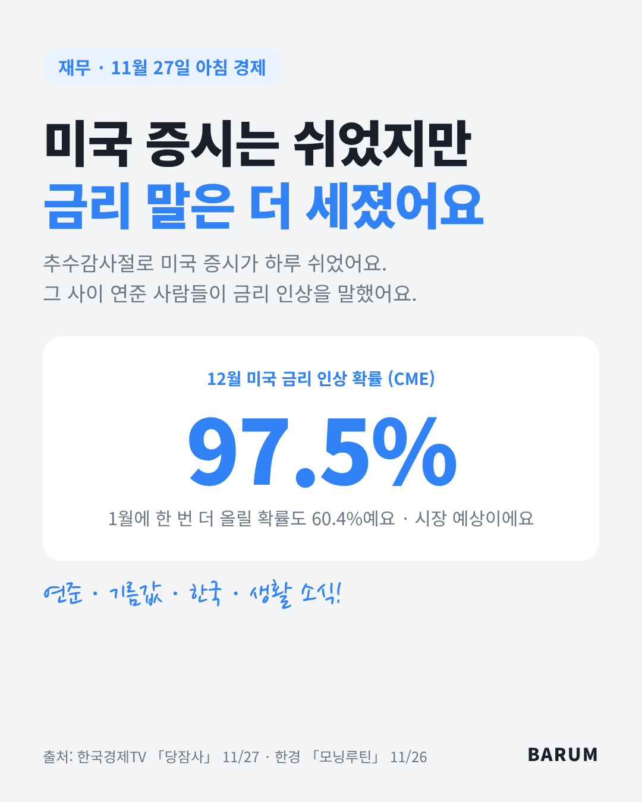
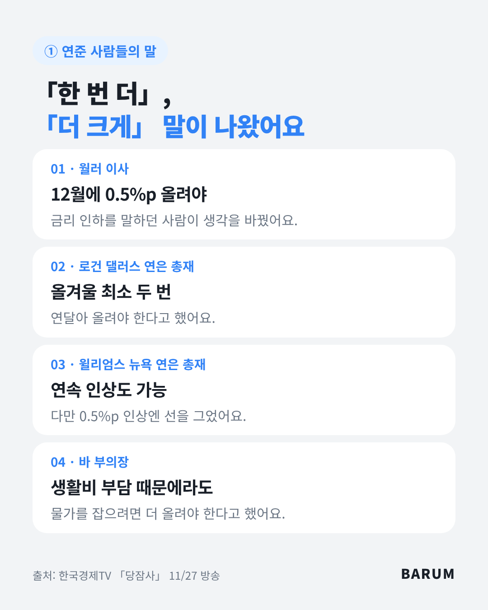
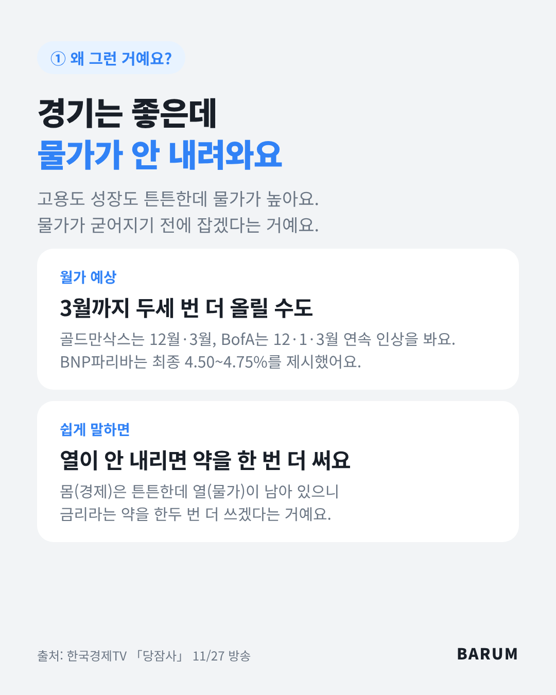
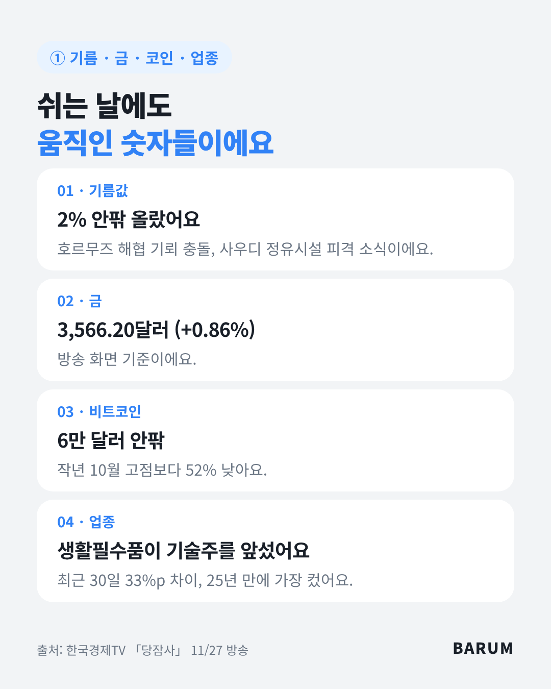
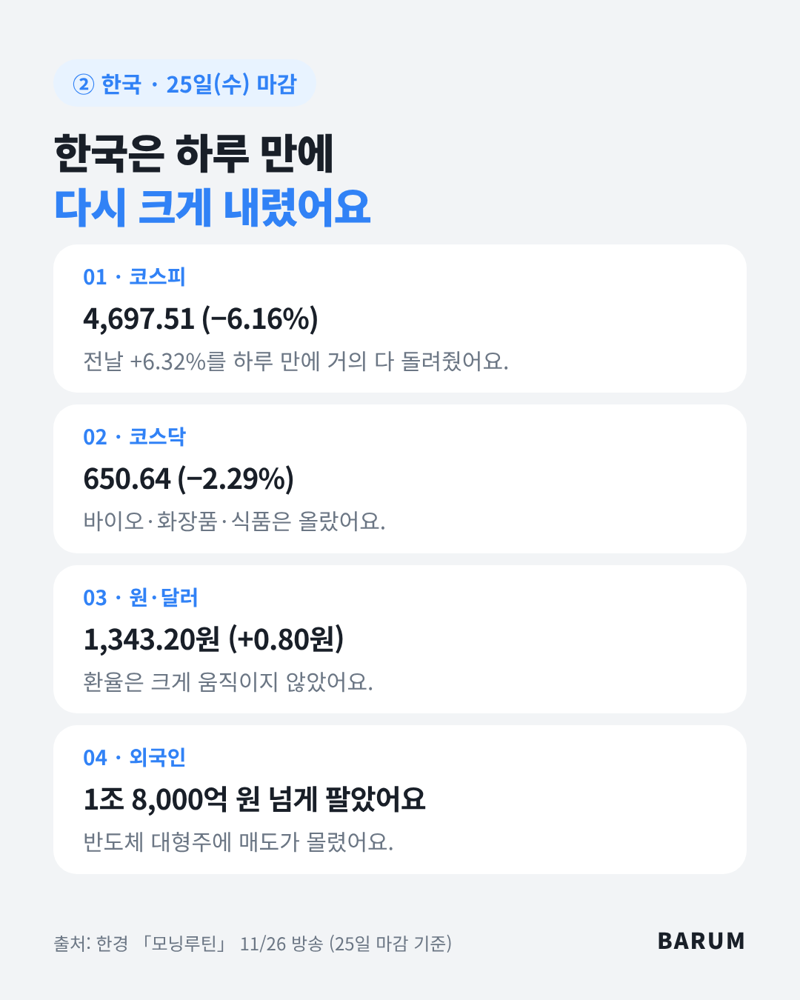
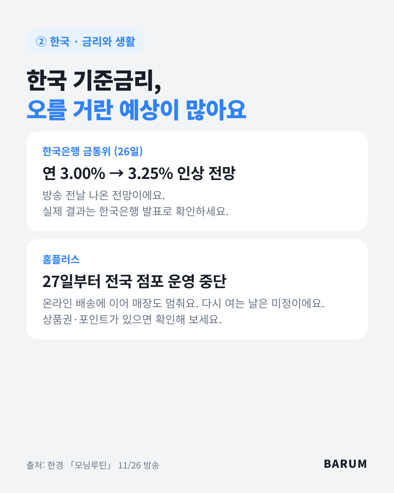
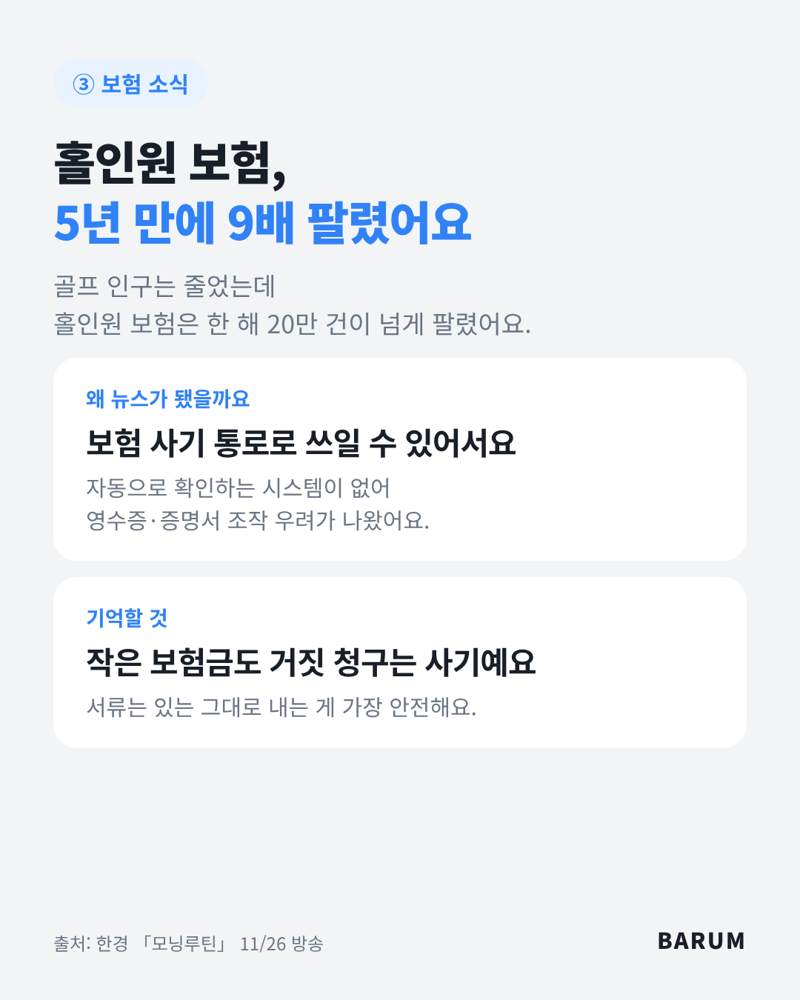
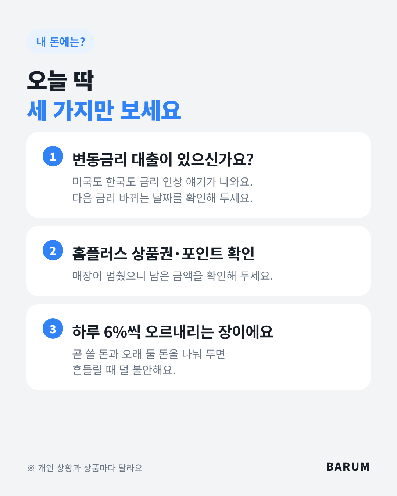
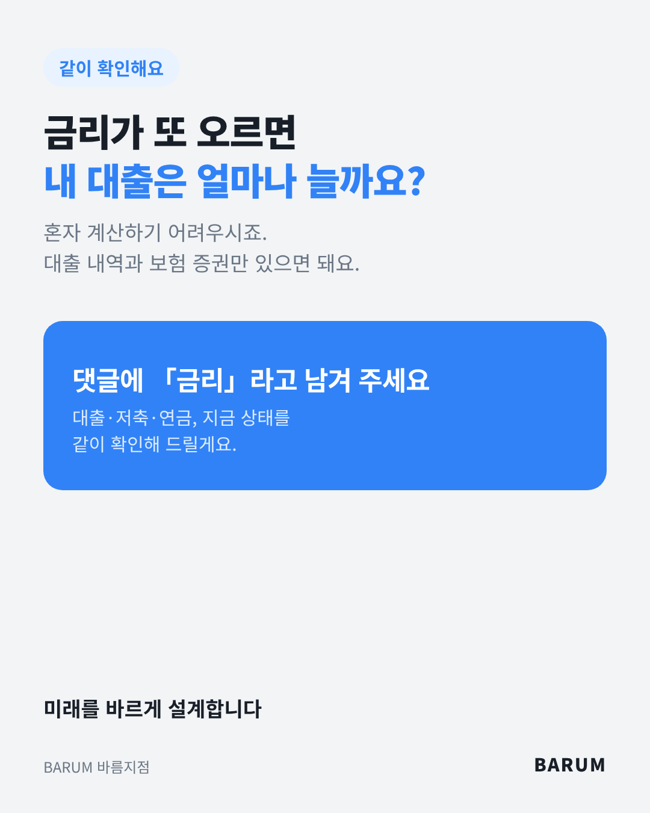

# 2026-11-27 재무 브리핑

## 카드뉴스 (세로 1080×1350 · 고객 공유용)

카드 묶음 받기: https://raw.githubusercontent.com/bokkile83-ui/barum-news/main/fin/cards/2026-11-27-mix_카드.zip

## 밤사이 미국 (당잠사 11/27)
- 미국 증시 추수감사절 휴장(26일). 28일은 현지시간 오후 1시 조기 폐장.
- 연준 인사 발언: 월러 이사 「12월 0.5%p 인상 필요」, 로건 댈러스 연은 총재 「올겨울 최소 두 차례 연속 인상」, 윌리엄스 뉴욕 연은 총재 「연속 인상 배제 안 해(0.5%p엔 선 그음)」, 하커 필라델피아 연은 총재 「연이은 인상 고려」, 바 부의장 「생활비 부담 줄이려면 추가 인상 필요」.
- CME: 12월 인상 확률 97.5%, 1월 60.4%.
- IB 전망: 골드만삭스 12월·3월 인상(1월 동결), BofA 12·1·3월 3연속, BNP파리바 3연속·최종 4.50~4.75%.
- 유가 2% 안팎 상승(호르무즈 해협 유조선 기뢰 충돌, 사우디 정유시설 피격 보도). 52주 화면 기준 WTI 84.91달러.
- 금 3,566.20달러(+0.86%), 은 41.24달러(+2.94%). 비트코인 6만 달러 안팎(작년 10월 고점 대비 −52%).
- 최근 30일 섹터: 헬스케어 +25.0%, 에너지 +19.7%, 필수소비재 +12.6% vs IT −7.3%. 필수소비재가 기술주를 33%p 앞서 25년 만에 최대 격차(BTIG).
- 2027년 말 S&P500 목표치: 도이치 9,000, 골드만·모건스탠리·바클레이즈 8,700, JP모간·UBS·웰스파고 8,200.
- 엔비디아: 중국 기업에 연산 자원을 임대하는 클라우드 업체엔 GPU 판매 불허 통보(CNBC), 동남아 4개국행 AI 서버 출하 중단 지시(FT).

## 한국 (모닝루틴 11/26 · 25일 수요일 마감)
- 코스피 4,697.51(−6.16%), 코스닥 650.64(−2.29%). 원·달러 1,343.20원(+0.80원).
- 외국인 코스피 1조 8,000억 원 이상 순매도(반도체 대형주), 개인 1조 4,000억 원대 순매수.
- 정부, 증안펀드 재원 확대 추진(2020년 10조 7,600억 원은 코스피 시총의 0.3% 수준이라는 지적).
- 한국은행 금통위(26일): 기준금리 연 3.00% → 3.25% 인상 가능성 유력 전망(방송 시점 전망, 결과 미반영).
- 홈플러스: 27일부터 전국 67개 전 점포 운영 중단(재개 미정). 긴급 운영자금 2,000억 원 조기 소진, 매각 실패 시 청산 우려.
- USTR 과잉생산 관세 상한: 한국·일본·EU 15%, 중국 20%, 베트남 35%. 협의 불만족 시 한국 최대 25% 경고. 최종 결정은 내년 예상.
- 홀인원 보험: 판매 2021년 22,742건 → 최근 연 20만 건(5년 만에 약 9배). 전산 자동 확인이 없어 서류 조작 등 보험사기 통로 우려.
- 전기차 배터리 리스제: 자동차관리법 개정 추진, 내년 1월 실증. 아이오닉 5 예시 실구입가 2,500만 원대, 월 구독료 30만 원대 검토.

## 설계사에게
- 결론: 미국은 12월 인상이 사실상 확정이고 1월·3월 추가 인상 전망까지 나왔다. 한국도 금통위 인상 전망이 우세했다. 오늘 상담 소재는 「변동금리 대출」이다.
- 한국 금통위 결과는 이 방송에 없다. 상담 전 한국은행 발표로 실제 결정을 확인하고 말한다.
- 홀인원 보험 기사는 「보험사기」 이슈다. 고객에게 청구 서류는 있는 그대로 내야 한다는 점만 전하고, 특정 상품 이야기는 하지 않는다.
- 홈플러스 이용 고객에게는 상품권·포인트 잔액 확인을 안내한다.
- 증시는 하루 +6%, 다음 날 −6%다. 방향을 단정하지 않는다.

## 오늘 고객에게 한마디
> 「미국은 12월에 금리를 올릴 게 거의 확실하고, 내년 초 한 번 더 얘기까지 나와요. 대출 금리가 언제 바뀌는지 같이 확인해 드릴게요.」

— BARUM 바름지점

## 출처
- [한국경제TV 「당잠사」 11/27 방송](https://www.youtube.com/watch?v=k0uy1rABZbY)
- [한경 코리아마켓 「모닝루틴」 11/26 방송](https://www.youtube.com/watch?v=CmaW3aIlpQI)
- 숫자는 방송 화면·멘트 기준. 미국 증시는 휴장이라 지수 숫자는 쓰지 않았다. 한국 숫자는 11/26 모닝루틴(25일 마감) 기준. 11/27 아침에 유튜브 도구 장애로 못 만들어 11/28 오전에 채워 올렸다. 머니가이드는 새 편이 없어 뺐다.
