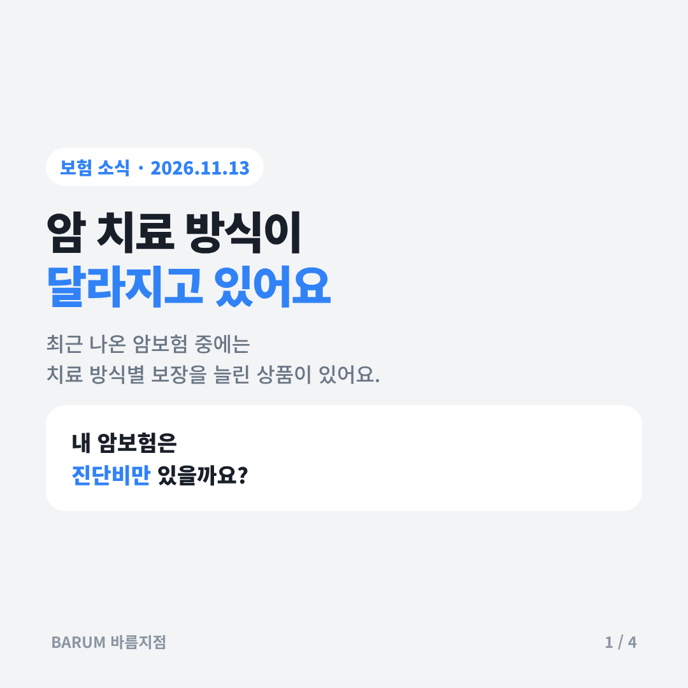
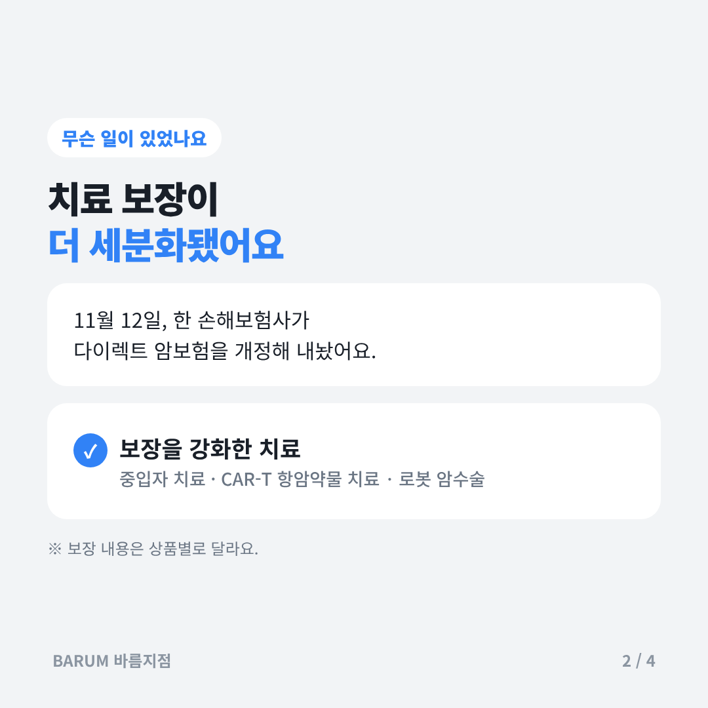
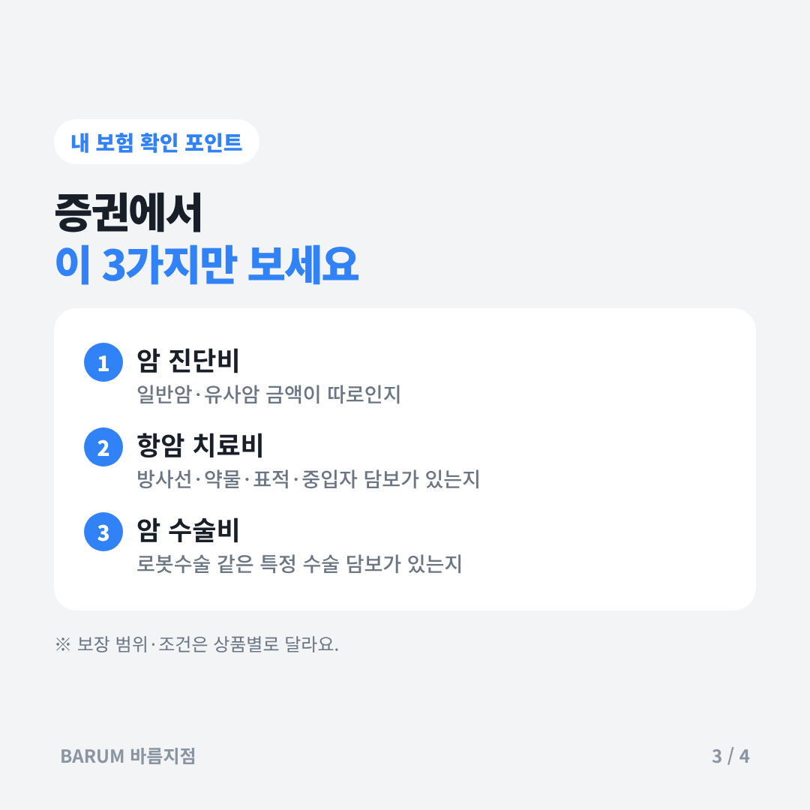
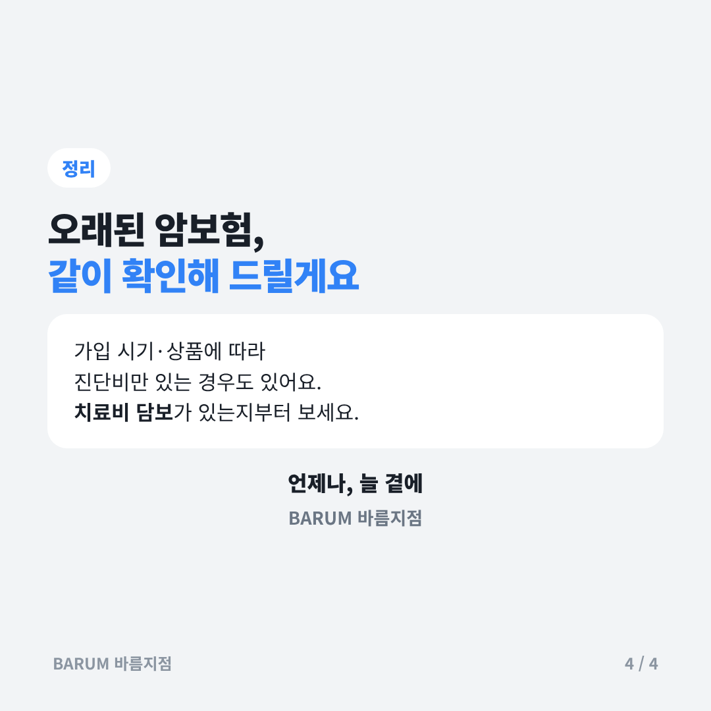

# 2026-11-13 보험 뉴스 브리핑

## 카드뉴스 (정사각형 1080×1080 · 고객 공유용)

카드 묶음 받기: https://raw.githubusercontent.com/bokkile83-ui/barum-news/main/news/cards/2026-11-13-cancer_카드.zip

## 금융당국
- 11.12~13 금감원·금융위 **보험 관련** 보도자료는 확인되지 않았다.
- 11.12 금융위 「금융회사 지배구조 개선방안」 발표 — 임추위 전원 독립이사, 연임 추천 3/4 이상 찬성. 설명자료는 4대 은행지주 사례 중심이며 보험사 적용 범위는 [확인].
- 설계사에게: 당장 영업 규칙 변화는 없다. 보험사 적용 여부는 후속 보도자료로 확인한다.

## 업계 뉴스
- 현대해상, 다이렉트 암플랜 개정(11.12) — 중입자·CAR-T 항암약물허가치료·로봇암수술 보장 강화. 암보험 상담 때 「진단비 vs 치료비」 비교 소재 — 글로벌이코노믹
- 같은 날 어린이보험 신담보 2종 — 선별검사 이상 소견 후 융모막·양수검사 지원비(최초 1회 최대 70만원), 특정질병 항바이러스제 치료비(37종) — 글로벌이코노믹
- 10월 보험 검색 관심도 1년 전보다 전부 하락 — 운전자 ▼42.8%·암 ▼39.8%·실손 ▼36.8%. 9월 손보 9개사 5세대 실손 가입 91,669건 — 시사매거진
- DB손보 3분기 누적 순익 1조3,119억원(+9.3%), 장기보험 손익 +35.5%, K-ICS 212.0% — 한국금융신문
- 현대해상 3분기 누적 순익 7,808억원(+23.1%), 투자손익 ▼76.1%·자동차보험 233억원 손실 — 중앙이코노미뉴스

## 오늘 고객에게 한마디
> 「요즘 암보험은 중입자·로봇수술처럼 치료 방식별로 보장이 나뉘어요. 지금 가진 암보험에 진단비만 있는지, 치료비 담보도 있는지 증권 한 번 같이 봐요.」

## 출처
- [글로벌이코노믹 — 현대해상, 다이렉트 암플랜·어린이 종합보험 개정(2026.11.12)](https://www.g-enews.com/article/Finance/2026/11/202611121109561705a6e8311f64_1)
- [시사매거진 — 실손·운전자·태아 등 보험 5종 검색 관심도 하락(2026.11.12)](https://www.sisamagazine.co.kr/article/1000000000747)
- [한국금융신문 — DB손보 2026 3분기 실적(2026.11.13)](https://www.fntimes.com/html/view.php?ud=2026111216390170839efc5ce4ae_18)
- [중앙이코노미뉴스 — 현대해상 3분기 누적 순익 7808억원(2026.11.13)](https://joongangenews.com/news/articleView.html?idxno=563670)
- [이즈보험 — 금융위 지배구조 개선방안 관련 설명자료(2026.11.13)](https://dazabi.com/insurance_magazine/article.php?id=47338)
