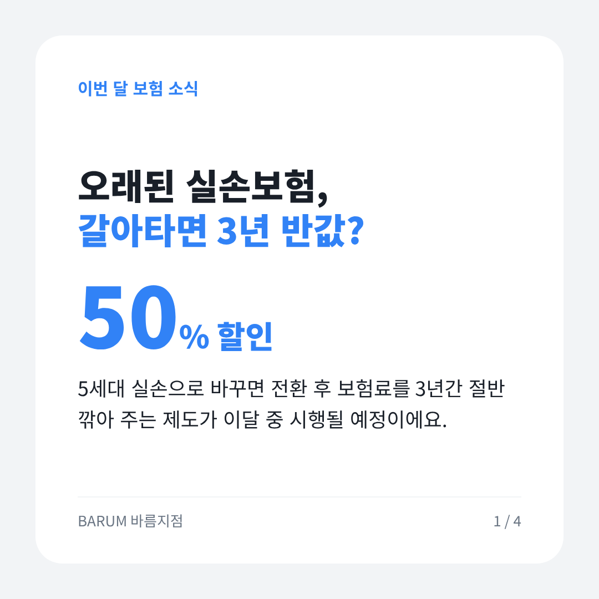
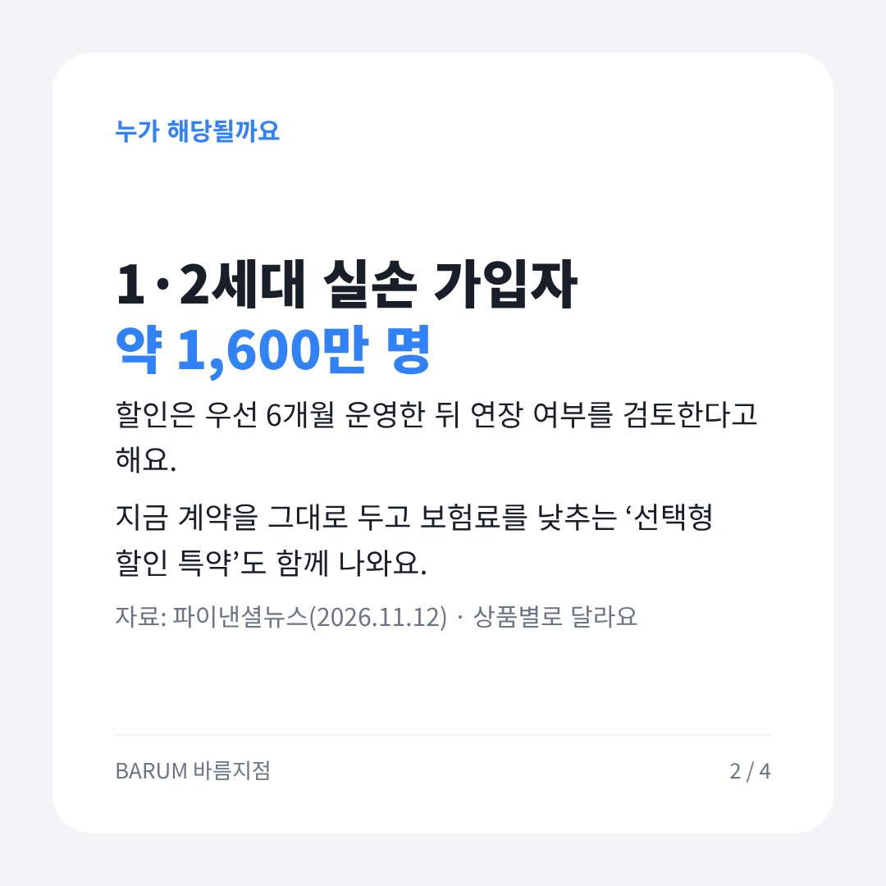
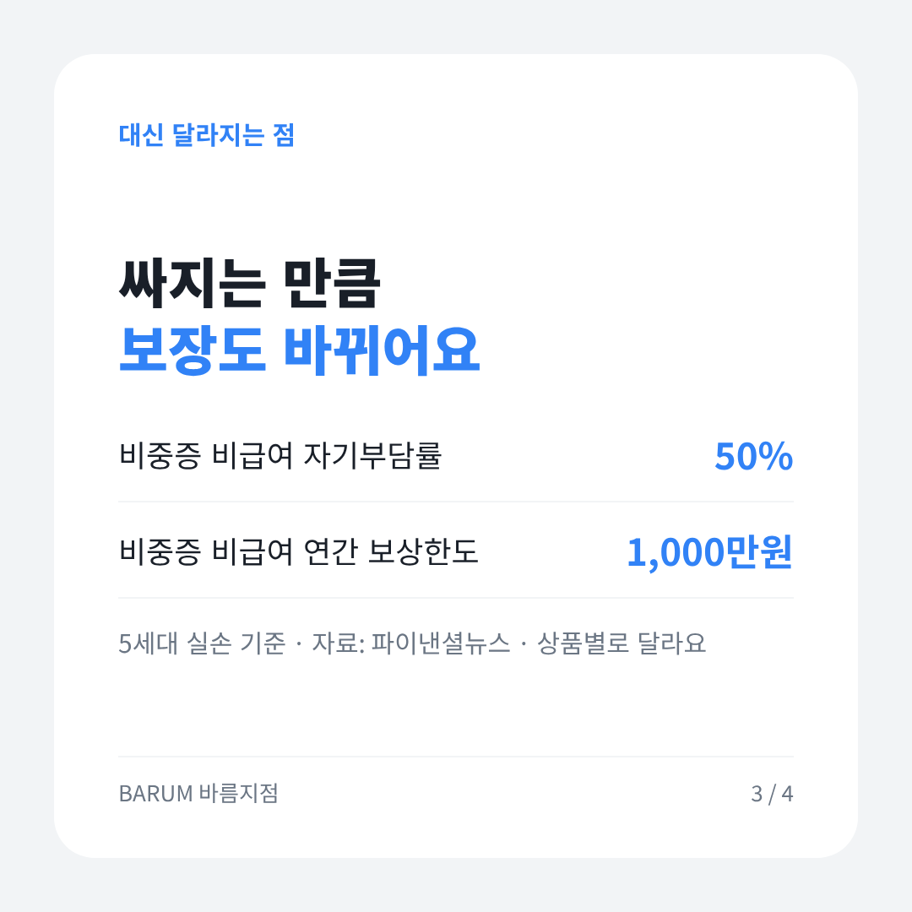
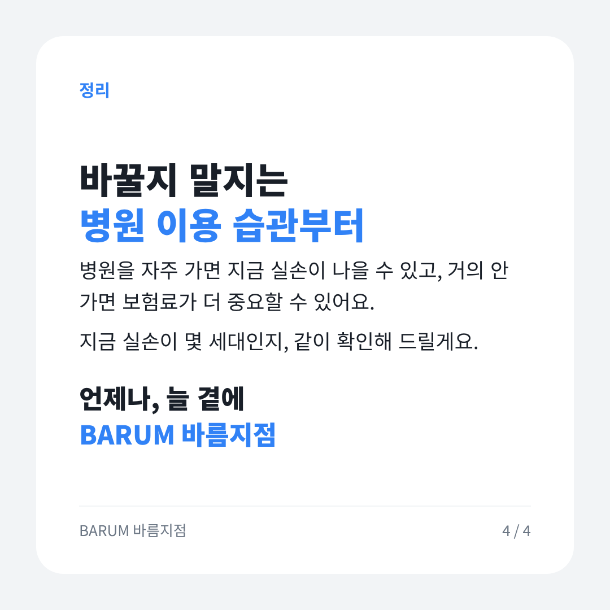

# 2026-11-14 보험 뉴스 브리핑

## 카드뉴스 (정사각형 1080×1080 · 고객 공유용)

카드 묶음 받기: https://raw.githubusercontent.com/bokkile83-ui/barum-news/main/news/cards/2026-11-14-silson_카드.zip

## 금융당국
- 11.13~14 금감원·금융위 **보험 관련 새 보도자료는 확인되지 않았다.**
- 대기 중인 건: 5세대 실손 계약전환 할인(전환 후 보험료 3년간 50% 할인) 이달 중 시행 예정. 6개월 운영 후 연장 검토. 기존 계약 유지형 「선택형 할인 특약」 병행.
- 설계사에게: 1·2세대 실손 고객 문의가 늘어난다. 시행일 확정 공지는 [확인] — 확정 전 날짜를 말하지 않는다.

## 업계 뉴스
- 5세대 실손 전환 할인 「3년 반값」 — 1·2세대 가입자 약 1,600만 명이 대상권. 비중증 비급여 자기부담 50%·연간 보상한도 1,000만원으로 바뀌는 점을 같이 설명해야 한다 — 파이낸셜뉴스
- 메리츠화재, 간병인사용일당 최저보험료 1만→8만원(10.26부터), 「3~100% 암후유」 가입한도 1억→2,000만원, 암치료비 최대 가입한도도 축소 — 보험저널
- 같은 회사 11월 주요 담보 보험료 최대 27% 인상 예정(담보·연령별 폭은 [확인]) — 간병·암치료비 리모델링 상담 소재 — 보험저널
- 5대 손보사 1~9월 누적 순익 5조9,943억원(+2.7%). 본업은 회복, 투자손익에서 희비(메리츠 -6.8%, 현대해상 +23.1%) — 아주경제
- 금융위 보험업감독규정 개정(11.4 의결): 보험사 위험평가(RAAS)에 「GA 운영위험 관리 적정성」 항목 신설 — GA 내부통제 점검이 강해진다 — 이투데이

## 오늘 고객에게 한마디
> 「오래된 실손을 5세대로 바꾸면 3년간 보험료 절반 할인 제도가 이달 중 시행될 예정이에요. 대신 비급여 자기부담이 커지니, 바꿀지 말지는 병원 이용 습관 보고 같이 따져 봐요.」

— BARUM 바름지점

## 출처
- [파이낸셜뉴스 — '3년간 반값' 5세대 실손 유인책 먹힐까(2026.11.12)](https://www.fnnews.com/news/202611121838386982)
- [보험저널 — 메리츠화재, 11월 보험료 최대 27% 인상(2026.11.10 수정)](https://www.insjournal.co.kr/news/articleView.html?idxno=33663)
- [아주경제 — 5대 손보사 실적 온도차(2026.11.13)](https://www.ajunews.com/view/20261113160211264)
- [이투데이 — 금융위, 보험사 계리가정 관리 강화…GA 위험도 평가(2026.11.04)](https://www.etoday.co.kr/news/view/2644167)
- [금융감독원 보도자료 목록](https://www.fss.or.kr/fss/bbs/B0000188/list.do?menuNo=200218)
- [금융위원회 보도자료 목록](https://www.fsc.go.kr/no010101)
