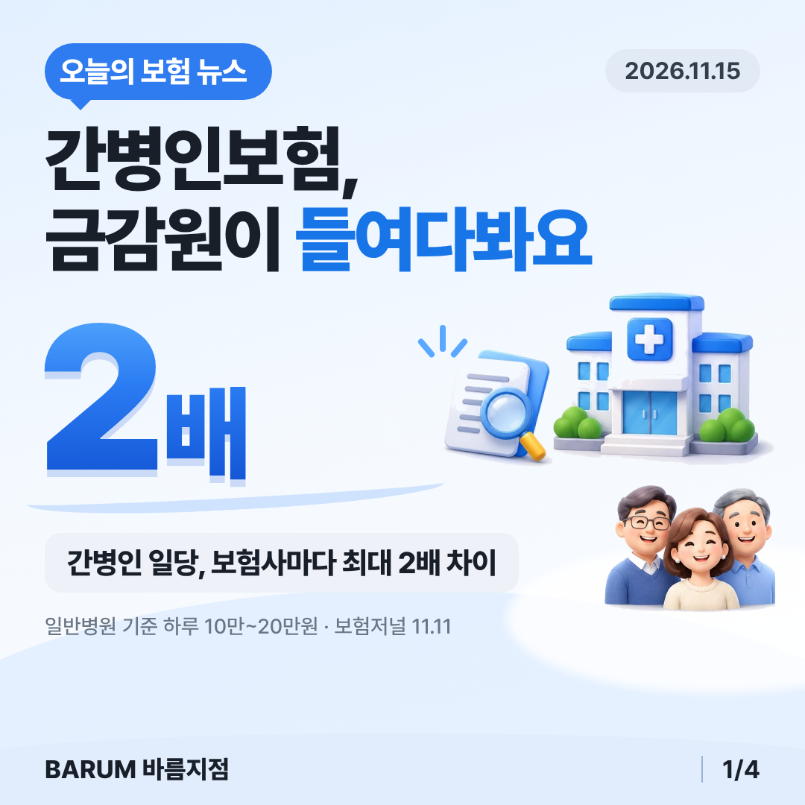
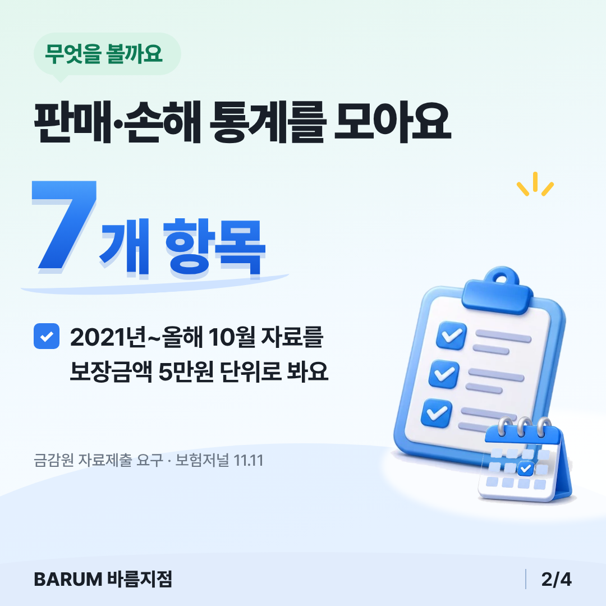
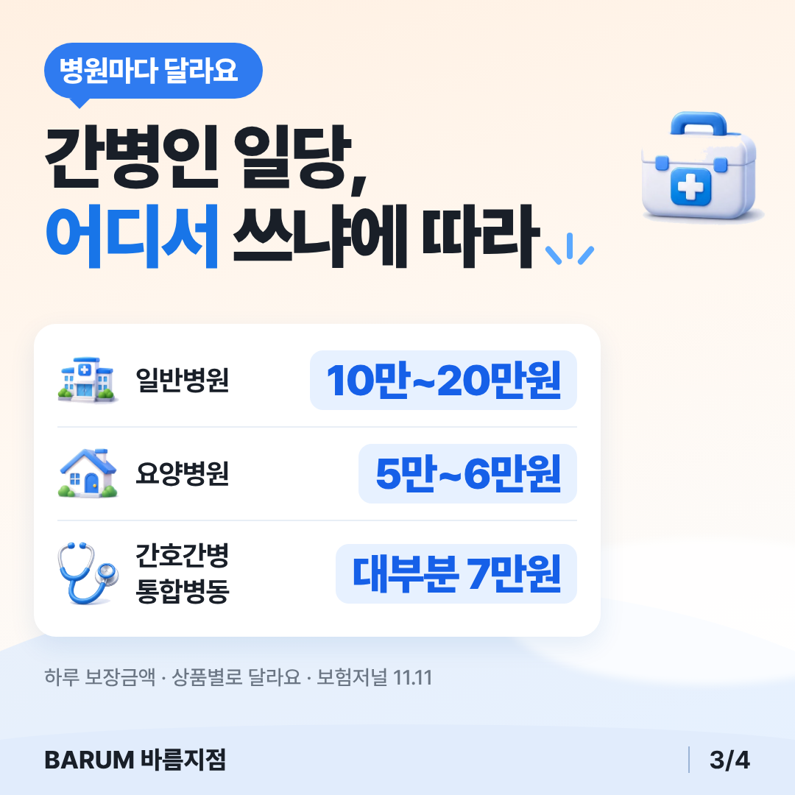

# 2026-11-15 보험 뉴스 브리핑

## 카드뉴스 (정사각형 1080×1080 · 고객 공유용)

카드 묶음 받기: https://raw.githubusercontent.com/bokkile83-ui/barum-news/main/news/cards/2026-11-15-ganbyeong_카드.zip

## 금융당국
- 11.14(토)~15(일) 금감원·금융위 **보험 관련 새 보도자료는 확인되지 않았다**(주말).
- 다음 주 예고: 11.19(목) 14시 금융위·금감원 **실손보험 점검회의**(부위원장 주재). 같은 날 금감원 **저축성보험 만기 후 최대 3년 연금 전환 안내**. 11.18(수) 금감원 자동차 보험사기 예방 안내.
- 설계사에게: 19일 실손 회의 뒤 1·2세대 전환 할인 관련 공지가 나올 수 있다 — 발표 전 시행일은 말하지 않는다. 저축성보험 만기 고객은 연금 전환 안내 자료를 받아 두고 상담에 쓴다.

## 업계 뉴스
- 금감원, 간병인보험 정밀 조사 착수 — 판매사에 2021년~올해 10월 신계약·손해율 등 7개 항목 통계를, 간병인사용일당 보장금액 5만원 단위로 요구. 통합·한도 축소 지시는 요구서에 없다 — 보험저널
- 간병인사용일당 현황: 일반병원 하루 10만~20만원(보험사별 최대 2배 차), 요양병원 5만~6만원, 간호·간병통합서비스 대부분 7만원 — 기존 고객 일당 점검 상담 소재 — 보험저널
- 5세대 실손 9월 손보 가입 91,669건(신규 50,679 · 4세대 재가입 28,297 · 1~4세대 전환 12,693). 보험료는 4세대보다 약 30% 낮다는 게 당국 설명이나 자기부담률이 달라 단순 비교는 어렵다 — 시사매거진
- 보험 검색 관심도 1년 새 모두 하락 — 운전자 -42.8%, 암 -39.8%, 실손 -36.8%, 치아 -34.3%, 태아 -22.7%(네이버 데이터랩 상대지수, 10월). 관심이 줄 때 먼저 점검 연락하는 쪽이 유리하다 — 시사매거진
- 단기납 종신 7년납 환급률(10년 시점) 최고 124.8%, 6개사 117.6% — 환급률 비교 문의 대비 — 보험저널

## 오늘 고객에게 한마디
> 「금감원이 간병인보험 일당을 들여다보고 있어요. 바뀔지는 아직 정해지지 않았으니, 지금 가지고 계신 간병 일당이 병원별로 얼마인지부터 같이 확인해 봐요.」

— BARUM 바름지점

## 출처
- [보험저널 — [단독] 간병인보험 보장한도 손보나… 금감원, 보장금액·손해율 정밀 조사 착수(2026.11.11)](https://www.insjournal.co.kr/news/articleView.html?idxno=33856)
- [뉴스핌 — 이번주 국내 주요 금융일정(11.16~11.20)(2026.11.14)](https://www.newspim.com/news/view/20261113001372)
- [시사매거진 — 실손·운전자·태아 등 보험 5종 검색 관심도 1년 전보다 모두 하락(2026.11.12)](https://www.sisamagazine.co.kr/article/1000000000747)
- [보험저널 — 단기납 종신보험 7년납 환급률 비교(2026.11.13)](https://www.insjournal.co.kr/news/articleView.html?idxno=33900)
- [금융감독원 보도자료 목록](https://www.fss.or.kr/fss/bbs/B0000188/list.do?menuNo=200218)
- [금융위원회 보도자료 목록](https://www.fsc.go.kr/no010101)
