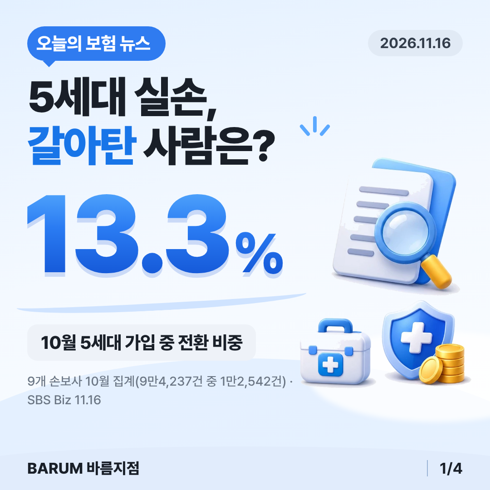
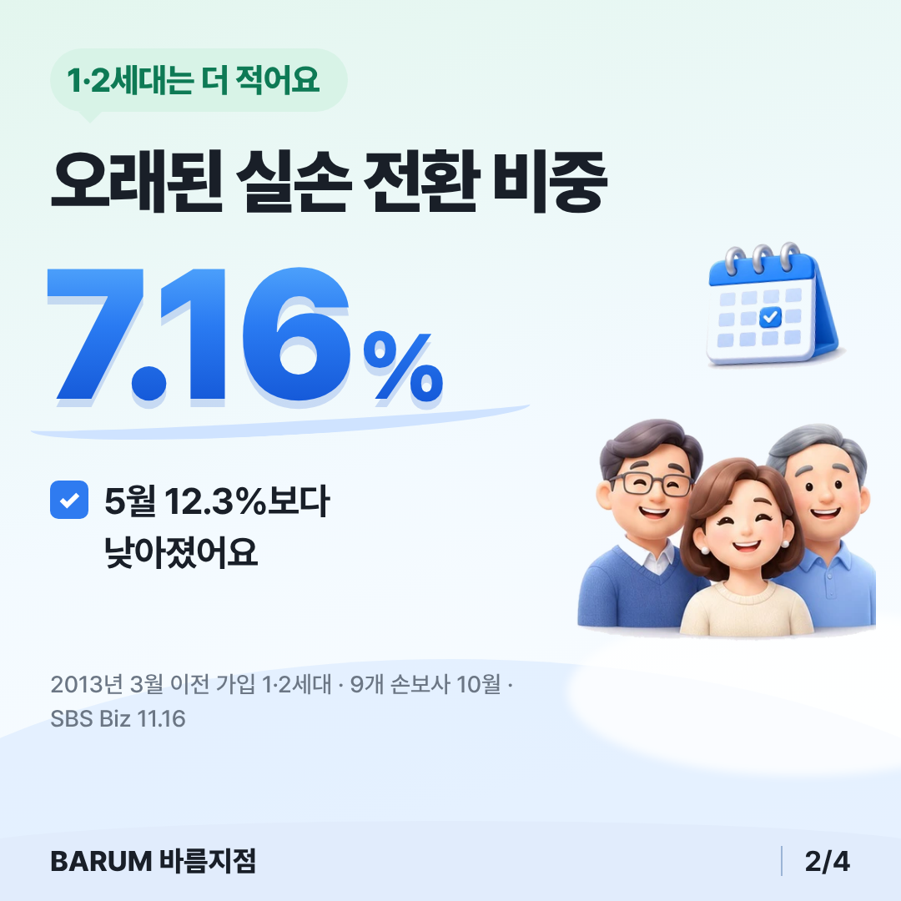
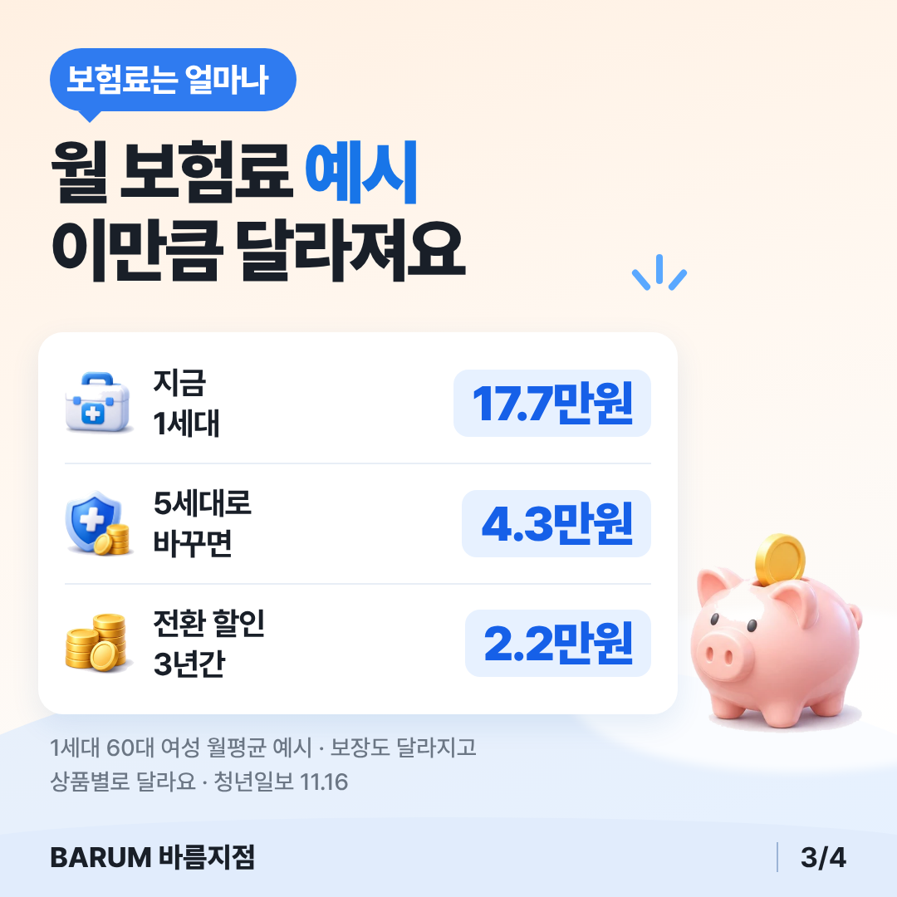
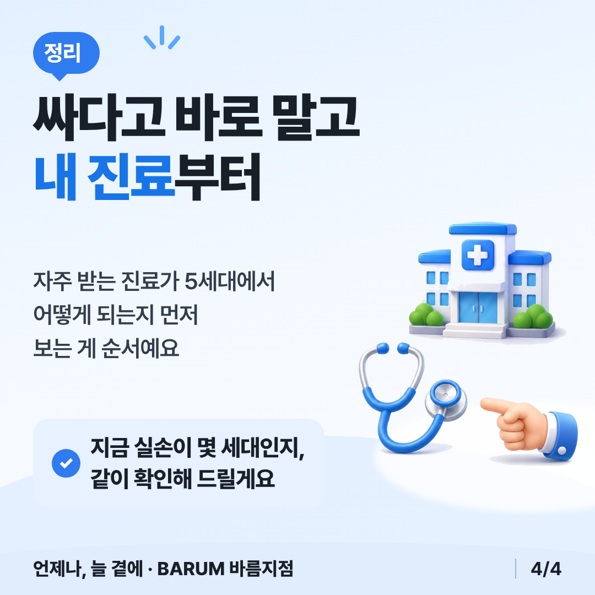

# 2026-11-16 보험 뉴스 브리핑

## 카드뉴스 (정사각형 1080×1080 · 고객 공유용)

카드 묶음 받기: https://raw.githubusercontent.com/bokkile83-ui/barum-news/main/news/cards/2026-11-16-silson5_카드.zip

## 금융당국
- 금감원, 설계사 6천 명 넘는 대형 GA에 **보험대리점 등록취소 사전통지** — 법인 대표 505명에게 리베이트 732억원 제공 혐의, 231명 검찰 송치. 공식 발표가 아닌 보도(최종 제재는 절차 뒤 결정).
- 오늘(16일) 예정이던 **수수료 개편 3차 FAQ 설명회 연기**, 새 일정 미정. 2027년 1월 판매수수료 4년 분급, 2029년 7년 분급 전환 계획은 그대로. 쟁점은 계약체결비용 공개 범위.
- 설계사에게: 리베이트·작성계약은 GA 등록취소까지 간다 — 고객 조기 해지 유도·대납 제안은 받지 않는다. 19일(목) 14시 실손보험 점검회의 · 저축성보험 만기 후 최대 3년 연금 전환 안내 발표 전, 시행일은 말하지 않는다.

## 업계 뉴스
- 5세대 실손 10월 9개 손보사 가입 94,237건 — 신규 54,639 · 4세대 재가입 27,056 · 1~4세대 전환 12,542(13.3%). 전환 비중은 5월 16.2%가 최고 — SBS Biz
- 1·2세대(2013년 3월 이전 가입) 전환 비중은 5월 12.3% → 10월 7.16%(6,746건). 이달 계약전환 할인(3년 50%) 효과가 관건 — SBS Biz
- 보험료 예시: 1세대 60대 여성 월 176,982원 → 5세대 43,241원 → 전환 할인 적용 시 3년간 21,620원. 대신 비중증 비급여 보장이 줄어 진료 습관부터 봐야 한다 — 청년일보
- 인터넷 전용 미니암보험 출시 — 암 주요치료비·항암방사선약물·표적항암약물허가치료비 위주, 기존 암보험 보완용. 암 5년 상대생존율 54.2%(2001~05) → 73.7%(2019~23) — 기존 암보험 치료비 담보 점검 소재 — 뉴스핌
- 18일(수) 금감원 전동킥보드 관련 자동차 보험사기 예방 안내 예정 — 운전자보험·자동차보험 상담 소재 — 뉴스핌

## 오늘 고객에게 한마디
> 「5세대 실손으로 갈아탄 분은 아직 열 명 중 한 명 정도예요. 보험료는 줄어도 보장이 달라지니, 지금 실손이 몇 세대인지와 자주 받는 진료부터 같이 확인해 봐요.」

— BARUM 바름지점

## 출처
- [SBS Biz(서플) — 실손 '5세대 갈아타기' 10%대 그쳐…이달 할인제도 효과 주목(2026.11.16)](https://supple.kr/news/cmwiftju0egk3al9pk1l89906)
- [청년일보 — 보험료는 반값, 보장은 축소...5세대 실손 전환 '엇갈린 셈법'(2026.11.16)](https://www.youthdaily.co.kr/news/article.html?no=229850)
- [이투데이 — 금감원, '732억 불법 리베이트' 대형 GA 등록취소 사전통지(2026.11.16)](https://www.etoday.co.kr/news/view/2648920)
- [보험저널 — 16일 수수료개편 FAQ 설명회 연기(2026.11.16)](https://www.insjournal.co.kr/news/articleView.html?idxno=33925)
- [뉴스핌 — 인터넷 전용 미니암보험 출시(2026.11.16)](https://www.newspim.com/news/view/20261116000462)
- [뉴스핌 — 이번주 국내 주요 금융일정(11.16~11.20)](https://www.newspim.com/news/view/20261113001372)
