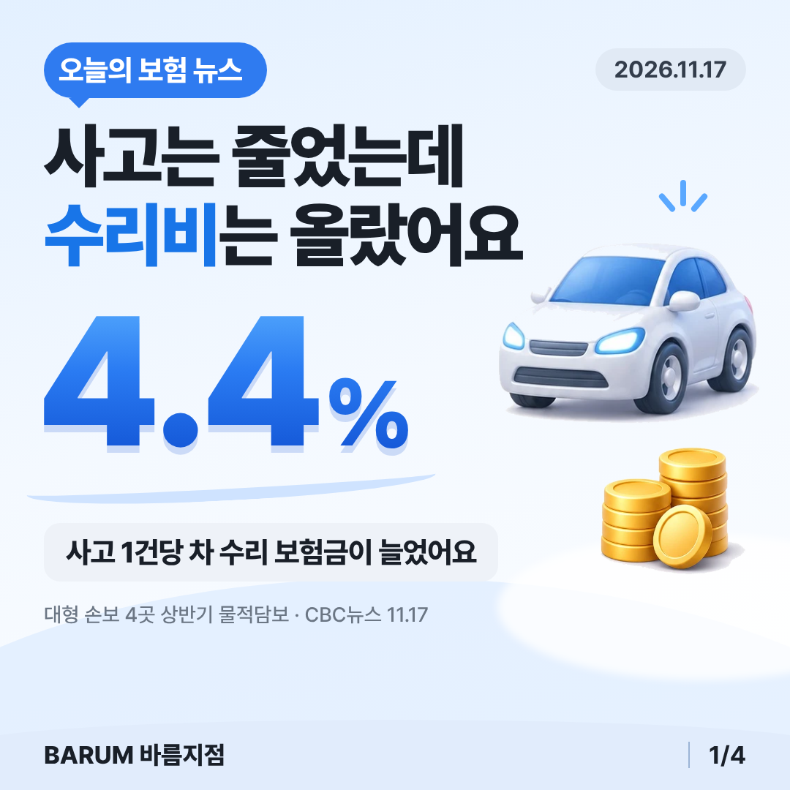
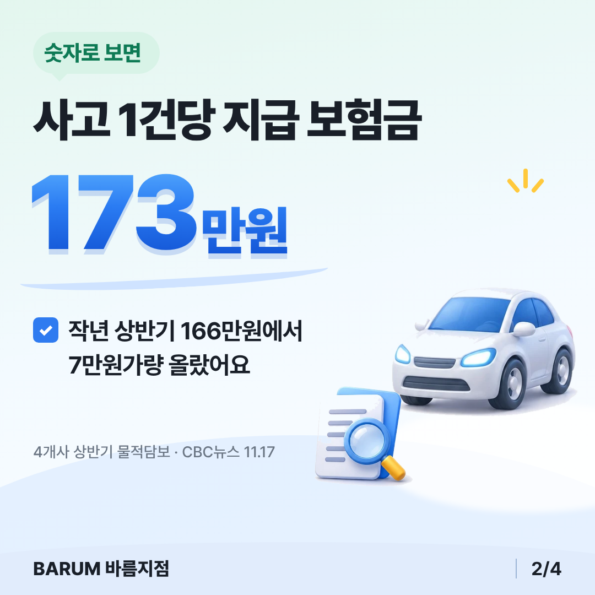
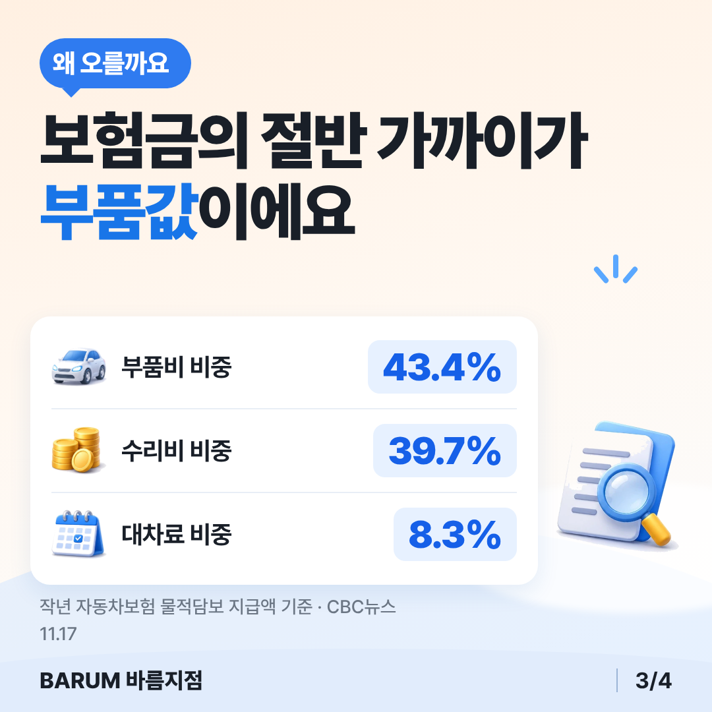
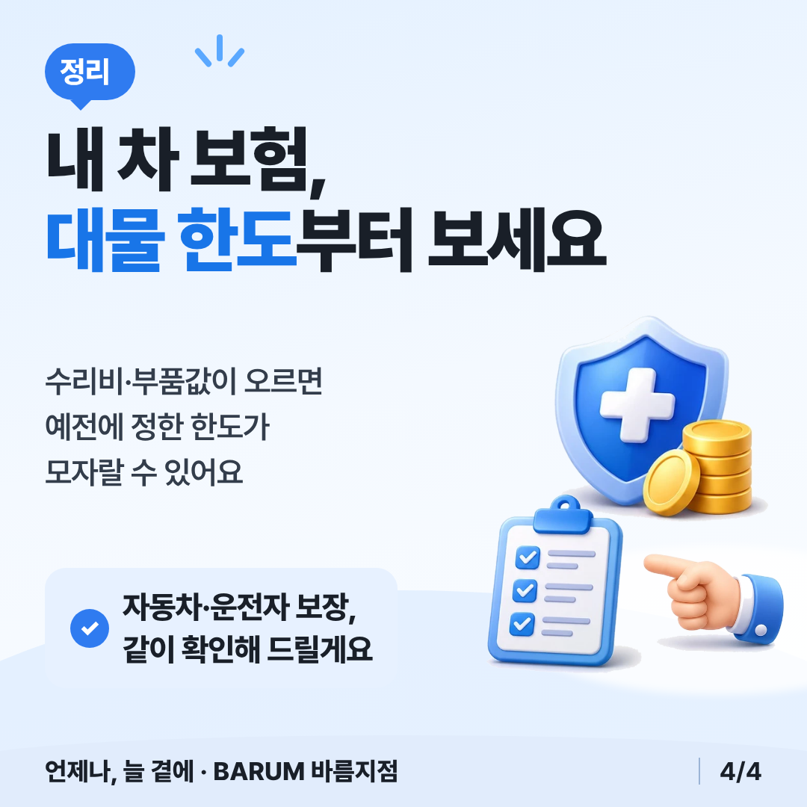

# 2026-11-17 보험 뉴스 브리핑

## 카드뉴스 (정사각형 1080×1080 · 고객 공유용)

카드 묶음 받기: https://raw.githubusercontent.com/bokkile83-ui/barum-news/main/news/cards/2026-11-17-carrepair_카드.zip

## 1) 금융당국
- **금감원, 대형 GA에 등록취소 사전통지(16일 보도)** — 설계사 6천 명 넘는 GA, 법인 대표 505명에게 경영인 정기보험으로 리베이트 732억원 제공 혐의. 410건 조기 해지·231명 송치. 최종 제재는 절차 뒤 결정.
- **이번 주 일정** — 18일(수) 금감원 자동차 보험사기 예방 안내(전동킥보드·음주차량 표적 사고) · 19일(목) 14시 금융위·금감원 실손보험 점검회의 · 같은 날 저축성보험 만기 후 최대 3년 연금 전환 안내. 안건·결과는 발표 전.
- **설계사에게** — 리베이트·조기 해지 유도는 GA 등록취소까지 간다. 18·19일 발표는 나온 뒤에 안내하고, 실손 변경 내용은 확정 전 말하지 않는다.

## 2) 업계 뉴스 — 상담 이야기거리
1. 자동차보험: 대형 손보 4개사 상반기 물적담보 사고는 2.6% 줄었는데 건당 지급보험금은 166.4만→173.6만원(4.4%↑). 작년 지급액의 43.4%가 부품비. 4개사 자동차보험손익 상반기 적자 전환 — CBC뉴스
2. 해약 증가: 생보 22개사 1~8월 해약환급금 약 34조2천억원, 전년 같은 기간보다 30% 이상 증가. 보험료 미납으로 효력 잃은 계약 환급금도 약 1조954억원 — 이즈보험
3. 요양비: 요양시설 본인부담금의 절반가량이 비급여라는 건강보험연구원 보고서가 보도됨. 간병·요양 상담 때 「급여 밖 비용」 이야기 소재 — 캐어유뉴스
4. 암보험: 손보사 인터넷 전용 「미니 암보험」 출시 — 진단비보다 주요치료비·항암방사선약물·표적항암 치료비 중심 구조, 기존 가입자도 추가 가입 가능(40세 남 월 2만원 수준) — 글로벌이코노믹
5. 건강보험: 불법개설 의료기관 환수 결정 2조9162억원 중 실제 징수 2563억원, 징수율 8.79%(2009~2025 누적). 건보공단 특사경 도입은 구상 단계 — 이즈보험

## 3) 오늘 고객에게 할 한마디
「사고는 줄었는데 차 한 번 고칠 때 드는 보험금은 오르고 있어요. 몇 년 전에 정한 대물 한도와 자동차·운전자 보장이 지금 수리비에 맞는지 같이 한번 봐 드릴게요.」

— BARUM 바름지점

## 출처
- [CBC뉴스 — 사고 줄어도 보험금은 증가…불법 리베이트 제재 (11.17)](https://www.cbci.co.kr/news/articleView.html?idxno=627635)
- [파이낸셜뉴스 — 금감원, 설계사 6천명 GA에 등록취소 사전통지 (11.16)](https://www.fnnews.com/news/202611162222526317)
- [뉴스핌 — 이번주 국내 주요 금융일정(11.16~11.20)](https://www.newspim.com/news/view/20261113001372)
- [이즈보험 DAILY 11.17호](https://dazabi.com/news/daily-report.php?date=2026-11-17&edition=daily)
- [캐어유뉴스 — 오늘의 시니어 트렌드 분석 (11.17)](https://www.careyounews.org/news/articleView.html?idxno=12451)
- [글로벌이코노믹 — 인터넷 가입전용 암보험 (11.16)](https://www.g-enews.com/article/Finance/2026/11/202611161003581972a6e8311f64_1)
