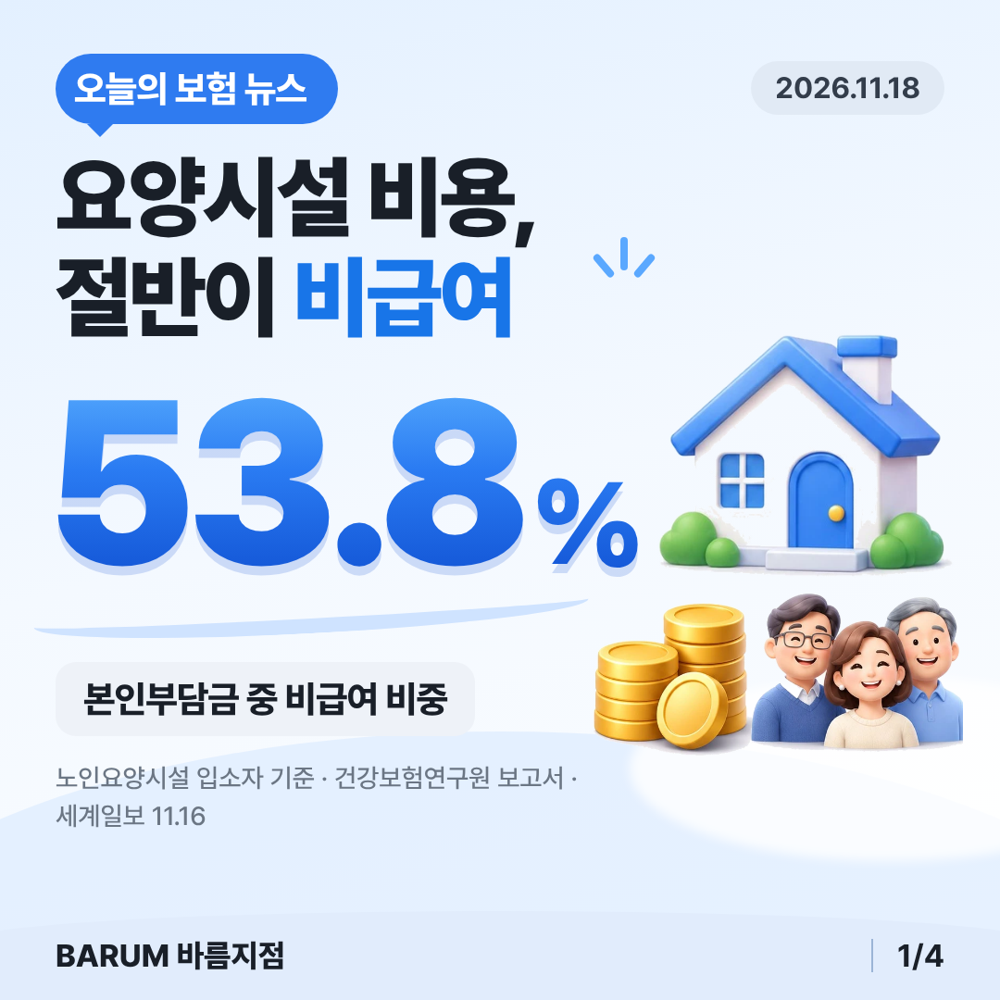
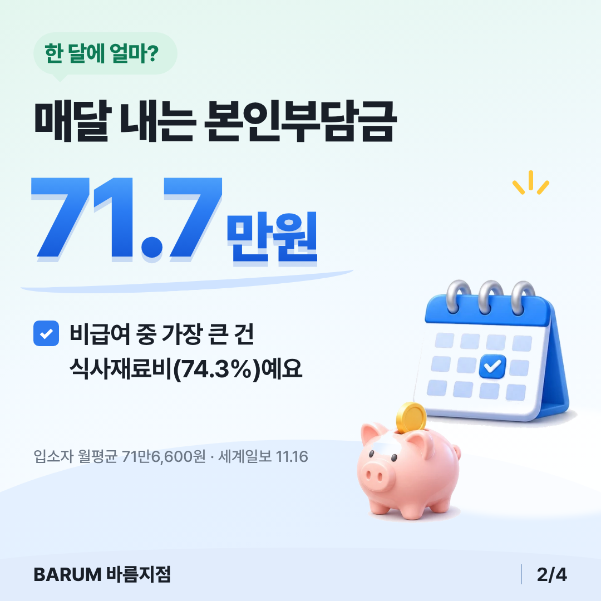
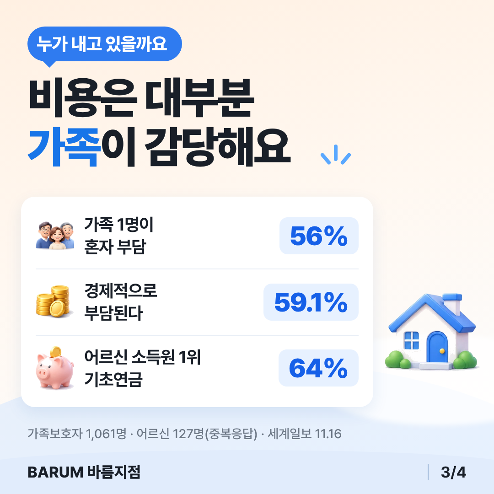
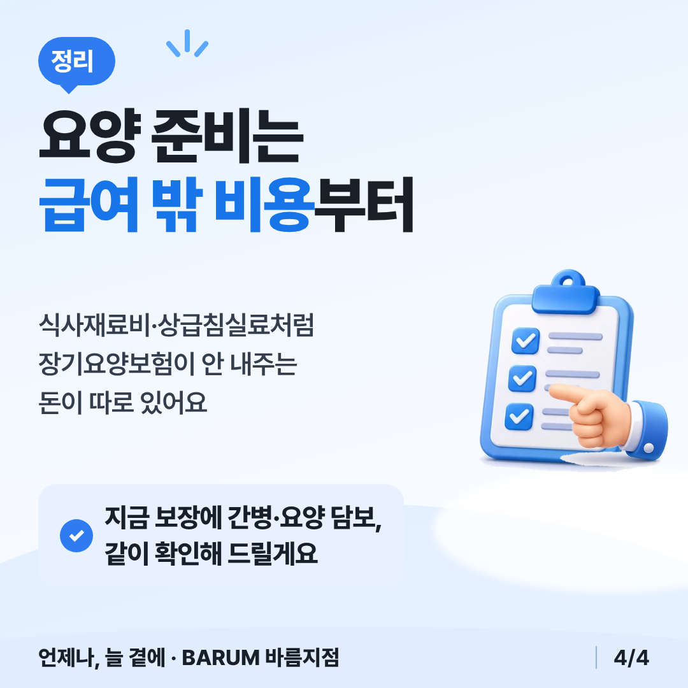

# 2026-11-18 보험 뉴스 브리핑

## 카드뉴스 (정사각형 1080×1080 · 고객 공유용)

카드 묶음 받기: https://raw.githubusercontent.com/bokkile83-ui/barum-news/main/news/cards/2026-11-18-carehome_카드.zip

## 1) 금융당국
- **금감원 「2026 결산부터 보험부채 부적정 산출 시 집중 감리·검사 후 제재」(17일 심포지엄)** — 국내 36개 보험사 작년 말 실제손해율 평균 103.8%, 올해 말 예상손해율 88.5%로 1년 새 15.3%p 낮게 추정했다는 지적. 계리가정보고서는 다음 달 말 시행.
- **오늘·내일 발표 예정** — 18일(수) 12시 금감원 자동차 보험사기 예방 안내 · 19일(목) 14시 금융위·금감원 실손보험 점검회의 · 같은 날 저축성보험 만기 후 최대 3년 연금 전환 안내. 금감원 검사 권한을 금융위 승인제로 바꾸는 「감독행정 쇄신안」은 이르면 23일 발표(단독 보도, 미확정). 16~18일 새벽 기준 금감원 보험 보도자료는 없다.
- **설계사에게** — 보험사 손해율이 실제보다 낮게 잡혔다는 지적과 감리 예고는 상품·보험료 조정 압력이다. 19일 실손 회의 결과는 발표 뒤에만 안내한다.

## 2) 업계 뉴스 — 상담 이야기거리
1. 요양비: 노인요양시설 입소자 월평균 본인부담금 71만6,600원 중 53.8%가 비급여(식사재료비 74.3%·기타실비 16%·상급침실료 9.7%). 가족보호자 59.1%가 「부담된다」, 가족 1명이 혼자 내는 경우 56% — 세계일보
2. 손해율: 생보 21곳 실제 95.3%→예상 83.9%, 손보 15곳 실제 115.6%→예상 94.8%. 「낙관적 계리 가정이 부채를 줄인다」는 학계 지적 — 재경일보
3. 운전자: 공정위가 대리운전 4개 사업자 동의의결 절차 개시. 대리기사 보험 중복가입 개선이 쟁점, 최종 시정안은 아직 — 보험저널
4. 예금보험료: 현행 0.15%, 민관 TF 수정안 생보 0.2%대 후반·손보 0.3%대 후반 논의 중. 생보협회장 12월 8일·손보협회장 12월 22일 임기 만료로 인선 본격화 — 뉴스핌
5. 신상품: 치매 입원일당 1일 최대 10만원·장기요양 시설급여 월 최대 100만원 담보, 10년 뒤 보장 2배 체증형 순환계 상품 등 손보 「틈새 보장」 경쟁(11.11 보도) — 보험저널

## 3) 오늘 고객에게 할 한마디
「요양시설에 들어가면 한 달 본인부담금이 평균 70만원대인데, 그중 절반 넘게가 장기요양보험이 내주지 않는 비용이라고 해요. 지금 보장에 간병·요양 쪽이 어떻게 들어 있는지 같이 한번 봐 드릴게요.」

— BARUM 바름지점

## 출처
- [세계일보 — 요양시설 본인부담 절반은 '비급여'…어르신은 기초연금 보태 (11.16)](https://www.segye.com/newsView/20261116510826)
- [재경일보 — 보험사 손해율 낙관 추정…부채 축소 지적 나와 (11.17)](https://news.jkn.co.kr/post/1102568)
- [파이낸셜뉴스 — 내주 금융감독원 행정 쇄신안 발표 (11.17)](https://www.fnnews.com/news/202611171523306497)
- [뉴스핌 — 이번주 국내 주요 금융일정(11.16~11.20)](https://www.newspim.com/news/view/20261113001372)
- [뉴스핌 — 실적 마친 보험업계, 협회장 인선 본격화 (11.17)](https://www.newspim.com/news/view/20261117001267)
- [보험저널 — 카카오·티맵, 대리기사 보험료 부담 줄인다 (11.17)](https://www.insjournal.co.kr/news/articleView.html?idxno=33943)
- [보험저널 — 손보사 신상품, '틈새 보장' 정조준 (11.11)](https://www.insjournal.co.kr/news/articleView.html?idxno=33861)
- [금융감독원 보도자료 목록](https://www.fss.or.kr/fss/bbs/B0000188/list.do?menuNo=200218)
