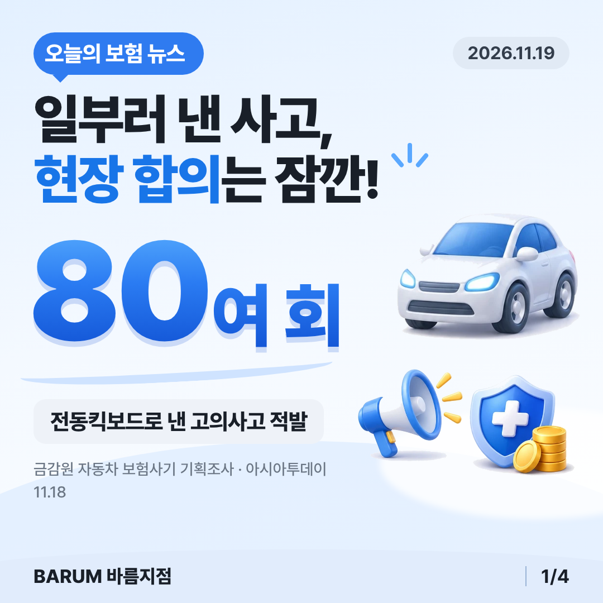
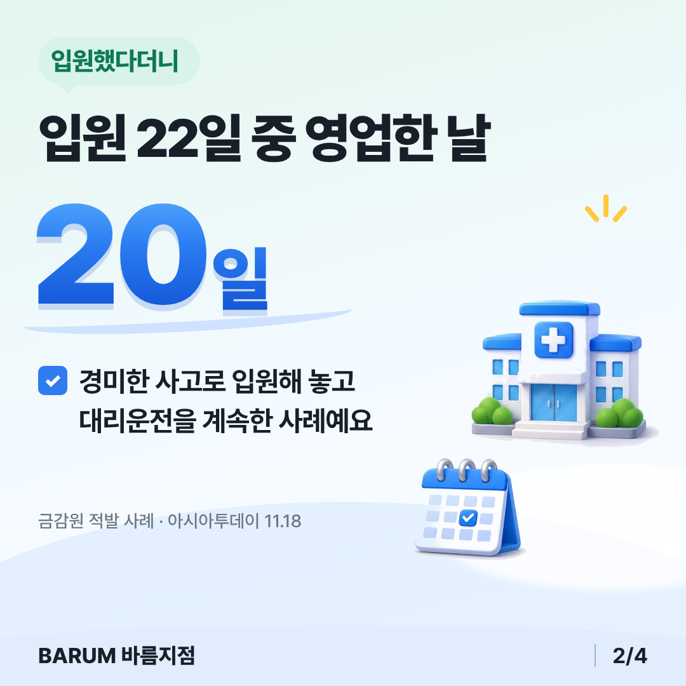
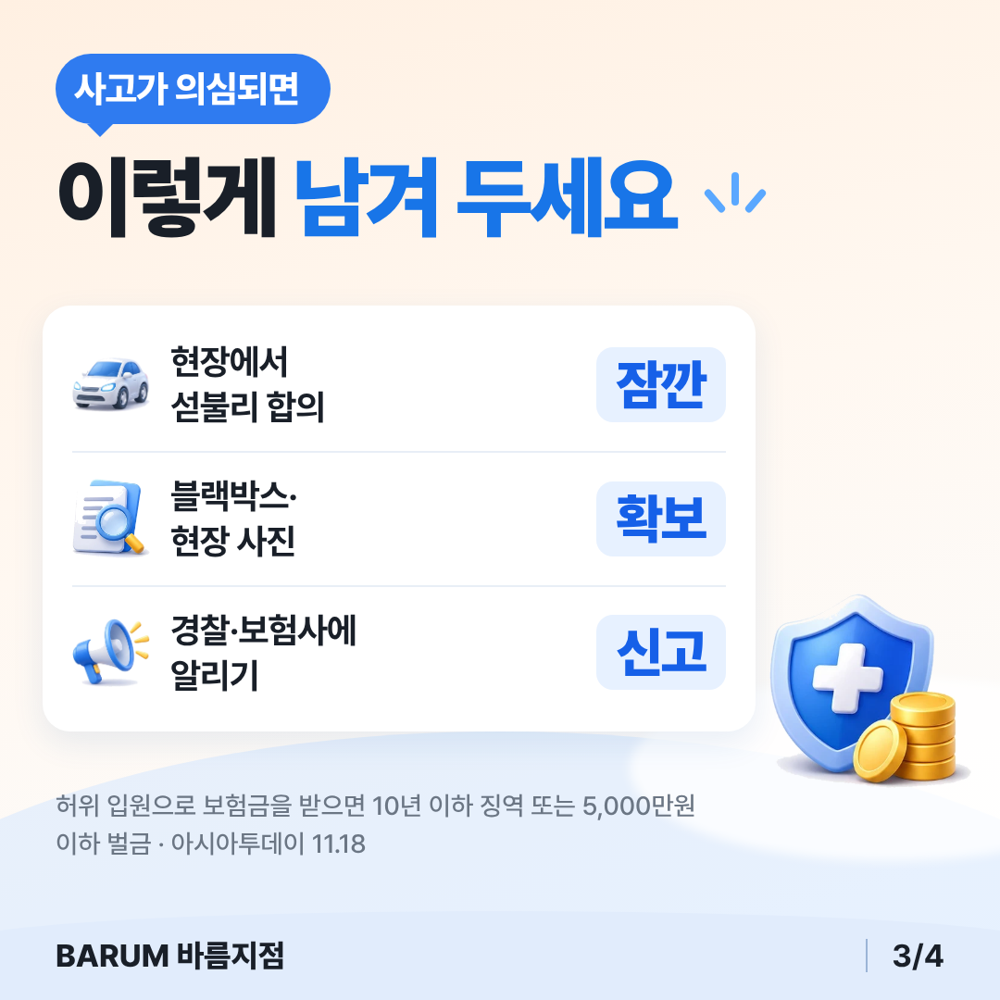
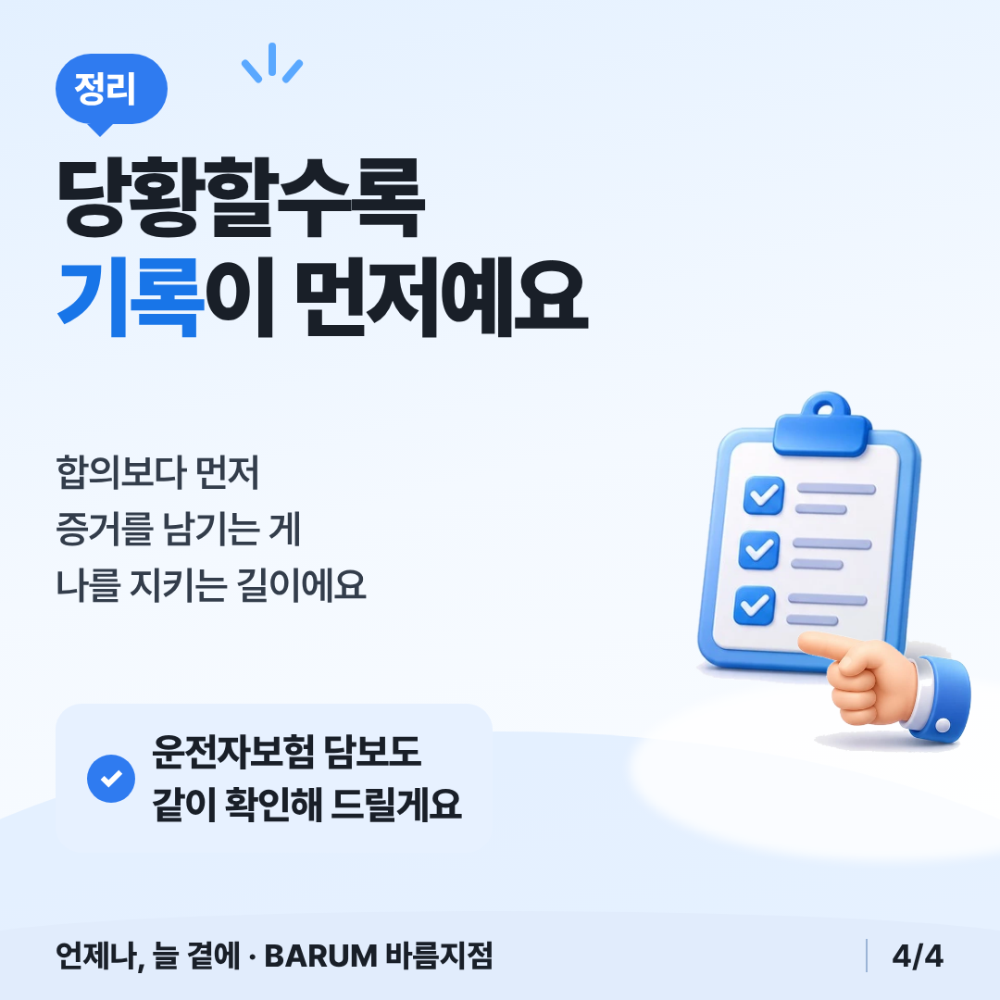

# 2026-11-19 보험 뉴스 브리핑

## 카드뉴스 (정사각형 1080×1080 · 고객 공유용)

카드 묶음 받기: https://raw.githubusercontent.com/bokkile83-ui/barum-news/main/news/cards/2026-11-19-carfraud_카드.zip

## 1) 금융당국
- **금감원 「자동차 보험사기, 이렇게 예방하세요」(18일)** — 기획조사에서 전동킥보드 고의사고 80여 차례 적발. 경미한 사고로 22일 입원한 대리기사가 그중 20일 영업, 개인택시 기사는 4차례 총 23일 입원 중 14일 운행. 허위입원 편취는 10년 이하 징역 또는 5,000만원 이하 벌금. 의심 사고는 현장 합의 자제 → 블랙박스·사진 확보 → 경찰·보험사 신고.
- **금감원, 대형 GA 한국보험금융에 등록취소 사전통지(16일)** — 소속 설계사 6천여명. 법인 대표 505명에게 732억원 리베이트 혐의, 송치 231명. 회사 측은 「최종 처분 전 소명 단계」 입장.
- **오늘(19일) 발표 예정** — 14시 금융위·금감원 실손보험 점검회의, 12시 금감원 「저축성보험 만기 후 최대 3년 연금 전환」 안내. 내용은 발표 뒤 확인.
- **설계사에게** — 운전자 고객에게 「의심 사고는 합의보다 기록」을 안내할 근거가 생겼다. GA 리베이트 제재는 판매 관행 감독 강화 신호다. 실손 회의 결과는 발표문 확인 전 안내 금지.

## 2) 업계 뉴스 — 상담 이야기거리
1. 보험사기: 입원 중 대리운전·택시 영업 사례 공개, 고의사고 의심 시 섣부른 합의 주의 — 아시아투데이
2. 11월 판매전략: 진단비보다 치료·돌봄 비용 쪽으로 이동. 통합치료비 20년간 최대 10억원 한도, 치매 시설급여 월 최대 100만원·재가급여 월 최대 50만원 상품 등장 — 한국보험신문
3. 연금: 한 생보사가 연금 개시 전 목돈 수령 선택 비율을 최대 30%→40%로 상향 — 한국보험신문
4. 암·치매: 신협 공제 4종 출시·개편, 표적항암약물 특약 2종(최초 1회·연간 1회 지급) 신설, 치매간병 특약 7종 추가 — 이투데이
5. 운전자: 대리기사 보험 중복가입 개선 추진, 대리운전 사업자 동의의결 절차 진행 중 — 보험저널

## 3) 오늘 고객에게 할 한마디
「요즘 일부러 부딪히는 사고가 늘었다고 금감원이 안내했어요. 사고가 의심되면 현장에서 바로 합의하지 마시고, 블랙박스·사진부터 남긴 뒤 경찰과 보험사에 알려 주세요. 운전자보험에 어떤 담보가 있는지도 같이 봐 드릴게요.」

— BARUM 바름지점

## 출처
- [아시아투데이 — 전동킥보드로 80번 고의 사고…금감원 "고의사고 의심 시 섣부른 합의 주의" (11.18)](https://www.asiatoday.co.kr/kn/view.php?key=20261118010007027)
- [연합뉴스 한민족센터 — 금감원, '불법리베이트' 한국보험금융에 등록취소 사전통지 (11.16)](https://www.koreancenter.or.kr/news/articleView.html?idxno=1440337)
- [뉴스핌 — 이번주 국내 주요 금융일정(11.16~11.20)](https://www.newspim.com/news/view/20261113001372)
- [한국보험신문 — 11월 보험사 판매전략, 진단비 넘어 치료·돌봄 비용에 무게 (11.09)](https://www.insnews.co.kr/news/articleView.html?idxno=93697)
- [이투데이 — 신협, 상해부터 치매·암까지⋯공제상품 보장 넓혔다 (11.12)](https://www.etoday.co.kr/news/view/2647233)
- [보험저널 — 카카오·티맵, 대리기사 보험료 부담 줄인다…중복가입 개선 추진 (11.17)](https://www.insjournal.co.kr/news/articleView.html?idxno=33943)
