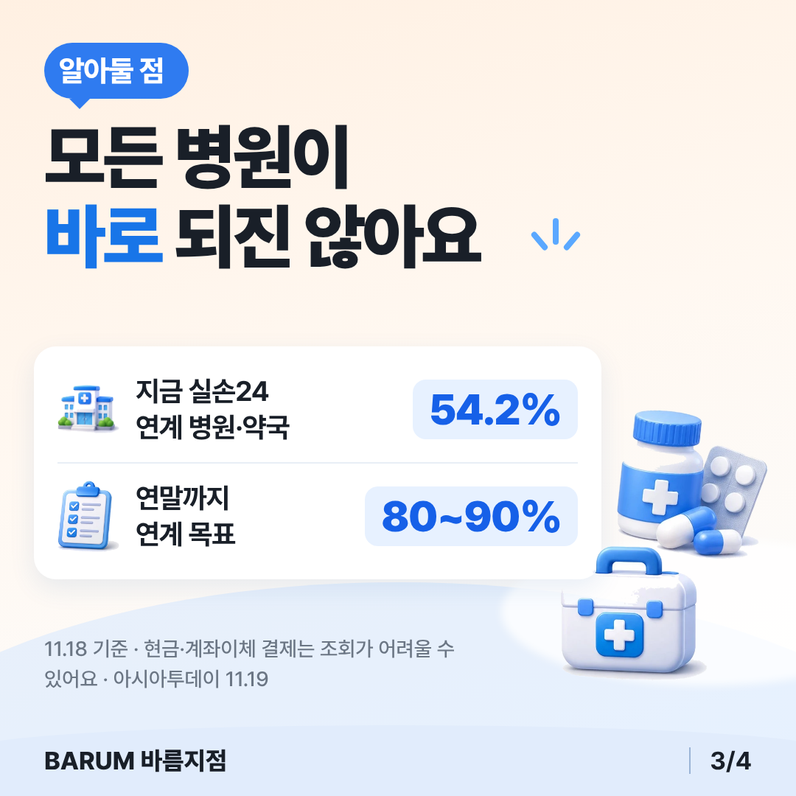

# 2026-11-20 보험 뉴스 브리핑

## 카드뉴스 (정사각형 1080×1080 · 고객 공유용)

카드 묶음 받기: https://raw.githubusercontent.com/bokkile83-ui/barum-news/main/news/cards/2026-11-20-silson24_카드.zip

## 1) 금융당국
- **금융위 「실손보험 점검회의」(19일)** — 최근 3년 미청구 실손보험금(최대 1조원 추산)을 내년 1분기부터 실손24 앱에서 조회·청구. 카드 결제정보와 신용정보원 청구이력을 대조하는 방식. 현금·계좌이체 결제분은 확인이 어려울 수 있음. 실손24 연계 병원·약국 54.2%(11.18 기준), 연말 80~90% 목표.
- **금감원 「저축성보험 연금 전환 신청기간 확대」(19일)** — 12월 1일부터 만기 후 최대 3년까지 연금 전환 신청 가능, 만기 1년 전 사전예약제 도입. 이미 만기보험금을 받았으면 신청 불가. 저축성보험 약 202만건 중 79.3%에 연금 전환 특약.
- **설계사에게** — 실손 청구권 소멸시효 3년을 근거로 「빠진 청구 점검」 상담을 열 수 있다. 만기 앞둔 저축성보험 고객에게 연금 전환 특약 유무·적용 이율 확인을 안내할 시점이다.

## 2) 업계 뉴스 — 상담 이야기거리
1. 실손: 내년 1분기 실손24 「미청구 보험금 찾기」 시행 예정, 부모·배우자 카드 결제분도 연계 병원이면 진료정보와 대조 가능 — 아시아투데이
2. 실손: 2013년 3월 이전 가입·재가입 조항 없는 1·2세대 실손 약 1,630만명 대상, 23일부터 5세대 전환 시 3년간 보험료 50% 할인. 전환 비중은 현재 약 15% — 아시아투데이
3. 연금: 저축성보험 만기 후 3년까지 연금 전환, 보험사 연 1회 계약관리 안내문에 전환 제도·적용 이율 안내 의무화 — 경향신문
4. 회계: 금감원, 미래 손해율을 낙관적으로 잡아 실적을 부풀린 보험사에 내년 초 감리 후 첫 제재 예고(최종손해율 「한도타절」 논란) — 머니투데이
5. 간편보험: 최근 5년 내 신규담보 손해율 90% 일괄 적용 규제 연말 시행, 일부 보험사는 6월 선적용 — 머니투데이

## 3) 오늘 고객에게 할 한마디
「병원 다녀오시고 실손 청구 깜빡하신 적 있으세요? 실손보험금은 3년이 지나면 청구가 어려워요. 내년부터 앱으로 조회가 쉬워지지만, 최근 영수증을 모아 두시면 빠진 게 있는지 같이 봐 드릴게요.」

— BARUM 바름지점

## 출처
- [아시아투데이 — 3년간 쌓인 '미청구 보험금' 1조원, 내년부터 쉽게 찾는다…5세대 전환 할인도 (11.19)](https://www.asiatoday.co.kr/kn/view.php?key=20261119010007726)
- [한국경제 — 청구 깜빡한 실손보험금 1조원…내년부터 실손24로 돌려받는다 (11.19)](https://www.hankyung.com/article/2026111981341)
- [경향신문 — 저축성보험 연금 전환, 만기 후 최대 3년까지 신청 가능해진다 (11.19)](https://www.khan.co.kr/article/202611191708011/)
- [아주경제 — 금감원, 저축성보험 연금전환 신청기간 3년으로 확대 (11.19)](https://www.ajunews.com/view/20261119095630291)
- [머니투데이(네이트) — 미래 손해율 낮춰 실적 부풀린 보험사 '철퇴' (11.20)](https://m.news.nate.com/view/20261120n01157)
