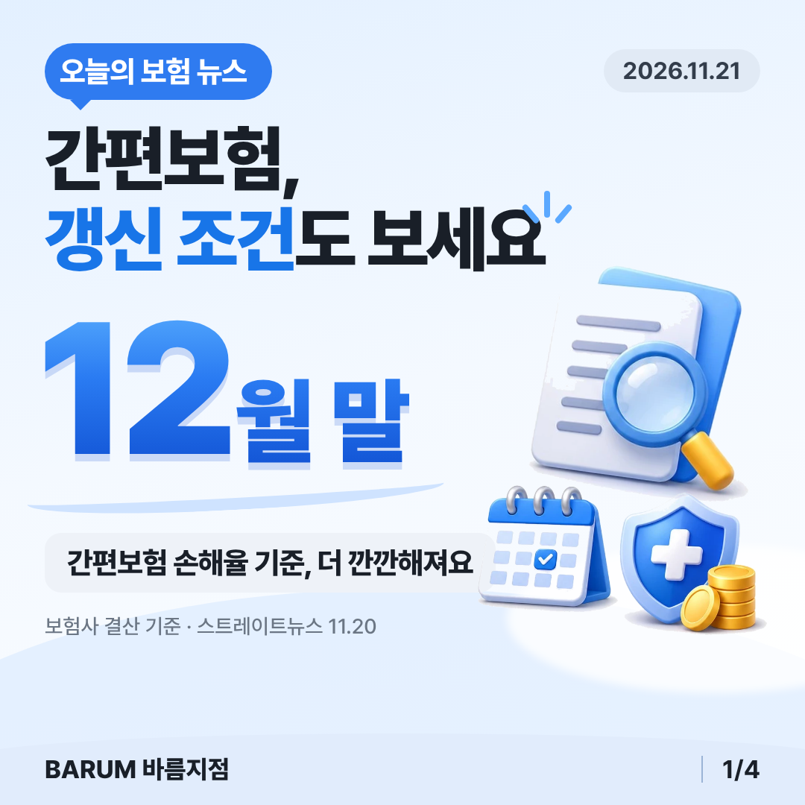
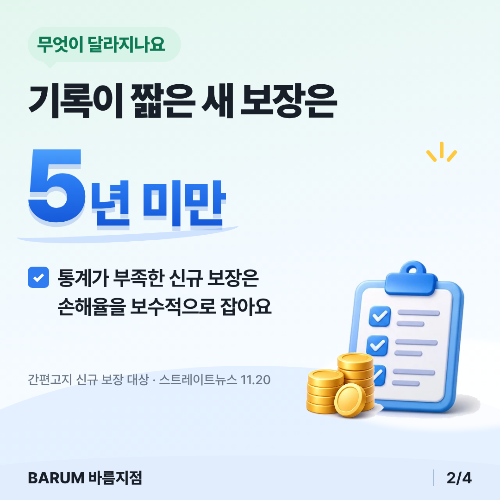
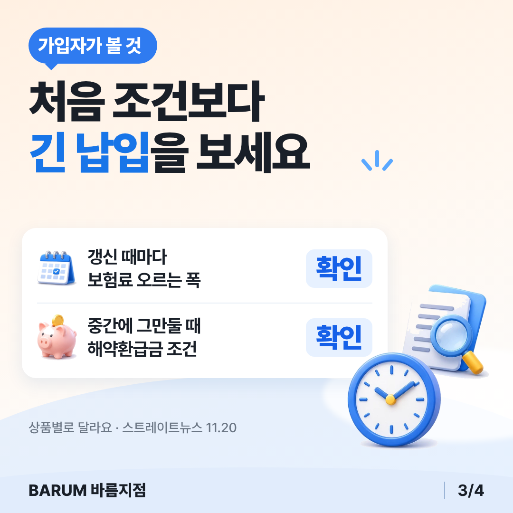
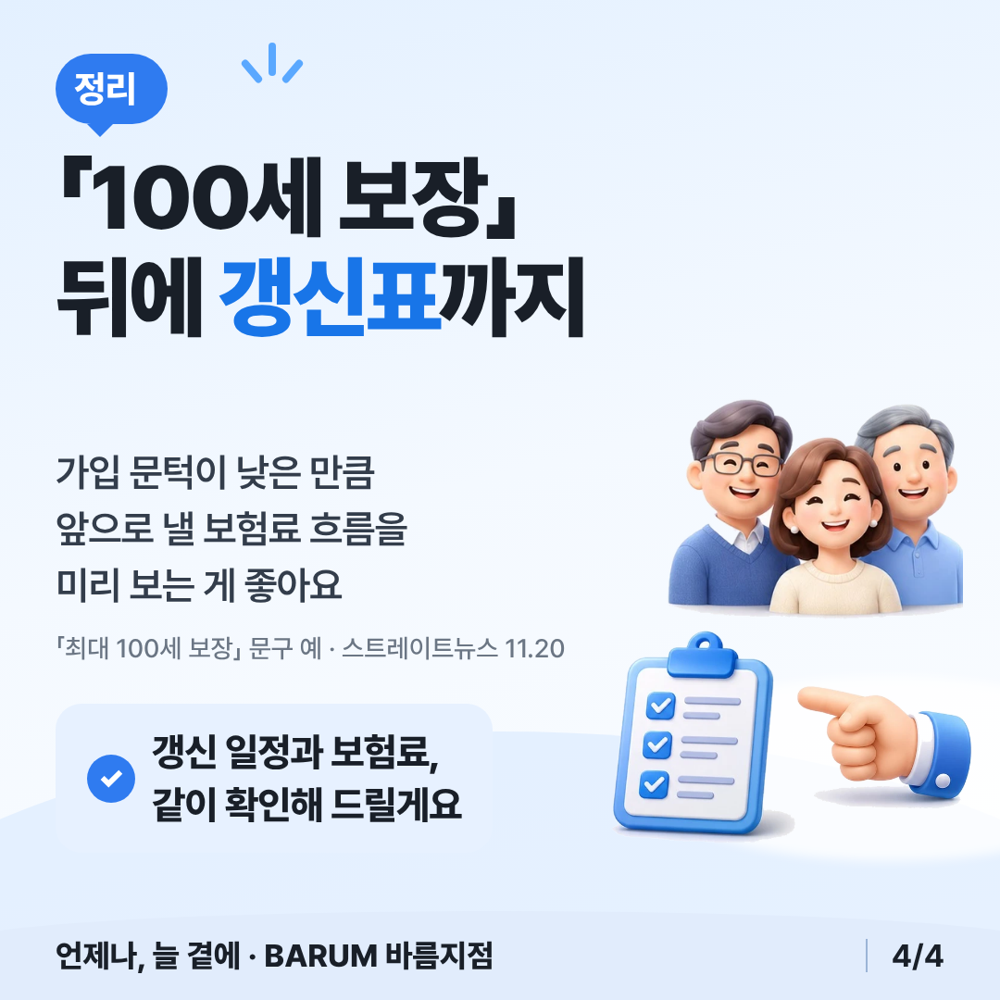

# 2026-11-21 보험 뉴스 브리핑

## 카드뉴스 (정사각형 1080×1080 · 고객 공유용)

카드 묶음 받기: https://raw.githubusercontent.com/bokkile83-ui/barum-news/main/news/cards/2026-11-21-easyins_카드.zip

## 1) 금융당국
- **간편보험 손해율 기준 강화(12월 말 결산부터)** — 경험통계가 5년에 못 미치는 간편고지 신규 보장은 손해율·사업비 가정을 보수적으로 잡는다. 일부 보험사는 목표 손해율 도달기간을 10년으로 잡았으나 보험료 조정률을 반영하면 13년이 필요한 것으로 확인됐다.
- **금융위, 보험판매전문회사에 「신중론」(20일 국회 입법토론회)** — GA에 수수료·사업비 협상권을 주면 수수료율 100%p 상승 시 월 보험료 약 1%, 500%p 상승 시 약 4.8% 오를 수 있다는 시뮬레이션 제시. 보험금 청구 대행·지급을 한 조직이 맡는 이해상충도 지적.
- **설계사에게** — 간편보험은 연말 이후 신상품 조건·보험료가 조정될 수 있다. 유병자·고령 고객에게는 첫 보험료보다 갱신 주기별 인상 폭과 해약환급금 조건을 먼저 보여 준다. GA 제도 개편은 아직 입법 논의 단계다.

## 2) 업계 뉴스 — 상담 이야기거리
1. 간편보험: 「최대 100세 보장」 같은 초기 조건만 볼 게 아니라 갱신 주기별 보험료 인상 폭·해약환급금 조건 등 장기 납입 구조를 따져야 한다는 지적 — 스트레이트뉴스
2. 판매채널: 보험판매전문회사 도입 입법토론회, 일정 규모 이상 GA에 유예기간 후 전환 의무화·직접 배상책임 부여 방안 논의 — 블로터
3. 판매채널: 국회 계류 법안 2건, 하나는 최소 자본금 상시 유지(미달 시 60일 내 증자), 다른 하나는 판매전문회사 1차 배상책임·보험금 청구 지원 업무 추가 — 비즈니스워치
4. 예보료: 예금자보호한도 1억원 상향 후속 예보료율 개편, 인상안이 생보 0.2% 후반·손보 0.3% 후반으로 낮아졌지만 업계 추가 부담 연 약 1.5조원 추산 — 파이낸셜뉴스
5. 실손: 최근 3년 미청구 실손보험금(약 1조원 추산) 내년 1분기 실손24에서 조회·청구 — 서울신문

## 3) 오늘 고객에게 할 한마디
「간편보험은 가입이 쉬운 대신 갱신 때 보험료가 어떻게 바뀌는지가 중요해요. 갖고 계신 보험의 갱신 일정과 예상 보험료, 같이 확인해 보실래요?」

— BARUM 바름지점

## 출처
- [스트레이트뉴스 — 간편보험 '리스크 쪼개기' 경쟁 속 연말 손해율 잣대 강화 (11.20)](https://www.straightnews.co.kr/news/articleView.html?idxno=315805)
- [비즈니스워치 — GA에 권한·책임 더 주는 보험판매전문회사…금융위 '신중론' (11.20)](https://news.bizwatch.co.kr/article/finance/2026/11/20/0020)
- [블로터 — 보험판매전문회사 도입 가시화…생·손보업계 판매 독립성 시험대 (11.20)](https://www.bloter.net/news/articleView.html?idxno=679242)
- [파이낸셜뉴스 — 예보료 인상안 낮췄지만 보험사 부담 여전 (11.20)](https://fnnews.com/news/202611200701330667)
- [서울신문 — 3년간 안 찾은 실손보험금 1조…내년부터 '실손24'서 확인·청구 (11.20)](https://www.seoul.co.kr/news/economy/finance/2026/11/20/20261120031005)
