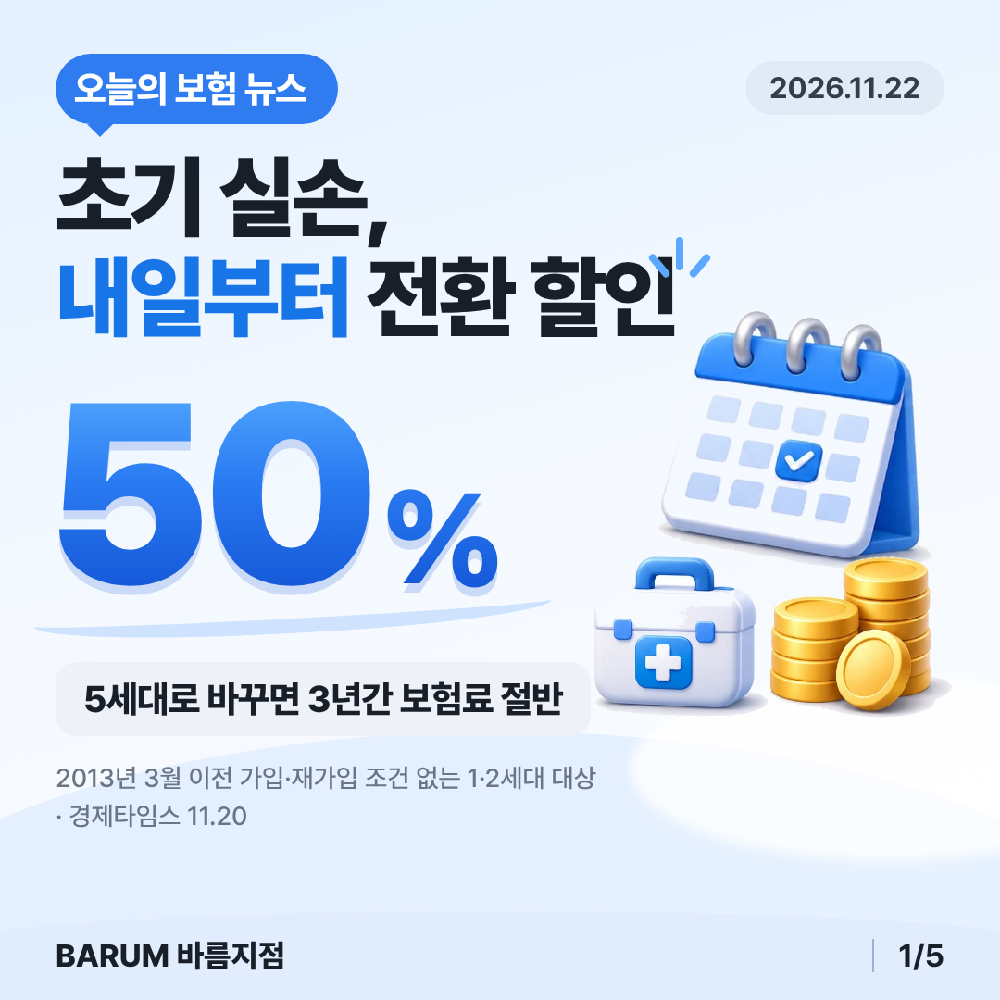
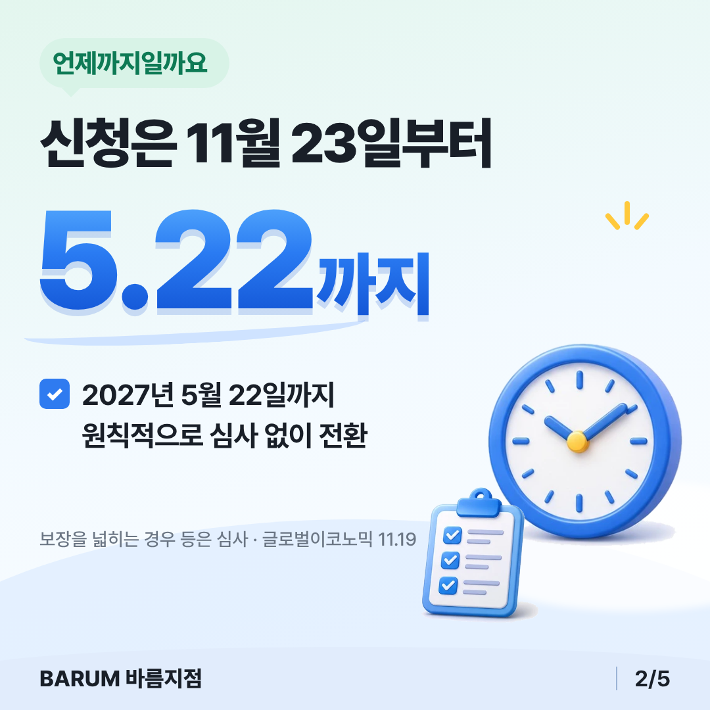
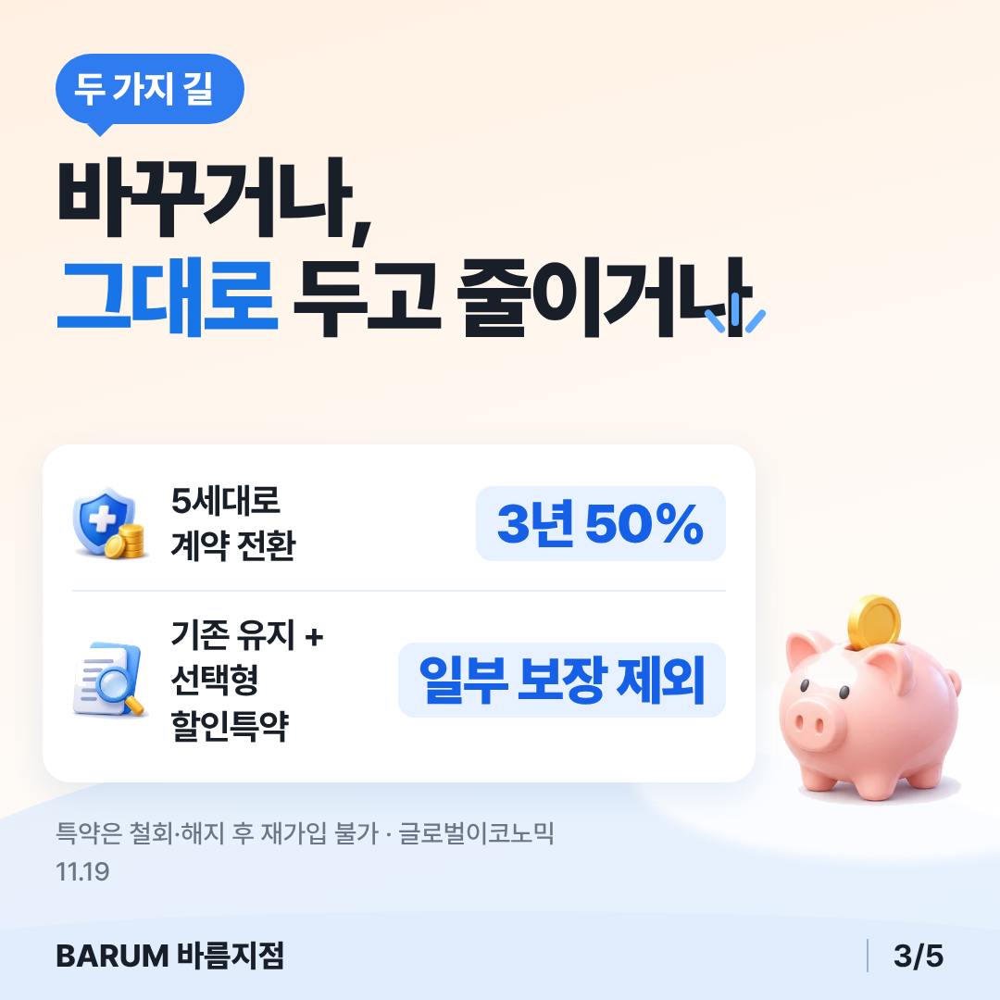
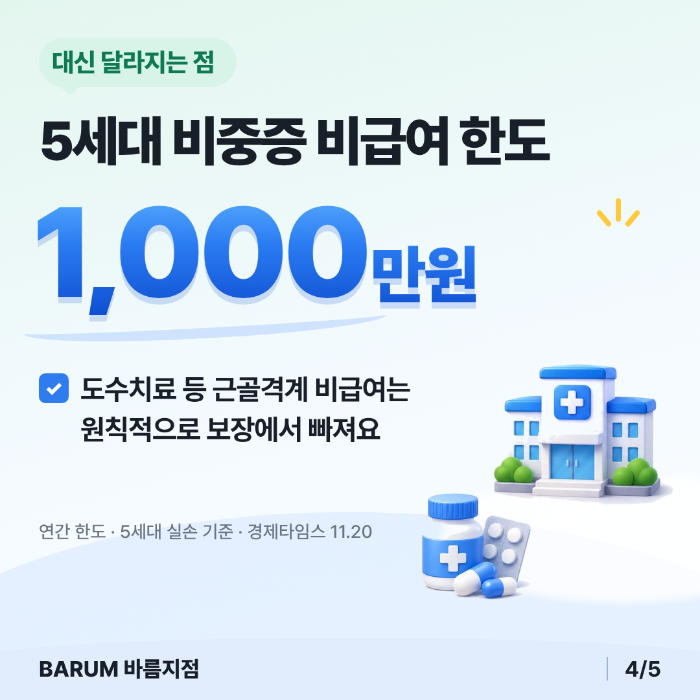

# 2026-11-22 보험 뉴스 브리핑

## 카드뉴스 (정사각형 1080×1080 · 고객 공유용)

카드 묶음 받기: https://raw.githubusercontent.com/bokkile83-ui/barum-news/main/news/cards/2026-11-22-silson5_카드.zip

## 1) 금융당국
- **초기 실손 계약전환 할인, 11월 23일(월) 시행** — 2013년 3월 이전 가입·재가입 조건 없는 1·2세대 실손을 2027년 5월 22일까지 5세대로 바꾸면 전환 후 3년간 보험료 50% 감면. 기존 계약을 유지하는 선택형 할인특약(근골격계 물리치료·비급여 주사 제외 / 비급여 MRI·MRA 제외 / 자기부담률 20%)도 함께 나온다. 전환 뒤 최대 6개월 철회, 신청 뒤 2영업일 숙려기간.
- **금감원, 미래 손해율 낙관 가정 보험사에 첫 제재 예고** — 6월 시행세칙 개정으로 근거 마련, 내년 초 감리 후 조치. 간편보험 신규담보 손해율 90% 일괄 적용은 연말 도입.
- **설계사에게** — 전환 할인은 설계사 아웃바운드 영업이 금지된다(경제타임스 11.20). 먼저 전화 돌리지 말고, 고객이 물어 오면 몇 세대인지·최근 진료 습관(도수치료·비급여 주사·MRI)부터 같이 본다. 선택형 특약은 한 번 철회·해지하면 재가입이 안 된다.

## 2) 업계 뉴스 — 상담 이야기거리
1. 실손: 5세대 비중증 비급여 연 한도 1,000만원(4세대 5,000만원), 입원 자기부담 50%(4세대 30%), 도수치료 등 근골격계 비급여 원칙적 제외 — 경제타임스
2. 실손: 10월 5세대 신계약 94,237건 중 기존 가입자 전환 13.3%, 1·2세대→5세대 전환은 7월 7,667건→10월 6,746건으로 감소세 — 경제타임스
3. 실손: 미청구 실손보험금 최근 3년 약 1조원 추산, 내년 1분기 실손24 「미청구 보험금 찾기」 도입. 청구권은 3년 지나면 소멸 — 서울신문
4. GA: 금감원, 설계사 6천여 명 규모 대형 GA에 등록취소 사전통지. 경영인 정기보험 리베이트 의혹 관련 — 파이낸셜뉴스
5. 자격시험: AI 부정행위 논란으로 금감원이 보험계리사·손해사정사 시험도 점검 대상에 포함 — 뉴스핌

## 3) 오늘 고객에게 할 한마디
「오래된 실손을 5세대로 바꾸면 3년간 보험료 절반 할인이 내일부터 시작돼요. 대신 도수치료·비급여 보장이 줄어드니, 갖고 계신 실손이 몇 세대인지와 병원 이용 습관부터 같이 확인해 보실래요?」

— BARUM 바름지점

## 출처
- [경제타임스 — 잠자는 실손보험금 1조원 찾는다…내년 1분기 환급 (11.20)](https://www.ket.kr/news/article.html?no=42223)
- [글로벌이코노믹 — 1·2세대 실손→5세대 전환 시 3년간 반값…23일부터 시행 (11.19)](https://www.g-enews.com/article/Finance/2026/11/202611191502134376a6e8311f64_1)
- [경제타임스 — 출시 반년 5세대 실손보험, 기존 가입자 전환율 13% (11.20)](https://www.ket.kr/news/article.html?no=42247)
- [서울신문 — 3년간 안 찾은 실손보험금 1조…내년부터 실손24서 확인·청구 (11.20)](https://www.seoul.co.kr/news/economy/finance/2026/11/20/20261120031005)
- [머니투데이 — 미래 손해율 멋대로 낮춰 실적 뻥튀기..금감원, 보험사 첫 제재한다 (11.19)](https://www.mt.co.kr/article/2026111913565871475)
- [파이낸셜뉴스 — 금감원, 보험설계사 6천명 GA에 등록취소 사전통지 (11.16)](https://www.fnnews.com/news/202611162222526317)
- [뉴스핌 — AI 부정행위 논란에…금감원, 보험계리사·손해사정사 시험도 점검 (11.16)](https://www.newspim.com/news/view/20261116001055)
