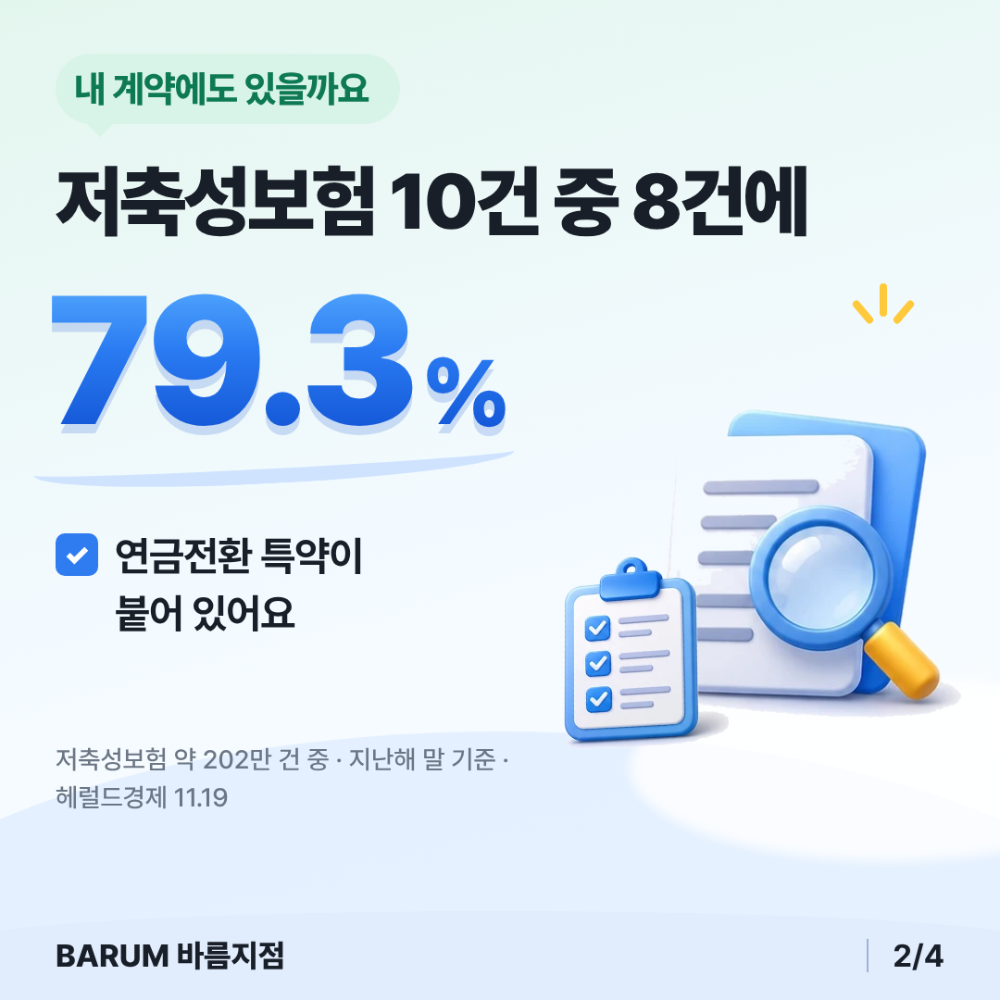

# 2026-11-23 보험 뉴스 브리핑

## 카드뉴스 (정사각형 1080×1080 · 고객 공유용)

카드 묶음 받기: https://raw.githubusercontent.com/bokkile83-ui/barum-news/main/news/cards/2026-11-23-pension_카드.zip

## 1) 금융당국
- **오늘(23일) 초기 실손 5세대 전환 할인 시작** — 2013년 3월 이전 가입·재가입 조건 없는 1·2세대 실손(약 1,630만 명)이 5세대로 바꾸면 3년간 보험료 50% 할인. 별도 심사 없이 2027년 5월 22일까지. 기존 계약을 두고 일부 보장을 빼는 선택형 할인특약도 함께 시행. 60대 여성 예시로 1세대 최대 87.8%, 2세대 최대 82.9% 절감(아시아경제).
- **12월 1일부터 저축성보험 만기 후 3년까지 연금 전환** — 금감원·생보협회. 만기보험금을 아직 안 받았으면 만기 후 최대 3년 안에 연금 전환 신청 가능, 만기 1년 전부터 사전예약제 도입. 지난해 말 저축성보험 약 202만 건 중 79.3%에 연금전환 특약.
- **설계사에게** — 이번 주 일정: 24일 보험업법 시행령·검사제재 규정 개정안 입법예고, 25일 1~9월 보험사 경영실적, 27일 9월 말 대출채권 현황. 만기 앞둔 저축보험 고객은 특약 유무·전환 가능 나이부터 본다. 만기 전 전환은 사망보장 종료·적용이율 변동이 따른다.

## 2) 업계 뉴스 — 상담 이야기거리
1. 실손: 5세대 전환 할인 오늘 시행 — 1세대 60대 여성 예시 월 17만원대 → 할인 적용 3년간 월 2만1,620원. 대신 비중증 비급여 보장이 줄어든다 — 아시아경제
2. 연금: 저축성보험 연금전환 신청 기간이 「만기일 하루」에서 「만기 후 3년」으로, 만기 1년 전 사전예약 가능(12월 1일 시행) — 헤럴드경제
3. 실손: 실손24 가입자 약 596만 명·누적 청구 1,955만 건, 요양기관 연계율 54.2%. 미청구 실손보험금 찾기는 내년 1분기 — 아시아경제
4. 재해: 풍수해·지진 재해보험 정부가 보험료 55~100% 지원, 소상공인은 정책자금 금리 0.1%p 우대 등 혜택 — CBC뉴스
5. 보험사기: 장기요양등급을 허위로 받아 15억원 상당 보험금 편취, 16명 송치·30대 설계사 구속 — CBC뉴스

## 3) 오늘 고객에게 할 한마디
「만기 다 된 저축보험 있으시죠? 12월부터는 만기 지나도 보험금을 안 찾으셨으면 3년 안에 연금으로 바꿀 수 있어요. 계약에 연금전환 특약이 붙어 있는지 먼저 같이 볼까요?」

— BARUM 바름지점

## 출처
- [아시아경제 — 23일부터 5세대 실손 할인제도 시행 (11.19)](https://view.asiae.co.kr/article/2026111909485083537)
- [헤럴드경제 — 저축성보험, 만기 지나도 3년간 연금 전환 가능 (11.19)](https://biz.heraldcorp.com/article/10942914)
- [보험저널 — 저축성보험 만기 놓쳐도 연금전환 가능](https://www.insjournal.co.kr/news/articleView.html?idxno=33983)
- [뉴스핌 — 이번주 국내 주요 금융일정 11.23~11.27 (11.22)](https://www.newspim.com/news/view/20261122000083)
- [CBC뉴스 — [금융家] 보험 ⑮ 혜택 넓히고 제도 손질 (11.23)](https://news.nate.com/view/20261123n00323)
