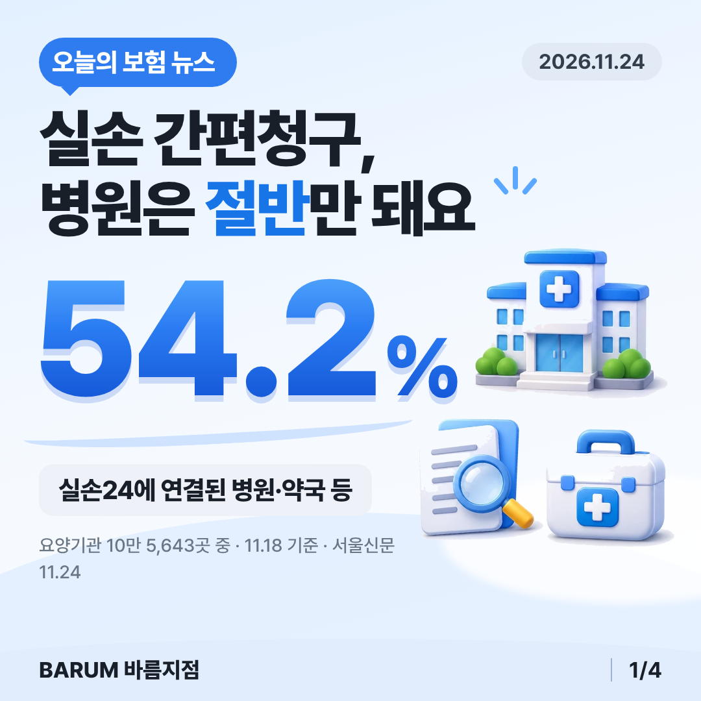
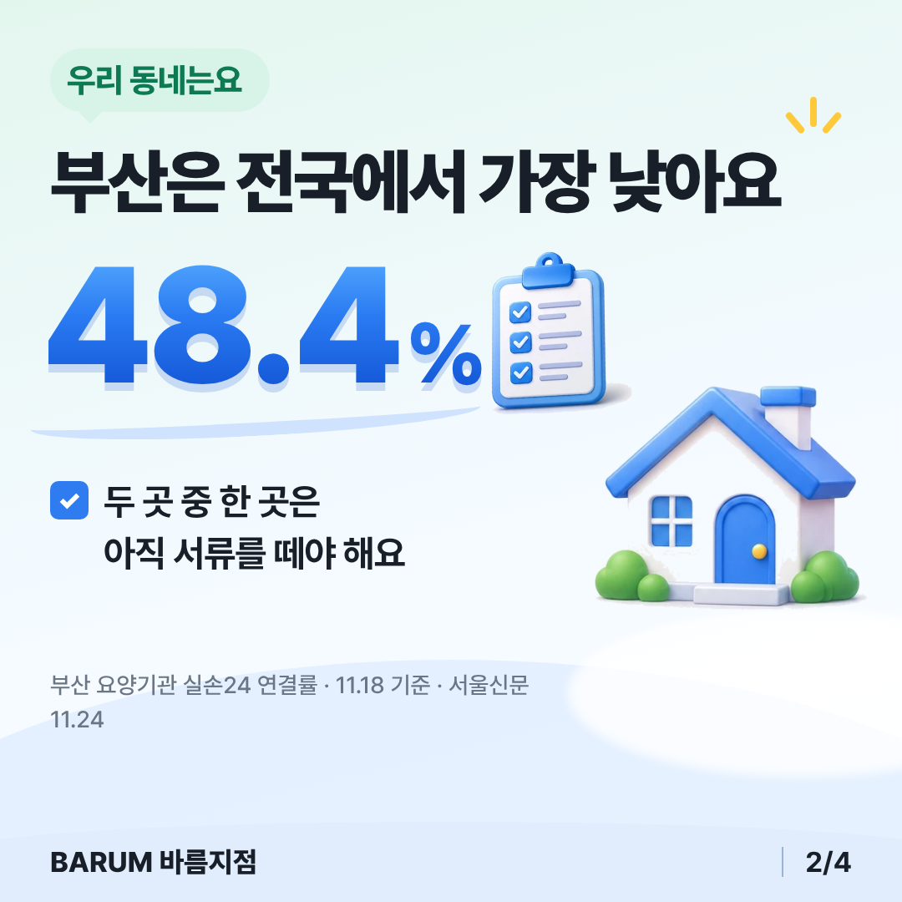
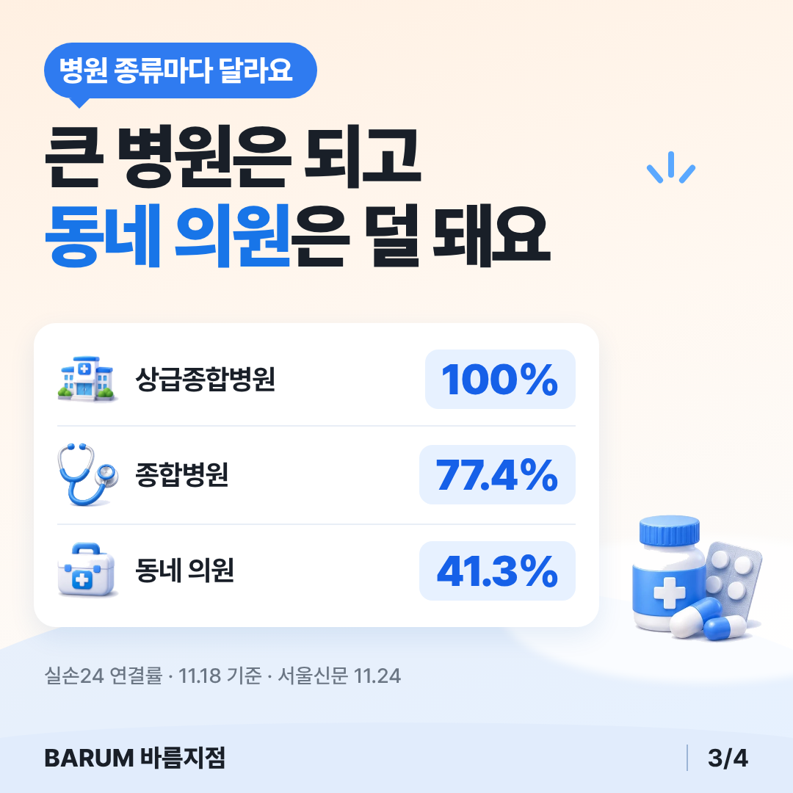
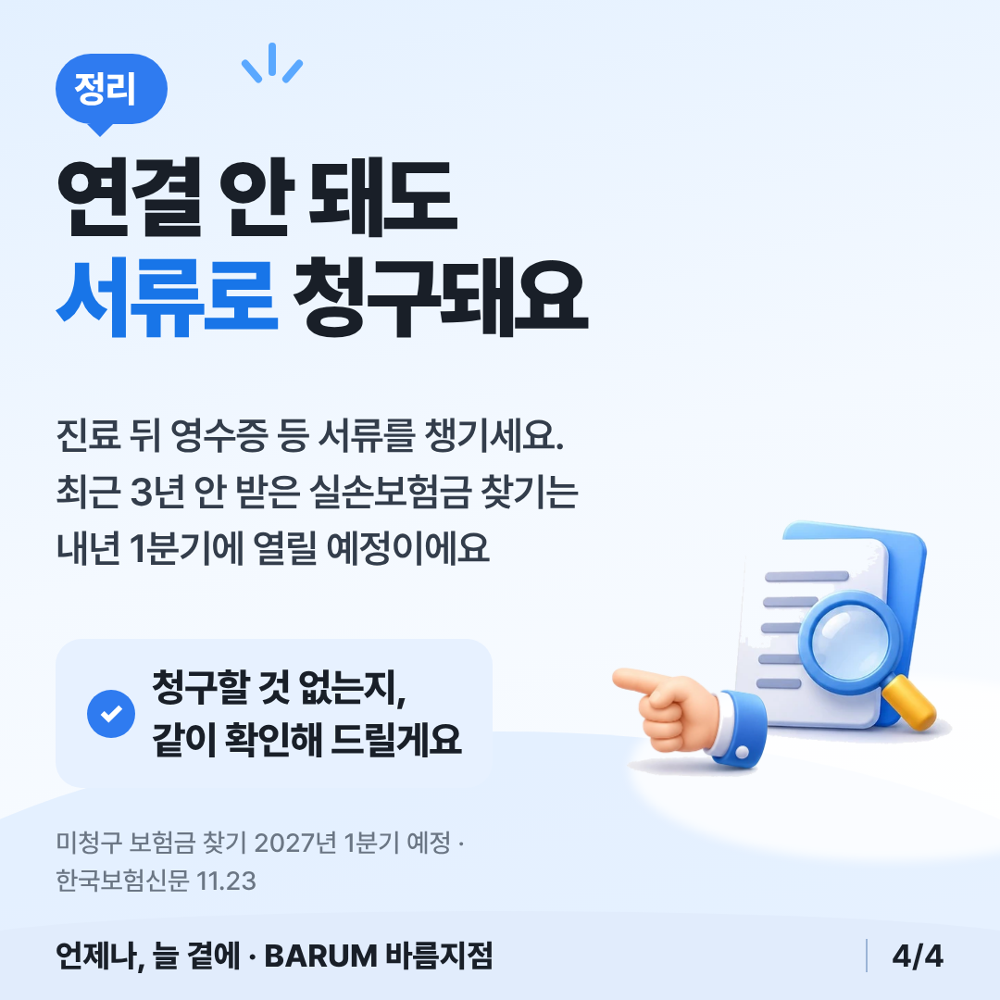

# 2026-11-24 보험 뉴스 브리핑

## 카드뉴스 (정사각형 1080×1080 · 고객 공유용)

카드 묶음 받기: https://raw.githubusercontent.com/bokkile83-ui/barum-news/main/news/cards/2026-11-24-silson24_카드.zip

## 1) 금융당국
- **오늘(24일) 정오 보험업법 시행령·금융기관 검사·제재 규정 개정안 입법예고** — 금융위·금감원 공동. 세부 내용은 정오 발표 뒤 확인(뉴스핌 일정). 내일(25일) 1~9월 보험회사 경영실적, 27일 9월 말 보험사 대출채권 현황 발표.
- **실손24 연계율 54.2%, 연말 목표 80~90%에 못 미침** — 11월 18일 기준 요양기관 10만 5,643곳 중 5만 7,258곳 연결. 금융위는 자발적 협조로 확대가 어려우면 과태료 부과 법 개정을 추진한다고 밝힌 바 있다. 미청구 실손보험금 찾기(최근 3년, 최대 1조원 추산)는 2027년 1분기 시작.
- **설계사에게** — 1·2세대 실손 전환 할인은 「설계사가 먼저 연락해 전환을 권유하는 영업」이 금지돼 있다. 고객이 먼저 물을 때 세대·병원 이용 습관부터 본다. 부산 고객은 동네 의원 청구 때 서류를 떼야 하는 경우가 많다.

## 2) 업계 뉴스 — 상담 이야기거리
1. 실손: 실손24 연결률 상급종합병원 100%·종합병원 77.4%·의원 41.3%·일반병원 34.2%, 치과의원 17.7%. 지역별로 경북 65.7% 최고, 부산 48.4% 최저 — 서울신문
2. 실손: 1·2세대 전환 할인 23일 시작 — 전환 뒤 청약철회 최대 6개월, 보험금 청구사유가 생겨도 전환 후 3개월 안 철회 가능, 2영업일 숙려기간 — 한국보험신문
3. 실손: 실손24 가입자 약 596만 명·누적 청구 1,955만 건. 2025년 한 해 미청구 실손보험금 약 3,386억원 — 한국보험신문
4. 암: 4대암(갑상선·대장·위·유방) 치료 이력자도 선택심사형으로 가입할 수 있는 갱신형 암보험 출시. 15~80세, 가입 1년 안 진단 시 50% 지급 — 더밸류뉴스
5. 보험사 AI: 가상 소비자 최대 500명으로 상품 반응을 미리 시험하는 손보사 「모의창구」가 2026 금융 AI 챌린지 대상(1,380팀 중 1위) — 더밸류뉴스

## 3) 오늘 고객에게 할 한마디
「동네 의원은 아직 절반 넘게 실손24 연결이 안 돼 있어요. 부산은 전국에서 연결률이 가장 낮다니, 진료받고 나오실 때 영수증 같은 서류는 꼭 챙겨 두세요. 놓친 청구 있는지 같이 봐 드릴게요.」

— BARUM 바름지점

## 출처
- [서울신문 — 동네의원 60% "실손24? 서류 떼세요" (11.24)](https://www.seoul.co.kr/news/economy/2026/11/24/20261124029002)
- [뉴스핌 — 이번주 국내 주요 금융일정 11.23~11.27 (11.22)](https://www.newspim.com/news/view/20261122000083)
- [한국보험신문 — 잠자는 실손보험금 깨운다 (11.23)](https://www.insnews.co.kr/news/articleView.html?idxno=93929)
- [뉴스웨이 — '실손24'로 3년치 미청구 보험금 찾는다 (11.19)](https://www.newsway.co.kr/news/view?ud=2026111910512963549)
- [더밸류뉴스 — 오늘의 보험사 소식 (11.23)](https://thevaluenews.co.kr/news/203529)
