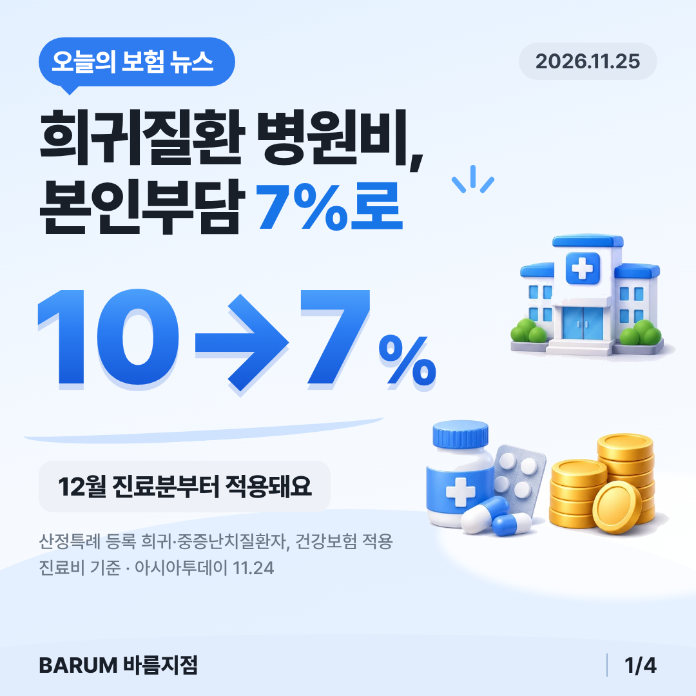
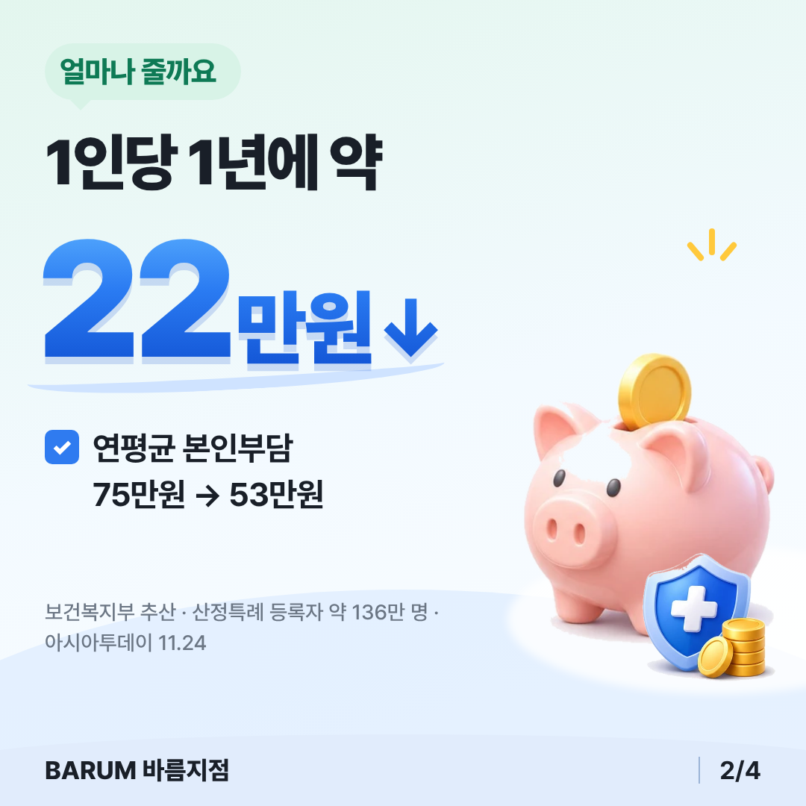
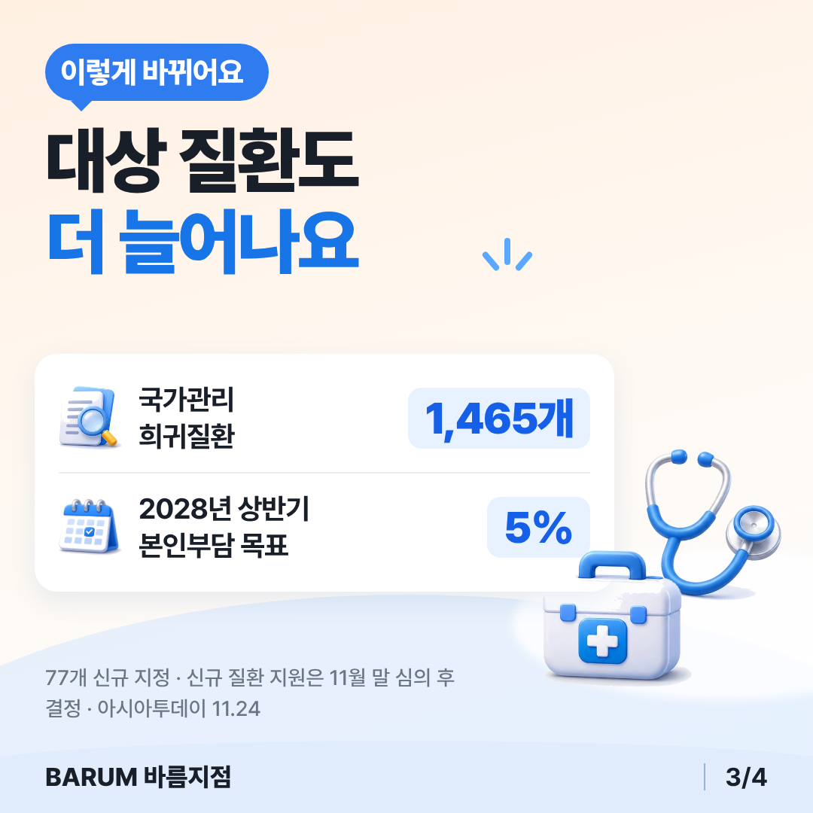
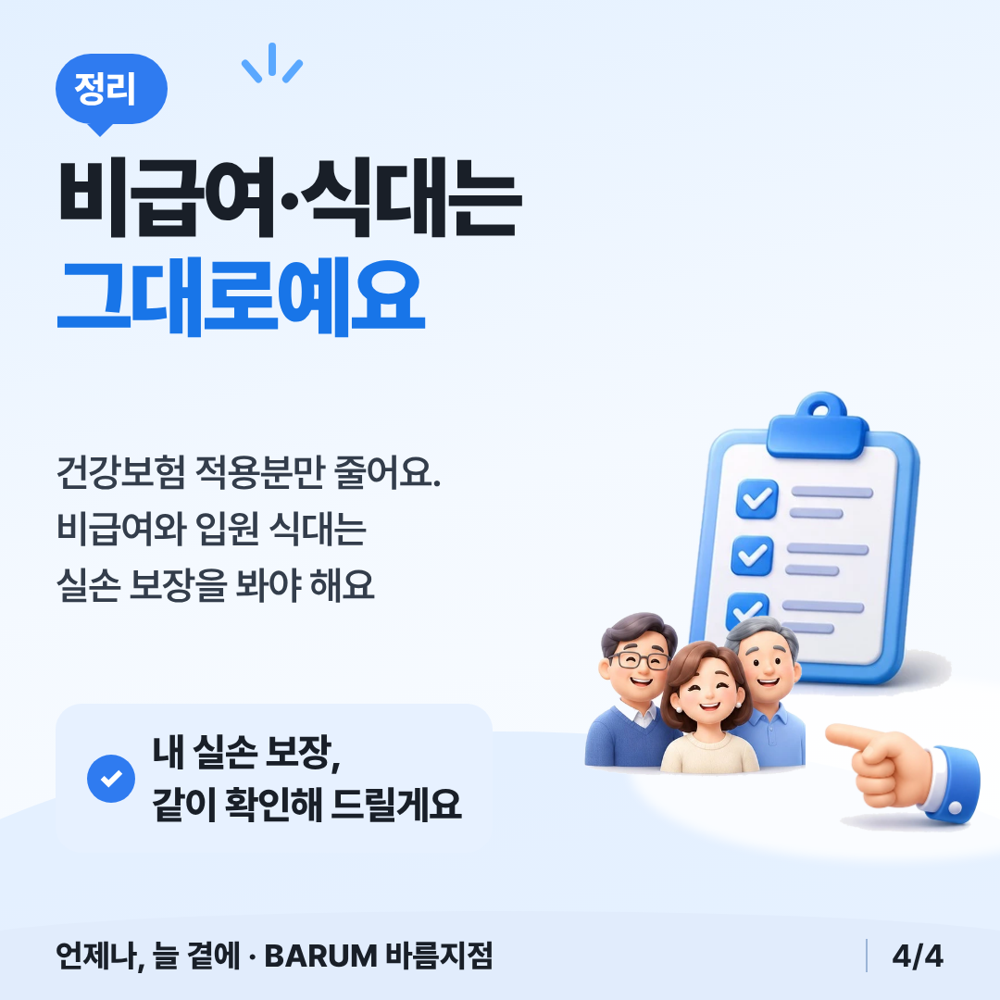

# 2026-11-25 보험 뉴스 브리핑

## 카드뉴스 (정사각형 1080×1080 · 고객 공유용)

카드 묶음 받기: https://raw.githubusercontent.com/bokkile83-ui/barum-news/main/news/cards/2026-11-25-rare7_카드.zip

## 1) 금융당국
- **오늘(25일)부터 보험업법 시행령·검사제재규정 개정안 입법·규정변경예고(~2027.1.4)** — 금융위. 보험사기방지 특별법·형법 제347조(보험계약 이용 사기) 위반자도 설계사 결격사유에 넣는다. GA가 업무정지를 받아도 가담하지 않은 설계사 생계를 위해 과징금으로 갈음할 수 있게 하고(가담 설계사 150명 이하 또는 15% 이하), 상한은 업무정지 6개월분. 2027년 3월 9일 시행 예정.
- **금융당국, 전 생·손보사 상품·영업 임원 소집** — 표준해약공제액 조정 등 제도 개선 의견 수렴. 신계약 과열 경쟁 억제가 배경(MTN 단독).
- **설계사에게** — 소속 GA가 제재를 받아도 영업이 통째로 멈추는 일이 줄어든다. 대신 보험사기 전력은 재등록이 막힌다. 표준해약공제액이 바뀌면 수수료·해지환급 구조에 영향이 갈 수 있어 다음 발표를 지켜본다.

## 2) 업계 뉴스 — 상담 이야기거리
1. 희귀질환: 산정특례 등록 희귀·중증난치질환자(약 136만 명) 건강보험 본인부담 10%→7%, 12월 진료분부터. 1인당 연 75만→53만원 추산. 비급여·입원 식대 제외, 2028년 상반기 5% 목표. 국가관리 희귀질환 77개 신규 지정해 1,465개 — 아시아투데이
2. 치매·간병: 손보사와 글로벌 제약사가 알츠하이머병 진단·치료·일상관리 협력 MOU(11.24). 치료비 보장에서 돌봄 관리로 넓히는 흐름. 65세 이상 치매 환자 100만 명 돌파 예상 — 경제타임스
3. 연금: 개인형퇴직연금(IRP) 운용 상품을 팔지 않고 연금을 받는 상품 출시. 만 55세 이상, 금액확정형·기간확정형 선택 — 뉴스핌
4. 종신·연금: 생보사 11월 신상품 — 낸 보험료를 생활자금으로 꺼내 쓰는 종신, 중증 진단 시 연금 50% 증액형 등 치매·장기요양 보장 강화 연금이 잇따름 — 보험저널(11.11)
5. 설계사 제도: 보험사기 전력자 모집시장 재진입 차단, 선량한 설계사는 과징금 제도로 생계 보호 — 한국경제TV

## 3) 오늘 고객에게 할 한마디
「희귀질환으로 산정특례 받고 계신 분은 12월 진료분부터 건강보험 본인부담이 10%에서 7%로 줄어요. 다만 비급여나 입원 식대는 그대로라, 실손에서 어디까지 받는지 한번 같이 봐 드릴게요.」

— BARUM 바름지점

## 출처
- [아시아투데이 — 병원비 낮추고 지원 대상 늘리고…희귀질환 치료 기회 확대 (11.24)](https://www.asiatoday.co.kr/kn/view.php?key=20261124010009503)
- [한국경제TV — 보험 사기범, 영구 퇴출…선량한 설계사는 보호 (11.24)](https://www.wowtv.co.kr/NewsCenter/News/Read?articleId=A202611240140)
- [한경일보 — 금융위, 보험업법 시행령 등 개정안 입법예고(26.11.25~27.1.4)](https://www.hkilbo.kr/news/articleView.html?idxno=145908)
- [MTN — 금융당국, 全보험사 임원 소집 (11.24)](https://news.mtn.co.kr/article/2026112410142932237)
- [경제타임스 — 치료비 넘어 돌봄…치매 대응 협력 (11.24)](https://ket.kr/news/article.html?no=42318)
- [뉴스핌 — IRP 상품 매도 없이 연금 받는 상품 출시 (11.24)](https://www.newspim.com/news/view/20261124001348)
- [보험저널 — 생보사 11월 신상품 봇물 (11.11)](https://www.insjournal.co.kr/news/articleView.html?idxno=33847)
