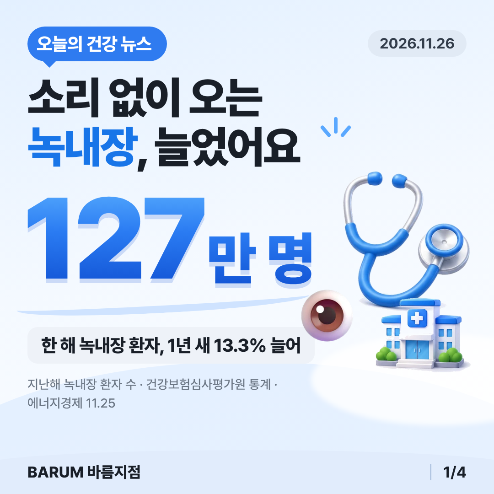
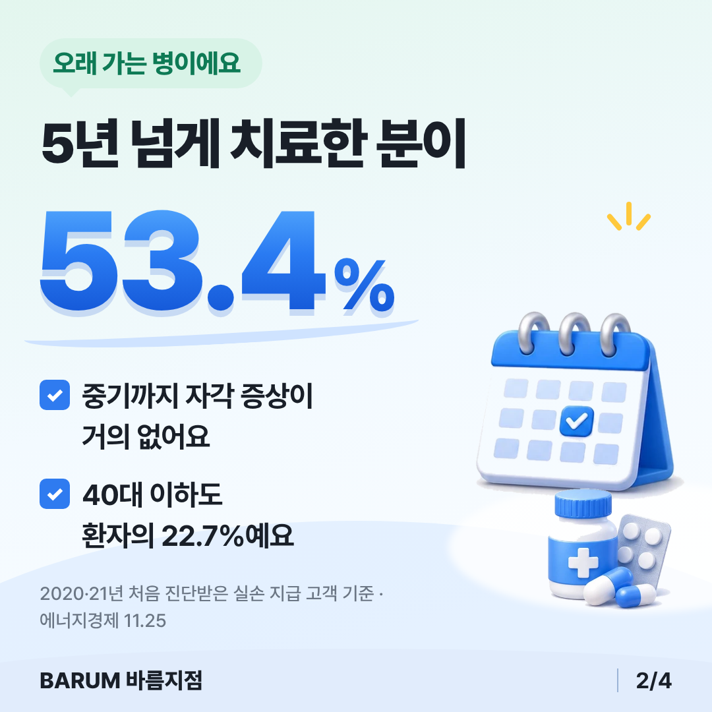
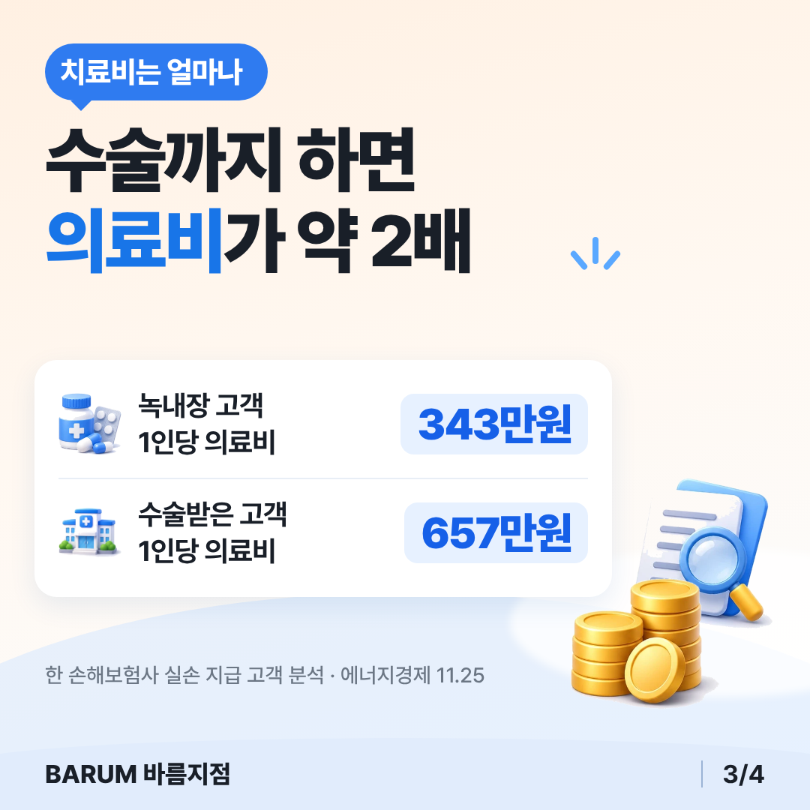
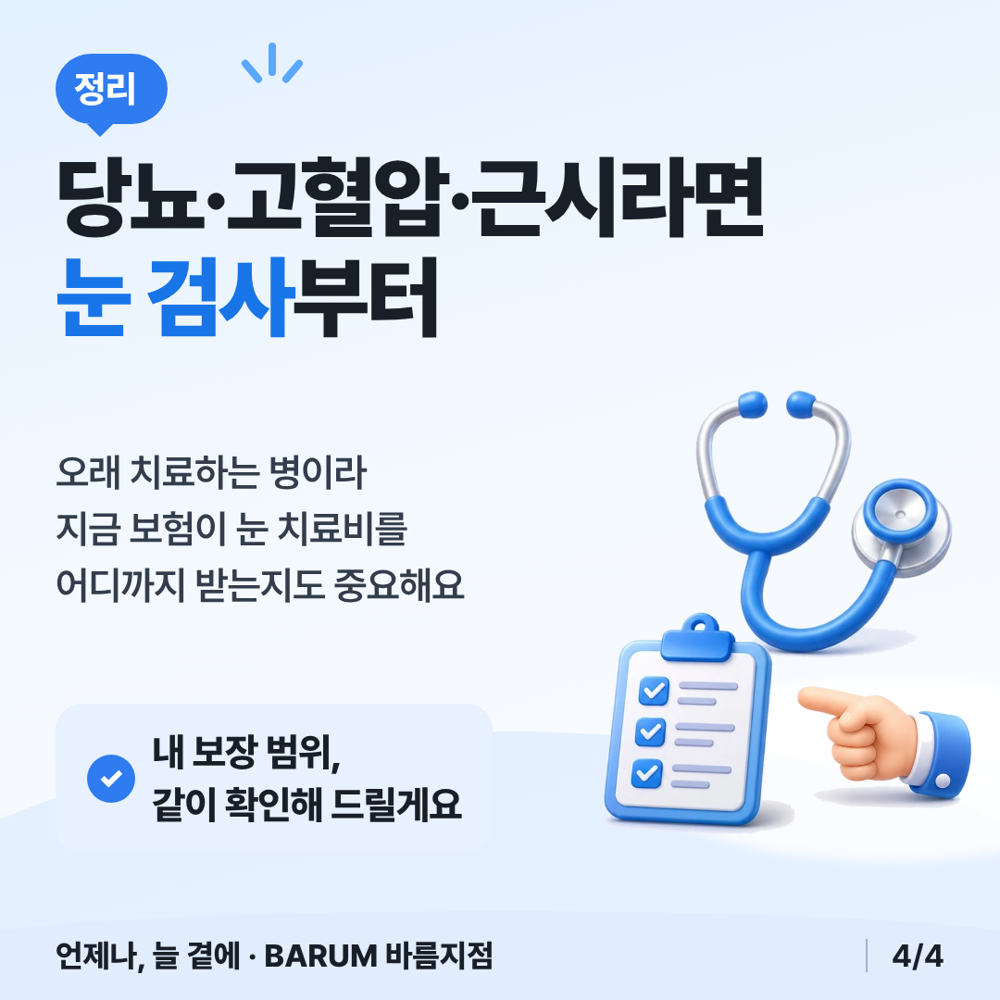

# 2026-11-26 보험 뉴스 브리핑

## 카드뉴스 (정사각형 1080×1080 · 고객 공유용)

카드 묶음 받기: https://raw.githubusercontent.com/bokkile83-ui/barum-news/main/news/cards/2026-11-26-glaucoma_카드.zip

## 1) 금융당국
- **금감원 「2026년 1~9월 보험회사 경영실적(잠정)」(11.25)** — 생보 22·손보 30개사 순이익 10조4,087억원, 전년 대비 7.8% 감소. 생보 3조8,879억원(-19.5%, 4년 만에 최저), 손보 6조5,209억원(+0.9%). 수입보험료는 212조원으로 15.6% 늘었다. 생보는 저축성 +34.0%·보장성 +10.3%.
- **원인** — 투자손익 감소와 계리감독 선진화(신규 담보 손해율 가정 90% 이상, 사업비 가정에 미래 물가 반영). 금감원은 손익 변동성이 줄고 고위험 상품·과당경쟁 유인이 줄 것으로 본다.
- **설계사에게** — 새 담보는 보수적으로 가격이 매겨지는 흐름이다. 이익이 준 생보사 중심으로 상품 개편·판매 조정이 이어질 수 있어 회사별 공지를 챙긴다.

## 2) 업계 뉴스 — 상담 이야기거리
1. 녹내장: 지난해 환자 127만 명(+13.3%), 40대 이하 22.7%. 한 손보사 실손 지급 분석에서 2020·21년 첫 진단 고객의 53.4%가 5년 넘게 치료, 1인당 의료비 343만원·수술 고객 657만원. 당뇨·고혈압·근시 고객에게 눈 검진 이야기로 — 에너지경제
2. 자동차보험: 대형 5개 손보사 10월까지 누적 손해율 83.9%(-1.5%p), 10월 한 달 80.4%(-7.2%p). 비가 적어 사고가 줄었지만 손익분기(80% 안팎) 위, 겨울 빙판·블랙아이스로 악화 예상 — 뉴스1
3. 분쟁: 손보 분쟁조정 신청 3분기 누적 4만2,478건(+38.2%), 보험사가 낸 소송 83건(+33.9%). 분쟁조정 신청 뒤 보험사 소송도 0건→7건. 청구 서류·고지 내용을 미리 챙기는 이유 — 뉴데일리
4. 정보유출 대비: 한전, 고객 약 152만 명 정보유출 뒤 금융사기 손해를 최대 1천만원 보상하는 보험 포함 이용권 무상 제공(등록 기한 내년 12월 31일). 금융거래 안심차단·휴대전화 무단개통 방지 서비스도 무료 안내 — 연합뉴스
5. 실적 흐름: 손보는 자동차·일반보험 손해율 하락으로 보험손익 25.5% 개선, 생보는 투자손익이 52.4% 줄어 순익 감소 — 파이낸셜뉴스

## 3) 오늘 고객에게 할 한마디
「녹내장은 중기까지 증상이 거의 없고, 진단받은 분 절반 넘게 5년 이상 치료한대요. 당뇨나 고혈압, 근시가 있으시면 눈 검진 한번 받아 보시고, 지금 보험이 눈 치료비를 어디까지 받는지도 같이 봐 드릴게요.」

— BARUM 바름지점

## 출처
- [파이낸셜뉴스 — 보험사 3분기 누적 순익 10조 돌파…순익은 8% 줄어 (11.25)](https://www.fnnews.com/news/202611250837195963)
- [헤럴드경제 — 보험사 3분기 누적 순익 10.4조 (11.25)](https://biz.heraldcorp.com/article/10947832)
- [에너지경제 — [보험사 풍향계] 녹내장, 40대 이하도 지속 관리해야 (11.25)](https://m.ekn.kr/view.php?key=20261125022114658)
- [뉴스1 — 車보험 손해율 두 달 연속 개선…적자 구조는 여전 (11.25)](https://www.news1.kr/finance/insurance-card/6365385)
- [뉴데일리 — 보험금 달라는 고객에 소송으로 맞선 손보사…소제기 34% 급증 (11.25)](https://biz.newdaily.co.kr/site/data/html/2026/11/25/2026112550152.html)
- [연합뉴스 — 한전, 정보유출 고객에 최대 1천만원 금융사기 보상보험 제공 (11.25)](https://www.yna.co.kr/view/AKR20261125085300003)
