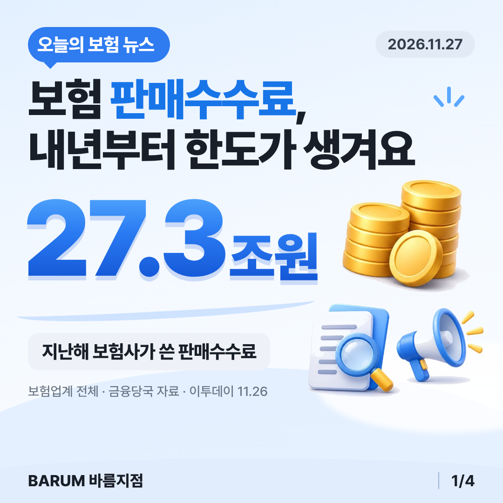
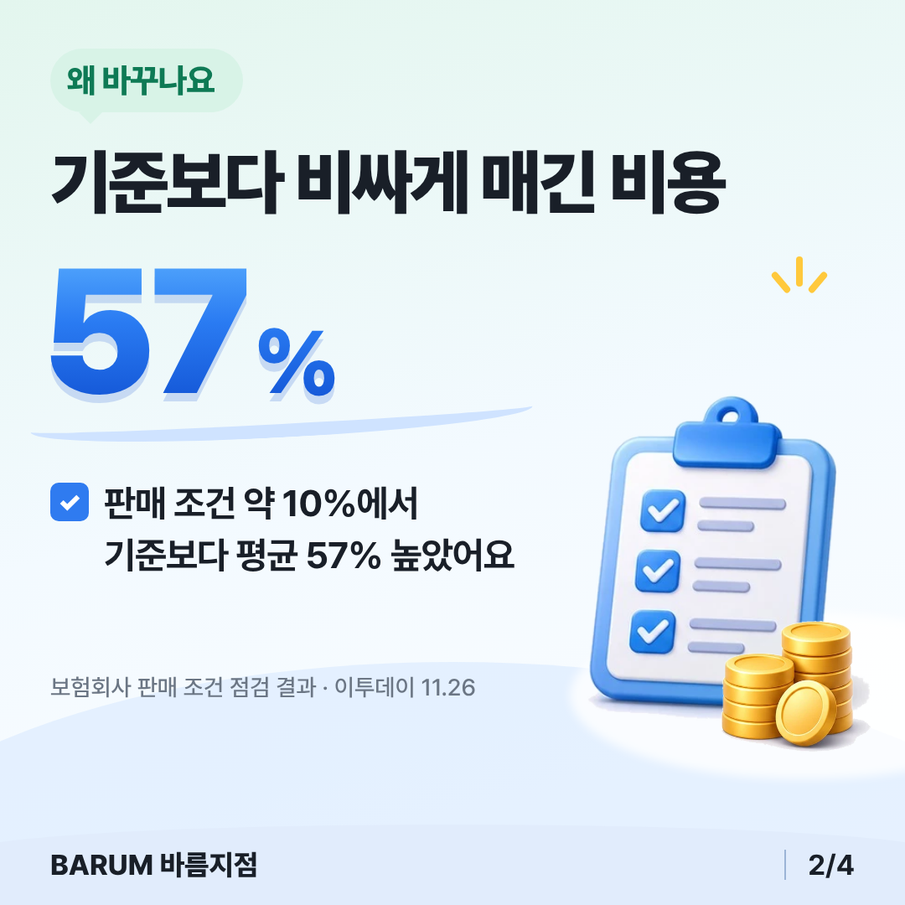
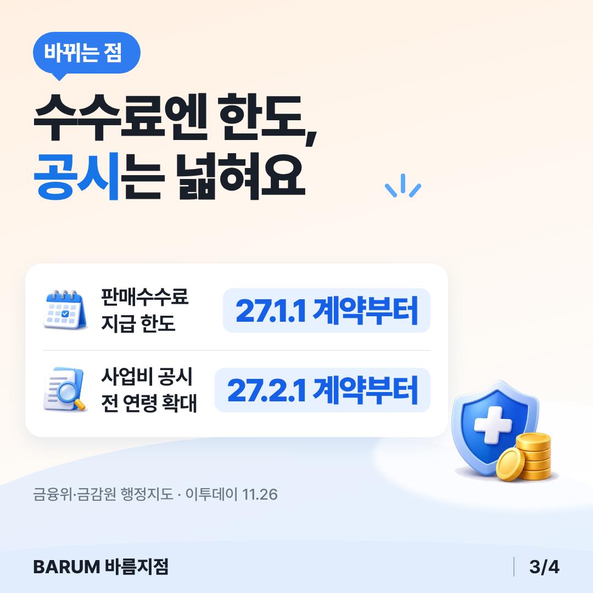
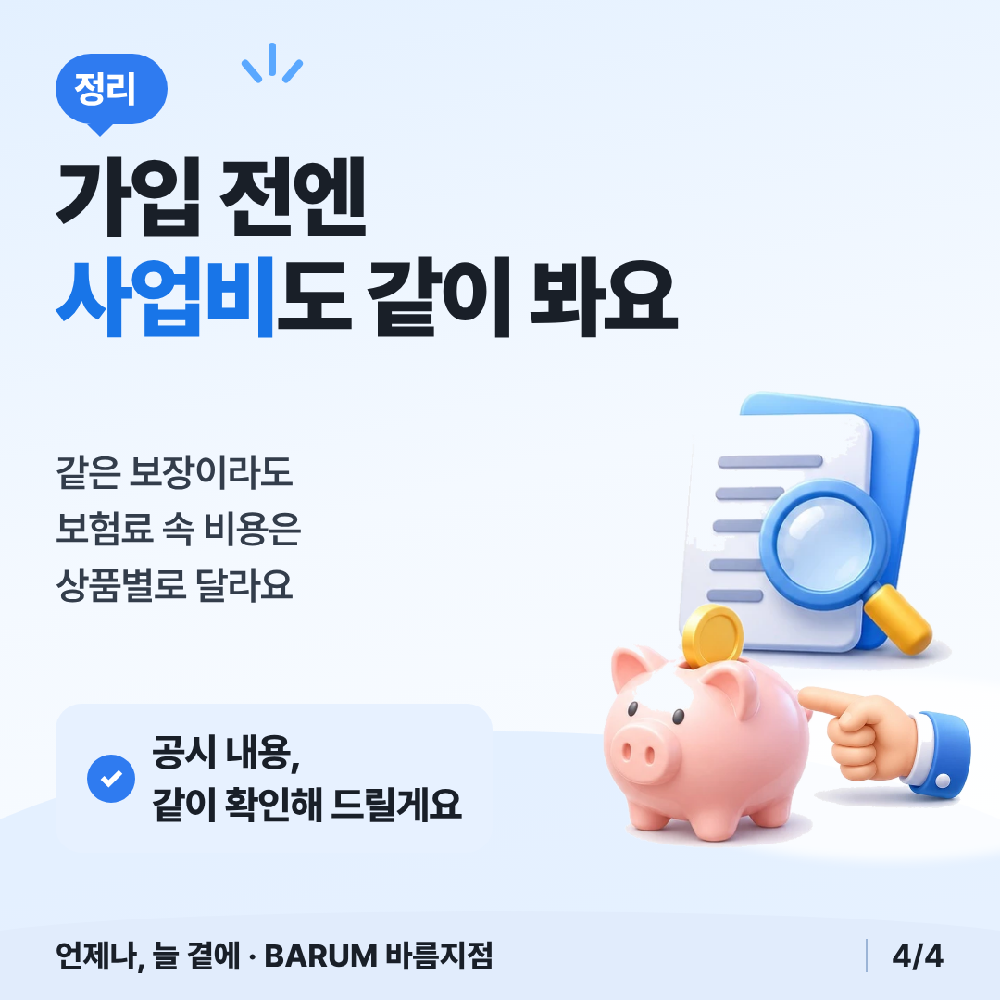

# 2026-11-27 보험 뉴스 브리핑

## 카드뉴스 (정사각형 1080×1080 · 고객 공유용)

카드 묶음 받기: https://raw.githubusercontent.com/bokkile83-ui/barum-news/main/news/cards/2026-11-27-commission_카드.zip

## 1) 금융당국
- **금융위·금감원 「보험 판매수수료 개편·공시규제 강화」 행정지도(11.26)** — 2027년 1월 1일 이후 계약부터 선지급수수료·유지관리수수료 지급한도를 「계약체결비용과 표준해약공제액 중 작은 금액」으로 묶는다. 종신사망보험은 표준해약공제액의 1.4배 기준. 사업비 공시는 지금의 「40세 남성·최장기납」 조건에서 전체 가입연령·납입기간으로 넓혀 2027년 2월 1일 계약부터 적용. 보험업감독규정 개정도 같이 간다.
- **배경** — 판매수수료 2022년 16조원 → 2024년 23조7,000억원 → 지난해 27조3,000억원(올해 상반기 14조1,000억원). 점검해 보니 회사별 판매 조건 평균 약 10%에서 표준해약공제액을 넘는 비용을 매겼고, 그 비용은 기준보다 평균 57% 높았다. 내년 1월 판매수수료 분급제도 시행 예정.
- **설계사에게** — 상품별 초기 수수료가 표준해약공제액 안으로 들어온다. 수수료 대신 보험료·보장 내용으로 비교하는 상담이 더 중요해진다. 분급 비율·기간은 아직 기사에 없으니 회사·GA 공지를 기다린다.

## 2) 업계 뉴스 — 상담 이야기거리
1. 실손: 주요 9개 손보사 10월 5세대 실손 94,237건 중 1~4세대에서 스스로 갈아탄 건 12,542건(13.3%). 23일부터 전환 할인이 시작됐지만 전환은 아직 저조 — 한국경제
2. 암: 한 생보사가 가입 후 10년간 암·유사암 진단이 없으면 이후 암 진단 때 치료 보장액을 2배로 주는 암치료보험을 내놨다(기타피부암·갑상선암 제외, 만 15~60세, 납입 중 암 진단 시 남은 보험료 면제) — 뉴스핌
3. 치매·간병: 국회 토론회(11.25)에서 사망보험금 중심인 보험금청구권신탁을 치매·장기간병 보험금까지 넓히자는 제안. 아직 논의 단계, 시행 일정은 없다 — 한국보험신문
4. 연금·치매: 11월 생보 신상품 — 중증치매(CDR 3점 이상)·장기요양 1~2등급이면 연금을 약 1.5배로 주는 연금보험, 뇌혈관·허혈성심장 진단 한도를 1,000만원→2,000만원으로 올린 간편 건강보험(최대 85세) 등 — 보험저널(11.11)
5. 종신: 낸 보험료를 최대 100%까지 중도인출해도 사망보장은 유지되는 종신, 완납 후 20년 안에 주계약 보험료 전액 인출 가능한 종신 등 「꺼내 쓰는 종신」이 늘었다. 상품별로 조건이 다르다 — 보험저널(11.11)

## 3) 오늘 고객에게 할 한마디
「내년부터 보험 판매수수료에 한도가 생기고, 보험료 속 판매비용 공시도 모든 나이로 넓어진대요. 새로 가입하실 땐 보장뿐 아니라 해지환급금과 사업비 공시도 같이 펼쳐 놓고 봐 드릴게요.」

— BARUM 바름지점

## 출처
- [이투데이 — 보험 판매수수료 과당경쟁 제동⋯내년부터 지급한도 규제 강화 (11.26)](https://www.etoday.co.kr/news/view/2653354)
- [한국사회복지저널 — 금융감독원, 2027년 1월 보험 판매수수료 개편 및 공시규제 강화 행정지도 시행 (11.26)](https://www.ksw-news.com/news/articleView.html?idxno=3067879)
- [한국경제 — 보험료 할인해도…5세대 실손 전환 저조 (11.26)](https://www.hankyung.com/article/2026112632381)
- [뉴스핌 — 10년간 암 진단 없으면 치료 보장액 2배 상품 출시 (11.26)](https://www.newspim.com/news/view/20261126000280)
- [한국보험신문 — 보험금청구권신탁 개선 논의… 치매·간병보험금까지 넓혀 (11.25)](https://www.insnews.co.kr/news/articleView.html?idxno=94068)
- [보험저널 — 생보사 11월 신상품 봇물 (11.11)](https://www.insjournal.co.kr/news/articleView.html?idxno=33847)
