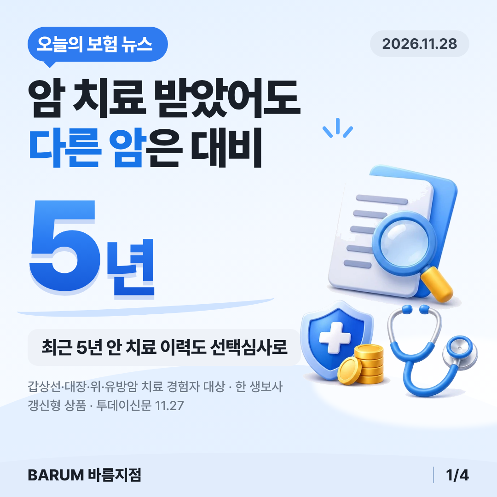
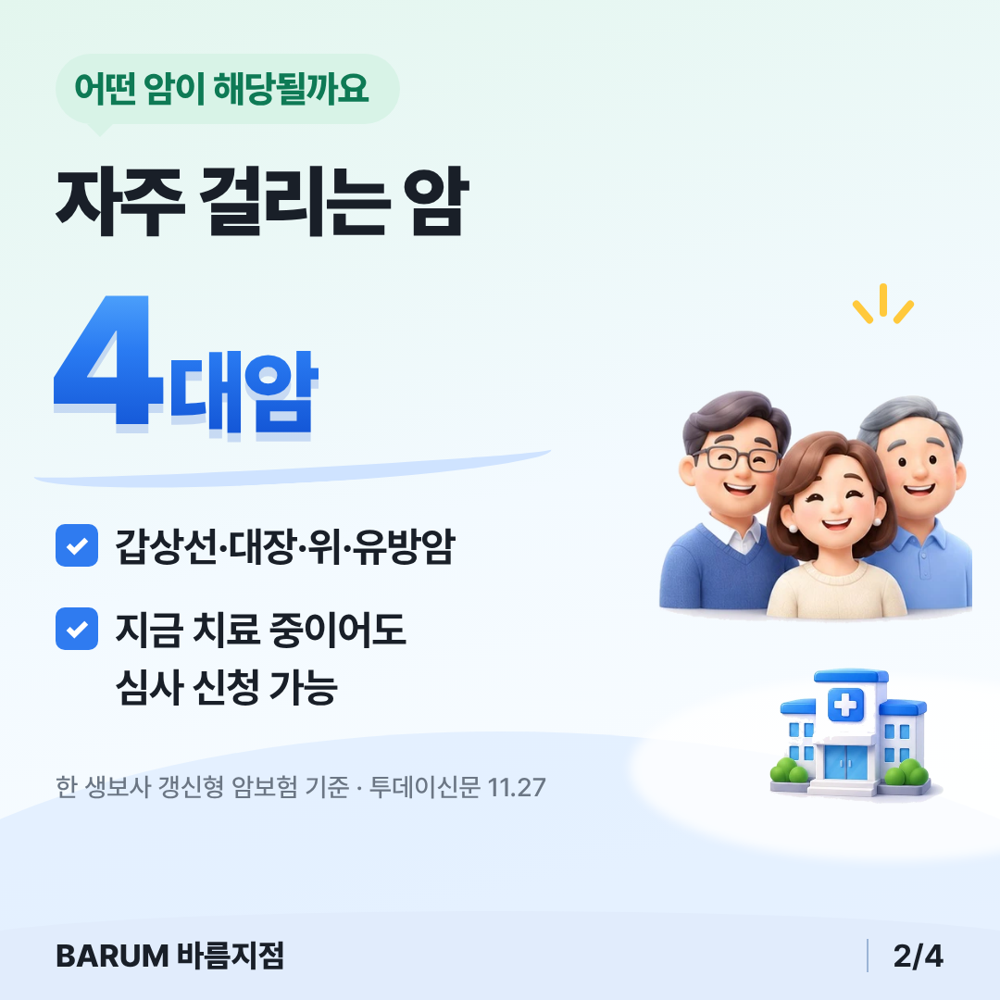
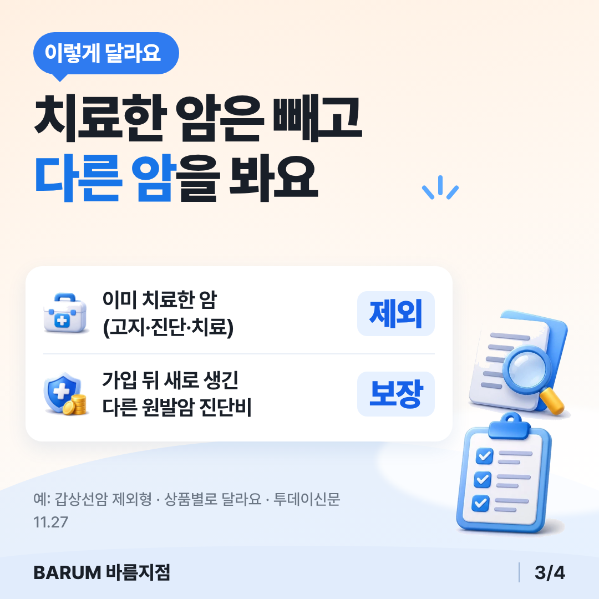
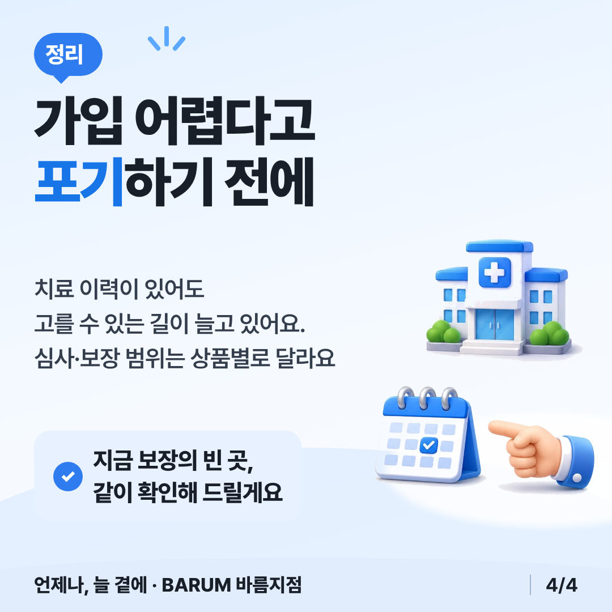

# 2026-11-28 보험 뉴스 브리핑

## 카드뉴스 (정사각형 1080×1080 · 고객 공유용)

카드 묶음 받기: https://raw.githubusercontent.com/bokkile83-ui/barum-news/main/news/cards/2026-11-28-cancerplus_카드.zip

## 1) 금융당국
- **금감원 「2026년 9월 말 보험사 대출채권 현황」(11.27)** — 대출채권 잔액 263조9,000억원(전분기 대비 2조1,000억원↓). 연체율 1.27%로 0.19%p 올라 2010년 12월 말 이후 15년 9개월 만에 가장 높다. 기업대출 연체율 1.49%(+0.28%p), 가계 0.84%(+0.01%p). 원인은 건설·부동산 PF 부실과 금리 상승. **설계사에게** — 보험계약대출·주택담보대출 상담에서 금리·연체 질문이 늘 수 있다. 금감원은 연말 상각·매각으로 12월 말 지표 개선 가능성을 봤다.
- **금융위·금감원 「금융행정 쇄신방안」(11.27)** — 업무 전반 정기검사 원칙 금지, 수시검사 사전통지 7일→7영업일, 중간 검사결과 공개 원칙 금지, 경미한 위반은 자체 시정·준법교육으로 제재 감면 확대. 세부 규정 개정은 2027년 분기별 추진. **설계사에게** — 검사 대상은 금융회사 중심이라 설계사 직접 변화는 기사에 없다.
- **참고: 보험업법 시행령 개정안 입법예고(11.25~2027.1.4, 11.24 발표)** — 설계사 결격사유를 따지는 법률이 보험사기방지 특별법 등으로 넓어지고, GA는 위반 가담 설계사가 150명 이하·전체의 15% 이하 등이면 업무정지 대신 과징금(업무정지 6개월분 상한)을 낼 수 있다. 시행 목표 2027년 3월 9일. **설계사에게** — GA 업무정지로 소속 설계사 영업이 통째로 멈출 위험이 줄어든다. 아직 예고 단계다.

## 2) 업계 뉴스 — 상담 이야기거리
1. 실손: 5세대 누적 가입 46만건 중 1·2세대에서 갈아탄 건 8.7%. 23일부터 1·2세대 전환 시 3년간 보험료 50% 할인이 시작됐다. 초기 실손 약 1,600만건이 얼마나 움직일지가 관건 — 뉴스1(11.27)
2. 실손 계산: 금융위 사례(60대 여성 1세대) 월 17만6,982원 → 5세대 전환 할인 시 월 2만1,620원, 3년 약 559만원 절감. 할인은 3년 뒤 끝나 월 4만3,241원. 전환 할인 신청은 내년 5월 22일까지, 청약철회 최대 6개월이지만 철회하면 할인 재이용이 어렵다 — 뉴스핌(11.21)
3. 암: 한 생보사가 갑상선·대장·위·유방암을 지금 치료 중이거나 최근 5년 안에 치료한 사람도 그 암만 빼고 선택심사로 드는 갱신형 암보험을 냈다. 같은 회사 종신은 10년 납입 중 암·뇌출혈·급성심근경색 진단 시 이후 보험료 면제 — 투데이신문(11.27)
4. 특약 경쟁: 올해 배타적사용권 35건(전년 48건, 27.1%↓). 생보 10→22건으로 늘었고 손보 38→13건으로 줄었다. 생보 사례는 특정 자궁질환 초음파검사·심폐소생술·뇌졸중 집중치료실 입원치료 특약·톤틴연금 — 이투데이(11.27)
5. 치매·순환계: 손보 11월 신상품 — 치매 전문재활 회당 최대 5만원(연 10회)·장기요양 1~5등급 시설급여 월 최대 100만원을 주는 치매보험, 일부 뇌·심장 진단비가 10년 뒤 2배가 되는 순환계 보험 등. 상품별로 조건이 다르다 — 보험저널(11.11)

## 3) 오늘 고객에게 할 한마디
「예전에 암 치료를 받으셨어도, 그 암만 빼고 다른 암을 대비하는 상품이 나오고 있어요. 지금 가진 보장에 빈 곳이 어딘지부터 같이 펼쳐 볼게요.」

— BARUM 바름지점

## 출처
- [글로벌이코노믹 — 보험사 대출채권 264조…연체율 1.27% (11.27)](https://www.g-enews.com/article/Finance/2026/11/202611270923166513a6e8311f64_1)
- [이즈보험(정책브리핑 전재) — 「금융행정 쇄신방안」 마련 (11.27)](https://dazabi.com/insurance_magazine/article.php?id=48433)
- [이즈보험(정책브리핑 전재) — 보험업법 시행령 개정안 입법예고 (11.24)](https://dazabi.com/insurance_magazine/article.php?id=48176)
- [뉴스1 — 실손보험 개혁 2년여 만에 제도적 마침표…이제는 성과 시험대 (11.27)](https://www.news1.kr/finance/insurance-card/6367544)
- [뉴스핌 — 5세대 실손보험 전환 따져보니…3년 559만원 절약하지만, 보장 달라져 (11.21)](https://www.newspim.com/news/view/20261120000619)
- [투데이신문 — 종신보험의 변신, 암보험의 확장 (11.27)](https://www.ntoday.co.kr/news/articleView.html?idxno=131176)
- [이투데이 — 보험상품 차별화 경쟁⋯올해 배타적사용권 성적표는 (11.27)](https://www.etoday.co.kr/news/view/2653956)
- [보험저널 — 손보사 신상품, 틈새 보장 정조준 (11.11)](https://www.insjournal.co.kr/news/articleView.html?idxno=33861)
