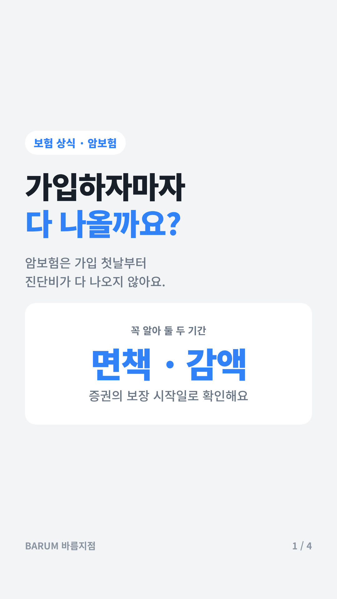
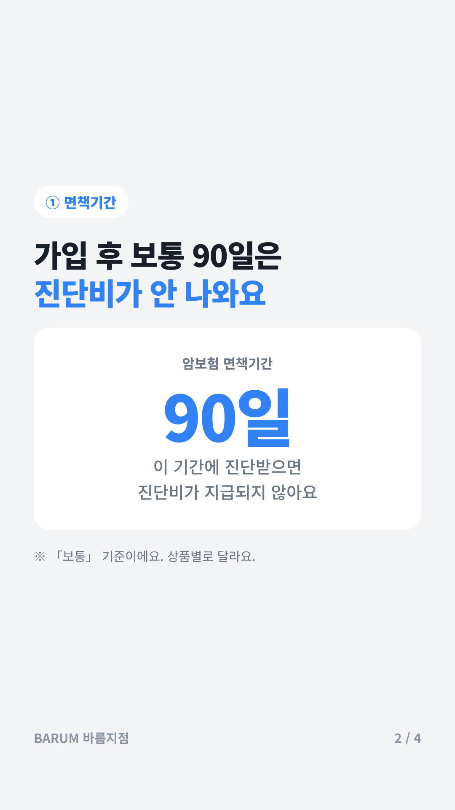
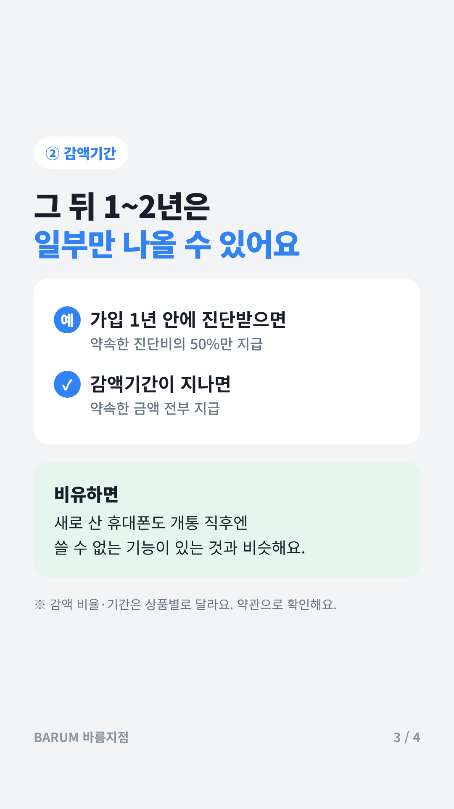
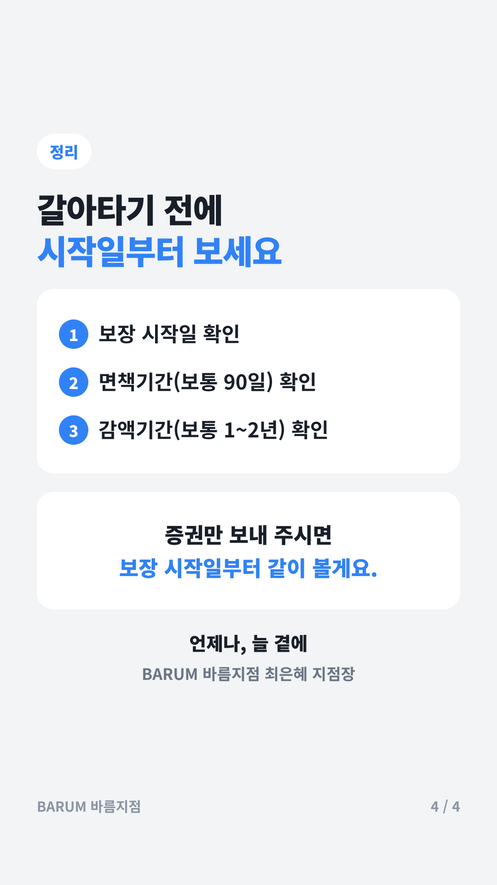

# 오늘 공부 — 암보험 면책기간과 감액기간

## 카드뉴스 (스토리 1080×1920 · 고객 공유용)

카드 묶음 받기: https://raw.githubusercontent.com/bokkile83-ui/barum-news/main/study/cards/2026-11-13-amboheom_카드.zip

## 한 줄로
- 가입 직후엔 암 진단비가 안 나오거나 반만 나온다.
## 꼭 알 것 3가지
- ① 면책기간(보장 안 되는 기간): 암보험은 보통 90일.
- ② 이 기간에 진단받으면 진단비가 지급되지 않는다.
- ③ 감액기간(일부만 주는 기간): 보통 1~2년, 예) 1년 내 50%.
## 고객에게 이렇게
> "가입 첫날부터 다 나오는 건 아니라서, 증권에서 보장 시작일부터 같이 볼게요."
## 영상 1개
- [보험 가입 후 면책기간에 대해 초특급이 알려줄게!](https://www.youtube.com/watch?v=9Kbj1Co34ZA)
## 출처
- [KB의 생각 — 면책기간과 감액기간](https://kbthink.com/insurance-guide/waiting-and-reduction-periods.html)
