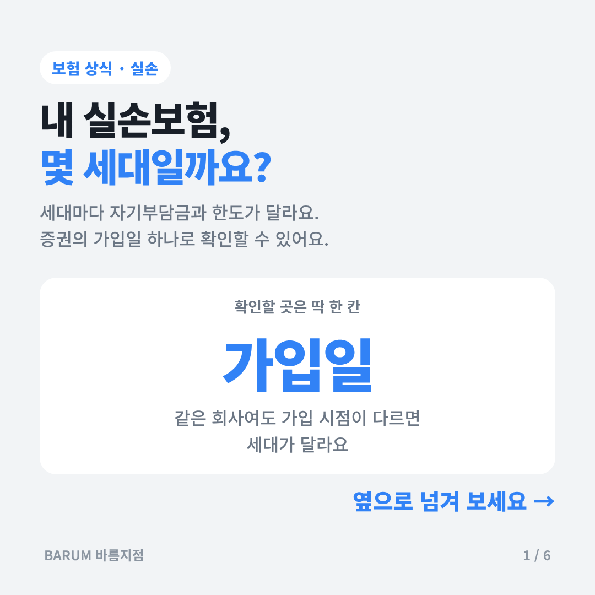
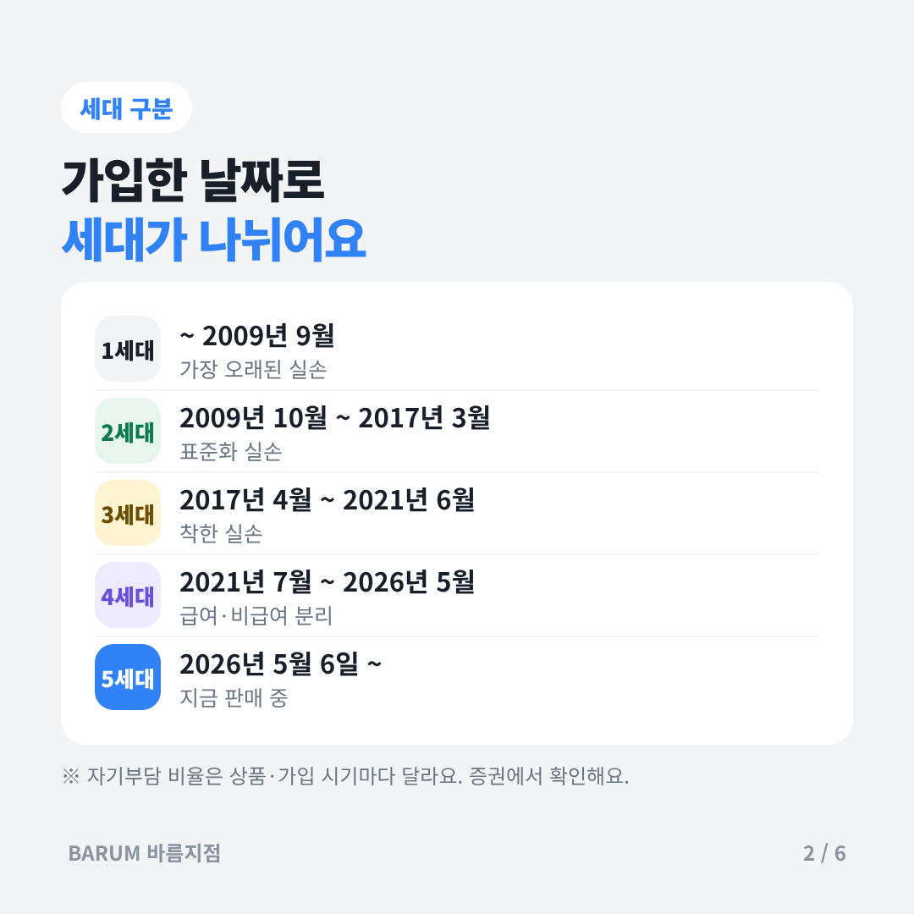
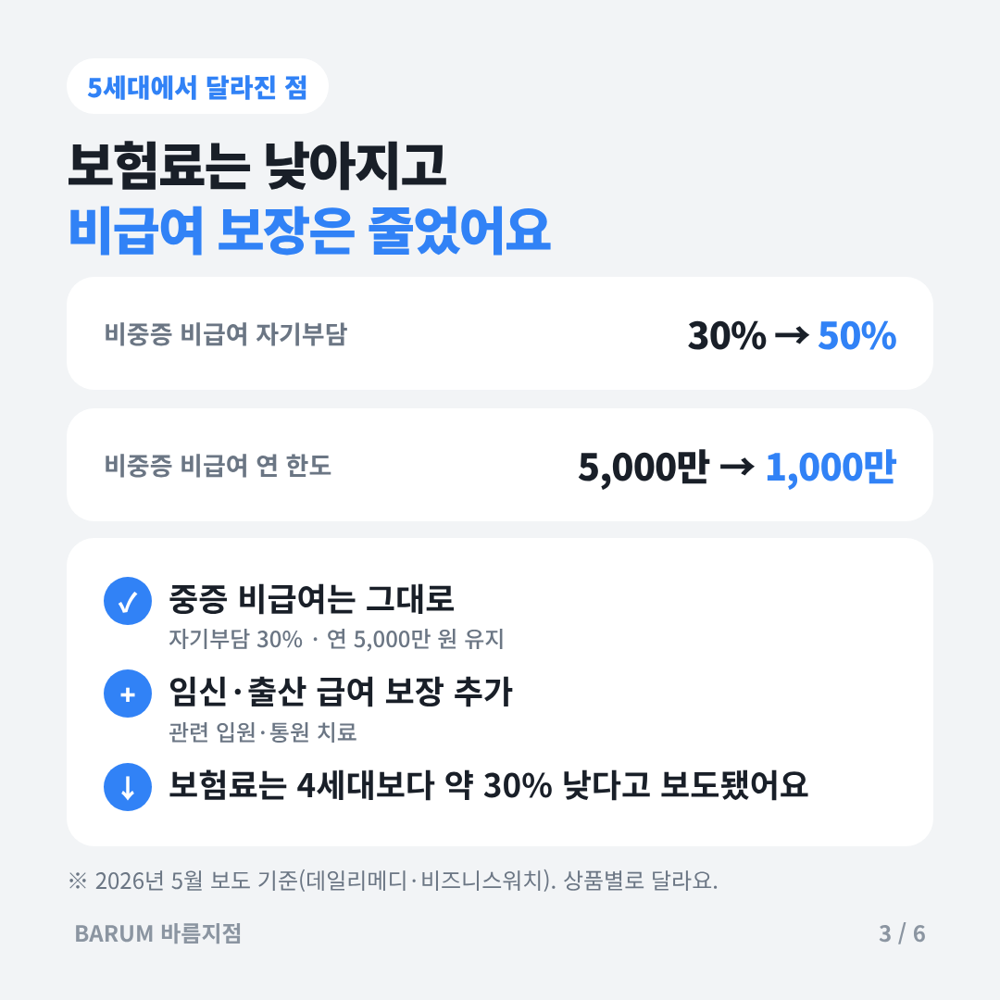
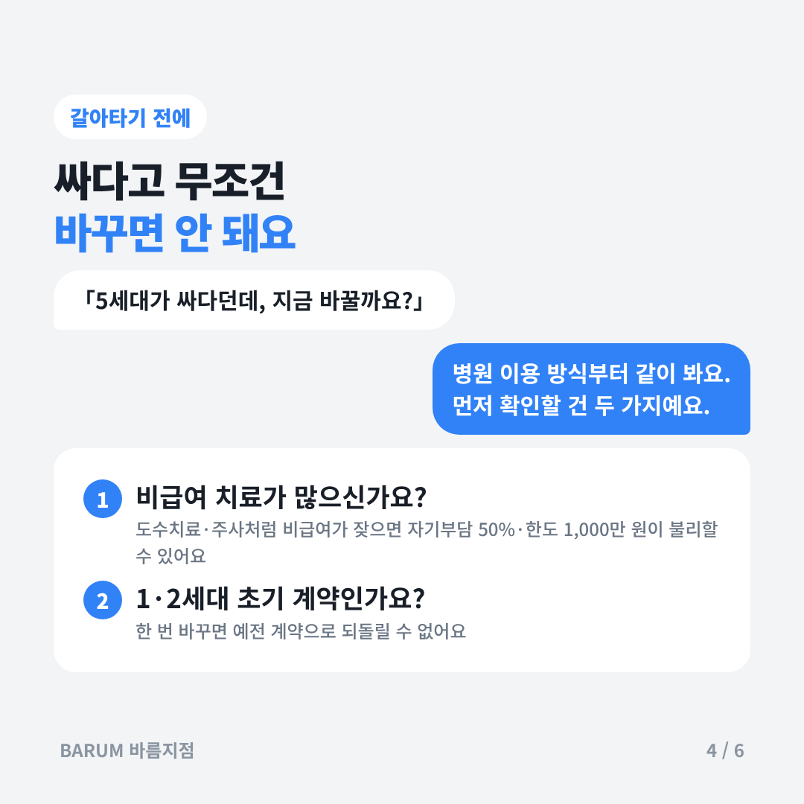
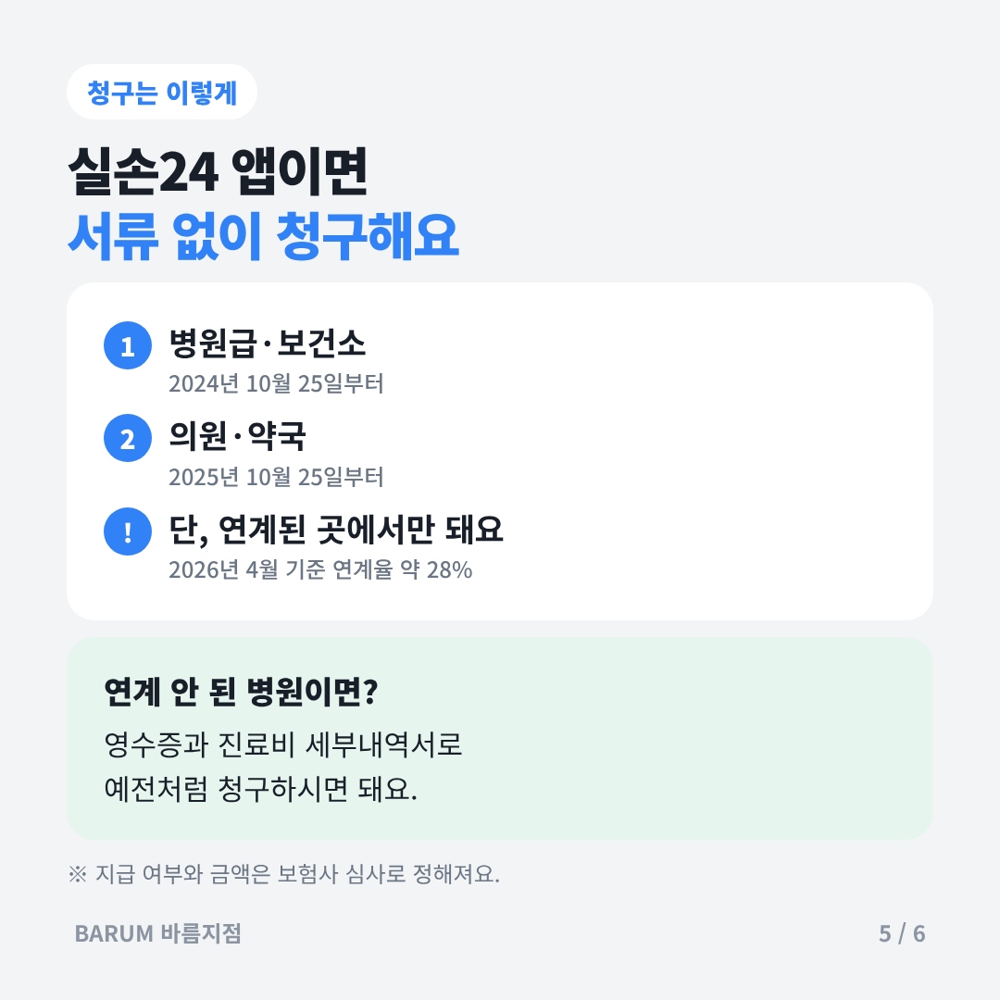
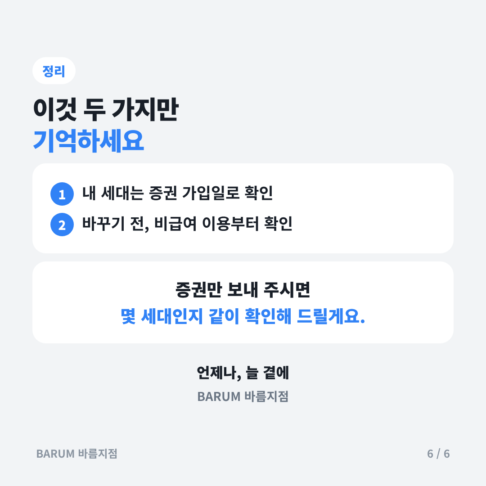

# 2026-11-13 오늘 공부 — 실손보험 세대 구분과 청구(실손24)

## 카드뉴스 (정사각형 1080×1080 · 고객 공유용)

카드 묶음 받기: https://raw.githubusercontent.com/bokkile83-ui/barum-news/main/study/cards/2026-11-13_카드.zip

## 3줄 요약
- 실손은 가입 시기로 세대가 갈린다: 1세대(~2009.9) · 2세대(2009.10~2017.3) · 3세대(2017.4~2021.6) · 4세대(2021.7~2026.5) · 5세대(2026.5.6 출시).
- 5세대는 비중증 비급여 자기부담이 30%→50%로 오르고 연 한도가 5,000만→1,000만원으로 줄었다. 중증 비급여는 30%·5,000만원 유지. 보험료는 4세대보다 약 30% 낮다고 보도됐다.
- 청구는 「실손24」 앱으로 서류 없이 가능: 병원급·보건소 2024.10.25, 의원·약국 2025.10.25부터. 다만 연계된 기관에서만 된다.

## 꼭 알 것
- 세대 확인 = 첫 가입 시점(보험증권 가입일). 같은 회사라도 가입 시점이 다르면 세대가 다르다.
- 4세대부터 급여·비급여가 나뉘고, 비급여는 직전 1년 비급여 보험금 청구액에 따라 보험료가 할인·할증된다(할증 구간 세부는 약관으로 [확인 필요]).
- 재가입 주기: 2세대 후기(2013.4 이후)·3세대 15년, 4세대 5년. 재가입 시점에 그때 판매 중인 상품(현재 5세대)으로 바뀐다. 1·2세대 초기 계약은 재가입 조항이 없다.
- 5세대 추가 보장(급여): 임신·출산 관련 입원·통원, 발달장애 급여 치료비. 보장 제외로 보도된 것: 체외충격파, 비급여 영양·미용 주사제, 미등재 신의료기술.
- 실손24 연계율(2026.4.1 기준) 약 28%(병원급 56%, 의원·약국 26%). 연계 안 된 곳은 기존 방식(서류·사진) 청구.

## 자주 틀리는 것
- 「5세대가 싸니까 무조건 갈아타야 한다」 → 아니다. 비급여 자기부담·한도가 달라지므로 비급여 이용 많은 고객은 불리할 수 있다. 1·2세대 초기 계약은 되돌릴 수 없다.
- 「실손24는 어느 병원에서나 된다」 → 연계 기관만 된다.
- 「1·2세대는 자기부담이 0%다」 → 상품·시기별로 0~20% 수준으로 다르다(보험증권 확인).
- 1·2세대 유지자용 선택형 할인 특약, 전환 시 3년 50% 할인은 2026.5월 기사 기준 「11월 시행 예정」이었다. 실제 시행·확정 할인율은 [확인 필요].

## 상담 때 한마디
- 「먼저 고객님 실손이 몇 세대인지 증권 가입일로 같이 확인해 볼게요. 세대마다 자기부담과 한도가 달라서, 지금 병원 이용 방식에 맞는지부터 보는 게 순서예요.」
- 「청구는 실손24 앱에서 병원 이름을 검색해 연계된 곳이면 서류 없이 접수됩니다. 연계 안 된 곳이면 영수증·세부내역서로 청구하시면 돼요. 지급 여부와 금액은 보험사 심사로 정해집니다.」

## 추천 영상
※ 유튜브 페이지는 직접 열지 못했다. 아래는 검색 결과의 영상 제목만 확인한 것이고, 채널명·내용은 [확인 필요]. 보기 전 공식 자료(금융위 보도자료)와 대조할 것.
- 5세대 실손보험 총정리｜달라지는 것 7가지, 지금 내 실손은 괜찮을까요? · 채널 [확인 필요] · https://www.youtube.com/watch?v=CFQp20ebnnA
- #573. 5세대 실손 드디어 출시 완료! (변경 사항 총정리) · 「반값보험료만들기」 시리즈(채널명 [확인 필요]) · https://www.youtube.com/watch?v=eVP72UKtveU
- 5세대 실손보험 풀버전｜싸다고 갈아타면 큰일납니다… · 채널 [확인 필요] · https://www.youtube.com/watch?v=aMW_A6D4314

## 출처
- 정책브리핑(korea.kr), 실손 청구 전산화 1단계 시행(2024.10.25): https://www.korea.kr/news/policyNewsView.do?newsId=148935501
- 데일리메디, 5세대 실손보험 출시(2026.5.5): https://www.dailymedi.com/news/news_view.php?wr_id=936208
- 비즈니스워치(2026.5): https://news.bizwatch.co.kr/article/finance/2026/05/04/0021
- 매일경제(다음), 4세대 실손 5세대로 전환 시작(2026.8.3): https://v.daum.net/v/UfHBqdJ6y0
- 한국경제(다음), 실손24 대상 확대(2025.11.4): https://v.daum.net/v/20251104155655441
- MTN, 실손 청구 전산화 연계율 28%(2026.4.15): https://news.mtn.co.kr/news-detail/2026041509593916255
- 금융위원회 보도자료 「5세대 실손보험 도입방안」(2026.5) 원문은 열람하지 못했다 [확인 필요]: https://fsc.go.kr

## HELPER 지식책 후보
1. 질문: 실손보험 세대는 어떻게 구분하나요?
   답: 첫 가입 시점으로 나눈다. 1세대 ~2009.9, 2세대 2009.10~2017.3, 3세대 2017.4~2021.6, 4세대 2021.7~2026.5, 5세대 2026.5.6 이후. 증권의 가입일을 확인한다.
   근거: 매일경제(다음) 2026.8.3 / 데일리메디 2026.5.5
2. 질문: 5세대 실손은 4세대와 무엇이 다른가요?
   답: 비중증 비급여 자기부담 30%→50%, 연 한도 5,000만→1,000만원. 중증 비급여는 30%·5,000만원 유지. 임신·출산 급여 보장 추가. 보험료는 4세대 대비 약 30% 낮다고 보도됐다.
   근거: 데일리메디 2026.5.5 / 비즈니스워치 2026.5 (금융위 원문 [확인 필요])
3. 질문: 실손24로 어디서나 서류 없이 청구할 수 있나요?
   답: 실손24와 연계된 요양기관에서만 된다. 병원급·보건소는 2024.10.25, 의원·약국은 2025.10.25부터 대상이지만 2026.4 기준 연계율은 약 28%다. 연계 안 된 곳은 서류로 청구한다.
   근거: 정책브리핑 2024.10.25 / 한국경제 2025.11.4 / MTN 2026.4.15
