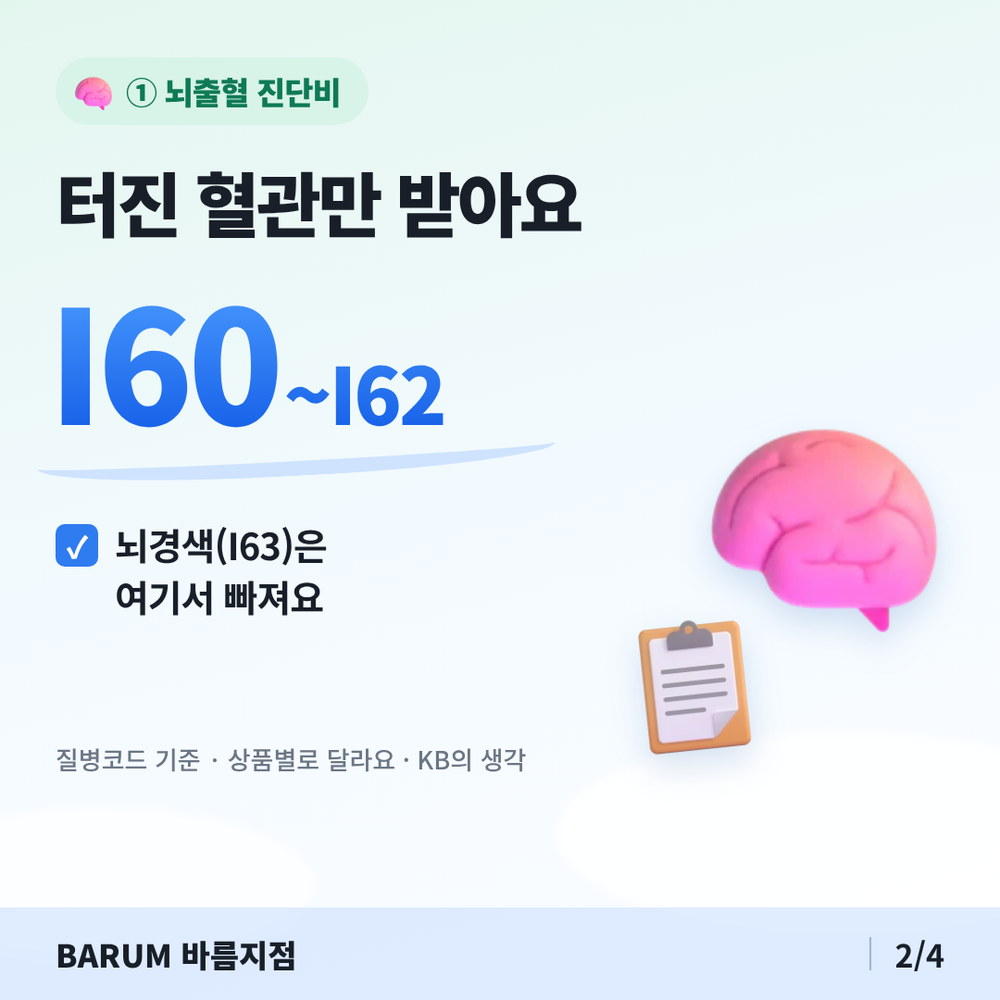
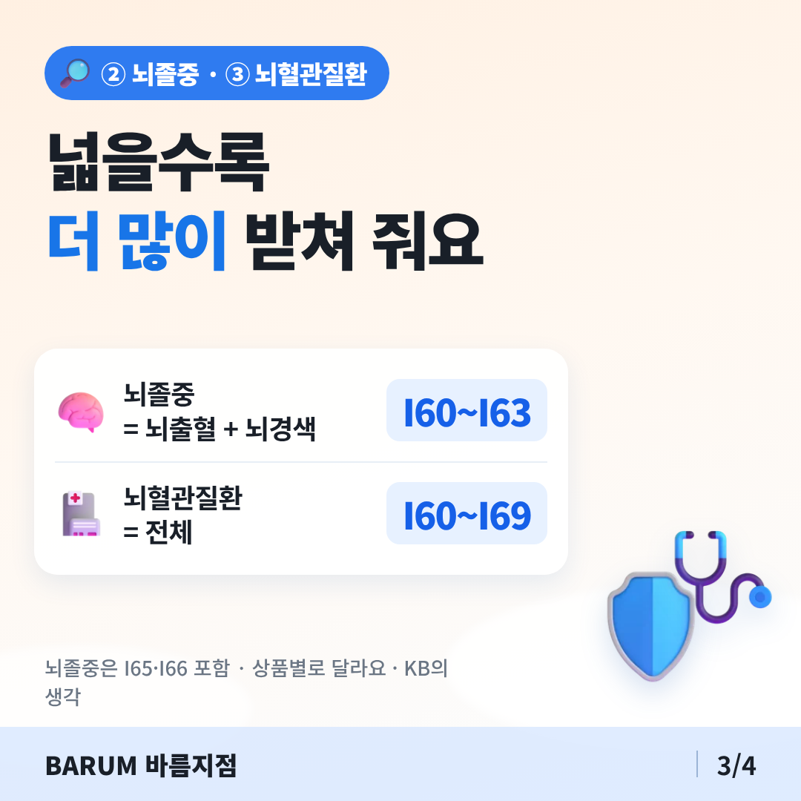

# 오늘 공부 — 뇌출혈·뇌졸중·뇌혈관질환 진단비 차이

## 카드뉴스 (정사각형 1080×1080 · 고객 공유용)

카드 묶음 받기: https://raw.githubusercontent.com/bokkile83-ui/barum-news/main/study/cards/2026-11-14-noehyeolgwan-v3_카드.zip

## 한 줄로
- 뇌 진단비는 이름에 따라 받는 범위가 다르다.
## 꼭 알 것 3가지
- ① 뇌출혈 진단비: 터진 혈관만(I60~I62). 뇌경색 빠짐.
- ② 뇌졸중 진단비: 뇌출혈 + 뇌경색(I63)·I65·I66.
- ③ 뇌혈관질환 진단비: I60~I69 전체, 가장 넓다.
## 고객에게 이렇게
> "같은 뇌 보장도 이름마다 범위가 달라서, 증권 담보명부터 같이 볼게요."
## 영상 1개
- [뇌혈관질환보험 보장범위 총정리｜뇌출혈·뇌경색·뇌졸중 차이!](https://www.youtube.com/watch?v=WALX_uLcEdk)
## 출처
- [KB의 생각 — 뇌혈관질환 보험, 특약별 진단비 보장 범위는?](https://kbthink.com/insurance/trend/cerebrovascular-disease.html)
