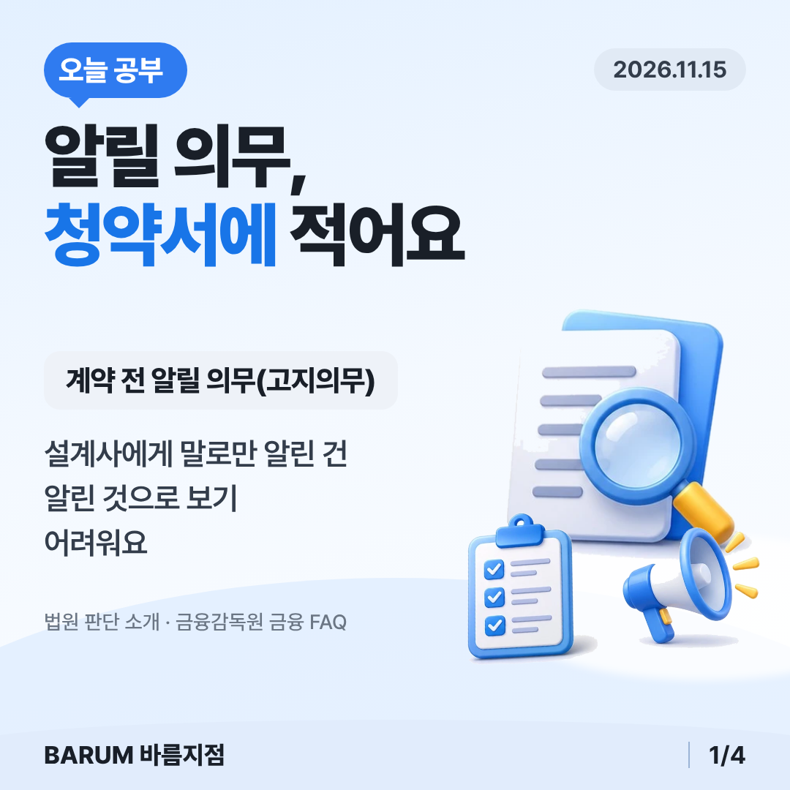
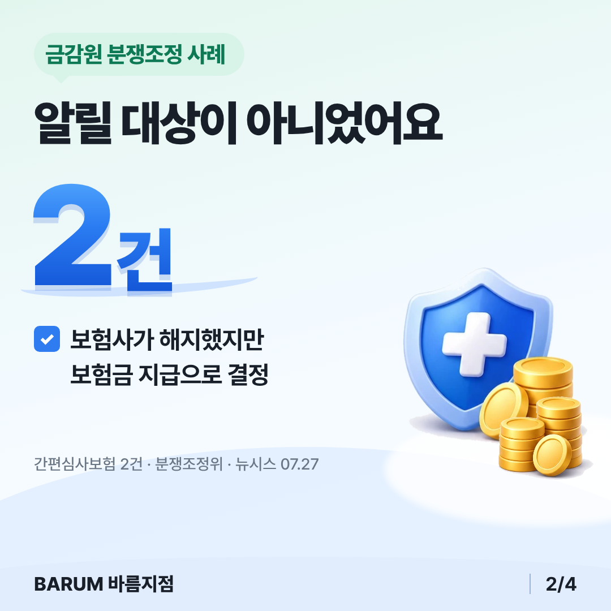
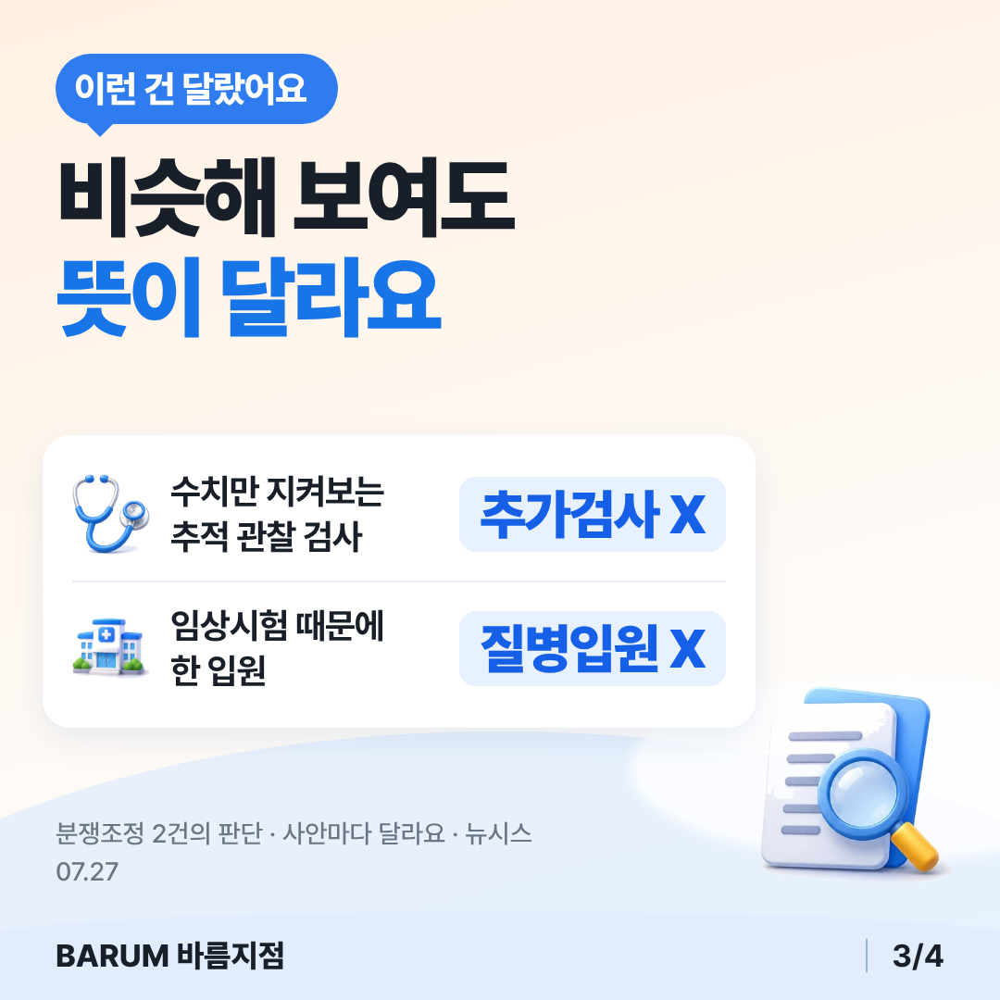
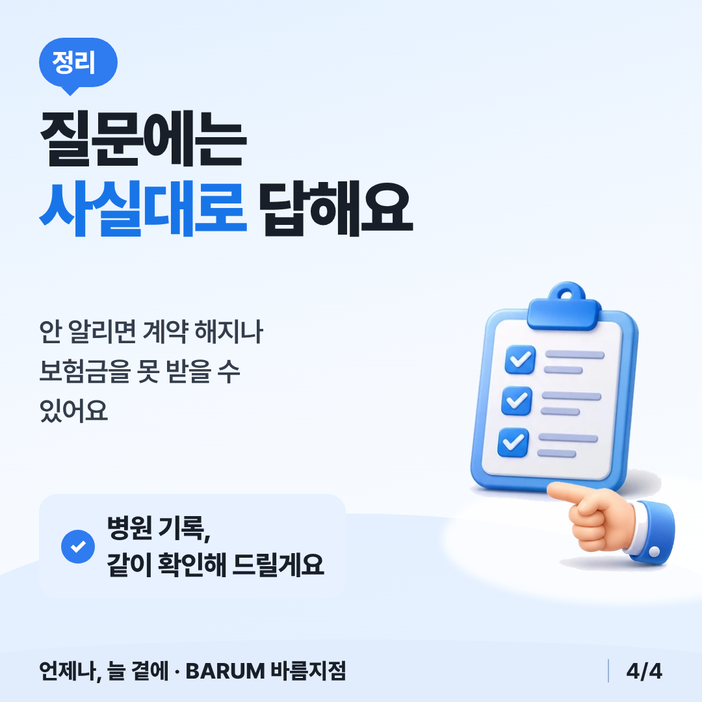

# 오늘 공부 — 계약 전 알릴 의무(고지의무)

## 카드뉴스 (정사각형 1080×1080 · 고객 공유용)

카드 묶음 받기: https://raw.githubusercontent.com/bokkile83-ui/barum-news/main/study/cards/2026-11-15-gojiuimu_카드.zip

## 한 줄로
- 병력은 청약서 질문에 사실대로 적어야 인정된다.
## 꼭 알 것 3가지
- ① 설계사에게 말로만 알린 건 고지로 보기 어렵다(법원).
- ② 안 알리면 계약 해지·보험금 부지급이 될 수 있다.
- ③ 추적 관찰 검사·임상시험 입원은 알릴 대상 아님(분조위 2건).
## 고객에게 이렇게
> "청약서 질문에 맞춰 병원 기록부터 같이 확인해 볼게요."
## 출처
- [금융감독원 금융 FAQ — 설계사에게 구두로 전달한 고지](https://www.fss.or.kr/fss/bbs/B0000172/view.do?nttId=49717&menuNo=200202&pageIndex=1)
- [뉴시스 2026.07.27 — '추적관찰·임상 입원' 고지 위반?…금감원 "보험금 지급"](https://www.newsis.com/view/NISX20260727_0003724388)
