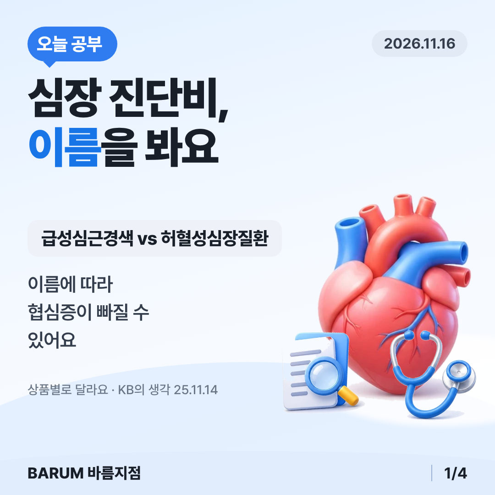
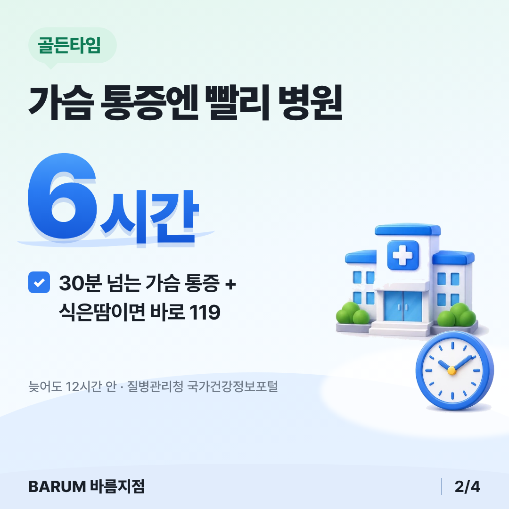
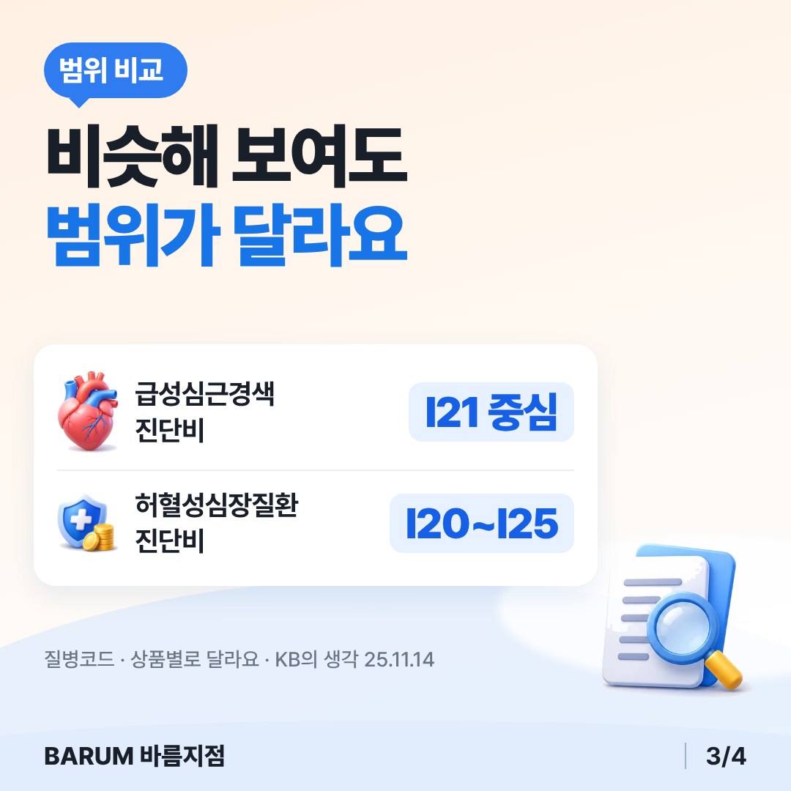
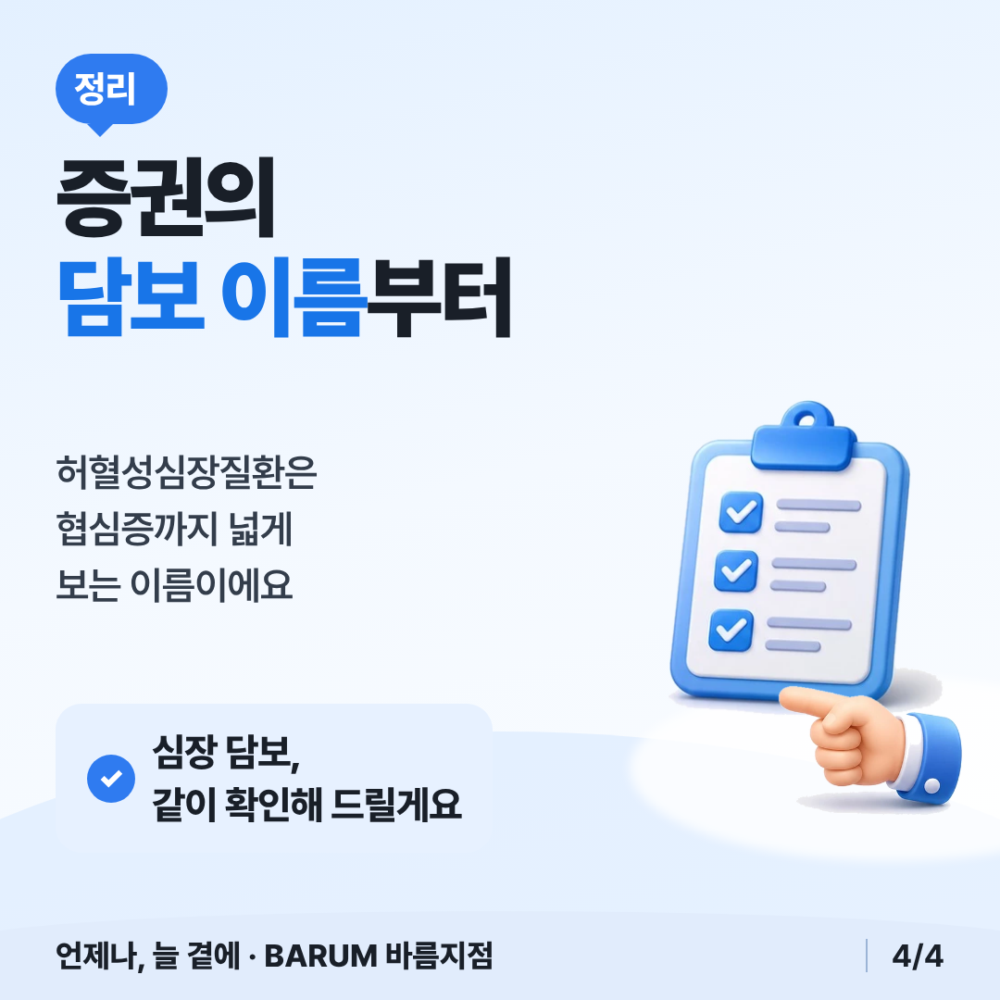

# 오늘 공부 — 급성심근경색 vs 허혈성심장질환 진단비

## 카드뉴스 (정사각형 1080×1080 · 고객 공유용)

카드 묶음 받기: https://raw.githubusercontent.com/bokkile83-ui/barum-news/main/study/cards/2026-11-16-simjang_카드.zip

## 한 줄로
- 심장 진단비는 담보 이름에 따라 협심증이 빠질 수 있다.
## 꼭 알 것 3가지
- ① 급성심근경색 진단비: 혈관이 꽉 막힌 경우(I21) 중심.
- ② 허혈성심장질환 진단비: I20~I25(질병코드), 협심증까지 포함.
- ③ 급성심근경색 골든타임은 6시간, 늦어도 12시간 안(질병관리청).
## 고객에게 이렇게
> "심장 담보는 이름마다 범위가 달라서, 증권의 담보명부터 같이 볼게요."
## 출처
- [KB의 생각 2025.11.14 — 심장질환 진단비 필요성 및 보장범위](https://kbthink.com/insurance/trend/cardio.html)
- [질병관리청 국가건강정보포털 — 급성 심근경색증](https://health.kdca.go.kr/healthinfo/biz/health/ccvdInfo/cvcdInfo/miInfoMain.do)
