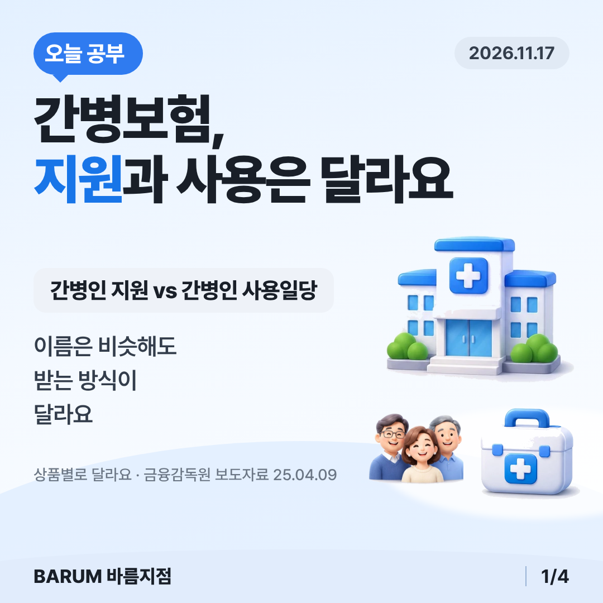
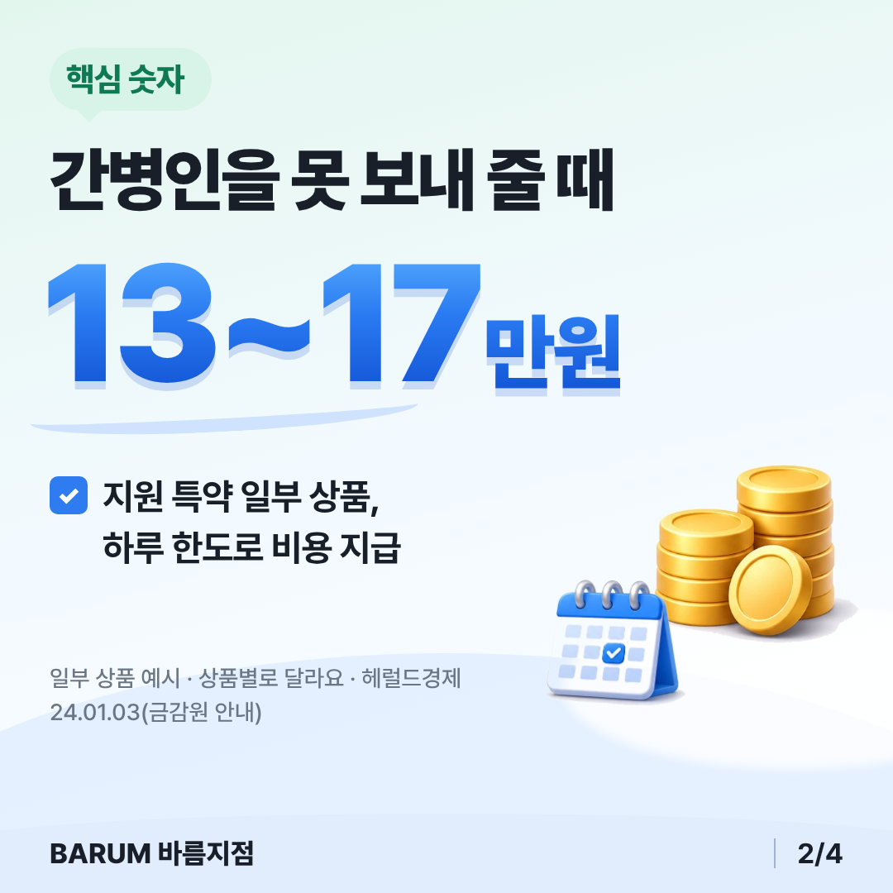
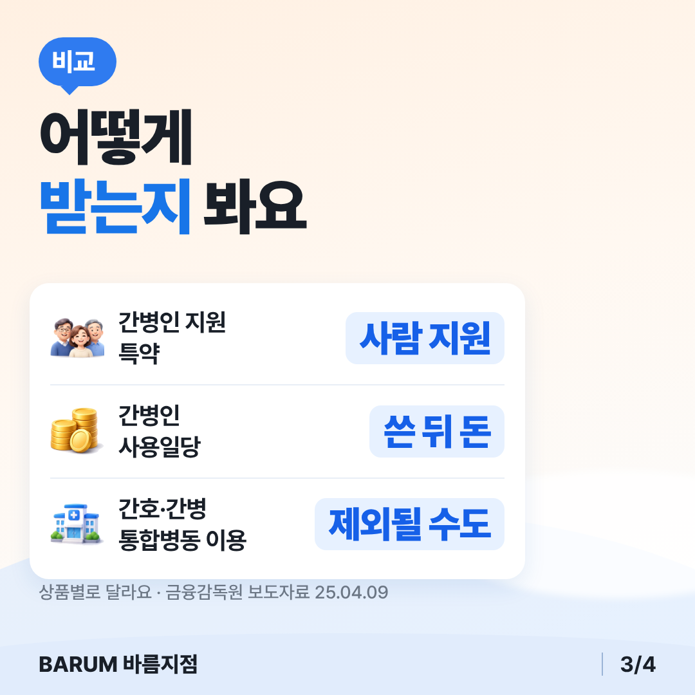
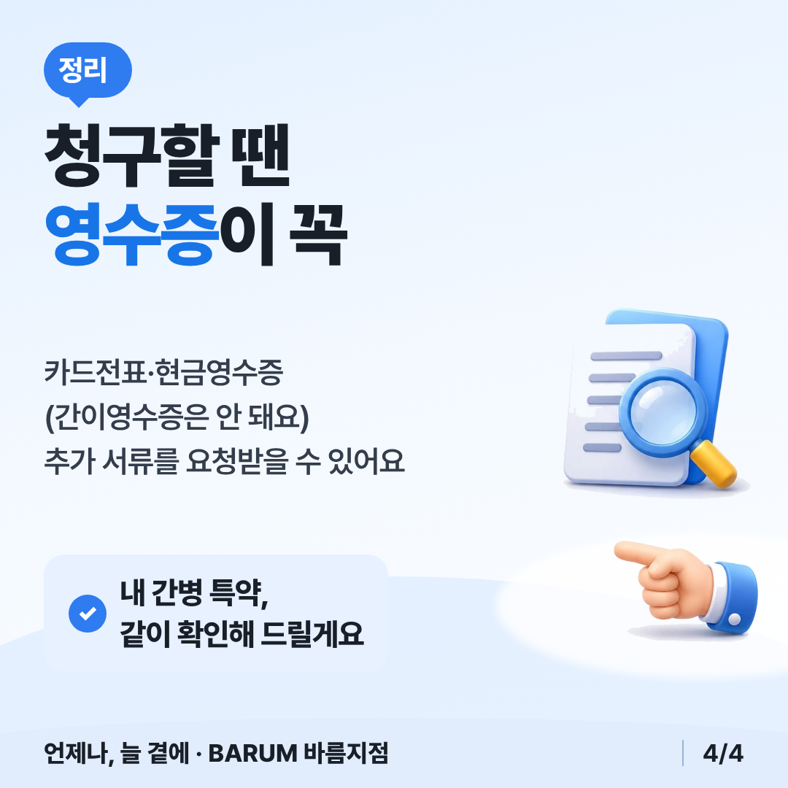

# 오늘 공부 — 간병인 지원 특약 vs 간병인 사용일당

## 카드뉴스 (정사각형 1080×1080 · 고객 공유용)

카드 묶음 받기: https://raw.githubusercontent.com/bokkile83-ui/barum-news/main/study/cards/2026-11-17-ganbyeong_카드.zip

## 한 줄로
- 간병 특약은 「사람을 보내 주는 것」과 「쓴 돈을 주는 것」이 다르다.
## 꼭 알 것 3가지
- ① 지원 특약: 보험사가 간병인을 보내 준다(못 보내면 한도 내 비용).
- ② 사용일당: 간병인을 쓰고 낸 비용이 확인돼야 받는다.
- ③ 간호·간병통합서비스(병원이 간병까지 하는 병동)면 사용일당이 안 나올 수 있다.
## 고객에게 이렇게
> "간병 특약이 지원형인지 사용일당형인지, 증권에서 같이 볼게요."
## 출처
- [금융감독원 보도자료 2025.4.9 — 주요 민원사례로 알아보는 소비자 유의사항(보험연구원 게재본)](https://kiri.or.kr/PDF/weeklytrend/20250421/trend20250421_6.pdf)
- [헤럴드경제 2024.01.03 — 금감원 "간병인 지원 특약과 사용 특약 달라요"](https://biz.heraldcorp.com/article/3293944)
