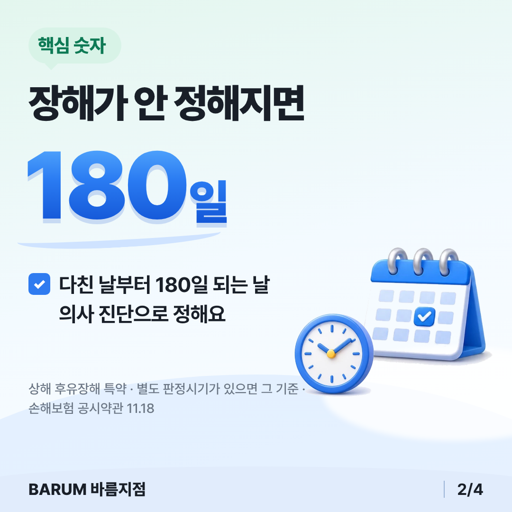
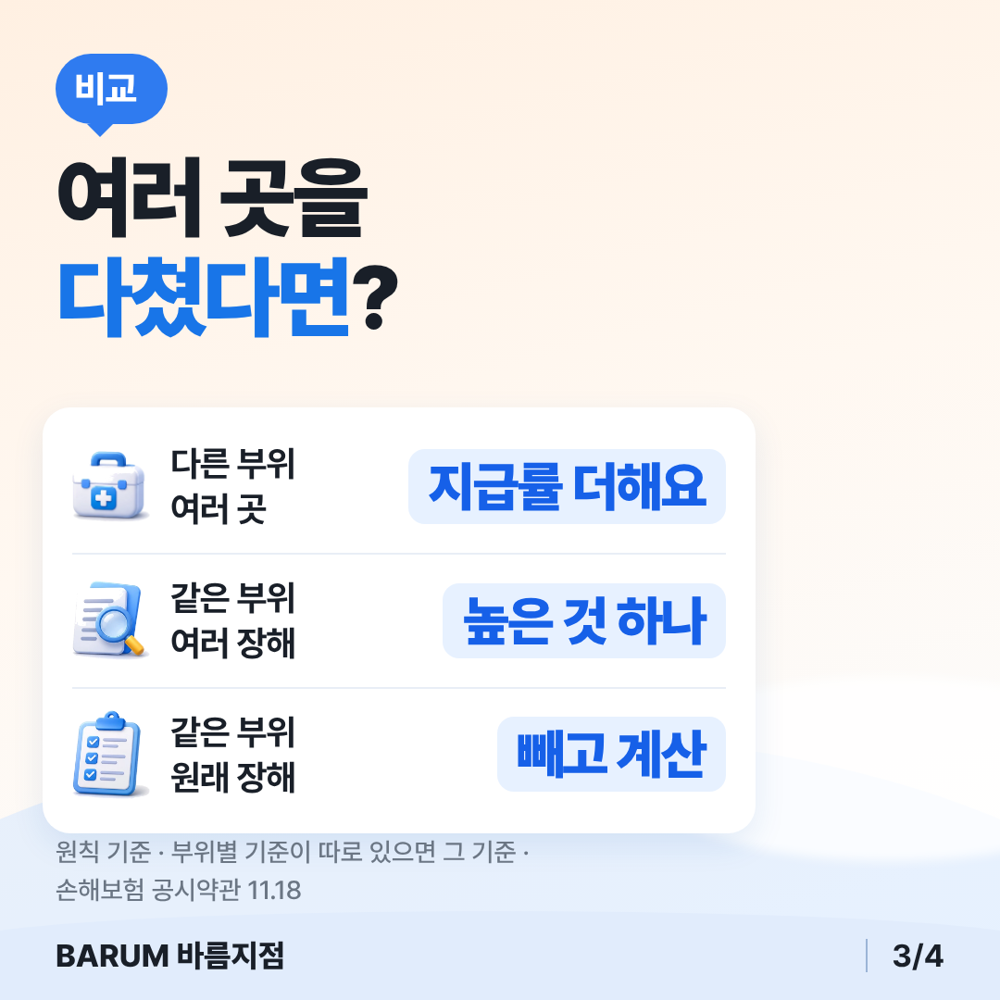

# 오늘 공부 — 상해 후유장해 보험금은 「가입금액 × 지급률」

## 카드뉴스 (정사각형 1080×1080 · 고객 공유용)

카드 묶음 받기: https://raw.githubusercontent.com/bokkile83-ui/barum-news/main/study/cards/2026-11-18-huyujanghae_카드.zip

## 한 줄로
- 후유장해는 정액이 아니라 장해 정도(지급률)만큼 나눠 받는다.
## 꼭 알 것 3가지
- ① 보험금 = 후유장해 가입금액 × 장해분류표 지급률(3~100%).
- ② 180일 안에 장해가 안 정해지면 180일 되는 날 진단으로 정한다.
- ③ 다른 부위는 지급률 합산, 같은 부위는 높은 것 하나(원칙).
## 고객에게 이렇게
> "후유장해는 비율로 나와요. 가입금액이 얼마인지 같이 볼게요."
## 출처
- [손해보험 공시약관 — 상해 후유장해(3~100%) 특별약관 제1·2조, 별표2 장해분류표 총칙](https://www.samsungfire.com/publication/pdf/ZPA010180_0_20260801_file1.pdf)
