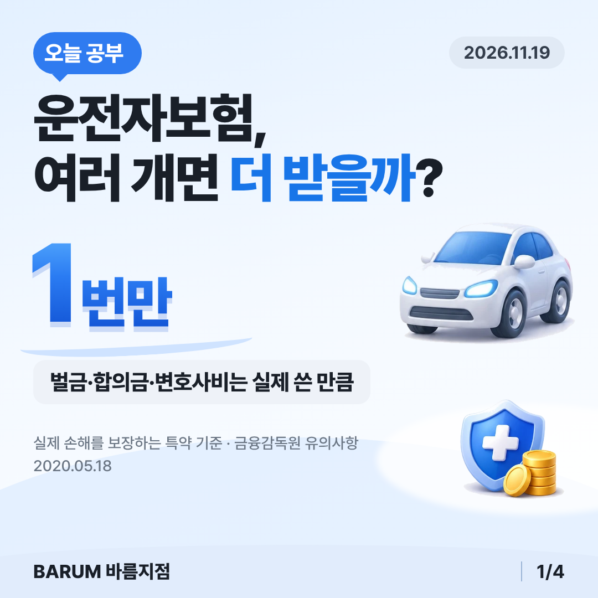
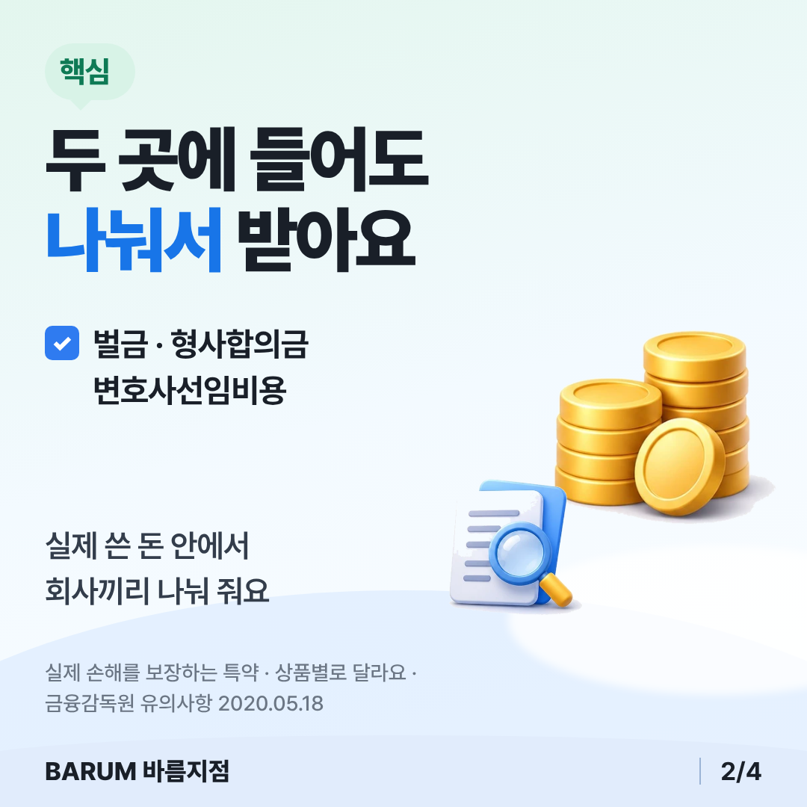
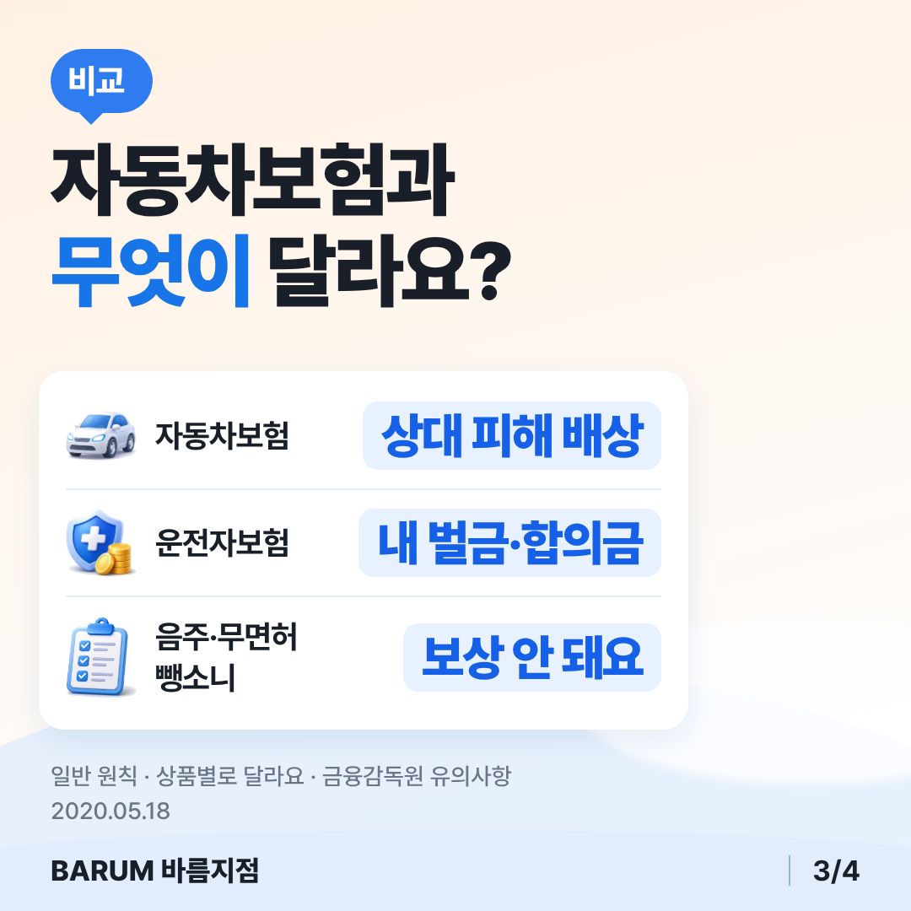
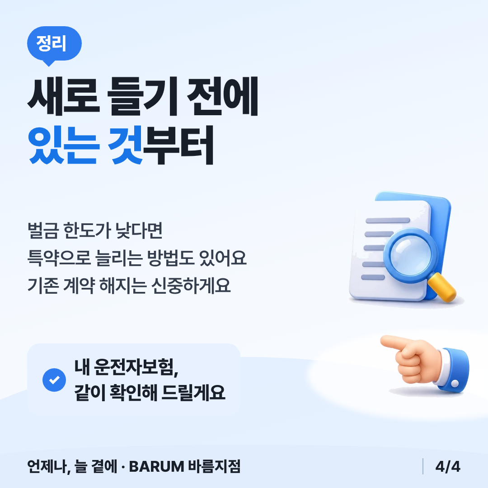

# 오늘 공부 — 운전자보험, 여러 개 들어도 실제 비용까지만

## 카드뉴스 (정사각형 1080×1080 · 고객 공유용)

카드 묶음 받기: https://raw.githubusercontent.com/bokkile83-ui/barum-news/main/study/cards/2026-11-19-unjeonja_카드.zip

## 한 줄로
- 벌금·합의금·변호사비 특약은 여러 개여도 실제 쓴 돈까지만 나와요.
## 꼭 알 것 3가지
- ① 실손형(실제 손해 보장) 특약은 중복 지급 안 됨 → 비례보상(회사끼리 나눠 지급).
- ② 운전자보험 = 자동차보험이 안 주는 내 형사·행정 비용(벌금·형사합의금).
- ③ 음주·무면허·뺑소니(사고 후 도주) 사고는 보상 안 됨.
## 고객에게 이렇게
> "운전자보험은 두 개라도 실제 비용만큼이라, 있는 것부터 같이 볼게요."
## 출처
- [이코노믹리뷰 2020.05.18 — 금감원 「운전자보험 소비자 유의사항」 보도](https://www.econovill.com/news/articleView.html?idxno=396973)
