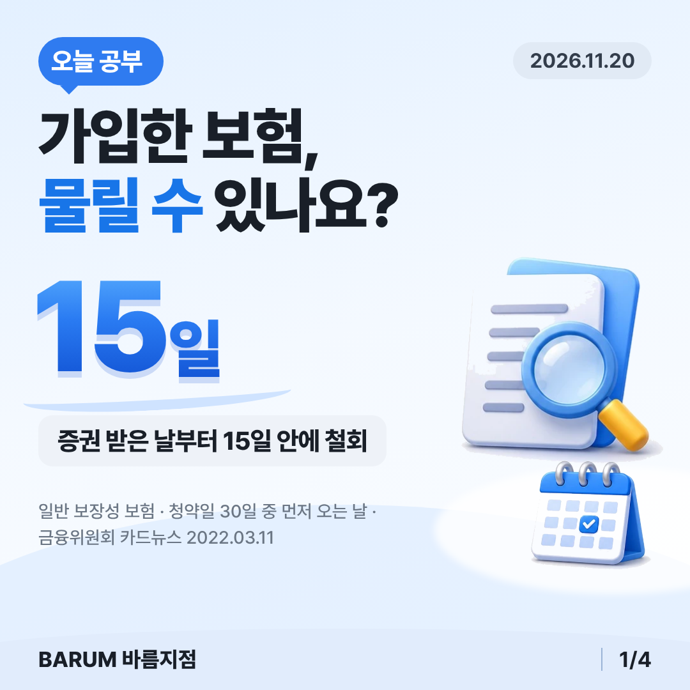
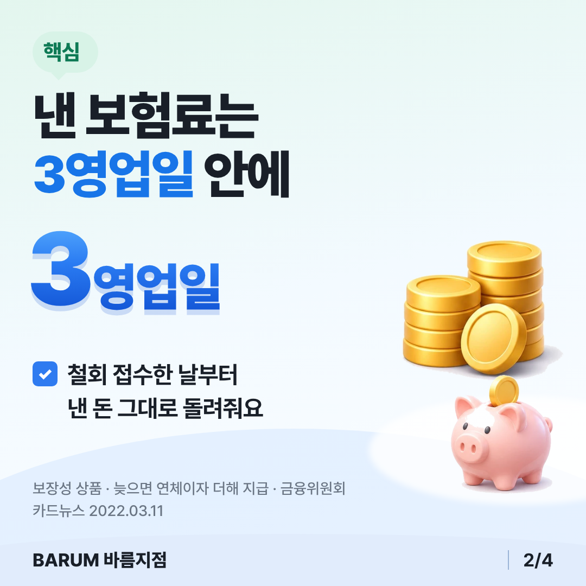
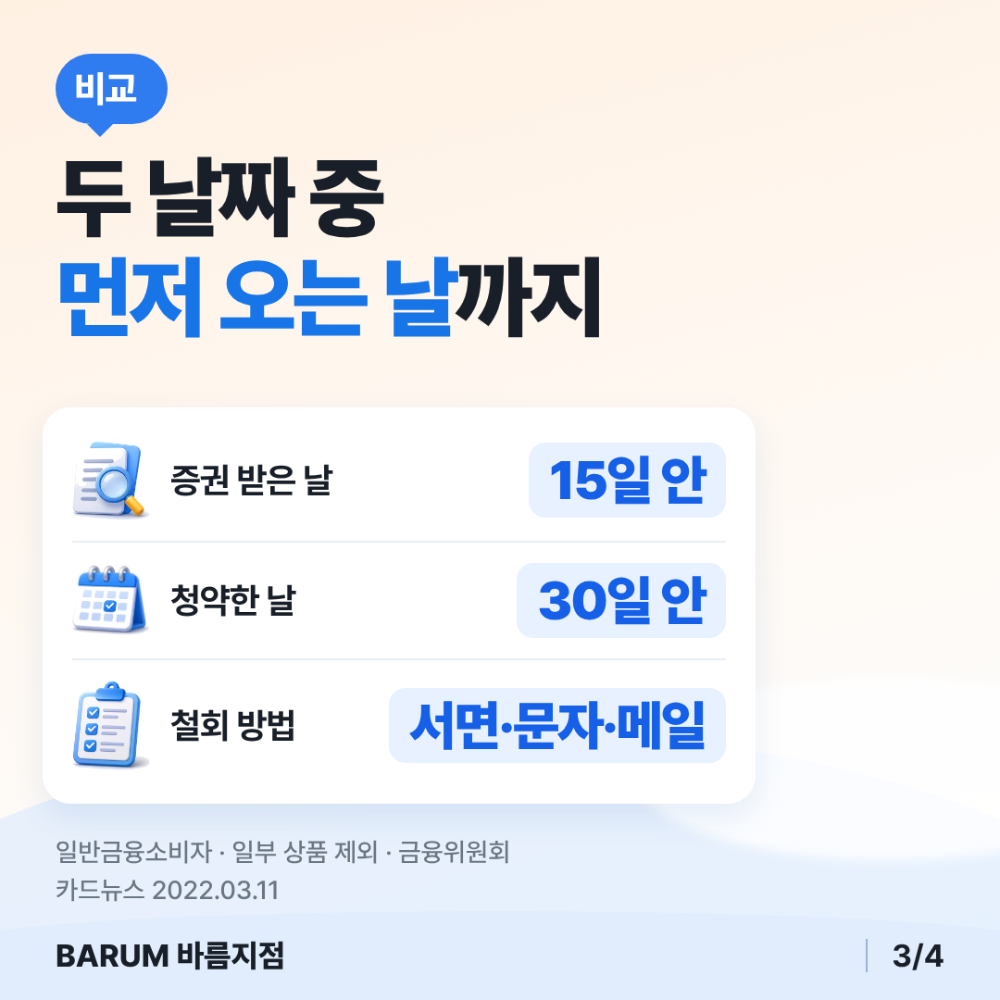
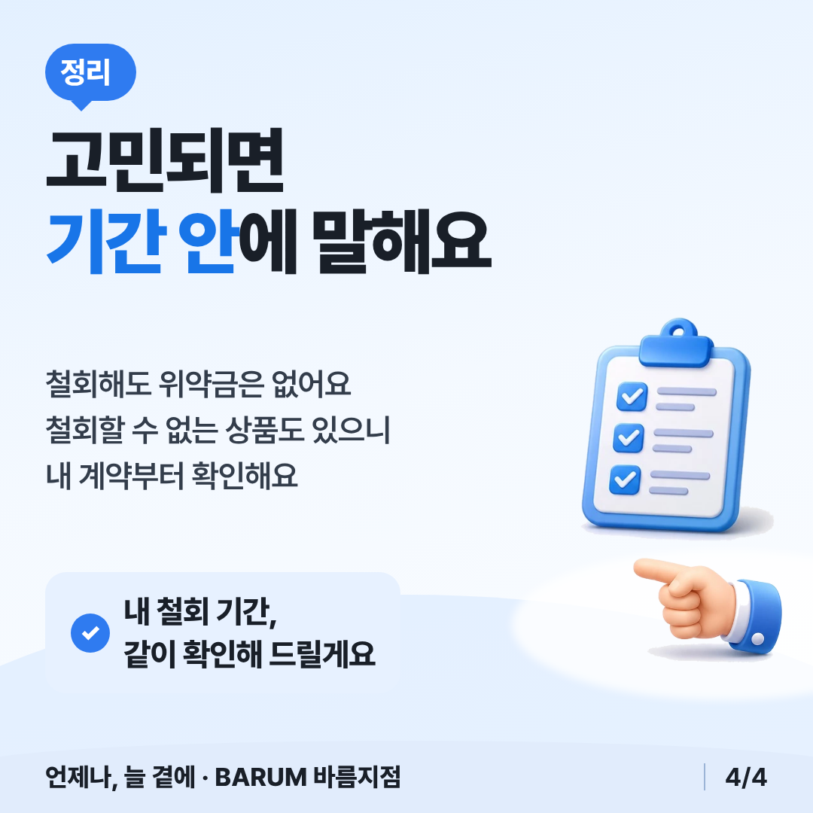

# 오늘 공부 — 보험 청약철회, 15일·30일 중 먼저 오는 날

## 카드뉴스 (정사각형 1080×1080 · 고객 공유용)

카드 묶음 받기: https://raw.githubusercontent.com/bokkile83-ui/barum-news/main/study/cards/2026-11-20-cheongyak_카드.zip

## 한 줄로
- 보장성 보험은 증권 받은 날 15일·청약일 30일 중 먼저 오는 날까지 철회돼요.
## 꼭 알 것 3가지
- ① 청약철회(가입 취소) = 잘못이 없어도 기간 안이면 가능.
- ② 낸 보험료는 접수일부터 3영업일 안에 반환, 위약금 없음.
- ③ 서면·문자·메일로 보낸 때 효력. 일부 상품은 철회 불가.
## 고객에게 이렇게
> "가입하시고 마음이 바뀌면 이 기간 안에 말씀 주시면 돼요."
## 출처
- [금융위원회 카드뉴스 2022.03.11 — 보험, 환불이 가능한가요?](https://www.fsc.go.kr/no040101?cnId=1085)
