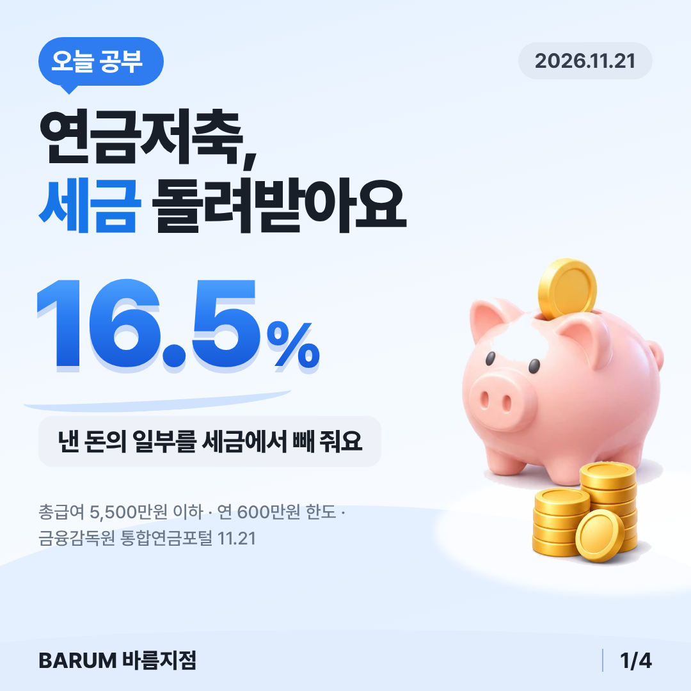
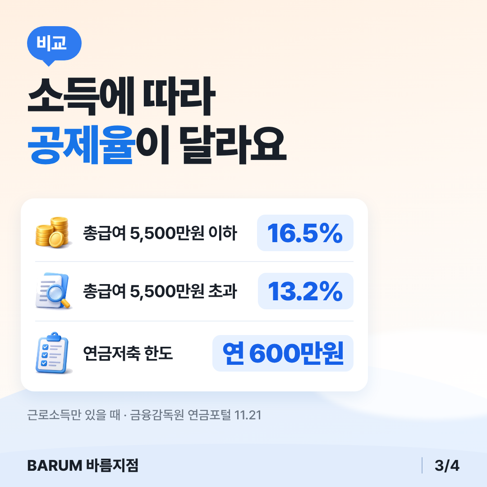

# 오늘 공부 — 연금저축 세액공제, 연 600만원까지

## 카드뉴스 (정사각형 1080×1080 · 고객 공유용)

카드 묶음 받기: https://raw.githubusercontent.com/bokkile83-ui/barum-news/main/study/cards/2026-11-21-yeongeum_카드.zip

## 한 줄로
- 연금저축에 낸 돈은 연 600만원까지 세액공제(세금 깎아 줌)돼요.
## 꼭 알 것 3가지
- ① 총급여 5,500만원 이하 16.5%, 초과 13.2% 공제.
- ② IRP(개인형 퇴직연금) 합치면 연 900만원까지.
- ③ 한도 400→600만원은 2023년부터 적용.
## 고객에게 이렇게
> "소득에 따라 돌려받는 비율이 달라서, 먼저 확인해 드릴게요."
## 출처
- [금융감독원 통합연금포털 — 연금저축 세제 · 세액공제](https://fss.or.kr/fss/main/contents.do?menuNo=201007)
- [정책브리핑 2023.01.05 — 연금계좌 세액공제 최대 900만원](https://www.korea.kr/news/policyNewsView.do?newsId=148910222)
